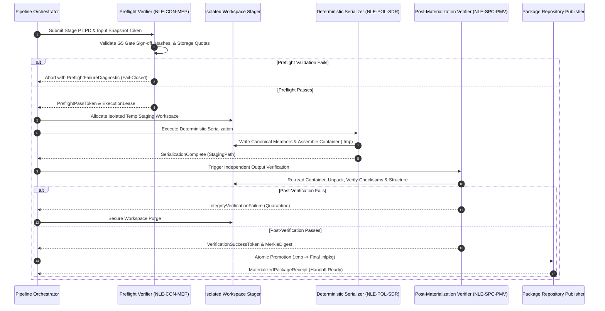

# Host-Game Package Materialization, Serialization & Integrity Verification Specification

**Document Identifier:** `NLE-SPC-PMS-001`  
**Lifecycle Stage:** Content Pipeline Architecture — Stage M (Package Materialization)  
**Parent Document:** [HOST_GAME_MODIFICATION_STRATEGY_AND_CONTENT_PIPELINE_ARCHITECTURE.md](file:///d:/App%20Winrar%20Files/Nexludic%20Engine%20(working)/docs/content-pipeline/HOST_GAME_MODIFICATION_STRATEGY_AND_CONTENT_PIPELINE_ARCHITECTURE.md) (`NLE-SPC-GMS-001`)  
**Upstream Contract:** [PACKAGE_READINESS_AND_DOWNSTREAM_HANDOFF_CONTRACT.md](file:///d:/App%20Winrar%20Files/Nexludic%20Engine%20(working)/docs/content-pipeline/PACKAGE_READINESS_AND_DOWNSTREAM_HANDOFF_CONTRACT.md) (`NLE-CON-PRH-001`)  
**System Status:** Authoritative Architectural Specification  
**Classification:** Internal Core Engine Architecture & Data Specification  

---

## 1. Executive Summary & Purpose

The **Host-Game Package Materialization, Serialization & Integrity Verification Specification** establishes the authoritative technical foundation for Stage M of the NexLudic Engine Content Pipeline. While Stage P (Step 64) evaluates content compatibility, builds the dependency directed acyclic graph (DAG), and emits an approved **Logical Package Definition (LPD)**, Stage M is solely responsible for transforming that approved logical definition into a verifiable, deterministic, and cryptographically attested **Physical Package Artifact** (`.nlpkg` or target-specific container format).

This specification enforces the fundamental architectural invariant:
$$\text{Valid Logical Definition} \neq \text{Physical Package Artifact} \neq \text{Installation / Game Application Permission}$$

Physical materialization is an offline, sandboxed build operation executing strictly within authorized workspace boundaries under Windows Medium Integrity Level (`DEC-002`). It does not modify game installations, inject processes, or bypass platform anti-cheat mechanisms (`BLK-SEC-01`).

```
+----------------------------------------------------------------------------------------------------+
|                                    STAGE M MATERIALIZATION PIPELINE                                |
+----------------------------------------------------------------------------------------------------+
|  +-------------------------+      +-------------------------+      +----------------------------+  |
|  | Stage P Approved LPD    | ---> | Materialization Preflight| ---> | Physical Layout Mapping    |  |
|  | & Frozen Input Snapshot |      | Contract (NLE-CON-MEP)  |      | & Canonical Ordering       |  |
|  +-------------------------+      +-------------------------+      +----------------------------+  |
|                                                                                   |                 |
|                                                                                   v                 |
|  +-------------------------+      +-------------------------+      +----------------------------+  |
|  | Isolated Workspace     | <--- | Post-Materialization    | <--- | Deterministic Serializer   |  |
|  | Publication & Handoff   |      | Verification (Indep.)   |      | Engine (RFC 8785 / Bit-for)|  |
|  +-------------------------+      +-------------------------+      +----------------------------+  |
+----------------------------------------------------------------------------------------------------+
```

---

## 2. Core Architectural Principles & Invariants

Stage M is governed by seven non-negotiable architectural invariants:

1. **Strict Input Immutability (`INV-PMS-01`):** Materialization must consume frozen, content-addressed snapshots of Stage P artifacts. Serializers must never read live, mutable working directories.
2. **Fail-Closed Preflight Validation (`INV-PMS-02`):** Materialization must not write a single byte to disk if preflight validation (schema compliance, serializer compatibility, storage quota, cryptographic signature verification of Gate G5 sign-off) fails.
3. **Bit-for-Bit Determinism (`INV-PMS-03`):** Identical input snapshots, target schemas, and serializer configurations must yield bit-for-bit identical physical package containers across independent builds, execution environments, and timestamps.
4. **Independent Post-Materialization Verification (`INV-PMS-04`):** The output artifact must be parsed, decompressed, and validated by an independent verifier module rather than relying on serializer return codes.
5. **Strict Workspace Isolation (`INV-PMS-05`):** All staging, compression, serialization, and verification must take place within an isolated temporary staging directory (`temp_materialization_dir`). Physical artifacts are published to the authorized package repository only upon passing all verification checks via an atomic rename operation.
6. **No Direct Game Interaction (`INV-PMS-06`):** Stage M never writes to host-game folders, user game directories, or system paths. Packaging is an artifact generation process, completely segregated from mod deployment or activation.
7. **Comprehensive Provenance Attestation (`INV-PMS-07`):** Every generated physical package must encapsulate a cryptographic chain of custody (`provenance.json`) linking every binary stream back to source asset digests, transformation records, and Gate G5 authorizations.

---

## 3. Package Physical Layout & Member Architecture

The standard physical artifact generated by Stage M is the NexLudic Package (`.nlpkg`), implemented as an uncompressed or standard Deflate ZIP container adhering strictly to deterministic serialization rules, or a specialized native container format registered via the Universal Adapter SDK.

```
<package_root>/
  |-- manifest.json              # Canonical JSON manifest (RFC 8785)
  |-- provenance.json            # Cryptographic chain-of-custody & build attestation
  |-- signatures/                # Optional detached cryptographic signatures
  |     |-- manifest.sig         # Ed25519 signature over manifest.json
  |     `-- package.sig          # Ed25519 signature over complete package byte stream
  |-- assets/                    # Normalized content payloads (bit-for-bit validated)
  |     |-- textures/
  |     |-- meshes/
  |     |-- audio/
  |     `-- configs/
  `-- overrides/                 # Host-game specific file overrides or virtual paths
        |-- mod_data/
        `-- scripts/
```

### 3.1 Member Directory Structure & Isolation
- **`manifest.json`:** The authoritative physical manifest detailing package identity, schema version, target game compatibility, member catalog, file sizes, relative paths, and SHA-256 digests.
- **`provenance.json`:** Detailed record containing build timestamps, engine version, builder identity, input snapshot root hashes, transformation receipt IDs, and Gate G5 authorization token.
- **`assets/`:** Primary payload directory storing immutable content items. Paths within `assets/` must be POSIX-normalized, lowercase, relative, and strictly free of directory traversal tokens (`..` or `./`).
- **`overrides/`:** Virtual mount points or replacement files mapped to the host-game's virtual filesystem structure as specified in the LPD.

---

## 4. Materialization Execution Workflow

The physical materialization lifecycle proceeds through eight distinct, sequentially enforced phases:



---

## 5. Security & Containment Architecture

In accordance with Engine Security Guidelines and Windows Medium IL sandboxing (`DEC-002`):

1. **Path Sanitization & Symlink Rejection:** Serializers and verifiers must reject absolute paths, drive letters (`C:`), Windows backslashes (`\`), UNC paths (`\server\share`), alternate data streams (`file:stream`), and symbolic links or NTFS reparse points. All container paths must strictly adhere to POSIX-normalized relative syntax.
2. **Denial of Service (DoS) Defense & Zip-Bomb Mitigation:**
   - Uncompressed size expansion limit: Maximum 10x compression ratio.
   - Total uncompressed package size ceiling: Configured per-project quota (default: 32 GB).
   - Maximum entry count: 250,000 members per package.
   - Maximum path length: 260 characters (to ensure cross-platform safety).
3. **Workspace Scrubbing:** In the event of any serialization, compression, or integrity verification failure, the temporary staging workspace must be securely unlinked, cleared of sensitive fragments, and deleted.

---

## 6. Downstream Interface & Stage M Handoff

Upon successful materialization and independent verification, Stage M emits a **Materialized Package Receipt** (`NLE-CON-MSP-001`). This receipt provides downstream consumers (Stage I / Installation Preparation and Stage V / Verification) with:
- The immutable physical package path in the authorized workspace package store.
- Cryptographic SHA-256 package digest and Merkle root.
- Ed25519 digital signature attestation.
- Complete member catalog and verified physical layout.

---

## 7. Compliance, Traceability & Invariants

This specification realizes requirements `PMS-REQ-001` through `PMS-REQ-032` and enforces full traceability to:
- [UNIVERSAL_CONTENT_PIPELINE_STAGE_AND_STATE_CONTRACT.md](file:///d:/App%20Winrar%20Files/Nexludic%20Engine%20(working)/docs/content-pipeline/UNIVERSAL_CONTENT_PIPELINE_STAGE_AND_STATE_CONTRACT.md) (`NLE-CON-UCP-001`)
- [HOST_GAME_CONTENT_VALIDATION_DEPENDENCY_RESOLUTION_AND_PACKAGE_ASSEMBLY_SPECIFICATION.md](file:///d:/App%20Winrar%20Files/Nexludic%20Engine%20(working)/docs/content-pipeline/HOST_GAME_CONTENT_VALIDATION_DEPENDENCY_RESOLUTION_AND_PACKAGE_ASSEMBLY_SPECIFICATION.md) (`NLE-SPC-PVA-001`)
- [PACKAGE_READINESS_AND_DOWNSTREAM_HANDOFF_CONTRACT.md](file:///d:/App%20Winrar%20Files/Nexludic%20Engine%20(working)/docs/content-pipeline/PACKAGE_READINESS_AND_DOWNSTREAM_HANDOFF_CONTRACT.md) (`NLE-CON-PRH-001`)
