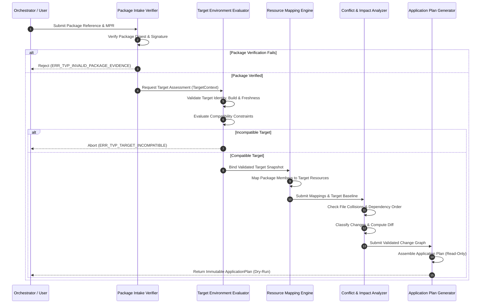
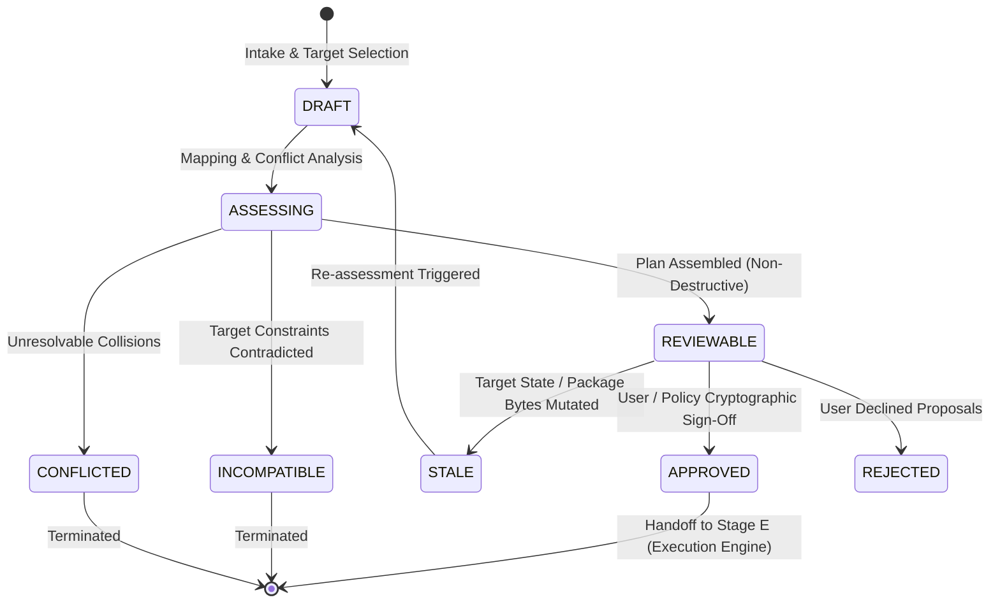

# Host-Game Target Environment Validation, Package Mapping and Application Planning Specification

**Document Identifier:** `NLE-SPC-TVP-001`  
**Lifecycle Stage:** Content Pipeline Architecture — Stage I (Target Validation & Planning)  
**Parent Document:** [HOST_GAME_MODIFICATION_STRATEGY_AND_CONTENT_PIPELINE_ARCHITECTURE.md](file:///d:/App%20Winrar%20Files/Nexludic%20Engine%20(working)/docs/content-pipeline/HOST_GAME_MODIFICATION_STRATEGY_AND_CONTENT_PIPELINE_ARCHITECTURE.md) (`NLE-SPC-GMS-001`)  
**Upstream Contract:** [PACKAGE_MATERIALIZATION_STATE_PROVENANCE_AND_HANDOFF_CONTRACT.md](file:///d:/App%20Winrar%20Files/Nexludic%20Engine%20(working)/docs/content-pipeline/PACKAGE_MATERIALIZATION_STATE_PROVENANCE_AND_HANDOFF_CONTRACT.md) (`NLE-CON-MSP-001`)  
**System Status:** Authoritative Architectural Specification  
**Classification:** Core Deployment Planning & Safety Specification  

---

## 1. Executive Summary & Purpose

The **Host-Game Target Environment Validation, Package Mapping and Application Planning Specification** establishes the authoritative technical framework for Stage I of the NexLudic Engine Content Pipeline. Following physical package materialization and cryptographic integrity verification in Stage M (Step 65), Stage I transitions a verified package artifact (`.nlpkg` or certified native archive) into a structured, reviewable, non-destructive **Application Plan** (`ApplicationPlan`).

This specification formalizes the fundamental separation of concerns:
$$\text{Verified Physical Package} \neq \text{Target Compatibility} \neq \text{Non-Destructive Application Plan} \neq \text{Installation / Execution Permission}$$

Stage I is strictly a **planning and validation phase**. It executes entirely in read-only and memory-mode dry-run contexts under Windows Medium Integrity Level (`DEC-002`). It does not modify game installations, inject runtime processes, alter file contents, or bypass platform security boundaries (`BLK-SEC-01`).

```
+----------------------------------------------------------------------------------------------------+
|                               STAGE I: APPLICATION PLANNING PIPELINE                               |
+----------------------------------------------------------------------------------------------------+
|  +-------------------------+      +-------------------------+      +----------------------------+  |
|  | Verified Package (.nlpkg)| ---> | Target Selection &      | ---> | Package Member to Target   |  |
|  | & MPR (NLE-CON-MSP-001) |      | Evidence Validation     |      | Resource Mapping Contract  |  |
|  +-------------------------+      +-------------------------+      +----------------------------+  |
|                                                                                   |                 |
|                                                                                   v                 |
|  +-------------------------+      +-------------------------+      +----------------------------+  |
|  | Immutable Application   | <--- | Precondition & Safety   | <--- | Change Classification,     |  |
|  | Plan & Downstream Gate  |      | Dry-Run Evaluation      |      | Conflicts & Impact Graph   |  |
|  +-------------------------+      +-------------------------+      +----------------------------+  |
+----------------------------------------------------------------------------------------------------+
```

---

## 2. Core Architectural Principles & Invariants

Stage I is governed by seven foundational invariants:

1. **Pure Non-Destructive Planning (`INV-TVP-01`):** The planning engine must never write, mutate, move, or delete any files in the host-game directory, staging directory, or user folders. All plan construction is strictly read-only and in-memory.
2. **Multi-Level Target Identity Disambiguation (`INV-TVP-02`):** A game title or marketing display name must never be conflated with a canonical game identity, specific release build, platform variant, or local installation instance.
3. **Cryptographic Package Verification Binding (`INV-TVP-03`):** Planning may only proceed against a physical package possessing an authoritative, non-stale Materialized Package Receipt (`MPR`) with verified SHA-256 and Merkle root hashes.
4. **Strict Destination Containment (`INV-TVP-04`):** All mapped destination paths must strictly resolve within authorized target boundaries. Path traversal (`..`), drive letter injections, or unverified reparse points trigger immediate, fail-closed abort.
5. **Explicit Change Semantics (`INV-TVP-05`):** Every proposed change must be explicitly classified (`ADD`, `REPLACE`, `UPDATE`, `OVERRIDE`, `REMOVE`, `NO_OP`, `METADATA_ONLY`). Silent overwrites or unrecorded file mutations are prohibited.
6. **Segregation of Authorization from Planning (`INV-TVP-06`):** Generating an application plan confers zero authorization to execute it. Review, approval, and execution permissions are independent cryptographic grants.
7. **Stale Evidence Invalidation (`INV-TVP-07`):** An application plan is bound to an exact target-state evidence snapshot. Any detected modification to target resources, adapter capabilities, or package revisions invalidates the plan.

---

## 3. Stage I Planning Architecture & Workflow



---

## 4. Logical State Transitions of an Application Plan



---

## 5. Security & Boundary Governance

1. **Windows Medium Integrity Level (`DEC-002`):** Planning engines run under standard user permissions. No elevated UAC tokens or driver-level interactions are permitted.
2. **Anti-Cheat Safety (`BLK-SEC-01`):** Stage I does not interact with running processes, does not open game process handles (`OpenProcess`), and strictly validates that destination paths do not target anti-cheat protected binaries or protected game executable directories.
3. **Zero Untrusted Execution:** No scripts, hooks, install executables, or code contained within the package are executed during Stage I planning.

---

## 6. Specification Traceability & Cross-References

This specification establishes requirements `APP-REQ-001` through `APP-REQ-032` and cross-references:
- [HOST_GAME_PACKAGE_MATERIALIZATION_SERIALIZATION_AND_INTEGRITY_VERIFICATION_SPECIFICATION.md](file:///d:/App%20Winrar%20Files/Nexludic%20Engine%20(working)/docs/content-pipeline/HOST_GAME_PACKAGE_MATERIALIZATION_SERIALIZATION_AND_INTEGRITY_VERIFICATION_SPECIFICATION.md) (`NLE-SPC-PMS-001`)
- [UNIVERSAL_CONTENT_PIPELINE_STAGE_AND_STATE_CONTRACT.md](file:///d:/App%20Winrar%20Files/Nexludic%20Engine%20(working)/docs/content-pipeline/UNIVERSAL_CONTENT_PIPELINE_STAGE_AND_STATE_CONTRACT.md) (`NLE-CON-UCP-001`)
- [PACKAGE_READINESS_AND_DOWNSTREAM_HANDOFF_CONTRACT.md](file:///d:/App%20Winrar%20Files/Nexludic%20Engine%20(working)/docs/content-pipeline/PACKAGE_READINESS_AND_DOWNSTREAM_HANDOFF_CONTRACT.md) (`NLE-CON-PRH-001`)
