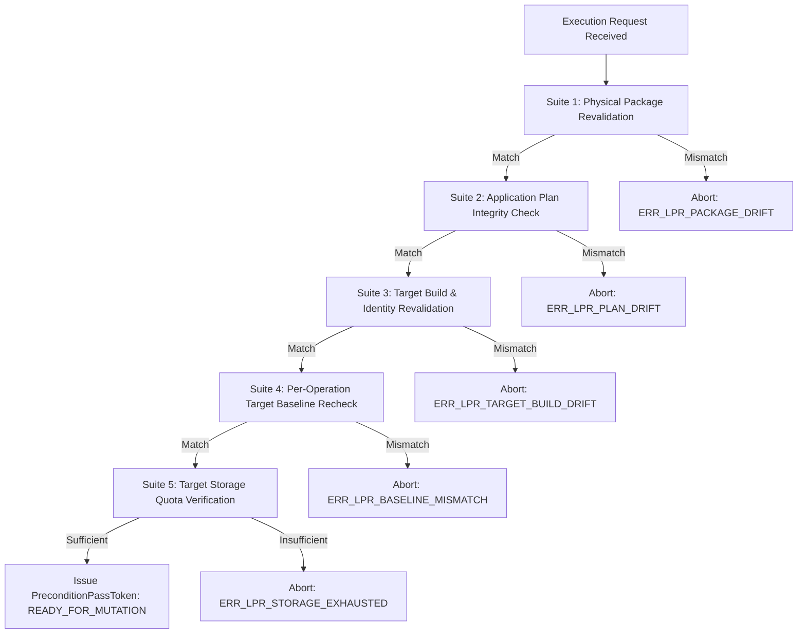

# Last-Moment Package, Plan and Target Precondition Revalidation Contract

**Document Identifier:** `NLE-CON-LPR-001`  
**Lifecycle Stage:** Content Pipeline Stage E Pre-Execution Gate  
**Parent Document:** [HOST_GAME_EXECUTION_AUTHORIZATION_PRECONDITION_REVALIDATION_AND_TRANSACTIONAL_APPLICATION_SPECIFICATION.md](file:///d:/App%20Winrar%20Files/Nexludic%20Engine%20(working)/docs/content-pipeline/HOST_GAME_EXECUTION_AUTHORIZATION_PRECONDITION_REVALIDATION_AND_TRANSACTIONAL_APPLICATION_SPECIFICATION.md) (`NLE-SPC-ETA-001`)  
**System Status:** Authoritative Architectural Contract  
**Classification:** Pre-Execution Verification & Precondition Gates  

---

## 1. Purpose & Non-Bypassable Boundary

The **Last-Moment Package, Plan and Target Precondition Revalidation Contract** establishes the final, non-bypassable preflight validation gate executed immediately before Stage E applies any modification to a target game environment.

Even if an application plan was thoroughly reviewed and authorized, target game files, external mod managers, or package files may have changed in the interval between planning and execution. This contract mitigates **Time-of-Check to Time-of-Use (TOCTOU)** vulnerabilities by verifying that reality matches the frozen planning baseline at the exact millisecond of execution.

---

## 2. Pre-Execution Revalidation Protocol

The revalidator executes five sequential validation suites:



### 2.1 Revalidation Suite Requirements
1. **Suite 1 (Package):** Re-verify that the physical `.nlpkg` container on disk matches the SHA-256 digest recorded in the frozen inputs.
2. **Suite 2 (Plan):** Re-compute the canonical plan hash and confirm it matches `plan_digest`.
3. **Suite 3 (Target Build):** Verify that the target game executable (e.g., `SkyrimSE.exe`) SHA-256 and file version match the target snapshot baseline.
4. **Suite 4 (Per-Operation Baselines):**
   - For every `ADD`: Assert destination is currently `CONFIRMED_ABSENT`.
   - For every `REPLACE`: Assert destination is currently `CONFIRMED_PRESENT` and its SHA-256 equals `expected_prior_sha256`.
   - For every `NO_OP`: Assert destination still matches member SHA-256.
5. **Suite 5 (Storage Quota):** Assert free disk space on the target volume exceeds:
   $$\text{FreeSpace} \ge \text{TotalUncompressedPayloadBytes} + \text{TotalBackupBytes} + 1.0\text{ GB Safety Buffer}$$

---

## 3. Formal Revalidation Pass Token (`PreconditionPassToken`)

```json
{
  "$schema": "https://schemas.nexludic.net/pipeline/v1/precondition-pass-token.json",
  "token_id": "tok-lpr-20261119-4821",
  "session_id": "sess-exe-88412",
  "status": "PRECONDITIONS_CONFIRMED",
  "verified_at": "2026-11-19T19:30:05Z",
  "checks_summary": {
    "package_sha256_verified": true,
    "plan_digest_verified": true,
    "target_executable_verified": true,
    "per_operation_baselines_verified": 482,
    "available_disk_bytes": 107374182400
  },
  "lease_duration_seconds": 60,
  "signer": "ed25519:validator_subsystem..."
}
```

---

## 4. Contract Diagnostic Codes

| Code | Severity | Description | Action |
| :--- | :--- | :--- | :--- |
| `ERR_LPR_PACKAGE_DRIFT` | FATAL | Package container modified on disk | Abort execution. Invalidate plan. |
| `ERR_LPR_PLAN_DRIFT` | FATAL | Plan JSON modified after authorization | Abort execution. Re-request authorization. |
| `ERR_LPR_TARGET_BUILD_DRIFT` | FATAL | Game updated / patched after planning | Abort execution. Re-run Stage I planning. |
| `ERR_LPR_BASELINE_MISMATCH` | FATAL | Existing target file changed before mutation | Abort execution. Do NOT overwrite file. |
| `ERR_LPR_STORAGE_EXHAUSTED` | FATAL | Insufficient free space for payload and backup | Abort execution. Free disk space. |
