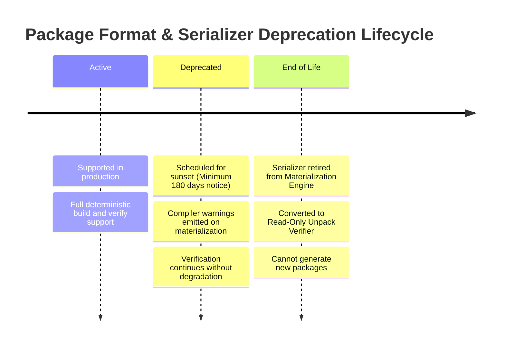

# Package Format Serializer Capability & Schema Compatibility Policy

**Document Identifier:** `NLE-POL-PSC-001`  
**Lifecycle Stage:** Content Pipeline Stage M Configuration & Governance  
**Parent Document:** [HOST_GAME_PACKAGE_MATERIALIZATION_SERIALIZATION_AND_INTEGRITY_VERIFICATION_SPECIFICATION.md](file:///d:/App%20Winrar%20Files/Nexludic%20Engine%20(working)/docs/content-pipeline/HOST_GAME_PACKAGE_MATERIALIZATION_SERIALIZATION_AND_INTEGRITY_VERIFICATION_SPECIFICATION.md) (`NLE-SPC-PMS-001`)  
**System Status:** Authoritative Architectural Policy  
**Classification:** Container Standards & Compatibility Governance  

---

## 1. Objective & Scope

The **Package Format Serializer Capability & Schema Compatibility Policy** governs the selection, capability registration, schema versioning, and deprecation lifecycle for package serialization engines within the NexLudic Engine. 

This policy ensures that physical package generation adheres to strict structural standards across diverse game engines and mod loaders, while preventing schema drifting, silently dropped fields, or unintended incompatibilities.

---

## 2. Supported Package Container Formats

NexLudic Engine defines three primary package container profiles:

```
+--------------------------------------------------------------------------------------------------+
|                                  PACKAGE CONTAINER ARCHITECTURES                                 |
+--------------------------------------------------------------------------------------------------+
|  1. NL_PACKAGE_V1 (Standard Universal Container)                                                 |
|     - Based on Deterministic ZIP Container Specification                                        |
|     - Mandatory canonical manifest.json and provenance.json                                      |
|     - Supports Deflate (Level 6) and Stored (Store-Only) compression                             |
|     - Universal compatibility across all desktop platforms                                       |
+--------------------------------------------------------------------------------------------------+
|  2. NATIVE_ARCHIVE_ADAPTER (Game-Engine Specific Containers)                                     |
|     - Bethesda BSA/BA2, Valve VPK, Unreal Engine PAK, Unity AssetBundles                         |
|     - Managed through certified Universal Adapter SDK Serializer Plugins                         |
|     - Must implement deterministic byte ordering and embedded NexLudic metadata header           |
+--------------------------------------------------------------------------------------------------+
|  3. LOOSE_VIRTUAL_OVERLAY (Virtual Filesystem Directory Trees)                                   |
|     - Canonical directory layout with sidecar .nlmanifest and .nlprovenance                      |
|     - Intended for development workflows and direct virtual mounting                             |
+--------------------------------------------------------------------------------------------------+
```

---

## 3. Serializer Capability Matrix & Contract Requirements

Any serializer plugin registered in the NexLudic Engine ecosystem must formally publish its capability descriptor adhering to the following schema:

```json
{
  "$schema": "https://schemas.nexludic.net/pipeline/v1/serializer-capability.json",
  "serializer_id": "nle-serializer-zip-v1",
  "format_id": "NL_PACKAGE_V1",
  "supported_schema_versions": ["1.0.0", "1.1.0"],
  "deterministic_reproducible": true,
  "supports_compression_methods": ["STORE", "DEFLATE"],
  "supports_streaming_write": false,
  "supports_embedded_manifest": true,
  "supports_checksum_algorithms": ["SHA256", "BLAKE3"],
  "memory_overhead_bytes_per_member": 128,
  "max_package_size_bytes": 1099511627776
}
```

### Serializer Non-Negotiable Contract Requirements
1. **Strict Determinism Attestation:** If `deterministic_reproducible` is `true`, the serializer must guarantee bit-for-bit identity across repeated invocations on identical input payloads.
2. **Memory Footprint Bounds:** Memory overhead per entry during serialization must not exceed 512 bytes. Serializers must stream large file payloads directly between disk buffers without loading entire multi-gigabyte assets into memory.
3. **No External Process Execution:** Serializers must execute within the engine's in-process managed runtime or certified native worker DLLs. Invoking untrusted third-party CLI tools (e.g., system `7z.exe` or `tar`) via shell command is strictly forbidden (`DEC-002`).

---

## 4. Schema Compatibility & Evolution Rules

NexLudic Engine enforces **Semantic Versioning (SemVer 2.0.0)** for all package manifest schemas (`MAJOR.MINOR.PATCH`):

1. **Major Version Bump (`X.0.0`):** Incompatible structural changes, removal of mandatory fields, introduction of non-backward-compatible container formats. Requires explicit pipeline migration tools.
2. **Minor Version Bump (`1.X.0`):** Backward-compatible feature additions (e.g., new optional metadata fields, new compression algorithms). Upgraded serializers must continue to read older minor versions.
3. **Patch Version Bump (`1.0.X`):** Backward-compatible bug fixes and documentation clarifications.

### Compatibility Forward and Backward Guarantees
- **Forward Invariant:** A serializer of version $N$ must fail-closed if asked to materialize a schema version $N+1$ with unknown mandatory structural fields.
- **Backward Invariant:** A serializer of version $N$ must successfully materialize valid schemas of version $N-1$ unless the specific schema version has completed its formal deprecation cycle.

---

## 5. Serializer Deprecation & Grace Period Lifecycle



1. **Active Phase:** Standard operational status. All packaging pipelines accept and prioritize this format.
2. **Deprecated Phase:** Formal notice issued. Pipelines emit high-visibility warnings. Schema upgrades are offered automatically in the Mashup Designer. Minimum deprecation notice period is 180 days.
3. **End of Life (EOL) Phase:** Serializer cannot be used to materialize new packages. However, read-only extraction and integrity verification capability must be maintained for backwards compatibility.

---

## 6. Audit & Compliance

All registered serializers are subjected to automated compliance suites in the CI/CD pipeline, verifying:
- Canonical JSON output serialization (`RFC 8785`).
- Multi-threaded execution isolation.
- Zero host environment leakage (no hostname, username, or local timezone encoding).
- Strict adherence to maximum resource limits.
