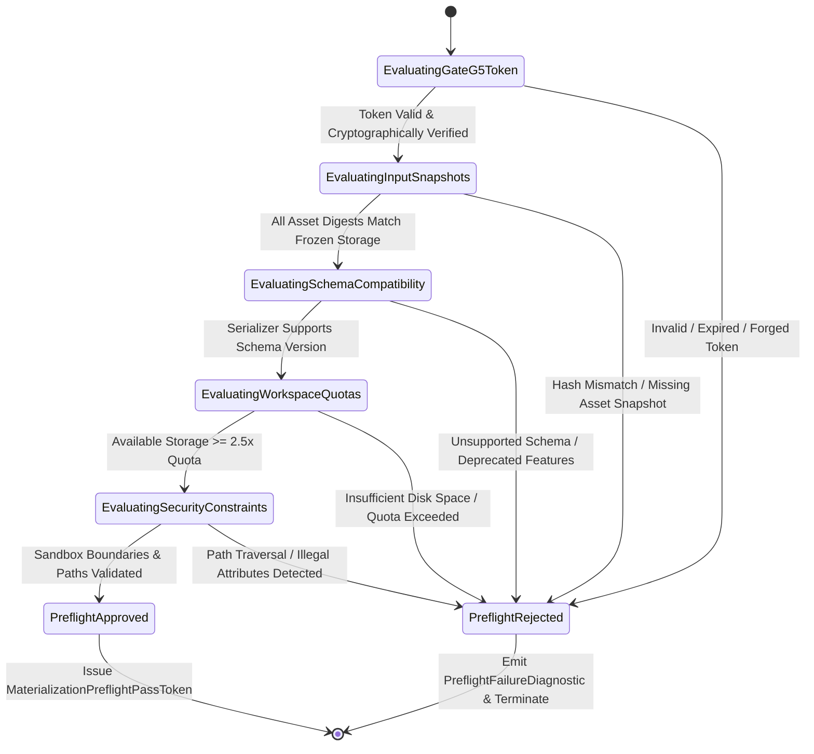

# Package Materialization Eligibility and Preflight Contract

**Document Identifier:** `NLE-CON-MEP-001`  
**Lifecycle Stage:** Content Pipeline Stage M Preflight  
**Parent Document:** [HOST_GAME_PACKAGE_MATERIALIZATION_SERIALIZATION_AND_INTEGRITY_VERIFICATION_SPECIFICATION.md](file:///d:/App%20Winrar%20Files/Nexludic%20Engine%20(working)/docs/content-pipeline/HOST_GAME_PACKAGE_MATERIALIZATION_SERIALIZATION_AND_INTEGRITY_VERIFICATION_SPECIFICATION.md) (`NLE-SPC-PMS-001`)  
**Upstream Input:** [PACKAGE_READINESS_AND_DOWNSTREAM_HANDOFF_CONTRACT.md](file:///d:/App%20Winrar%20Files/Nexludic%20Engine%20(working)/docs/content-pipeline/PACKAGE_READINESS_AND_DOWNSTREAM_HANDOFF_CONTRACT.md) (`NLE-CON-PRH-001`)  
**System Status:** Authoritative Architectural Contract  
**Classification:** Core Governance & Boundary Preconditions  

---

## 1. Purpose & Scope

The **Package Materialization Eligibility and Preflight Contract** establishes the definitive, non-bypassable preflight validation gate that must be satisfied before any physical serialization work commences in Stage M. This contract guarantees that physical materialization is executed only against complete, authorized, structurally sound, and immutable logical package representations.

Any preflight check failure must result in immediate **Fail-Closed Abort** (`ABORT_PREFLIGHT_FAIL`), preventing any allocation of temporary build containers, filesystem modifications, or disk writes.

---

## 2. Preflight Contract Invariants

1. **Gate G5 Dependency Invariant (`CON-MEP-01`):** Materialization eligibility strictly requires an authoritative, non-expired Gate G5 Packaging Authorization Token issued by the Step 64 Package Readiness Gate.
2. **Content Snapshot Immutability (`CON-MEP-02`):** Every member asset listed in the Logical Package Definition (LPD) must exist within a frozen, content-addressed storage repository. The SHA-256 hash of each input asset must match the hash recorded during Step 64 validation.
3. **Workspace Quota Assurance (`CON-MEP-03`):** The target staging volume must possess free, contiguous storage space equal to at least $2.5 \times$ the projected uncompressed package payload size plus a minimum 1.0 GB safety buffer.
4. **Target Schema Version Compatibility (`CON-MEP-04`):** The serializer engine version must explicitly support the requested package schema version without lossy feature fallback.
5. **Zero Modifiable External State (`CON-MEP-05`):** Preflight validation must confirm that materialization execution will operate entirely within the isolated staging sandbox and does not require elevated administrative privileges (`DEC-002`).

---

## 3. Preflight Eligibility Checklist & State Transitions

The Preflight Evaluator executes six verification phases in strict sequence:



---

## 4. Formal Contract Data Schemas

### 4.1 Preflight Evaluation Request
```json
{
  "$schema": "https://schemas.nexludic.net/pipeline/v1/preflight-request.json",
  "request_id": "req-mep-20261119-001",
  "logical_package_id": "pkg-skyrim-nordic-armory-v1.0.0",
  "gate_g5_token": {
    "token_id": "g5-auth-98127391-abef",
    "issued_at": "2026-11-19T18:45:00Z",
    "expires_at": "2026-11-19T19:45:00Z",
    "authority": "NLE-CON-PRH-001-GATE-G5",
    "signature": "ed25519:abcdef1234567890..."
  },
  "input_snapshot_root_digest": "sha256:d8b2e104f981237a6b91c0e9d1a8e97f012b3c4d5e6f7a8b9c0d1e2f3a4b5c6d",
  "target_package_format": "NL_PACKAGE_V1",
  "requested_compression_profile": "DEFLATE_DETERMINISTIC_L6",
  "projected_uncompressed_bytes": 104857600
}
```

### 4.2 Preflight Pass Token (`NLE-MEP-PASS`)
```json
{
  "$schema": "https://schemas.nexludic.net/pipeline/v1/preflight-pass-token.json",
  "token_id": "mep-pass-20261119-7712",
  "request_id": "req-mep-20261119-001",
  "status": "PREFLIGHT_PASSED",
  "timestamp": "2026-11-19T18:45:05Z",
  "granted_lease": {
    "lease_id": "lease-mat-89123",
    "allocated_temp_dir": "D:/NexLudic/Workspace/Staging/temp_mat_89123/",
    "max_allowed_bytes": 314572800,
    "lease_duration_seconds": 600
  },
  "verified_input_members_count": 482,
  "verified_input_digest": "sha256:d8b2e104f981237a6b91c0e9d1a8e97f012b3c4d5e6f7a8b9c0d1e2f3a4b5c6d",
  "signer_signature": "ed25519:98123471012398abcef..."
}
```

### 4.3 Preflight Failure Diagnostic Structure
When preflight checks fail, the engine generates an immutable diagnostic record:
```json
{
  "$schema": "https://schemas.nexludic.net/pipeline/v1/preflight-failure.json",
  "error_code": "ERR_MEP_INPUT_DIGEST_MISMATCH",
  "severity": "FATAL",
  "failure_stage": "EvaluatingInputSnapshots",
  "member_id": "assets/textures/armor_diffuse.dds",
  "expected_sha256": "sha256:4a5b6c...",
  "observed_sha256": "sha256:9f8e7d...",
  "remediation": "Input asset modified after Gate G5 sign-off. Trigger Stage P re-assembly.",
  "timestamp": "2026-11-19T18:45:02Z"
}
```

---

## 5. Failure Classifications & Diagnostic Codes

| Code | Classification | Description | Action |
| :--- | :--- | :--- | :--- |
| `ERR_MEP_GATE_TOKEN_INVALID` | Security / Governance | Gate G5 token missing, expired, or invalid signature | Abort. Require Step 64 re-authorization. |
| `ERR_MEP_INPUT_DIGEST_MISMATCH` | Integrity / Tampering | Frozen asset snapshot digest does not match LPD | Abort. Quarantine staging workspace. |
| `ERR_MEP_SNAPSHOT_MISSING` | Storage / Pipeline | Referenced member payload not found in storage | Abort. Re-fetch input snapshot. |
| `ERR_MEP_UNSUPPORTED_SCHEMA` | Compatibility | Target schema version incompatible with serializer | Abort. Update serializer or downgrade LPD schema. |
| `ERR_MEP_INSUFFICIENT_STORAGE` | System Resource | Target storage volume has less than $2.5\times$ space | Abort. Free disk space on workspace volume. |
| `ERR_MEP_SECURITY_POLICY_VIOLATION` | Sandbox Security | Path traversal, symlink, or illegal attribute found | Abort. Audit input manifest for malformed paths. |

---

## 6. Contract Invariants Enforcement

Any invocation of Stage M that bypasses `NLE-CON-MEP-001` or attempts materialization without an authentic, non-expired `MaterializationPreflightPassToken` will trigger immediate system halt and post a high-severity security audit event.
