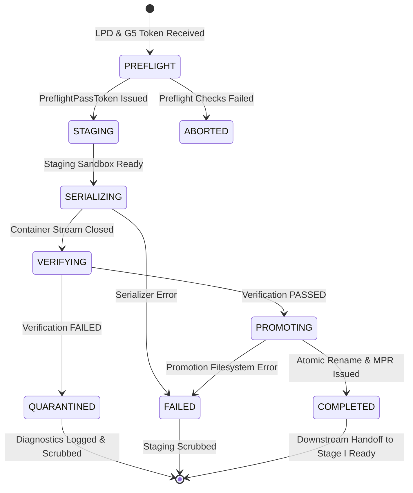

# Package Materialization State, Provenance and Handoff Contract

**Document Identifier:** `NLE-CON-MSP-001`  
**Lifecycle Stage:** Content Pipeline Stage M Handoff & Governance  
**Parent Document:** [HOST_GAME_PACKAGE_MATERIALIZATION_SERIALIZATION_AND_INTEGRITY_VERIFICATION_SPECIFICATION.md](file:///d:/App%20Winrar%20Files/Nexludic%20Engine%20(working)/docs/content-pipeline/HOST_GAME_PACKAGE_MATERIALIZATION_SERIALIZATION_AND_INTEGRITY_VERIFICATION_SPECIFICATION.md) (`NLE-SPC-PMS-001`)  
**Downstream Interface:** Stage I (Host-Game Installation Preparation & Mod Deployment Planning)  
**System Status:** Authoritative Architectural Contract  
**Classification:** Pipeline Stage Contracts & Inter-Stage Handoff  

---

## 1. Purpose & Architectural Context

The **Package Materialization State, Provenance and Handoff Contract** governs the formal transition of a verified physical package from Stage M (Package Materialization) to downstream pipeline consumers (Stage I / Installation Preparation, and Stage V / Verification).

This contract defines:
1. The formal **Materialized Package Receipt (MPR)** data contract.
2. The end-to-end cryptographic **Provenance Record (`provenance.json`)** linking the physical binary artifact back to raw source assets, normalization receipts, and packaging approvals.
3. The authoritative state machine governing the Stage M completion gate.

---

## 2. Stage M Formal State Machine



---

## 3. Cryptographic Provenance Record Schema (`provenance.json`)

The `provenance.json` document embedded inside the physical package container provides an unforgeable, content-addressed audit trail:

```json
{
  "$schema": "https://schemas.nexludic.net/pipeline/v1/package-provenance.json",
  "provenance_version": "1.0.0",
  "package_id": "pkg-skyrim-nordic-armory-v1.0.0",
  "build_attestation": {
    "engine_version": "0.8.4",
    "serializer_id": "nle-serializer-zip-v1",
    "build_timestamp": "2026-11-19T18:45:00Z",
    "build_environment": {
      "os": "Windows_NT",
      "architecture": "x64",
      "isolation_level": "MEDIUM_INTEGRITY"
    }
  },
  "upstream_authorizations": {
    "stage_p_lpd_id": "lpd-skyrim-nordic-armory-v1",
    "stage_p_lpd_sha256": "sha256:3a4b5c6d7e8f9a0b1c2d3e4f5a6b7c8d9e0f1a2b3c4d5e6f7a8b9c0d1e2f3a4b",
    "gate_g5_token_id": "g5-auth-98127391-abef",
    "gate_g5_signature": "ed25519:abcdef1234567890..."
  },
  "source_lineage": [
    {
      "source_asset_id": "ast-diffuse-texture-001",
      "source_game": "SourceGame_Skyrim",
      "ingestion_receipt_id": "rcpt-ing-20261118-0012",
      "transformation_receipt_id": "rcpt-trf-20261118-0482",
      "normalized_digest": "sha256:e3b0c44298fc1c149afbf4c8996fb92427ae41e4649b934ca495991b7852b855",
      "package_relative_path": "assets/textures/armor_diffuse.dds"
    }
  ],
  "signer": {
    "key_id": "key-nexludic-official-build",
    "public_key": "ed25519:1234567890abcdef...",
    "signature": "ed25519:fedcba0987654321..."
  }
}
```

---

## 4. Materialized Package Receipt (MPR) Handoff Contract

Upon completion of Stage M, the pipeline emits the **Materialized Package Receipt**, which is transferred to the orchestrator for downstream handoff:

```json
{
  "$schema": "https://schemas.nexludic.net/pipeline/v1/materialized-package-receipt.json",
  "receipt_id": "mpr-20261119-48192",
  "package_id": "pkg-skyrim-nordic-armory-v1.0.0",
  "status": "STAGE_M_COMPLETED",
  "physical_artifact": {
    "file_path": "D:/NexLudic/Workspace/Packages/pkg-skyrim-nordic-armory-v1.0.0.nlpkg",
    "container_format": "NL_PACKAGE_V1",
    "byte_size": 52428800,
    "sha256_digest": "sha256:9a8b7c6d5e4f3a2b1c0d9e8f7a6b5c4d3e2f1a0b9c8d7e6f5a4b3c2d1e0f9a8b",
    "merkle_root_sha256": "sha256:123456789abcdef0123456789abcdef0123456789abcdef0123456789abcdef0"
  },
  "content_summary": {
    "total_member_count": 482,
    "asset_count": 480,
    "override_count": 0,
    "metadata_file_count": 2
  },
  "verification_attestation": {
    "verification_token": "ver-20261119-90124",
    "verified_at": "2026-11-19T18:46:12Z",
    "verdict": "VERIFIED_VALID"
  },
  "downstream_eligibility": {
    "stage_i_eligible": true,
    "requires_runtime_elevation": false,
    "anti_cheat_clearance_required_at_stage_i": true
  }
}
```

---

## 5. Downstream Invariants & Consumption Rules

1. **Stage I Non-Tampering Obligation:** Downstream consumers (Stage I / Installation Planning) MUST verify the `sha256_digest` of the physical package against the MPR before extracting or reading any members.
2. **Immutable Storage Hand-Off:** Once an MPR is issued, the physical `.nlpkg` file is locked in read-only mode in the package repository. No in-place modification is permitted. Any revision requires a new build cycle and a new package version identifier.
