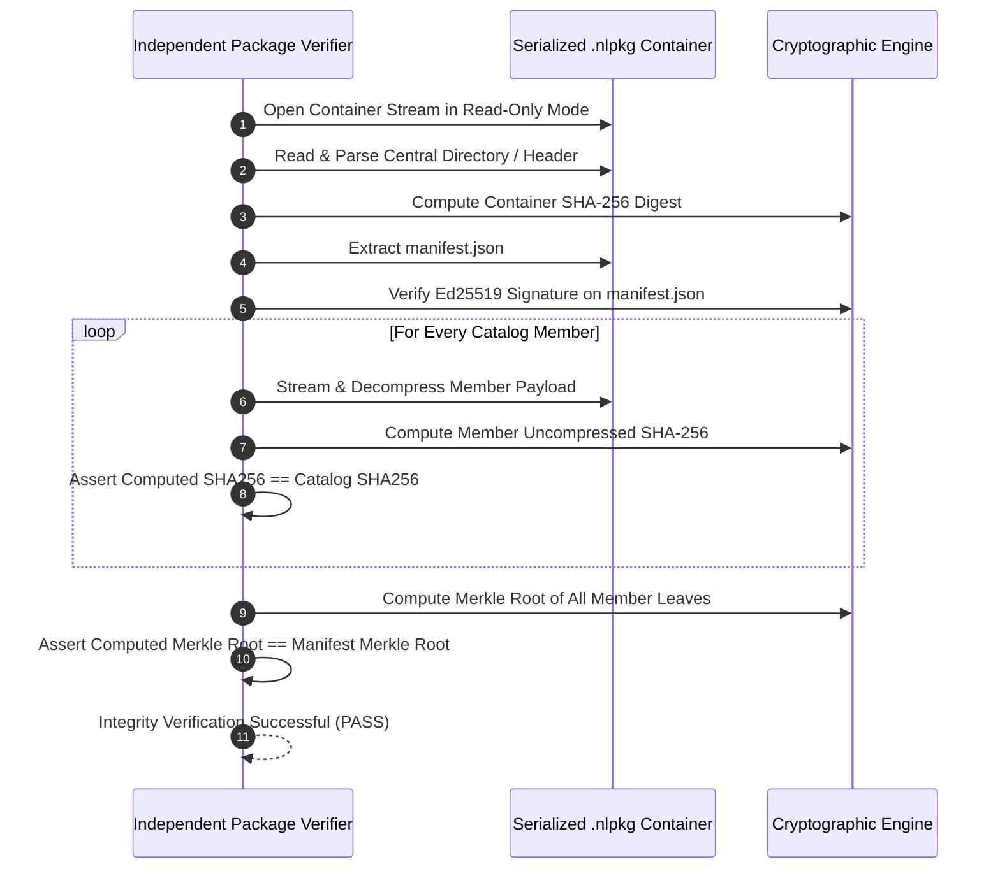

# Package Member and Physical Artifact Integrity Verification Contract

**Document Identifier:** `NLE-CON-PAI-001`  
**Lifecycle Stage:** Content Pipeline Stage M Verification Contract  
**Parent Document:** [HOST_GAME_PACKAGE_MATERIALIZATION_SERIALIZATION_AND_INTEGRITY_VERIFICATION_SPECIFICATION.md](file:///d:/App%20Winrar%20Files/Nexludic%20Engine%20(working)/docs/content-pipeline/HOST_GAME_PACKAGE_MATERIALIZATION_SERIALIZATION_AND_INTEGRITY_VERIFICATION_SPECIFICATION.md) (`NLE-SPC-PMS-001`)  
**System Status:** Authoritative Architectural Contract  
**Classification:** Cryptographic Integrity & Tamper Protection  

---

## 1. Purpose & Scope

The **Package Member and Physical Artifact Integrity Verification Contract** establishes the dual-layer cryptographic verification protocol governing all materialized packages in NexLudic Engine. 

This contract enforces rigorous mathematical verification at both:
1. **The Member Level:** Validating individual decompressed file streams against their canonical cryptographic digests.
2. **The Container Level:** Validating the complete, serialized container archive and manifest Merkle tree.

---

## 2. Dual-Layer Cryptographic Architecture

```
+--------------------------------------------------------------------------------------------------+
|                            DUAL-LAYER INTEGRITY VERIFICATION MODEL                               |
+--------------------------------------------------------------------------------------------------+
|                                                                                                  |
|  [ LAYER 1: MEMBER-LEVEL INTEGRITY ]                                                             |
|  - Stream Hash: SHA-256 computed on uncompressed raw byte stream of each member entry            |
|  - Merkle Tree Leaf: Leaf_i = SHA256(UTF8(Path_i) || 0x00 || Length_i || 0x00 || SHA256(Data_i)) |
|  - Merkle Root Hash: Root = MerkleRoot(Leaf_0, Leaf_1, ..., Leaf_N)                              |
|                                                                                                  |
|                                     |                                                            |
|                                     v                                                            |
|                                                                                                  |
|  [ LAYER 2: CONTAINER-LEVEL INTEGRITY ]                                                          |
|  - Package Stream Digest: SHA-256 computed over the entire serialized container file             |
|  - Manifest Digital Signature: Ed25519 signature over canonical manifest.json                    |
|  - Container Digital Signature: Ed25519 signature over Package Stream Digest                      |
|                                                                                                  |
+--------------------------------------------------------------------------------------------------+
```

---

## 3. Cryptographic Hashing Protocols & Formats

### 3.1 Supported Hash Algorithms
- **Primary Algorithm:** SHA-256 (FIPS 180-4). Mandatory for all member payloads, manifests, and container digests.
- **High-Performance Streaming Algorithm (Optional):** BLAKE3. May be utilized for high-throughput local cache verification, provided SHA-256 digests remain present in the authoritative manifest.
- **Strictly Prohibited Algorithms:** MD5, SHA-1, CRC32 (CRC32 is permitted only as a legacy ZIP header checksum, never as an integrity verification mechanism).

### 3.2 Member Merkle Leaf Calculation
For each member $i$ in the canonical member list:
$$\text{Leaf}_i = \text{SHA256}\left( \text{NormalizePath}(P_i) \mathbin{\Vert} 0\text{x}00 \mathbin{\Vert} \text{Uint64LE}(S_i) \mathbin{\Vert} 0\text{x}00 \mathbin{\Vert} \text{Digest}_i \right)$$
where $P_i$ is the physical relative path, $S_i$ is uncompressed byte size, and $\text{Digest}_i$ is the uncompressed SHA-256 digest.

---

## 4. Verification Execution Contract

The verification protocol executes in three mandatory phases:



### 4.1 Fail-Closed Assertion Rules
1. **Any Digest Mismatch:** If a single member byte produces a SHA-256 mismatch, the entire package is declared corrupted and quarantined (`ERR_PAI_MEMBER_DIGEST_MISMATCH`).
2. **Missing Manifest Entry:** If the container holds an archive entry not cataloged in `manifest.json`, the package is rejected for unauthorized payload injection (`ERR_PAI_UNAUTHORIZED_ENTRY`).
3. **Missing Physical Stream:** If an entry cataloged in `manifest.json` is missing from the container, verification fails (`ERR_PAI_MISSING_ENTRY`).
4. **Invalid Signature:** If the manifest or container Ed25519 signature fails verification against the trusted public key, the package is rejected for tampering (`ERR_PAI_SIGNATURE_INVALID`).

---

## 5. Formal Verification Result Schema

```json
{
  "$schema": "https://schemas.nexludic.net/pipeline/v1/integrity-verification-result.json",
  "verification_id": "ver-20261119-90124",
  "package_path": "D:/NexLudic/Workspace/Packages/pkg-nordic-armory.nlpkg",
  "overall_verdict": "VERIFIED_VALID",
  "container_sha256": "sha256:8a1b2c3d4e5f6a7b8c9d0e1f2a3b4c5d6e7f8a9b0c1d2e3f4a5b6c7d8e9f0a1b",
  "merkle_root_sha256": "sha256:123456789abcdef0123456789abcdef0123456789abcdef0123456789abcdef0",
  "signature_verification": {
    "signer_public_key": "ed25519:abcdef0123456789...",
    "signature_status": "VALID"
  },
  "verified_member_count": 482,
  "failed_member_count": 0,
  "execution_duration_ms": 312,
  "timestamp": "2026-11-19T18:46:12Z"
}
```

---

## 6. Diagnostic Codes

| Code | Severity | Description | Action |
| :--- | :--- | :--- | :--- |
| `ERR_PAI_CONTAINER_DIGEST_MISMATCH` | FATAL | Container archive SHA-256 corrupted | Quarantine artifact. Discard build. |
| `ERR_PAI_MEMBER_DIGEST_MISMATCH` | FATAL | Member uncompressed payload corrupted | Quarantine artifact. Rebuild package. |
| `ERR_PAI_MERKLE_ROOT_MISMATCH` | FATAL | Computed Merkle root differs from manifest | Reject package as structurally modified. |
| `ERR_PAI_UNAUTHORIZED_ENTRY` | FATAL | Uncataloged entry detected in container | Reject package. Security alert triggered. |
| `ERR_PAI_SIGNATURE_INVALID` | FATAL | Cryptographic signature validation failed | Reject package as untrusted/tampered. |
