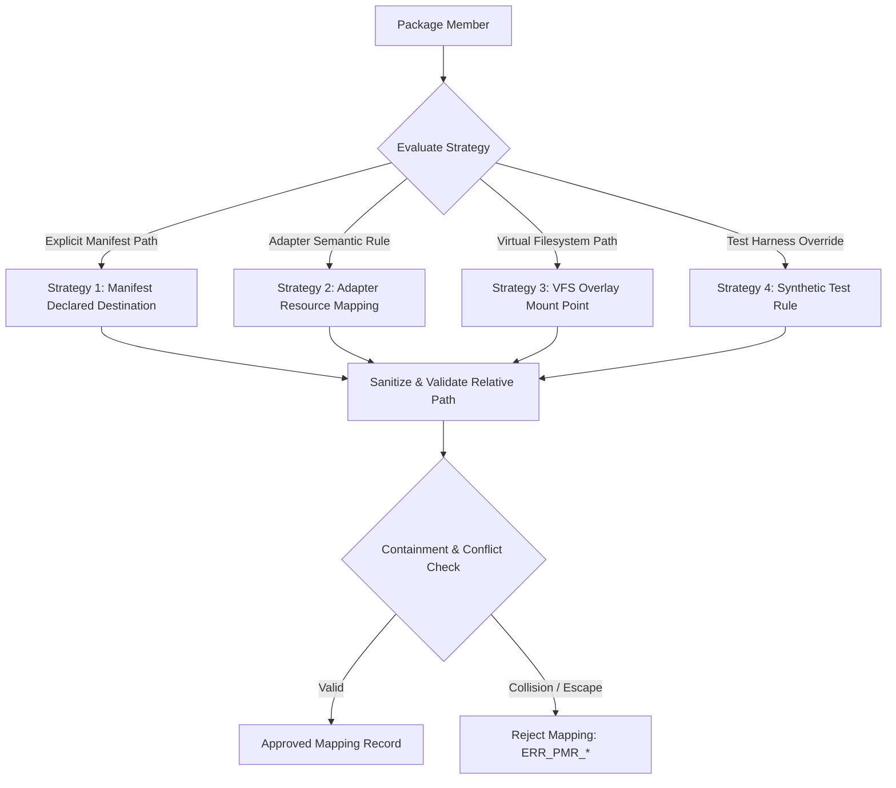

# Package Member to Target Resource Mapping Contract

**Document Identifier:** `NLE-CON-PMR-001`  
**Lifecycle Stage:** Content Pipeline Stage I Mapping Contract  
**Parent Document:** [HOST_GAME_TARGET_VALIDATION_PACKAGE_MAPPING_AND_APPLICATION_PLANNING_SPECIFICATION.md](file:///d:/App%20Winrar%20Files/Nexludic%20Engine%20(working)/docs/content-pipeline/HOST_GAME_TARGET_VALIDATION_PACKAGE_MAPPING_AND_APPLICATION_PLANNING_SPECIFICATION.md) (`NLE-SPC-TVP-001`)  
**System Status:** Authoritative Architectural Contract  
**Classification:** Resource Mapping & Destination Resolution  

---

## 1. Purpose & Scope

The **Package Member to Target Resource Mapping Contract** governs the formal translation of individual package members stored within a physical package (`.nlpkg`) to designated, permitted resource destinations within the target game environment.

This contract defines:
1. Permitted mapping strategies.
2. Structured mapping record schemas.
3. Strict ambiguity detection and resolution policies.
4. Rules for handling unmapped, optional, and unsupported members.

---

## 2. Permitted Mapping Strategies

The Mapping Engine resolves package members to target resources using four authorized strategies:



### 2.1 Strategy Definitions
1. **`STRAT_MANIFEST_EXPLICIT`:** The package `manifest.json` specifies an exact `target_relative_path`. Permitted only if the path is explicitly allowed by the target adapter profile.
2. **`STRAT_ADAPTER_RULE`:** The game adapter translates member metadata (e.g., texture category, script type) into the target game's canonical layout (e.g., `Data/Textures/...`).
3. **`STRAT_VIRTUAL_OVERLAY`:** The member is routed to a virtual filesystem overlay directory without modifying physical game files.
4. **`STRAT_SYNTHETIC`:** Mock mapping rules utilized in CI/CD synthetic QA suites.

---

## 3. Formal Mapping Record Schema

Every resolved mapping must be recorded as an immutable JSON structure:

```json
{
  "$schema": "https://schemas.nexludic.net/pipeline/v1/package-member-mapping.json",
  "mapping_id": "map-20261119-001",
  "package_id": "pkg-skyrim-nordic-armory-v1.0.0",
  "package_member_id": "mem-001-diffuse",
  "source_relative_path": "assets/textures/armor_diffuse.dds",
  "source_sha256": "sha256:e3b0c44298fc1c149afbf4c8996fb92427ae41e4649b934ca495991b7852b855",
  "target_resource_id": "res-tex-armor-diffuse",
  "destination_relative_path": "Data/Textures/Armor/Nordic/armor_d.dds",
  "mapping_strategy": "STRAT_ADAPTER_RULE",
  "required_operation": "ADD",
  "is_optional": false,
  "confidence": "VERIFIED_DETERMINISTIC",
  "status": "MAPPED_VALID"
}
```

---

## 4. Ambiguity, Collision & Unmapped Member Rules

1. **Heuristic Guessing Strictly Prohibited:** The mapping engine must NEVER match members based solely on raw filenames or loose keyword searches (`ERR_PMR_AMBIGUOUS_NAME_ONLY`).
2. **Destination Collision Detection:** If two distinct package members resolve to the identical `destination_relative_path`, the engine triggers `ERR_PMR_DESTINATION_COLLISION` and blocks planning.
3. **Unmapped Required Members:** If a mandatory package member cannot be resolved to a valid target destination, the entire application plan is declared incomplete (`ERR_PMR_UNMAPPED_REQUIRED_MEMBER`).
4. **Optional Member Exclusion:** Optional members that lack valid mappings may be excluded from the application plan only if permitted by project policy, with full rationale logged in the plan diagnostics.

---

## 5. Contract Diagnostic Codes

| Code | Severity | Description | Action |
| :--- | :--- | :--- | :--- |
| `ERR_PMR_AMBIGUOUS_NAME_ONLY` | FATAL | Member attempted mapping via bare filename heuristic | Reject mapping. Require adapter rule. |
| `ERR_PMR_DESTINATION_COLLISION` | FATAL | Multiple members map to the same destination path | Abort planning. Resolve member collision. |
| `ERR_PMR_UNMAPPED_REQUIRED_MEMBER`| FATAL | Required package member has no target destination | Abort planning. Update mapping rules. |
| `ERR_PMR_SCOPE_ESCAPE` | FATAL | Destination path escapes authorized target directory | Reject mapping. Security audit triggered. |
