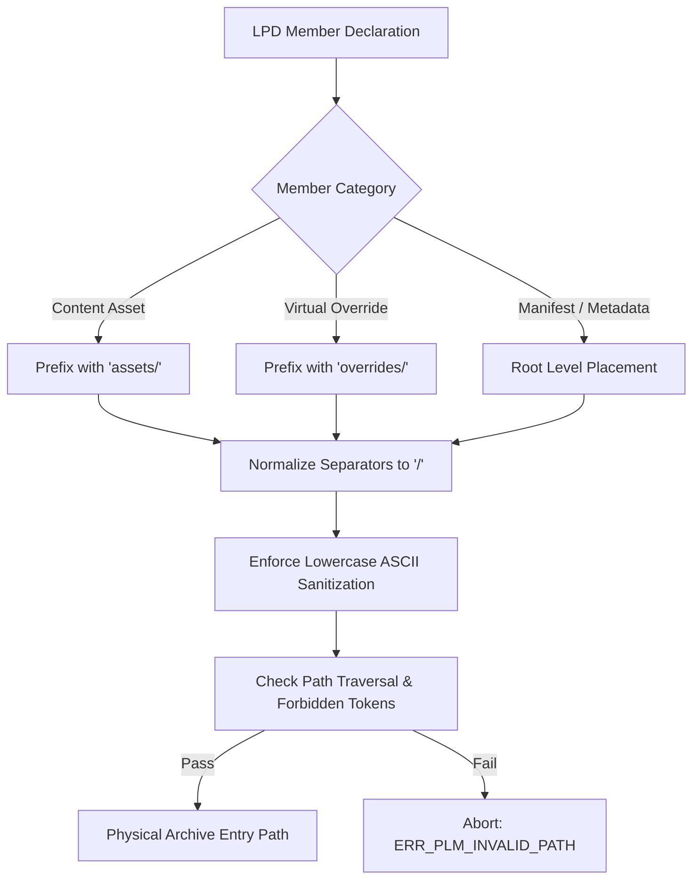

# Package Physical Layout and Member Mapping Specification

**Document Identifier:** `NLE-SPC-PLM-001`  
**Lifecycle Stage:** Content Pipeline Stage M Architecture  
**Parent Document:** [HOST_GAME_PACKAGE_MATERIALIZATION_SERIALIZATION_AND_INTEGRITY_VERIFICATION_SPECIFICATION.md](file:///d:/App%20Winrar%20Files/Nexludic%20Engine%20(working)/docs/content-pipeline/HOST_GAME_PACKAGE_MATERIALIZATION_SERIALIZATION_AND_INTEGRITY_VERIFICATION_SPECIFICATION.md) (`NLE-SPC-PMS-001`)  
**Upstream Contract:** [PACKAGE_READINESS_AND_DOWNSTREAM_HANDOFF_CONTRACT.md](file:///d:/App%20Winrar%20Files/Nexludic%20Engine%20(working)/docs/content-pipeline/PACKAGE_READINESS_AND_DOWNSTREAM_HANDOFF_CONTRACT.md) (`NLE-CON-PRH-001`)  
**System Status:** Authoritative Architectural Specification  
**Classification:** Container Standards & Physical Layout  

---

## 1. Executive Summary & Purpose

The **Package Physical Layout and Member Mapping Specification** defines the precise on-disk and in-archive physical structure of NexLudic Engine packages (`.nlpkg`). It establishes the formal translation rules between the abstract, logical member declarations formulated in Stage P's Logical Package Definition (LPD) and their concrete, serialized locations inside physical container archives.

This specification ensures that physical packages maintain absolute structural clarity, prevent path collision or ambiguity, isolate content domains, and adhere to strict security constraints against path traversal and file-system spoofing.

---

## 2. Canonical Physical Layout Anatomy

A NexLudic Package (`.nlpkg`) conforms to a strictly partitioned internal hierarchy:

```
<archive_root>/
  |-- manifest.json                    # Mandatory: Canonical JSON Manifest (RFC 8785)
  |-- provenance.json                  # Mandatory: Cryptographic Provenance & Build Chain
  |-- signatures/                      # Optional: Cryptographic attestation
  |     |-- manifest.sig               # Ed25519 signature over manifest.json
  |     `-- package.sig                # Ed25519 signature over full archive
  |-- assets/                          # Payload Domain 1: Immutable content assets
  |     |-- textures/
  |     |     |-- armor_d.dds
  |     |     `-- armor_n.dds
  |     |-- models/
  |     |     `-- cuirass.mesh
  |     `-- audio/
  |           `-- equip_leather.wav
  `-- overrides/                       # Payload Domain 2: Target-specific file replacements
        |-- Data/
        |     `-- Scripts/
        |           `-- QuestController.pex
        `-- Config/
              `-- settings.ini
```

### 2.1 File System and Layout Segregation Rules
1. **Manifest Isolation:** `manifest.json` and `provenance.json` MUST always reside at the root level of the archive. They cannot be nested inside subdirectories.
2. **Payload Segregation:** All content assets must reside within either `assets/` or `overrides/`. No raw content files may be placed in the archive root or outside designated domain subdirectories.
3. **No Symlinks or Hardlinks:** The physical container must store regular file streams only. Storing symbolic links, NTFS junctions, hardlinks, FIFOs, socket files, or device nodes is strictly prohibited. Any archive entry exhibiting non-regular file attributes will cause immediate validation failure.

---

## 3. Logical-to-Physical Path Translation Rules

During Stage M materialization, the mapping engine translates each member entry in the LPD to an archive physical path according to deterministic transformation rules:



### 3.1 Normalization and Sanitization Constraints
- **Path Separators:** All path separators MUST be normalized to forward slashes (`/`). Backslashes (`\`) are strictly forbidden inside archive entry names.
- **Root and Traversal Stripping:** Entries must NEVER begin with a slash (`/`), drive letter (`C:`), or UNC prefix (`//`). Any path containing `.` (current directory) or `..` (parent directory) segments is rejected as a security violation (`ERR_PLM_TRAVERSAL_DETECTED`).
- **Character Encoding & Restrictions:** All physical paths MUST be encoded in UTF-8 without byte order marks (BOM). Permitted characters are restricted to:
  - Alphanumeric characters: `a-z`, `A-Z`, `0-9`
  - Safe symbols: `_` (underscore), `-` (hyphen), `.` (period)
  - Delimiters: `/` (forward slash)
- **Forbidden Characters:** Characters such as `:`, `*`, `?`, `"`, `<`, `>`, `|`, control characters (`0x00`-`0x1F`), and trailing dots or spaces are rejected.

---

## 4. Case-Folding & Cross-Platform Collisions

To guarantee cross-platform compatibility across Windows (case-insensitive NTFS/ReFS) and Linux/macOS (case-sensitive ext4/APFS):

1. **Physical Canonicalization:** Inside the physical container, entry paths are stored with preserved logical case, but uniqueness is enforced using **Unicode Case-Folded Comparison** (`CaseFold(PathA) == CaseFold(PathB)`).
2. **Collision Prevention:** If an LPD contains two entries whose paths differ only by case (e.g., `textures/Armor.dds` and `textures/armor.dds`), materialization must fail immediately with `ERR_PLM_CASE_COLLISION`.

---

## 5. Physical Layout Member Catalog Schema

The resulting layout mapping is recorded in the physical package manifest:

```json
{
  "physical_layout_version": "1.0.0",
  "container_format": "NL_PACKAGE_V1",
  "member_catalog": [
    {
      "member_id": "mem-001-diffuse",
      "logical_path": "Textures/Armor_Diffuse.dds",
      "physical_path": "assets/textures/armor_diffuse.dds",
      "byte_length": 4194304,
      "checksum_sha256": "sha256:e3b0c44298fc1c149afbf4c8996fb92427ae41e4649b934ca495991b7852b855",
      "compression_method": "DEFLATE",
      "compressed_byte_length": 1845120
    },
    {
      "member_id": "mem-002-manifest",
      "logical_path": "manifest.json",
      "physical_path": "manifest.json",
      "byte_length": 14208,
      "checksum_sha256": "sha256:7a8b9c0d1e2f3a4b5c6d7e8f9a0b1c2d3e4f5a6b7c8d9e0f1a2b3c4d5e6f7a8b",
      "compression_method": "STORE",
      "compressed_byte_length": 14208
    }
  ]
}
```

---

## 6. Diagnostic Codes

| Code | Severity | Description | Action |
| :--- | :--- | :--- | :--- |
| `ERR_PLM_INVALID_PATH` | FATAL | Path contains illegal characters or formatting | Abort serialization. Audit LPD paths. |
| `ERR_PLM_TRAVERSAL_DETECTED` | FATAL | Path contains `..` or leading `/` | Abort serialization. Quarantine task. |
| `ERR_PLM_CASE_COLLISION` | FATAL | Two entries collide under case-folding | Abort serialization. Rename colliding assets. |
| `ERR_PLM_RESERVED_ROOT_VIOLATION` | FATAL | Unauthorized file placed at archive root | Move entry to `assets/` or `overrides/`. |
