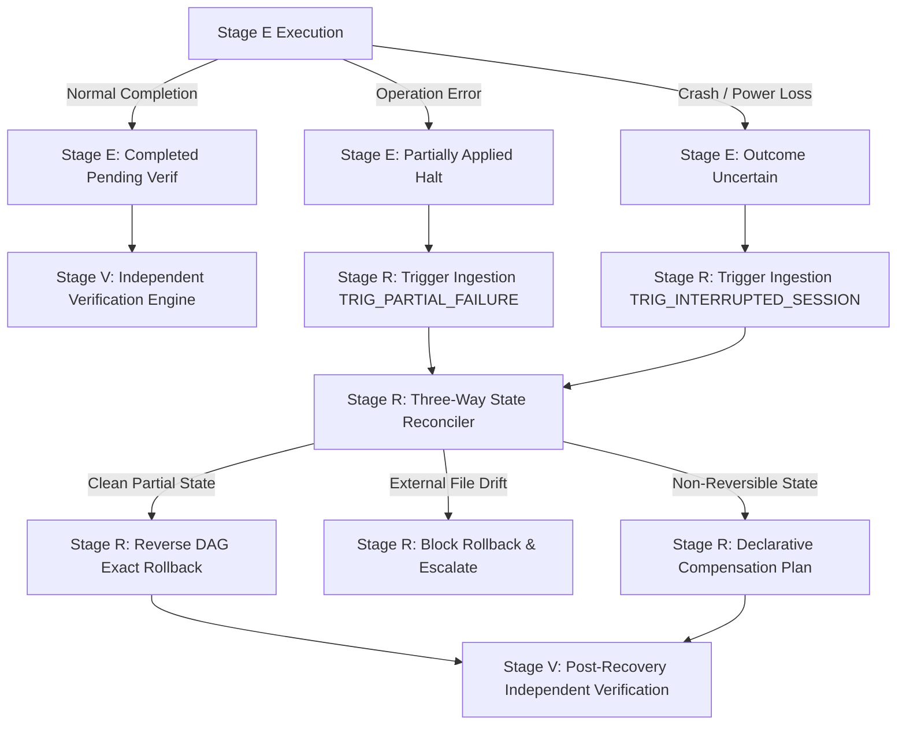

# Phase 8 Failure, Recovery and Verification Consistency Review

**Document Identifier:** `NLE-REV-PH8-002`  
**Lifecycle Stage:** Phase 8 Fault Resilience & Recovery Audit  
**Parent Document:** [PHASE_8_HOST_GAME_MODIFICATION_PIPELINE_INTEGRATION_AND_READINESS_ASSESSMENT.md](file:///d:/App%20Winrar%20Files/Nexludic%20Engine%20(working)/docs/content-pipeline/PHASE_8_HOST_GAME_MODIFICATION_PIPELINE_INTEGRATION_AND_READINESS_ASSESSMENT.md) (`NLE-REV-PH8-001`)  
**System Status:** Authoritative Architectural Review  
**Classification:** Fault Tolerance & Lifecycle Recovery Consistency  

---

## 1. Executive Summary & Review Scope

The **Phase 8 Failure, Recovery and Verification Consistency Review** evaluates the end-to-end fault tolerance, partial-failure governance, and recovery consistency across the Content Pipeline.

The review confirms that execution failures in Stage E seamlessly hand off to Stage R without data loss, that historical journals are never erased, and that post-application verification (Stage V) operates with total independence from execution success claims.

---

## 2. Failure Propagation & Recovery Lifecycle Flow

---

## 3. Key Fault-Resilience Findings

1. **Zero Silent Overwrites:** Destructive changes (`REPLACE`/`REMOVE`) require verified pre-mutation backups; if backup creation fails, execution halts before the target file is touched.
2. **Crash & Interruption Safety:** If an execution or recovery session crashes mid-mutation, the system recovers by re-auditing physical disk state rather than blindly replaying operations.
3. **Audit Separation:** Recovery writes to `recovery_journal.jsonl` and preserves `execution_journal.jsonl` permanently.
4. **Verification Independence:** Stage V evaluates physical files directly against cryptographic receipts, completely ignoring process exit codes or self-reported success flags.
