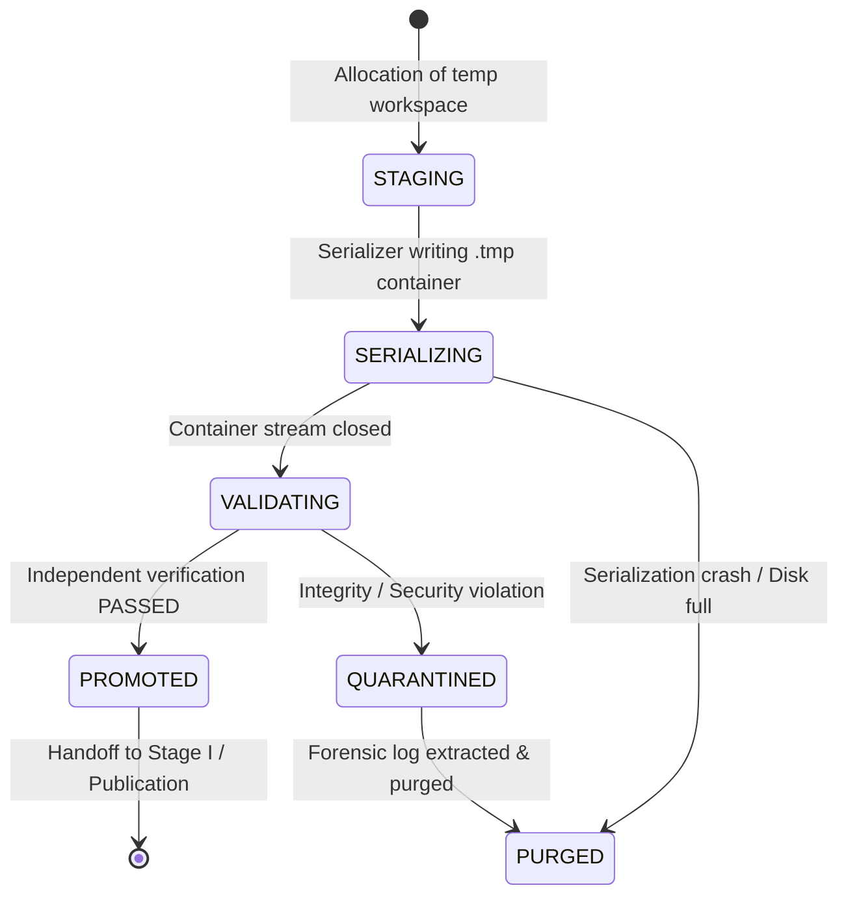

# Post-Materialization Validation and Output Lifecycle Specification

**Document Identifier:** `NLE-SPC-PMV-001`  
**Lifecycle Stage:** Content Pipeline Stage M Validation & Lifecycle  
**Parent Document:** [HOST_GAME_PACKAGE_MATERIALIZATION_SERIALIZATION_AND_INTEGRITY_VERIFICATION_SPECIFICATION.md](file:///d:/App%20Winrar%20Files/Nexludic%20Engine%20(working)/docs/content-pipeline/HOST_GAME_PACKAGE_MATERIALIZATION_SERIALIZATION_AND_INTEGRITY_VERIFICATION_SPECIFICATION.md) (`NLE-SPC-PMS-001`)  
**Upstream Contract:** [PACKAGE_MEMBER_AND_PHYSICAL_ARTIFACT_INTEGRITY_VERIFICATION_CONTRACT.md](file:///d:/App%20Winrar%20Files/Nexludic%20Engine%20(working)/docs/content-pipeline/PACKAGE_MEMBER_AND_PHYSICAL_ARTIFACT_INTEGRITY_VERIFICATION_CONTRACT.md) (`NLE-CON-PAI-001`)  
**System Status:** Authoritative Architectural Specification  
**Classification:** Post-Build Verification & Artifact Promotion  

---

## 1. Executive Summary & Purpose

The **Post-Materialization Validation and Output Lifecycle Specification** establishes the definitive operational protocol for validating physical package artifacts after serialization and managing their progression through the artifact lifecycle.

Under no circumstances may the Content Pipeline rely upon serializer process return codes as proof of container validity. Instead, an independent verifier module must treat the freshly materialized container file as untrusted input, rigorously checking its physical structure, internal directory consistency, decompressibility, and cryptographic attestation before promoting it to the authoritative package repository.

---

## 2. Artifact Output Lifecycle State Machine

The generated physical package progresses through five strictly governed lifecycle states:



### 2.1 State Descriptions
1. **`STAGING`:** Staging directory allocated (`.tmp` extension). Workspace boundaries locked.
2. **`SERIALIZING`:** Serializer writing container bits to temporary file (`package.tmp`).
3. **`VALIDATING`:** Serialization complete. File handle closed. Independent validator inspects artifact in read-only mode.
4. **`PROMOTED`:** All structural, cryptographic, and schema validations passed. Artifact atomically renamed to `<package_id>.nlpkg` in the authorized package repository.
5. **`QUARANTINED`:** Structural corruption, uncataloged payload, zip-bomb, or signature failure detected. File isolated for forensics, then safely deleted.
6. **`PURGED`:** Workspace scrubbed and all temporary files unlinked.

---

## 3. Independent Post-Materialization Validation Protocol

The independent validator executes four sequential audit suites:

```
+--------------------------------------------------------------------------------------------------+
|                            INDEPENDENT VALIDATION AUDIT SUITES                                   |
+--------------------------------------------------------------------------------------------------+
|  1. Container Physical Well-Formedness Audit                                                     |
|     - Verify container magic bytes (e.g., 'PK\x03\x04')                                          |
|     - Verify Central Directory integrity, record count, and end-of-central-directory record      |
|     - Check for trailing unmapped bytes or prepended executable stubs (anti-tamper)             |
|                                                                                                  |
|  2. Security & Archive Safety Audit (Anti-Zip-Bomb / DoS)                                        |
|     - Total entry count <= 250,000                                                               |
|     - Uncompressed size expansion ratio <= 10.0x                                                 |
|     - Max uncompressed archive size <= Workspace Quota                                           |
|     - Absence of absolute paths, drive letters, backslashes, or directory traversal segments     |
|                                                                                                  |
|  3. Manifest and Provenance Concordance Audit                                                    |
|     - Extract and parse manifest.json and provenance.json using RFC 8785 canonical parser        |
|     - Assert exact 1:1 bijection between catalog entries and physical archive members            |
|     - Zero unauthorized / extraneous archive entries permitted                                   |
|                                                                                                  |
|  4. Full Cryptographic Bitstream Verification                                                    |
|     - Stream and decompress every member; compute uncompressed SHA-256                           |
|     - Validate computed member hashes against manifest catalog                                   |
|     - Compute Merkle tree root and assert match against manifest.json                            |
|     - Compute full container SHA-256 digest and verify Ed25519 signature                         |
+--------------------------------------------------------------------------------------------------+
```

---

## 4. Atomic Promotion Protocol

To guarantee that incomplete or partially written packages are never visible to downstream pipeline stages or users:

1. **Staging File Convention:** During serialization and validation, the file must be stored with a temporary name:  
   `D:/NexLudic/Workspace/Staging/{package_id}.tmp`
2. **Atomic Promotion Operation:** Promotion to the final package repository MUST be executed using an atomic filesystem rename operation (`MoveFileEx` with `MOVEFILE_REPLACE_EXISTING` on Windows):  
   $$\text{Promote}: \texttt{staging/}\{\text{pkg\_id}\}\texttt{.tmp} \xrightarrow[\text{atomic}]{\text{rename}} \texttt{packages/}\{\text{pkg\_id}\}\texttt{.nlpkg}$$
3. **Cross-Volume Guard:** The staging directory and final package repository MUST reside on the same filesystem volume to ensure the rename operation is guaranteed atomic by the operating system kernel.

---

## 5. Diagnostic Codes & Remediation

| Code | Severity | Description | Action |
| :--- | :--- | :--- | :--- |
| `ERR_PMV_CONTAINER_MALFORMED` | FATAL | Corrupted archive headers or missing central directory | Quarantine container. Re-execute serialization. |
| `ERR_PMV_EXPANSION_RATIO_EXCEEDED` | FATAL | Compression ratio exceeds 10.0x (Zip-bomb risk) | Quarantine container. Security audit required. |
| `ERR_PMV_MEMBERSHIP_MISMATCH` | FATAL | Mismatch between manifest catalog and archive members | Quarantine container. Serializer bug investigation. |
| `ERR_PMV_CHECKSUM_FAILURE` | FATAL | Decompressed member hash does not match manifest | Quarantine container. Discard corrupted build. |
| `ERR_PMV_PROMOTION_FAILED` | FATAL | Atomic filesystem rename operation failed | Retain validated .tmp. Check file locks / permissions. |
