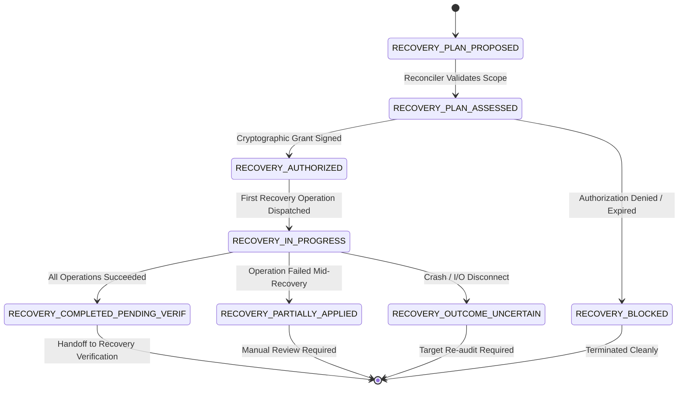

# Recovery Authorization Scope and Plan Lifecycle Contract

**Document Identifier:** `NLE-CON-RAP-001`  
**Lifecycle Stage:** Content Pipeline Stage R Governance Contract  
**Parent Document:** [HOST_GAME_MODIFICATION_RECOVERY_ROLLBACK_RESTORATION_AND_RECONCILIATION_SPECIFICATION.md](file:///d:/App%20Winrar%20Files/Nexludic%20Engine%20(working)/docs/content-pipeline/HOST_GAME_MODIFICATION_RECOVERY_ROLLBACK_RESTORATION_AND_RECONCILIATION_SPECIFICATION.md) (`NLE-SPC-MRR-001`)  
**System Status:** Authoritative Architectural Contract  
**Classification:** Authorization Scope & Recovery Plan Lifecycle  

---

## 1. Purpose & Authority Model

The **Recovery Authorization Scope and Plan Lifecycle Contract** governs how recovery plans are authorized, versioned, and managed through their operational lifecycle.

Because recovery operations alter the target game filesystem (restoring historical files or removing additions), recovery requires an **independent authorization grant** (`RecoveryAuthorizationGrant`). Original approval to install a package NEVER confers authorization to execute rollback or recovery. AI agents are strictly prohibited from self-authorizing recovery plans.

---

## 2. Cryptographic Recovery Authorization Grant Schema

```json
{
  "$schema": "https://schemas.nexludic.net/pipeline/v1/recovery-authorization-grant.json",
  "grant_id": "grant-rec-20261120-0012",
  "bound_recovery_scope": {
    "recovery_plan_id": "rec-plan-skyrim-nordic-armory-v1",
    "recovery_plan_digest": "sha256:7a8b9c0d1e2f3a4b5c6d7e8f9a0b1c2d3e4f5a6b7c8d9e0f1a2b3c4d5e6f7a8b",
    "original_session_id": "sess-88412",
    "target_installation_instance_id": "inst-7788-9900-aabb",
    "selected_strategy": "STRAT_EXACT_ROLLBACK",
    "authorized_operations_count": 120,
    "authorized_file_deletions": 116,
    "authorized_file_restorations": 4
  },
  "validity_window": {
    "issued_at": "2026-11-20T09:35:00Z",
    "expires_at": "2026-11-20T09:45:00Z"
  },
  "issuer": {
    "identity": "user:operator_01",
    "role": "CERTIFIED_INTEGRATION_LEAD",
    "public_key": "ed25519:33445566778899aabbcc...",
    "signature": "ed25519:abcdef0123456789..."
  }
}
```

---

## 3. Formal 8-State Recovery Lifecycle



---

## 4. Contract Diagnostic Codes

| Code | Severity | Description | Action |
| :--- | :--- | :--- | :--- |
| `ERR_RAP_AUTHORIZATION_MISSING` | FATAL | Recovery plan dispatched without signed grant | Block execution immediately. |
| `ERR_RAP_SCOPE_MISMATCH` | FATAL | Grant parameters do not match recovery plan | Reject execution. Audit recovery scope. |
| `ERR_RAP_AI_SELF_AUTHORIZATION` | FATAL | AI agent attempted to authorize recovery plan | Hard abort. High-severity alert logged. |
