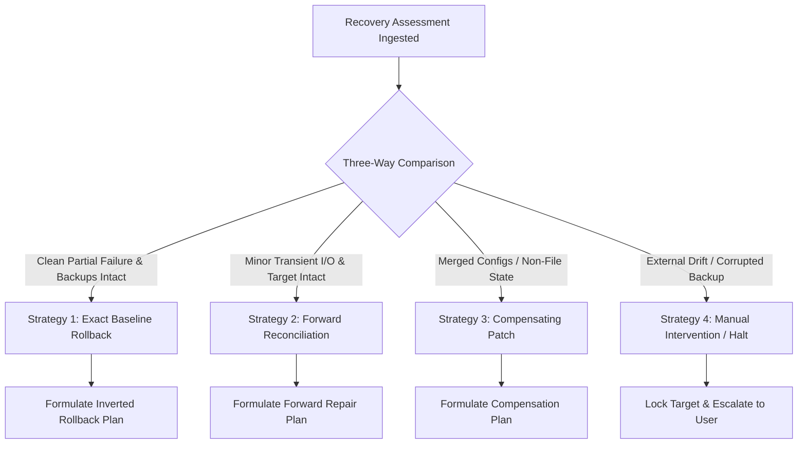

# Rollback Strategy Selection and Restoration Contract

**Document Identifier:** `NLE-CON-SSR-001`  
**Lifecycle Stage:** Content Pipeline Stage R Strategy & Restoration  
**Parent Document:** [HOST_GAME_MODIFICATION_RECOVERY_ROLLBACK_RESTORATION_AND_RECONCILIATION_SPECIFICATION.md](file:///d:/App%20Winrar%20Files/Nexludic%20Engine%20(working)/docs/content-pipeline/HOST_GAME_MODIFICATION_RECOVERY_ROLLBACK_RESTORATION_AND_RECONCILIATION_SPECIFICATION.md) (`NLE-SPC-MRR-001`)  
**System Status:** Authoritative Architectural Contract  
**Classification:** Recovery Strategy Selection & Restoration Procedures  

---

## 1. Purpose & Scope

The **Rollback Strategy Selection and Restoration Contract** establishes the decision framework for selecting an appropriate recovery response following an execution failure or target drift incident, and defines the operational contract for executing physical rollback operations.

Rollback must never be treated as a blind, mechanical reversal of an operation list. The selection of a recovery strategy requires mathematical proof that the selected actions are safe, that recovery sources are verified, and that external user content will not be harmed.

---

## 2. Recovery Strategy Selection Matrix

Stage R evaluates four candidate recovery strategies:

### 2.1 Strategy Definitions & Eligibility Criteria
1. **`STRAT_EXACT_ROLLBACK` (Exact Baseline Rollback):**
   - *Eligibility:* All committed `REPLACE`/`REMOVE` operations possess verified pre-mutation backups; all committed `ADD` operations have confirmed-absent tombstones; zero external drift detected.
   - *Outcome:* Target returned bit-for-bit to $S_{\text{orig}}$.
2. **`STRAT_FORWARD_REPAIR` (Forward Reconciliation):**
   - *Eligibility:* Failure occurred due to transient resource exhaustion; target baseline remains intact; re-running remaining operations is safe.
   - *Outcome:* Target progresses forward to intended state $S_{\text{int}}$.
3. **`STRAT_COMPENSATION` (Compensating Correction):**
   - *Eligibility:* Modifications involve non-reversible config merges or VFS mounts where byte-level inversion is not possible.
   - *Outcome:* Target transitioned to an approved, consistent alternative state.
4. **`STRAT_MANUAL_INTERVENTION` (Escalation & Lock):**
   - *Eligibility:* External modifications detected, backups corrupted, or state uncertainty exists.
   - *Outcome:* Modifications halted; target locked; diagnostic report surfaced to human operator.

---

## 3. Reverse Dependency Ordering Protocol

When `STRAT_EXACT_ROLLBACK` is selected, operations MUST execute in the **exact inverse topological order** of the original Application Plan DAG:

### 3.1 Operation Inversion Rules
- **Rollback of `ADD`:** Delete the newly introduced file, provided its current SHA-256 matches the package member digest and prior absence was verified.
- **Rollback of `REPLACE`:** Atomically restore the original file from the pre-mutation backup (`MoveFileEx` with replace).
- **Rollback of `REMOVE`:** Restore the original file from the pre-mutation backup.
- **Rollback of `NO_OP`:** Zero action required.

---

## 4. Contract Diagnostic Codes

| Code | Severity | Description | Action |
| :--- | :--- | :--- | :--- |
| `ERR_SSR_INVERSE_ORDER_CYCLE` | FATAL | Dependency cycle detected in rollback ordering | Abort rollback. Require manual intervention. |
| `ERR_SSR_NO_VIABLE_STRATEGY` | FATAL | No automated recovery strategy satisfies constraints | Lock target. Escalate to human operator. |
| `ERR_SSR_ROLLBACK_VERIF_FAILED` | FATAL | Restored file does not match pre-change SHA-256 | Halt rollback. Mark RECOVERY_FAILED. |
