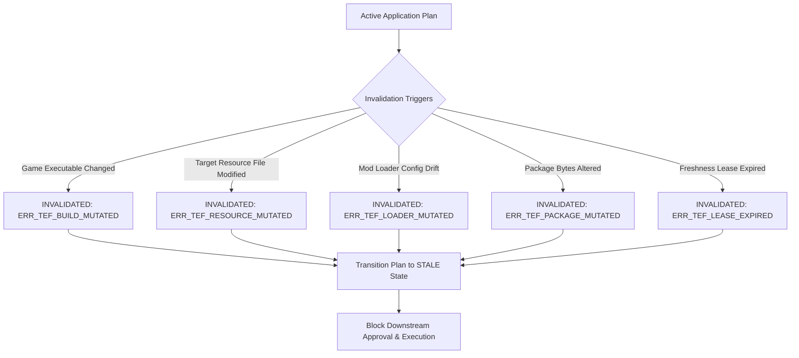

# Target State Evidence Freshness and Invalidation Policy

**Document Identifier:** `NLE-POL-TEF-001`  
**Lifecycle Stage:** Content Pipeline Stage I Policy & Governance  
**Parent Document:** [HOST_GAME_TARGET_VALIDATION_PACKAGE_MAPPING_AND_APPLICATION_PLANNING_SPECIFICATION.md](file:///d:/App%20Winrar%20Files/Nexludic%20Engine%20(working)/docs/content-pipeline/HOST_GAME_TARGET_VALIDATION_PACKAGE_MAPPING_AND_APPLICATION_PLANNING_SPECIFICATION.md) (`NLE-SPC-TVP-001`)  
**System Status:** Authoritative Architectural Policy  
**Classification:** Evidence Governance & Freshness Lifecycle  

---

## 1. Objective & Scope

The **Target State Evidence Freshness and Invalidation Policy** governs how NexLudic Engine collects, verifies, tracks, and invalidates target-state evidence during application planning. 

An application plan is only as safe as the target-state evidence supporting it. If the target game installation updates, if files are altered, or if mod loader configurations drift between plan generation and downstream review, the plan becomes structurally invalid and potentially dangerous. This policy enforces strict freshness standards and defines mandatory invalidation protocols.

---

## 2. Resource Existence State Taxonomy

To avoid catastrophic false assumptions regarding the target filesystem, the engine strictly distinguishes four distinct resource presence states:

```
+--------------------------------------------------------------------------------------------------+
|                            RESOURCE PRESENCE STATE TAXONOMY                                      |
+--------------------------------------------------------------------------------------------------+
|  1. CONFIRMED_ABSENT                                                                             |
|     - Cryptographic/filesystem observation confirms the path does NOT exist                      |
|     - Safe for ADD operations                                                                    |
+--------------------------------------------------------------------------------------------------+
|  2. CONFIRMED_PRESENT                                                                            |
|     - Verified present on disk; SHA-256 digest and file attributes recorded                      |
|     - Required for REPLACE, UPDATE, or NO_OP operations                                          |
+--------------------------------------------------------------------------------------------------+
|  3. UNKNOWN                                                                                      |
|     - No authoritative observation exists; path has not been inspected                           |
|     - MUST NEVER be assumed absent! (A missing observation != proof of absence)                  |
+--------------------------------------------------------------------------------------------------+
|  4. UNINSPECTABLE                                                                                |
|     - Path cannot be accessed due to permissions, locks, or containment policy                   |
|     - Blocks planning for any operation targeting this destination                               |
+--------------------------------------------------------------------------------------------------+
```

---

## 3. Evidence Freshness Bounds & Snapshot Tokens

1. **Target Evidence Snapshot (`TargetSnapshot`):** All planning operations must bind to an immutable, cryptographically hashed target evidence snapshot:
   $$\text{SnapshotToken} = \text{SHA256}(\text{TargetID} \mathbin{\Vert} \text{BuildID} \mathbin{\Vert} \text{Timestamp} \mathbin{\Vert} \text{ResourceDigestCatalog})$$
2. **Freshness Lease Window:** An active planning lease expires after a maximum duration of **1800 seconds (30 minutes)**. After expiration, the plan is marked `STALE_EXPIRED` and requires re-verification.
3. **Synthetic Fixture Bypass:** For synthetic CI/CD test runs, snapshots utilize mocked deterministic tokens with indefinite freshness.

---

## 4. Invalidation Triggers & Protocols

An application plan is immediately **invalidated** upon the occurrence of any of the following triggers:



### 4.1 Invalidation Severity & Remediation
- **Critical Invalidation (Game Update / Resource Mutation):** Requires a complete re-run of Stage I planning from scratch. Cached mapping results are purged.
- **Expiration Invalidation (Lease Timeout):** If a fast-path re-hash confirms the target state and package have not changed, the plan lease may be refreshed without full recomputation.

---

## 5. Policy Diagnostic Codes

| Code | Severity | Description | Action |
| :--- | :--- | :--- | :--- |
| `ERR_TEF_UNKNOWN_TREATED_AS_ABSENT` | FATAL | System attempted to treat UNKNOWN state as ABSENT | Abort planning. Audit evidence collector. |
| `ERR_TEF_BUILD_MUTATED` | FATAL | Target game build changed after snapshot capture | Invalidate plan. Re-run Stage I planning. |
| `ERR_TEF_RESOURCE_MUTATED` | FATAL | Target resource file digest altered | Invalidate plan. Re-run conflict analysis. |
| `ERR_TEF_PACKAGE_MUTATED` | FATAL | Source package physical digest altered | Invalidate plan. Re-verify package intake. |
| `ERR_TEF_LEASE_EXPIRED` | WARNING | Snapshot lease exceeded maximum time window | Refresh snapshot or revalidate hashes. |
