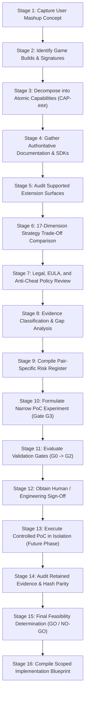

# NEXLUDIC ENGINE — TECHNICAL FEASIBILITY FRAMEWORK
## Document ID: NLE-FEAS-FRAMEWORK-001
**Phase:** 1 — Product Definition & Research  
**Step:** 6 of 100 — Technical Feasibility Strategy & Risk-Gated Validation Plan  
**Date:** November 16, 2026  
**Auditor / Architect:** Senior Feasibility & Game-Integration Systems Architect  
**Classification:** Research, Strategy & Governance Specification  

---

## 1. Executive Summary & Framework Purpose

NexLudic Engine is designed as a universal, AI-assisted platform that helps users plan, develop, validate, and manage integrations between disparate PC games. Because commercial PC games operate across radically different runtimes, compiled languages, anti-cheat boundaries, and intellectual property constraints, **the platform's universality applies to its evaluation and orchestration methodology, not to a blanket guarantee that every arbitrary game combination is technically possible or legally permissible**.

The purpose of this framework is to establish an objective, repeatable, and evidence-gated procedure for answering:
1. *Can a proposed pair of games be combined to achieve the user's specific requested outcomes?*
2. *Which technical integration strategy (Host-Game Modification, Live IPC Bridge, or Hybrid Integration) is appropriate?*
3. *What precise empirical evidence must be proven through controlled validation gates before any implementation code may be authored?*

---

## 2. The Four Tiers of Technical Reality

To prevent wishful thinking, premature commitments, and AI-generated hallucinations from corrupting the engineering baseline, NexLudic Engine evaluates all technical claims across four distinct epistemic tiers:

```
+----------------------------------------------------------------------------------------------------+
|                                    THE FOUR EPISTEMIC TIERS                                        |
+----------------------------------+-----------------------------------------------------------------+
| Epistemic Tier                   | Definition & Operational Threshold                              |
+----------------------------------+-----------------------------------------------------------------+
| 1. Theoretically Imaginable      | A gameplay crossover concept that can be articulated in natural |
|                                  | language, fiction, or video editing, but lacks any identified   |
|                                  | software mechanism in the target binaries.                      |
+----------------------------------+-----------------------------------------------------------------+
| 2. Technically Plausible         | An integration mechanism that aligns with known engine traits   |
|                                  | or general computing theory, but has not been verified against  |
|                                  | the specific game versions, memory layouts, or anti-cheat rules.|
+----------------------------------+-----------------------------------------------------------------+
| 3. Practically Implementable     | A capability supported by documented APIs, accessible modding   |
|                                  | frameworks, or working proof-of-concept scripts that operate    |
|                                  | within acceptable complexity, performance, and legal limits.    |
+----------------------------------+-----------------------------------------------------------------+
| 4. Independently Validated       | A capability proven through an executed, reproducible test on   |
|                                  | target game builds, with retained logs, measured performance,   |
|                                  | safe cleanup, and zero system destabilization.                  |
+----------------------------------+-----------------------------------------------------------------+
```

> [!CRITICAL]
> **Feasibility Threshold Rule:** No feature, integration approach, or game pair may be approved for production implementation (Gate G5/G6) unless it has reached **Tier 4 (Independently Validated)**. Tier 2 and Tier 3 status authorizes only scoped research or proof-of-concept experiments (Gate G3).

---

## 3. The 14 Core Feasibility Questions

Before accepting any proposed game pair for mashup implementation, NexLudic Engine must answer the following 14 questions with verifiable evidence:

1. **Exact Desired Outcomes:** What specific entities, mechanics, weapons, movement behaviors, UI overlays, or world events does the user want to transfer, combine, or synchronize?
2. **Host Selection:** Which game will serve as the primary execution runtime (Host), or must both games run concurrently?
3. **Documented Extension Surfaces:** Can either game expose the required capabilities through documented, publisher-supported, or established community extension interfaces?
4. **Toolchain Version Alignment:** Are required mod loaders, SDKs, compilers, or scripting runtimes actively maintained and compatible with the user's exact installed game patch?
5. **Runtime Lifecycle Compatibility:** Can the integration function within the games' normal tick rates, thread models, memory budgets, and process lifetimes without causing deadlocks?
6. **Data Transport Safety:** Can the required data be exchanged over local IPC (Named Pipes) with sub-5 ms latency, zero network port exposure, and no memory corruption?
7. **System Footprint & Persistence:** Does the integration require modifying game files, injecting native DLLs, synthesizing input, or running external daemons?
8. **Dependency on Undocumented Internals:** Does any requested feature depend on volatile memory offsets, reverse-engineered private symbols, or undocumented engine bugs?
9. **Legal, EULA, and Anti-Cheat Compliance:** Are the game's licensing terms, modding guidelines, intellectual property restrictions, and anti-cheat drivers compatible with the proposed approach?
10. **Controlled Proof-of-Concept:** Can the critical technical assumption be tested in a small, isolated, 100% reversible experiment before full development begins?
11. **Failure, Crash, and Disconnect Recovery:** What happens when either game crashes, updates, loses focus, or terminates unexpectedly? Does the platform recover gracefully?
12. **Identification of Infeasible Features:** Which specific user-requested requirements cannot be achieved under current constraints, and what are the realistic fallback alternatives?
13. **Implementation Approval Evidence:** What exact test outputs, exit codes, and performance measurements constitute sufficient proof to authorize implementation?
14. **Immediate Rejection Triggers:** What findings (e.g. kernel anti-cheat, encrypted DRM, unmoddable runtime) require immediate rejection of the proposed strategy?

---

## 4. Game-Pair Feasibility Profile Specification

Every candidate game pair submitted to NexLudic Engine is compiled into a standardized, versioned profile comprising four core analytical sections:

### 4.1 Game Identity & Environment Signatures
Captures immutable metadata for both Game A and Game B:
- **Title, Developer, Publisher:** Formal entity names.
- **Platform & Operating System:** Target OS architecture (e.g. Windows 11 x64 Build 26100).
- **Exact Edition & Build Number:** Specific patch version (e.g. `v1.21.1` vs `v1.20.4`), executable name (`javaw.exe`, `Spider-Man.exe`), and SHA-256 binary hash.
- **Engine & Runtime:** Verified engine technology (e.g. JVM/LWJGL, REDengine 4, Unreal Engine 4.27, RAGE, Unity IL2CPP).
- **Distribution Store & Launcher:** Steam, Epic Games Store, GOG Galaxy, Xbox App, or Standalone (determines file permissions, path structures, and DRM wrappers).
- **Protection & Anti-Cheat Profile:** Active integrity monitors (VAC, Easy Anti-Cheat, BattlEye, Vanguard, Denuvo, or None).

### 4.2 Atomic Gameplay Capability Decomposition
Users frequently describe mashups in broad, romantic terms (e.g. *"Put Spider-Man into Minecraft"*). The feasibility engine decomposes broad requests into atomic, testable capability units (`CAP-###`).

For every capability, the profile defines:
- **Capability ID & Short Name:** Stable identifier (e.g. `CAP-SWING-001: Web Raycast Anchor`).
- **User-Visible Behavior:** Observable in-game action.
- **Inputs & Outputs:** Parameter schemas (e.g. camera vector in -> block hit coordinate out).
- **Responsible Component:** Which game or bridge module executes the logic.
- **Latency & Performance Budget:** Maximum acceptable processing time (e.g. <16.6 ms for per-frame physics).
- **Validation Method:** Automated unit test, headless simulation, or guided manual checklist.
- **Fallback Behavior:** Graceful degradation if the feature cannot be implemented.

### 4.3 Game Accessibility & Modification Surface
Audits the accessible technical interface for both titles, categorizing surfaces into five legal and engineering levels:
- **Level 1 (Officially Supported APIs):** Publisher SDKs, Radiant mod tools, official telemetry UDP ports, Steam Workshop.
- **Level 2 (Established Community Loaders):** Open-source frameworks operating via documented hooks (FabricMC, BepInEx, RE-UE4SS, Cyber Engine Tweaks).
- **Level 3 (Publicly Documented Reverse-Engineered Hooks):** Community ASI loaders (Script Hook RDR2), memory-mapped telemetry taps.
- **Level 4 (Unverified / Volatile Internals):** Memory pattern scanning (AOB), raw vtable hooking, undocumented private engine structures.
- **Level 5 (Prohibited / Hostile Surfaces):** Kernel-level hooks, anti-cheat bypasses, DRM cracking, memory tampering in multiplayer games.

### 4.4 Version Drift & Maintenance Exposure
Evaluates the longevity of the integration against updates:
- **Patch Frequency:** Live-service titles (frequent updates breaking offsets) vs. completed single-player titles (stable baselines).
- **Deobfuscation Dependency:** Reliance on third-party mapping updates (e.g. Fabric Yarn mappings).
- **Version-Pinning Strategy:** Restricting mod loading to explicitly tested build hashes to prevent game crashes after auto-updates.

---

## 5. The Three-Approach Evaluation Methodology

NexLudic Engine systematically evaluates every candidate game pair across three candidate strategies:

```
+----------------------------------------------------------------------------------------------------+
|                                    THREE-APPROACH EVALUATION MATRIX                                 |
+--------------------------+---------------------------------+---------------------------------------+
| Approach                 | Architectural Paradigm          | Typical Applicability                 |
+--------------------------+---------------------------------+---------------------------------------+
| **Approach A:**          | Single-process in-engine mod    | When one game has a mature modding    |
| **Host-Game Mod**        | running inside a moddable Host. | framework (Fabric, CET, BepInEx).     |
|                          | Guest mechanics re-implemented. | Best visual fidelity and zero IPC lag.|
+--------------------------+---------------------------------+---------------------------------------+
| **Approach B:**          | Dual-process concurrent bridge  | When both games run simultaneously,   |
| **Live IPC Bridge**      | exchanging live telemetry/inputs| exposing telemetry or accepting inputs|
|                          | via local Named Pipes.          | (e.g. Rocket League + Cyberpunk).     |
+--------------------------+---------------------------------+---------------------------------------+
| **Approach C:**          | Host game is modded with custom | When deep visual integration in Host  |
| **Hybrid Integration**   | entities, connected to active   | requires live event feeds from a      |
|                          | secondary game via IPC bridge.  | running secondary game.               |
+--------------------------+---------------------------------+---------------------------------------+
```

### The 17 Evaluation Dimensions
Every approach is evaluated against 17 rigorous dimensions before a strategy is recommended:

| # | Dimension | Evaluation Standard |
| :--- | :--- | :--- |
| **01** | **Technical Access** | Are required extension hooks documented, available, and verified on target builds? |
| **02** | **Feature Coverage** | What percentage of requested capabilities (`CAP-###`) can be achieved? |
| **03** | **Integration Complexity** | Qualitative development effort (Low, Moderate, High, Extreme). |
| **04** | **Runtime Compatibility** | Does the approach operate within target memory, thread, and OS lifecycle models? |
| **05** | **Cross-Language Support** | Can components use idiomatic languages (Java for Fabric, C++ for hooks, Lua for CET)? |
| **06** | **Data Exchange** | What payloads are transmitted, and is framing/schema validation enforced? |
| **07** | **Latency Suitability** | Does the response time fit the mechanic (sub-16 ms for physics, sub-100 ms for events)? |
| **08** | **State Synchronization** | Can coordinate systems, tick rates, and entity state machines be reconciled without drift? |
| **09** | **Failure Containment** | Can one component or game crash without destabilizing the host platform? |
| **10** | **Deployment Friction** | Does setup require simple file drops or complex manual tool installations? |
| **11** | **Maintainability** | How fragile is the integration against minor game patches and loader updates? |
| **12** | **Security & Privileges** | Can the approach execute under standard Windows user rights without UAC elevation? |
| **13** | **Licensing Compliance** | Are source code licenses, distribution rules, and EULAs fully respected? |
| **14** | **Multiplayer / Anti-Cheat** | Is the integration 100% compliant with single-player and anti-cheat policies? |
| **15** | **Testability** | Can core behaviors be verified headlessly via automated test harnesses? |
| **16** | **Atomic Reversibility** | Can all files be uninstalled and restored to vanilla state with 100% hash parity? |
| **17** | **User Experience** | Can setup, status, warnings, and error recovery be communicated clearly to users? |

---

## 6. Evidence Classification & Rules of Governance

All engineering claims within NexLudic Engine must adhere to a standardized evidence classification model:

```
+----------------------------------------------------------------------------------------------------+
|                                    EVIDENCE CLASSIFICATION MODEL                                   |
+--------------------------+-------------------------------------------------------------------------+
| Classification           | Evidence Criteria                                                       |
+--------------------------+-------------------------------------------------------------------------+
| **Verified**             | Supported by authoritative vendor docs, inspected repository source, or |
|                          | an executed reproducible test with retained logs and artifacts.         |
+--------------------------+-------------------------------------------------------------------------+
| **Strongly Supported**   | Documented by credible community maintainers for adjacent versions, but |
|                          | not yet empirically executed against the exact target patch.            |
+--------------------------+-------------------------------------------------------------------------+
| **Plausible Unverified** | Technically reasonable based on engine architecture, but lacking direct |
|                          | API documentation, offsets, or proof-of-concept verification.           |
+--------------------------+-------------------------------------------------------------------------+
| **Unknown**              | Insufficient data available to make an engineering determination.       |
+--------------------------+-------------------------------------------------------------------------+
| **Unsupported**          | Technical barriers (lack of mod loader, closed engine, focus lock)      |
|                          | prevent implementation under the stated constraints.                    |
+--------------------------+-------------------------------------------------------------------------+
| **Prohibited / Blocked** | Conflicts with legal EULAs, active kernel anti-cheat, or platform       |
|                          | security rules (e.g. memory injection in online multiplayer).           |
+--------------------------+-------------------------------------------------------------------------+
```

### The 10 Mandatory Evidence Rules
1. **Assumption != Verification:** An architect's assumption or intuition is never evidence.
2. **AI Output != Proof:** An AI coding agent generating code or claiming an API exists is an unverified hypothesis, not proof.
3. **Videos Establish Observable Claims Only:** Video demonstrations prove only what is visually observable on screen; they do not prove underlying architectural cleanliness or universal compatibility.
4. **Version Precision Required:** API availability claims must specify the exact patch version and runtime build tested.
5. **No Version Generalization:** Verifying compatibility on Game Version X does not prove compatibility on Version Y.
6. **Absence of Source != Absence of Feature:** An unavailable document must be marked "Unavailable / Research Required," not treated as proof of impossibility.
7. **Documented Disagreements:** Conflicting technical reports must be logged explicitly in the risk register rather than silently resolved in favor of convenience.
8. **Preserve Uncertainty:** If evidence is incomplete, the final rating must remain *Conditional*, *Hold*, or *Plausible Unverified*.
9. **Mandatory Citation Trails:** Every material claim must cite a verified URL, official doc chapter, or local test artifact log.
10. **Zero Premature Success Claims:** No feature may be marked "Supported" or "Operational" until physically demonstrated in a passing test.

---

## 7. The 11-State Feature Support Model

NexLudic Engine tracks every atomic gameplay capability (`CAP-###`) through an explicit lifecycle state model:

```
+----------------------------------------------------------------------------------------------------+
|                                    FEATURE SUPPORT STATE TAXONOMY                                  |
+----+-----------------------------+-----------------------------------------------------------------+
| #  | State                       | Definition & Required Evidence Transition Boundary              |
+----+-----------------------------+-----------------------------------------------------------------+
| 01 | **Not Evaluated**           | Requirement identified by user; research not yet initiated.     |
| 02 | **Research Required**       | Initial review reveals missing documentation or version ambiguity|
| 03 | **Supported by Docs**       | Official or community documentation confirms API hook exists.   |
| 04 | **Prototype Validated**     | Narrow proof-of-concept passes Gate G4 in isolated test rig.    |
| 05 | **Integration Validated**   | Feature operates cleanly inside full NexLudic Engine workflow.  |
| 06 | **Regression Tested**       | Feature passes automated regression suite across multiple builds|
| 07 | **Partially Supported**     | Core mechanic works; secondary attributes (e.g. sound) degraded.|
| 08 | **Unsupported**             | Technical barriers prevent implementation; fallback suggested.  |
| 09 | **Prohibited**              | Blocked due to anti-cheat, copyright, or security policies.     |
| 10 | **Temporarily Unavailable** | Broken by recent upstream game patch; awaiting adapter update.  |
| 11 | **Deprecated**              | Legacy integration superseded by a superior architectural route.|
+----+-----------------------------+-----------------------------------------------------------------+
```

---

## 8. Decision Determination & Stop Rules

Every feasibility assessment concludes with one of six definitive determinations:

```
+----------------------------------------------------------------------------------------------------+
|                                      FEASIBILITY DETERMINATIONS                                    |
+---------------------+------------------------------------------------------------------------------+
| Determination       | Operational Meaning & Permitted Action                                       |
+---------------------+------------------------------------------------------------------------------+
| **GO**              | All mandatory capabilities reach Tier 4 (Validated); risks mitigated;       |
|                     | authorize scoped implementation planning (Gate G5).                          |
+---------------------+------------------------------------------------------------------------------+
| **CONDITIONAL GO**  | Core capabilities validated; secondary features unverified; proceed solely  |
|                     | within explicit capability boundaries with user-acknowledged limits.         |
+---------------------+------------------------------------------------------------------------------+
| **HOLD**            | Critical unknowns remain unresolved (e.g. missing version mapping); halt all |
|                     | implementation until targeted research experiment is executed.               |
+---------------------+------------------------------------------------------------------------------+
| **REDESIGN**        | Current strategy is unviable (e.g. Strategy B blocked by anti-cheat), but    |
|                     | an alternative strategy (Strategy A Host Mod) shows strong promise.          |
+---------------------+------------------------------------------------------------------------------+
| **NO-GO**           | Technical, security, or legal barriers make the mashup impossible under     |
|                     | platform standards; reject integration and report reasons honestly.          |
+---------------------+------------------------------------------------------------------------------+
| **PARTIAL SUPPORT** | Explicit subset of capabilities approved for implementation; all unsupported |
|                     | features clearly marked as disabled in the blueprint.                        |
+---------------------+------------------------------------------------------------------------------+
```

### Mandatory Stop Conditions
The platform must immediately halt evaluation and issue a **NO-GO** or **REDESIGN** if:
1. Target game enforces active kernel-level anti-cheat in the intended mode (`REQ-SAFE-001`).
2. Implementation requires bypassing DRM, decrypting protected executables, or modifying unauthorized code.
3. Implementation requires bundling or redistributing copyrighted commercial assets (`REQ-MOD-003`).
4. Proof-of-concept cannot be executed safely or reversed with 100% hash parity (`REQ-PKG-002`).
5. Critical technical assumption relies on unverified memory offsets or fabricated APIs.

---

## 9. End-to-End Feasibility Workflow (16 Stages)

The complete lifecycle from user concept to authorized implementation plan:



---

## 10. Cost & Maintenance Estimation Methodology

Integration effort varies wildly between two superficially similar game pairs. NexLudic Engine employs a multi-factor qualitative estimation model:

| Cost / Effort Factor | Low Effort Drivers | High / Extreme Effort Drivers |
| :--- | :--- | :--- |
| **Extension Surface** | Open mod loader (Fabric, BepInEx), documented SDK | Closed proprietary C++ binary, zero scripting |
| **Toolchain Vitality** | Active open-source community, stable Gradle plugin | Abandoned tools, manual hex pattern scanning |
| **Asset Pipeline** | Native JSON models, OGG audio, standard PNGs | Encrypted proprietary archives (`.toc`, `.rpf`) |
| **Execution Domain** | Strategy A (Single game runtime) | Strategy B/C (Dual running games, live IPC) |
| **Patch Sensitivity** | Single-player game with frozen update cycle | Live-service online game patching weekly |
| **Testing Harness** | Headless automated simulation possible | Requires human gameplay verification in 3D world |

---

## 11. Scenario-Based Framework Verification

To verify that the framework reaches robust, sensible engineering determinations, eight representative hypothetical scenarios were evaluated:

### Scenario 1: Well-Documented Modding API
- *Context:* Minecraft Java Edition adding custom western weapons inspired by RDR2.
- *Evidence Status:* **Verified** (Fabric API Item & Entity hooks documented).
- *Gate Outcome:* **Gate G0–G2 Passed; G3 PoC Authorized**.
- *Supported Feature Subset:* 100% of weapon, projectile, and HUD mechanics.
- *Determination:* **GO (Strategy A Host Mod)**.

### Scenario 2: Limited Feature Subset Accessible
- *Context:* Extracting vehicles from a racing game into an open-world RPG. Vehicle models can be imported, but complex tire deformation physics cannot be supported by the host engine.
- *Evidence Status:* Asset replacement verified; physics transfer unsupported.
- *Gate Outcome:* **Conditional Pass**.
- *Supported Feature Subset:* Visual vehicle models and basic arcade driving physics supported; simulation tire physics marked unsupported.
- *Determination:* **PARTIAL SUPPORT (Conditional GO with transparent limitations)**.

### Scenario 3: Critical Surface Undocumented
- *Context:* Attempting to dynamically hook real-time ragdoll physics from a closed proprietary title with no public symbols.
- *Evidence Status:* **Unknown / Plausible Unverified**.
- *Gate Outcome:* **Hold at Gate G1**.
- *Next Permitted Action:* Scoped reverse-engineering research spike; zero code generation permitted.
- *Determination:* **HOLD**.

### Scenario 4: Anti-Cheat Conflict
- *Context:* User requests live telemetry bridge reading player health from a competitive multiplayer game protected by Easy Anti-Cheat.
- *Evidence Status:* **Prohibited / Blocked** (EAC detects external process handles).
- *Gate Outcome:* **Fail at Gate G1**.
- *Determination:* **NO-GO (Hard Block; Anti-Cheat Violation)**. Platform refuses live hooking.

### Scenario 5: IPC Exists, Gameplay Mechanics Irreproducible
- *Context:* Two games establish a sub-millisecond Named Pipe connection, but the target game cannot spawn custom 3D geometries at runtime.
- *Evidence Status:* Transport verified; game capability unsupported.
- *Gate Outcome:* **Fail at Gate G2**.
- *Determination:* **REDESIGN (Switch from Strategy B live bridge to Strategy A host mod)**.

### Scenario 6: Game Update Destabilizes Integration
- *Context:* Host game auto-updates from v1.20 to v1.21, invalidating mod loader obfuscation mappings and crashing on boot.
- *Evidence Status:* **Regression Detected (Tier 2 Launch Failure)**.
- *Gate Outcome:* **Demoted to Temporarily Unavailable**.
- *Action:* Automatic rollback to pre-mod backup; platform locks mod until updated adapter mappings are verified.
- *Determination:* **HOLD / ROLLBACK**.

### Scenario 7: PoC Passes Technically, Distribution Blocked
- *Context:* Mashup mod compiles and runs perfectly in private testing, but user requests bundling 5 GB of proprietary high-res textures for public download.
- *Evidence Status:* Technical feasibility verified; legal distribution prohibited.
- *Gate Outcome:* **Fail at Gate G6 (Release Eligibility)**.
- *Action:* Enforce Non-Distributive Asset Policy (`REQ-MOD-003`); package contains only code and a local user-directed extraction script.
- *Determination:* **CONDITIONAL GO (Non-distributive local package only)**.

### Scenario 8: Dual Extension Surfaces with Unacceptable Sync Complexity
- *Context:* User requests synchronizing every frame of a 60 fps combat simulation across two separate running 3D engines over IPC.
- *Evidence Status:* Both games moddable; real-time lockstep state sync causes intolerable visual stutter and thread deadlocks.
- *Gate Outcome:* **Fail at Gate G2**.
- *Determination:* **REDESIGN (Recommend Strategy A host mod or reduce sync frequency to high-level match events)**.

