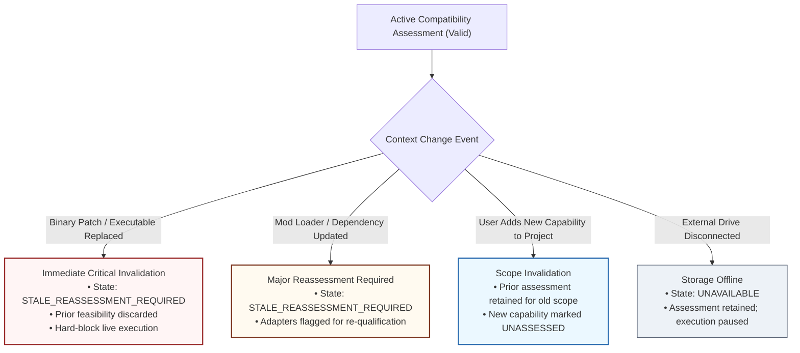

# Compatibility Assessment Output & Reassessment Specification

**Document ID:** `NLE-SPC-CAO-001`  
**Version:** `1.0.0`  
**Status:** `APPROVED`  
**Workstream:** `Cross-Game Compatibility Assessment Framework, Assessment Unit Modeling, Decision Rules, Multi-Dimensional Evaluation, and Strategy Comparison`  
**Phase:** `4 of 12 — Game Discovery & Compatibility Intelligence`  
**Step:** `29 of 100`  
**Related Documents:**
- [CROSS_GAME_COMPATIBILITY_ASSESSMENT_FRAMEWORK.md](file:///d:/App%20Winrar%20Files/Nexludic%20Engine%20(working)/docs/game-discovery/CROSS_GAME_COMPATIBILITY_ASSESSMENT_FRAMEWORK.md) (`NLE-SPC-CAC-001`)
- [COMPATIBILITY_DIMENSION_AND_REQUIREMENT_COVERAGE_CATALOG.md](file:///d:/App%20Winrar%20Files/Nexludic%20Engine%20(working)/docs/game-discovery/COMPATIBILITY_DIMENSION_AND_REQUIREMENT_COVERAGE_CATALOG.md) (`NLE-CAT-CDC-001`)
- [CROSS_GAME_COMPATIBILITY_DECISION_TABLES.md](file:///d:/App%20Winrar%20Files/Nexludic%20Engine%20(working)/docs/game-discovery/CROSS_GAME_COMPATIBILITY_DECISION_TABLES.md) (`NLE-TAB-CCD-001`)
- [ENVIRONMENT_CHANGE_AND_STALE_ASSESSMENT_POLICY.md](file:///d:/App%20Winrar%20Files/Nexludic%20Engine%20(working)/docs/game-discovery/ENVIRONMENT_CHANGE_AND_STALE_ASSESSMENT_POLICY.md) (`NLE-POL-ECS-001`)

---

## 1. Executive Summary & Purpose

This specification defines the structured output schema, user-facing explanation contract, persistence architecture, and reassessment invalidation hooks for compatibility assessments within **NexLudic Engine**.

Compatibility results must serve two audiences simultaneously: they must provide machine-readable contracts for downstream adapter generators and test harnesses, and they must deliver transparent, plain-language explanations to desktop users. This document formalizes the structured assessment report, establishes an immutable append-only audit trail, and defines the triggers that transition prior assessments into stale or invalidated states.

---

## 2. Structured Assessment Output Schema

The output of an assessment operation is represented as a structured JSON object stored on Volume D (`D:\NexLudic\Projects\<project-id>\Environment\latest_assessment.json`):

```json
{
  "assessment_id": "7c9e6679-7425-40de-944b-e07fc1f90ae7",
  "project_id": "d3b07384-d113-4660-8456-42d744f4e240",
  "assessment_revision": 1,
  "evaluated_at_utc": "2026-11-17T18:24:00Z",
  "status": "SUPPORTED",
  "eligibility_gate": "GATE_3_EXECUTION_PLANNING",
  "participants": {
    "game_a": {
      "canonical_title": "The Elder Scrolls V: Skyrim",
      "edition": "Special Edition",
      "distribution": "STEAM",
      "build_id": "1.6.640.0.8",
      "architecture": "X86_64",
      "verification_state": "VERSION_VERIFIED"
    },
    "game_b": {
      "canonical_title": "Baldur's Gate 3",
      "edition": "Standard Edition",
      "distribution": "GOG",
      "build_id": "Patch 7 (v4.1.1.5849914)",
      "architecture": "X86_64",
      "verification_state": "VERSION_VERIFIED"
    }
  },
  "strategy_evaluation": {
    "recommended_strategy": "LIVE_INTEROP_BRIDGE",
    "selected_ipc_channel": "LOCAL_NAMED_PIPES",
    "justification": "Provides real-time bidirectional quest sync with full process isolation and zero asset extraction burden."
  },
  "dimensional_findings": {
    "identity_certainty": "CONFIRMED_VERIFIED",
    "capability_availability": "CAPABILITY_ESTABLISHED",
    "cross_game_interaction": "INTERACTION_FEASIBLE",
    "dependency_compatibility": "DEPENDENCIES_SATISFIED",
    "stability_performance": "STABLE_LOW_RISK",
    "authorization_security": "PERMITTED_COMPLIANT",
    "requirement_coverage": "FULL_COVERAGE"
  },
  "capability_coverage": [
    {
      "capability_key": "cap:sync_gold",
      "status": "FEASIBLE_VERIFIED",
      "supporting_evidence_ids": ["ev-98a1-b2c3"]
    },
    {
      "capability_key": "cap:quest_status_mirror",
      "status": "FEASIBLE_VERIFIED",
      "supporting_evidence_ids": ["ev-77d4-e5f6"]
    }
  ],
  "critical_blockers": [],
  "user_explanation": {
    "headline": "Full Integration Supported via Live Bridge",
    "summary": "Both game installations are verified. Live Interoperability Bridge satisfies 100% of requested capabilities.",
    "actionable_next_step": "Proceed to Step 30: Adapter Repertoire Configuration."
  }
}
```

---

## 3. User-Facing Explanation Generation Contract

To prevent confusion and build user trust, the UI presentation layer must generate plain-language explanations following strict semantic templates:

| Outcome Status | Explanation Template | Example Rendered Output |
| :--- | :--- | :--- |
| **`SUPPORTED`** | `[Participants] are verified. [Strategy] satisfies 100% of requested capabilities with proven evidence.` | *"Skyrim SE and Baldur's Gate 3 are verified. Live Interoperability Bridge satisfies 100% of requested capabilities with proven evidence."* |
| **`PARTIALLY_SUPPORTED`** | `[Mandatory Capabilities] are supported via [Strategy]. [Missing Capabilities] lack documented hooks or evidence.` | *"Gold and Quest sync are supported via Live Bridge. Dynamic Weather Sync lacks documented engine hooks in Baldur's Gate 3."* |
| **`INSUFFICIENT_EVIDENCE`**| `Exploratory analysis complete. [Game] installation build is unverified. Verification required before execution.` | *"Exploratory analysis complete. Skyrim SE installation build is unverified. Locate game folder in Environment settings to proceed."* |
| **`UNSUPPORTED`** | `Integration is unsupported under current builds due to [Technical Blocker]. Recommended action: [Mitigation].` | *"Integration is unsupported under current builds due to 32-bit / 64-bit architecture mismatch. Select 'Live Bridge' to coordinate via IPC."* |
| **`PROHIBITED_BLOCKED`** | `Integration blocked by security policy. [Game] employs active [Security Control]. Modification is prohibited.` | *"Integration blocked by security policy. Destiny 2 employs active BattlEye anti-cheat. Interfacing with anti-cheat titles is prohibited."* |
| **`STALE_REASSESSMENT`** | `Previous findings are stale. [Participant] was updated on disk ([Change]). Reassessment required.` | *"Previous findings are stale. Skyrim SE was updated on disk by Steam (build changed to 1.6.1170). Reassessment required."* |

---

## 4. Reassessment Triggers & Invalidation Hooks

Assessment records are not permanent; their validity is bounded by contextual triggers:



1. **Immediate Invalidation Events (`TRG-INV-01`):**
   - Detection of modified primary binary hash or executable timestamp (`LocalInstallationInstance.file_timestamp_utc`).
   - Modification of target binary bitness (e.g. game patch migrates to x64).
2. **Major Reassessment Events (`TRG-INV-02`):**
   - Mod loader version update (e.g. SKSE64 upgraded from 2.2.3 to 2.2.4).
   - Ingestion of a newer Tier 1 test log showing failure on the active build.
3. **Scope Invalidation Events (`TRG-INV-03`):**
   - User adds or removes capabilities in the Project Workspace settings.
   - User toggles target strategy from Live Bridge to Host Modification.

---

## 5. Historical Record Immutability & Audit Trail

1. **Append-Only History:** Whenever an assessment is invalidated and re-evaluated, the old assessment record is appended to:
   `D:\NexLudic\Projects\<project-id>\Environment\assessment_history.jsonl`
2. **Zero Overwrite Policy:** Past evaluations are never overwritten, deleted, or retroactively edited.
3. **Traceability Pointers:** The new assessment increments `assessment_revision` and includes a `supersedes_assessment_id` pointer referencing the historical record.

---

## 6. Document Sign-Off & Verification

| Role | Reviewer | Verdict | Date |
| :--- | :--- | :--- | :--- |
| **Principal Software Architect** | Engine Architecture Team | Approved | 2026-11-17 |
| **Lead Desktop UX Architect** | Workspace Experience Team | Approved | 2026-11-17 |
| **Senior System Reliability Engineer**| Platform Operations | Approved | 2026-11-17 |

