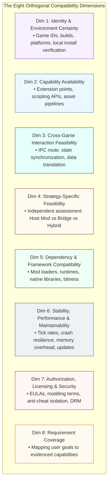

# Compatibility Dimension & Requirement Coverage Catalog

**Document ID:** `NLE-CAT-CDC-001`  
**Version:** `1.0.0`  
**Status:** `APPROVED`  
**Workstream:** `Cross-Game Compatibility Assessment Framework, Assessment Unit Modeling, Decision Rules, Multi-Dimensional Evaluation, and Strategy Comparison`  
**Phase:** `4 of 12 — Game Discovery & Compatibility Intelligence`  
**Step:** `29 of 100`  
**Related Documents:**
- [CROSS_GAME_COMPATIBILITY_ASSESSMENT_FRAMEWORK.md](file:///d:/App%20Winrar%20Files/Nexludic%20Engine%20(working)/docs/game-discovery/CROSS_GAME_COMPATIBILITY_ASSESSMENT_FRAMEWORK.md) (`NLE-SPC-CAC-001`)
- [GAME_ENVIRONMENT_PROFILE_AND_COMPATIBILITY_CONTEXT_MODEL.md](file:///d:/App%20Winrar%20Files/Nexludic%20Engine%20(working)/docs/game-discovery/GAME_ENVIRONMENT_PROFILE_AND_COMPATIBILITY_CONTEXT_MODEL.md) (`NLE-DOM-ENV-001`)
- [COMPATIBILITY_EVIDENCE_QUALITY_AND_CONFLICT_RULES.md](file:///d:/App%20Winrar%20Files/Nexludic%20Engine%20(working)/docs/game-discovery/COMPATIBILITY_EVIDENCE_QUALITY_AND_CONFLICT_RULES.md) (`NLE-RUL-CEQ-001`)
- [CROSS_GAME_COMPATIBILITY_DECISION_TABLES.md](file:///d:/App%20Winrar%20Files/Nexludic%20Engine%20(working)/docs/game-discovery/CROSS_GAME_COMPATIBILITY_DECISION_TABLES.md) (`NLE-TAB-CCD-001`)

---

## 1. Executive Summary & Purpose

This catalog defines the multi-dimensional assessment matrix used by **NexLudic Engine** to evaluate cross-game compatibility. Rather than forcing heterogeneous engineering realities into a single artificial score, the framework evaluates compatibility across eight orthogonal dimensions.

Each dimension defines its purpose, prerequisite inputs, evidence expectations, evaluation criteria, possible findings, and its specific impact on the user's mashup requirements.

---

## 2. The Eight Compatibility Dimensions

---

## 3. Detailed Dimension Specifications

### 3.1 Dimension 1: Identity & Environment Certainty
- **Definition:** The degree of factual certainty established regarding the identities, releases, builds, platforms, and verified local installations of both participant games.
- **Prerequisite Data:** Catalog references (`CanonicalGameId`), detected `GameVersionBuild`, verified `LocalInstallationInstance` (from Step 27).
- **Expected Evidence:** PE headers (`VS_FIXEDFILEINFO`), manifest files (Steam `.acf`, GOG `goglog.ini`, Epic `.item`), cryptographic SHA-256 digests.
- **Possible Findings:**
  - `CONFIRMED_VERIFIED`: Canonical identity, exact build, and local binary integrity are 100% verified.
  - `PARTIALLY_IDENTIFIED`: Game title known, but specific build or distribution channel is unconfirmed.
  - `UNVERIFIED_DECLARATION`: User asserts game is installed, but no folder or binary verified on disk.
  - `AMBIGUOUS_CONFLICT`: Multiple candidate builds or conflicting files detected.
- **Requirement Impact:** A finding lower than `CONFIRMED_VERIFIED` restricts downstream conclusions to exploratory analysis and hard-blocks code generation or runtime launch.

### 3.2 Dimension 2: Capability Availability
- **Definition:** The existence and accessibility of technical extension mechanisms, scripting hooks, and content pipelines in each game independently.
- **Prerequisite Data:** Target game engine identity, binary architecture (x86 vs x64), documented modding interfaces.
- **Expected Evidence:** Official SDK headers, script engine documentation (e.g. Papyrus, Lua, C# Mono), known hook points.
- **Possible Findings:**
  - `CAPABILITY_ESTABLISHED`: Verified extension API or script engine exists and is accessible.
  - `CAPABILITY_RESTRICTED`: Engine features limited modding (e.g. basic texture swap only; no runtime code execution).
  - `CAPABILITY_ABSENT`: Engine is a sealed monolithic binary with no external hooks.
  - `CAPABILITY_UNASSESSED`: No documentation available for this engine or build.
- **Requirement Impact:** If a requested feature (e.g. live quest tracking) requires runtime scripting, and Game A is `CAPABILITY_RESTRICTED` (texture-only), the requirement is flagged as `BLOCKED_BY_CAPABILITY_GAP`.

### 3.3 Dimension 3: Cross-Game Interaction Feasibility
- **Definition:** The technical plausibility of transferring state, synchronizing ticks, or sharing content between the two specific game environments.
- **Prerequisite Data:** Dual environment profiles (`GamePairIntegrationContext`), communication channel specification.
- **Expected Evidence:** Benchmarked IPC protocols (Named Pipes, Shared Memory, WebSockets), serialization schemas, timing models.
- **Possible Findings:**
  - `INTERACTION_FEASIBLE`: Low-latency, thread-safe communication route established between processes.
  - `INTERACTION_ASYMMETRIC`: Feasible in one direction (e.g. Game A can emit events to Game B, but Game B cannot inject state into Game A).
  - `INTERACTION_TIMING_HAZARD`: High risk of deadlock, frame stutter, or watch-dog timeouts due to incompatible event loops.
  - `INTERACTION_UNSUPPORTED`: No viable communication channel without hooking protected process memory.
- **Requirement Impact:** Dictates whether real-time synchronization or asynchronous file-based handoffs must be employed.

### 3.4 Dimension 4: Strategy-Specific Feasibility
- **Definition:** Independent evaluation of the three architectural approaches: Host-Game Modification, Live Interoperability Bridge, and Hybrid Integration.
- **Prerequisite Data:** Defined user mashup requirements, capability mappings for both games.
- **Expected Evidence:** Architectural trade-off analysis, adapter availability records.
- **Possible Findings:**
  - Evaluated independently for each strategy: `STRATEGY_RECOMMENDED`, `STRATEGY_VIABLE_WITH_TRADE_OFFS`, `STRATEGY_DEFERRED`, `STRATEGY_EXCLUDED`.
- **Requirement Impact:** Prevents arbitrarily assuming that one strategy fits all mashups.

### 3.5 Dimension 5: Dependency & Framework Compatibility
- **Definition:** The availability, version compatibility, and co-existence of required external frameworks, mod loaders, and platform runtimes.
- **Prerequisite Data:** Required loaders (e.g. SKSE64, ScriptHookV, UE4SS), runtimes (.NET 8.0 Desktop, VC++ Redistributable).
- **Expected Evidence:** Dependency records, version range intervals (`[1.6.640, 1.6.659]`), on-disk DLL presence.
- **Possible Findings:**
  - `DEPENDENCIES_SATISFIED`: All mandatory loaders and runtimes present and verified.
  - `DEPENDENCY_VERSION_MISMATCH`: Required loader installed, but build is incompatible with current game patch.
  - `DEPENDENCY_MISSING_MANDATORY`: A required loader is absent from host storage.
  - `DEPENDENCY_CONFLICT`: Two required frameworks conflict (e.g. overlapping memory hook vectors).
- **Requirement Impact:** Actionable guidance on what prerequisites the user must configure before proceeding.

### 3.6 Dimension 6: Stability, Performance & Maintainability
- **Definition:** The projected operational resilience, frame-time impact, memory footprint, and fragility under game patches.
- **Prerequisite Data:** Empirical test benchmarks, telemetry records, community crash statistics.
- **Expected Evidence:** Crash logs, frame pacing benchmarks, update frequency history.
- **Possible Findings:**
  - `STABLE_LOW_RISK`: Negligible overhead ($< 1\text{ ms}$ tick cost); robust error recovery.
  - `MODERATE_IMPACT_FRAGILE`: Functional, but sensitive to game updates or introduces noticeable frame hitching.
  - `HIGH_RISK_UNSTABLE`: Frequent engine panics, potential save-game corruption, or memory leaks.
  - `STABILITY_UNASSESSED`: No empirical runtime data available; requires sandbox testing.
- **Requirement Impact:** Requires explicit user acknowledgment before authorizing experimental or high-impact integrations.

### 3.7 Dimension 7: Authorization, Licensing & Security Policies
- **Definition:** Compliance with software licensing, publisher modding policies, anti-cheat isolation, user privacy, and operating system security boundaries.
- **Prerequisite Data:** Publisher EULAs, platform terms of service, active anti-cheat signatures (Easy Anti-Cheat, BattlEye, Vanguard).
- **Expected Evidence:** Official publisher modding policies, anti-cheat technical documentation, license texts.
- **Possible Findings:**
  - `PERMITTED_COMPLIANT`: Single-player modding explicitly allowed or supported; non-invasive hooks; zero anti-cheat trigger.
  - `POLICY_RESTRICTED`: Permitted in offline single-player mode, but strictly barred if connected to online services.
  - `PROHIBITED_ANTI_CHEAT`: Game employs active kernel anti-cheat or competitive online multiplayer safeguards.
  - `PROHIBITED_DRM_BYPASS`: Feasibility relies on decrypting, bypassing, or tampering with commercial DRM.
- **Requirement Impact:** Any finding of `PROHIBITED_ANTI_CHEAT` or `PROHIBITED_DRM_BYPASS` issues a **hard stop** (`PROHIBITED_BLOCKED`). The engine will not design or execute integration routes that bypass security controls.

### 3.8 Dimension 8: Requirement Coverage
- **Definition:** The exact degree to which the user's specific mashup goals are satisfied by the feasible capabilities across all dimensions.
- **Prerequisite Data:** User capability checklist (`UserMashupRequirements`).
- **Expected Evidence:** Direct mapping from requested capability to evidenced technical route.
- **Possible Findings:**
  - `FULL_COVERAGE`: $100\%$ of mandatory and optional capabilities have verified feasible routes.
  - `PARTIAL_COVERAGE_MANDATORY_MET`: All mandatory capabilities feasible; some optional capabilities unassessed or blocked.
  - `PARTIAL_COVERAGE_MANDATORY_UNMET`: One or more mandatory capabilities are blocked or lack evidence.
  - `ZERO_COVERAGE`: No requested capabilities can be satisfied under current constraints.
- **Requirement Impact:** Directly maps to top-level status (`SUPPORTED` vs `PARTIALLY_SUPPORTED` vs `UNSUPPORTED`).

---

## 4. Document Sign-Off & Verification

| Role | Reviewer | Verdict | Date |
| :--- | :--- | :--- | :--- |
| **Principal Software Architect** | Engine Architecture Team | Approved | 2026-11-17 |
| **Lead Game Interoperability Researcher**| Interoperability Research Group | Approved | 2026-11-17 |
| **Senior QA & Testing Architect** | Quality Assurance Governance | Approved | 2026-11-17 |

