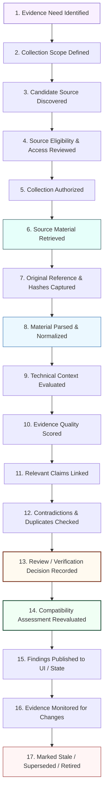
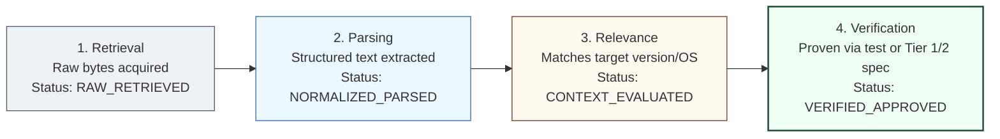

# Compatibility Evidence Collection & Lifecycle Specification

**Document ID:** `NLE-SPC-ECL-001`  
**Version:** `1.0.0`  
**Status:** `APPROVED`  
**Workstream:** `Compatibility Evidence Collection, Verification, Provenance Tracking, and Operational Lifecycle Architecture`  
**Phase:** `4 of 12 — Game Discovery & Compatibility Intelligence`  
**Step:** `30 of 100`  
**Related Documents:**
- [CROSS_GAME_COMPATIBILITY_ASSESSMENT_FRAMEWORK.md](file:///d:/App%20Winrar%20Files/Nexludic%20Engine%20(working)/docs/game-discovery/CROSS_GAME_COMPATIBILITY_ASSESSMENT_FRAMEWORK.md) (`NLE-SPC-CAC-001`)
- [COMPATIBILITY_EVIDENCE_QUALITY_AND_CONFLICT_RULES.md](file:///d:/App%20Winrar%20Files/Nexludic%20Engine%20(working)/docs/game-discovery/COMPATIBILITY_EVIDENCE_QUALITY_AND_CONFLICT_RULES.md) (`NLE-RUL-CEQ-001`)
- [COMPATIBILITY_EVIDENCE_RECORD_AND_PROVENANCE_SCHEMA_SPECIFICATION.md](file:///d:/App%20Winrar%20Files/Nexludic%20Engine%20(working)/docs/game-discovery/COMPATIBILITY_EVIDENCE_RECORD_AND_PROVENANCE_SCHEMA_SPECIFICATION.md) (`NLE-DOM-ERP-001`)
- [COMPATIBILITY_SOURCE_ELIGIBILITY_AND_COLLECTION_POLICY.md](file:///d:/App%20Winrar%20Files/Nexludic%20Engine%20(working)/docs/game-discovery/COMPATIBILITY_SOURCE_ELIGIBILITY_AND_COLLECTION_POLICY.md) (`NLE-POL-SEC-001`)
- [EVIDENCE_CLAIM_LINKAGE_AND_VERIFICATION_RULES.md](file:///d:/App%20Winrar%20Files/Nexludic%20Engine%20(working)/docs/game-discovery/EVIDENCE_CLAIM_LINKAGE_AND_VERIFICATION_RULES.md) (`NLE-RUL-ECL-001`)

---

## 1. Executive Summary & Purpose

This specification establishes the operational information lifecycle, collection boundaries, state transitions, and verification stages for compatibility evidence within **NexLudic Engine**.

While Step 29 defined the conceptual compatibility assessment model (the reasoning rules that consume evidence to reach feasibility conclusions), Step 30 defines the operational pipeline that discovers, captures, validates, normalizes, links, refreshes, and retires that evidence.

In compatibility research, assertions must never be accepted at face value. A retrieved document, community guide, or demonstration video is an unverified input until it passes strict validation stages. This document enforces a deterministic lifecycle that separates retrieval from verification, prevents unverified material from masquerading as ground truth, and maintains an unbroken chain of custody for all evidence stored on Volume D (`DEC-009`).

---

## 2. Core Epistemic Principles of Evidence Management

1. **Retrieval $\ne$ Verification:** Successfully fetching a webpage, downloading a release note, or parsing a manifest confirms that content was obtained; it does **not** establish that the claims within it are true, accurate, or applicable.
2. **Context-Bounded Provenance:** Every evidence item must record where, when, how, and by whom it was acquired, along with the exact game versions, platforms, and environments to which it applies.
3. **No Phantom Ground Truth:** Generative AI summaries, forum anecdotes, and ungrounded claims must never be promoted to verified status without primary documentation or empirical validation logs.
4. **Non-Destructive Normalization:** Normalizing text into structured fields must preserve verbatim excerpts and cryptographic hashes of the original artifact to guarantee auditability.
5. **Separation of Retrieval Errors from Negative Compatibility:** A network timeout, access denial, or 404 error during evidence collection indicates an infrastructure retrieval failure, **never** technical incompatibility between games.
6. **Immutable Historical Audit:** Evidence records and human review decisions are preserved append-only; newer evidence supersedes older evidence without erasing historical assessments.

---

## 3. The 17-Stage Evidence Lifecycle Model

The evidence lifecycle governs the progression of an information item from initial research question to potential supersession or retirement:

### 3.1 Detailed Stage Descriptions

| Stage ID | Stage Name | Purpose & Permitted Operations | Responsible Actor | Output State |
| :--- | :--- | :--- | :--- | :--- |
| **STG-01** | Need Identification | Identifies a missing capability hook, version constraint, or dependency question. | Assessment Engine | `NEED_REGISTERED` |
| **STG-02** | Scope Definition | Binds search parameters (target game, build, OS, required capability). | Workflow Controller | `SCOPE_BOUND` |
| **STG-03** | Source Discovery | Identifies potential documentation, repository, or release note URLs. | Discovery Module / AI | `CANDIDATE_DISCOVERED` |
| **STG-04** | Eligibility Review | Evaluates source domain against licensing, rate limits, and authority policies. | Policy Guard | `ELIGIBILITY_CONFIRMED` |
| **STG-05** | Collection Authorization| Confirms collection is within approved network and storage bounds. | User / Ambient Policy | `COLLECTION_AUTHORIZED` |
| **STG-06** | Material Retrieval | Fetches raw content via bounded HTTP GET or file read (strictly non-locking). | Ingestion Worker | `RAW_RETRIEVED` |
| **STG-07** | Provenance Capture | Computes SHA-256 hash of raw payload; records UTC timestamp and URL. | Provenance Engine | `PROVENANCE_SEALED` |
| **STG-08** | Parsing & Normalization| Extracts structured assertions, version ranges, and API names without data loss. | Parsing Pipeline | `NORMALIZED_PARSED` |
| **STG-09** | Context Evaluation | Validates whether extracted builds match the target project environment. | Context Mapper | `CONTEXT_EVALUATED` |
| **STG-10** | Quality Scoring | Assigns authority tier (Tier 1–5) and qualitative confidence. | Evidence Evaluator | `QUALITY_CLASSIFIED` |
| **STG-11** | Claim Linkage | Creates explicit pointer binding evidence item to specific capability claim. | Linkage Engine | `CLAIM_ASSOCIATED` |
| **STG-12** | Conflict & Duplicate Check| Detects syndicated content duplicates and checks against known contradictory logs.| Conflict Analyzer | `DEDUPLICATED_CHECKED` |
| **STG-13** | Review Decision | Records human or automated verification disposition. | Reviewer / Harness | `VERIFIED_APPROVED` |
| **STG-14** | Assessment Reevaluation| Triggers Step 29 decision tables to update project compatibility status. | Feasibility Engine | `ASSESSMENT_UPDATED` |
| **STG-15** | Finding Publication | Updates `latest_assessment.json` on Volume D and workspace UI. | Workspace Presenter | `PUBLISHED_ACTIVE` |
| **STG-16** | Change Monitoring | Periodically checks for source updates, patch releases, or upstream revisions. | Freshness Daemon | `MONITORED_CURRENT` |
| **STG-17** | Supersession / Retirement| Transitions evidence to superseded or stale when new patches invalidate it. | Lifecycle Manager | `SUPERSEDED_RETIRED` |

---

## 4. Separation of Retrieval, Parsing, Relevance, and Verification

To prevent ungrounded claims from polluting the decision engine, the framework enforces four distinct validation boundaries:

1. **Retrieval Boundary:** Successful retrieval guarantees only that the source server returned HTTP 200 or the local file was read. It makes zero assertions about truthfulness.
2. **Parsing Boundary:** Successful parsing converts HTML/Markdown/JSON into text fields. If syntax errors occur, the raw payload is retained and marked `PARSE_WARNING`.
3. **Relevance Boundary:** A document may be completely truthful about *Skyrim v1.5.97*, but completely irrelevant to a project targeting *Skyrim v1.6.1170*. Relevance evaluates version and platform scope alignment.
4. **Verification Boundary:** An evidence item is marked `VERIFIED_APPROVED` only when it originates from an authoritative Tier 1/2 source or is corroborated by an empirical automated test log (`TestExecutionRecord`).

---

## 5. Automated vs. Manual Review Boundaries

To balance scalability with safety, the workflow clearly demarcates automated operations from operations requiring explicit human review:

| Workflow Operation | Permitted Mode | Authorization / Review Boundary |
| :--- | :--- | :--- |
| **Source Fetching & Hash Sealing** | Fully Automated | Permitted within whitelisted documentation domains and bounded depth. |
| **Duplicate & Syndrome Detection** | Fully Automated | Automated URL normalization and text similarity hashing ($> 95\%$). |
| **Relevance & Version Range Filter** | Fully Automated | Mathematical interval parsing against detected build numbers. |
| **Promotion to `VERIFIED_APPROVED` (Tier 1/2)**| Automated with Criteria | Permitted only for official SDK headers or automated test harness passes. |
| **Peer Evidence Conflict Resolution** | **Strictly Manual Review** | Contradictory Tier 1/2 sources trigger `EVIDENCE_CONFLICT`; requires engineer triage. |
| **Security / Anti-Cheat Overrides** | **Strictly Prohibited** | No human or automated actor may override an anti-cheat block (`BLK-SEC-01`). |
| **AI Hypothesis Ingestion** | **Human Affirmation Required**| AI-extracted claims remain `PROVISIONAL_CANDIDATE` until reviewed by user. |

---

## 6. Document Sign-Off & Verification

| Role | Reviewer | Verdict | Date |
| :--- | :--- | :--- | :--- |
| **Principal Software Architect** | Engine Architecture Team | Approved | 2026-11-17 |
| **Senior Evidence & Data Provenance Engineer**| Data Governance | Approved | 2026-11-17 |
| **Lead Game Interoperability Researcher**| Interoperability Research Group | Approved | 2026-11-17 |
| **Senior Security & Compliance Officer**| Security Governance | Approved | 2026-11-17 |

