# Compatibility Evidence Drill-Down and Report Traceability Specification

**Document ID:** `NLE-SPC-EDT-001`  
**Version:** 1.0.0  
**Phase:** 4 of 12 — Game Discovery & Compatibility Intelligence  
**Step:** 32 of 100 — Game-Pair Compatibility Report & Recommendation Experience Specification  
**Classification:** Epistemic Evidence Navigation & Forensic Traceability Contract  
**Status:** Approved Specification  
**Authoritative Reference:** `NLE-DOM-SPEC-001`, `NLE-SPC-ECL-001`, `NLE-SPC-CRD-001`, `COMPATIBILITY_EVALUATION_EXPLAINABILITY_AND_TRACE_SPECIFICATION.md`

---

## 1. Traceability Architecture & Objectives

Every factual assertion rendered in the NexLudic Engine Game-Pair Compatibility Report—whether a requirement coverage verdict, a technical dependency clearance, or an architectural recommendation—must remain bidirectionally traceable back to:
1. The **exact rule** that evaluated the condition (`RULE-ID` + Version).
2. The **exact input facts** fed into the rule (game versions, runtime architectures, platform capabilities).
3. The **underlying evidence record** backing each fact (`EVD-ID` + cryptographic hash).
4. The **provenance chain** detailing how, when, and by whom the evidence was collected.

If traceability information is missing or corrupted, the UI must explicitly identify the gap rather than synthesizing plausible placeholder links.

```mermaid
flowchart LR
    ReportUI["Report Summary Badge (UI)"]
    ReqRecord["Requirement Coverage Record"]
    RuleTrace["Rule Evaluation Trace (NLE-SPC-EET-001)"]
    FactInput["Verified Input Fact Set (NLE-CAT-RIA-001)"]
    EvidenceRec["Cryptographic Evidence Record (NLE-SPC-ECL-001)"]
    SourceOrigin["Primary Source / Binary / Documentation"]

    ReportUI -->|Click / Focus| ReqRecord
    ReqRecord -->|Inspect Decision| RuleTrace
    RuleTrace -->|Verify Inputs| FactInput
    FactInput -->|Audit Provenance| EvidenceRec
    EvidenceRec -->|Examine Origin| SourceOrigin
```



---

## 2. Interaction Contract: `EvidenceDrilldownDrawer`

To maintain uninterrupted user context while enabling deep forensic inspection, all evidence drill-down interactions open a persistent, accessible **Side Sheet / Drawer** (`CMP-018 ContextualSideSheet`) over the right 40% of the viewport, preserving the main report view and scroll position.

### 2.1 Drawer Interaction Contract
- **Trigger Mechanisms:**
  - Clicking any `[EVD-xxxx]` evidence chip in the report body.
  - Clicking the `[Inspect Evidence & Rules]` action on any Requirement Row or Strategy Card.
  - Activating keyboard shortcut `Alt + E` when a requirement row has active focus.
- **Visual Presentation:** Right-anchored sheet (min-width: 480px, max-width: 680px), non-modal backdrop, smooth slide-in animation (200ms ease-out). Focus automatically moves to the drawer header close button while maintaining an `aria-controls` reference back to the triggering element.
- **Escape Key Contract:** Pressing `Esc` closes the drawer and restores keyboard focus cleanly to the exact trigger element on the main report surface.

### 2.2 Drawer Content Layout Schema

```
+-------------------------------------------------------------------------+
| [DRAWER HEADER] Evidence Forensics: EVD-8021                      [X]   |
| Status: VERIFIED & FRESH | Epistemic Tier: TIER 2 (DOCUMENTED)          |
+-------------------------------------------------------------------------+
| EVIDENCE METADATA:                                                      |
| - Title:            SKSE64 Runtime Plugin Architecture & API Headers    |
| - Origin / Author:  Silverlock / SKSE Team                              |
| - Source Type:      Official Developer Header & Documentation           |
| - Applicable Game:  The Elder Scrolls V: Skyrim Special Edition         |
| - Version Scoped:   v1.5.97 to v1.6.640                                 |
| - Collected At:     2026-11-10T14:22:00Z                                |
| - SHA-256 Hash:     7f83b1657ff1fc53b92dc18148a1d65dfc2d4b1fa3d677284b  |
+-------------------------------------------------------------------------+
| TARGET CLAIM VALIDATION:                                                |
| Claim: "Host supports native C++ DLL injection into game main thread"  |
| Rule Outcome: RULE-STR-HM-002 -> OUTCOME_SATISFIED                      |
+-------------------------------------------------------------------------+
| EXCERPT / EVIDENCE ARTIFACT PREVIEW:                                    |
| +---------------------------------------------------------------------+ |
| | // SKSE64 Interface Definition                                      | |
| | struct SKSEInterface {                                              | |
| |     UInt32 skseVersion;                                             | |
| |     UInt32 runtimeVersion;                                          | |
| |     void* (*QueryInterface)(UInt32 id);                             | |
| | };                                                                  | |
| +---------------------------------------------------------------------+ |
+-------------------------------------------------------------------------+
| PROVENANCE & CHAIN OF CUSTODY:                                          |
| Ingestion: Automated Catalog Sync -> Hash Checked -> Security Verified   |
| Reviewer: System Engine Baseline (SHA Signed)                           |
+-------------------------------------------------------------------------+
| CONFLICTS & DISPUTES: None recorded. Fully compatible with Game A v1.5 |
+-------------------------------------------------------------------------+
| [Open Cached Artifact (Read-Only)]  [Copy Citation]  [Report Issue]     |
+-------------------------------------------------------------------------+
```

---

## 3. Bidirectional Drill-Down Navigation Workflows

### 3.1 Workflow A: Requirement -> Rule Trace -> Evidence
1. **User Focus:** User reviews Requirement `REQ-02: Real-time Telemetry State Synchronization` currently showing `COVERAGE_PARTIAL`.
2. **Action:** User clicks `[Inspect Reasoning]` on the requirement row.
3. **Display:** Side drawer opens with the active rule trace (`RULE-STR-LB-002: Live Telemetry Hook Verification`).
4. **Findings Rendered:**
   - Input: Guest Game exports physics positions at 60 Hz via memory offsets (Verified by `EVD-8044`).
   - Input: Host Game script engine limits external event polling to 20 Hz (Verified by `EVD-8012`).
   - Synthesis: Rate mismatch causes telemetry downsampling (`COVERAGE_PARTIAL`).
5. **Drill Further:** Clicking `[EVD-8012]` transitions the drawer view to the detailed header inspection for Host script engine frequency limits.

### 3.2 Workflow B: Strategy Rejection Forensics
1. **User Focus:** User wonders why `Strategy C: Hybrid Integration` is marked `UNVIABLE` despite high requirement coverage.
2. **Action:** User clicks `[Why was this unviable?]` on Strategy C card.
3. **Display:** Drawer renders `RULE-REQ-MAND-001` and `RULE-STR-LB-003` evaluation steps:
   - Rule evaluated: Dual-engine memory footprint calculation.
   - Evaluated inputs: Host footprint (3.2 GB) + Guest footprint (2.8 GB) + OS reserve (4.0 GB) = 10.0 GB.
   - User system environment: 8.0 GB Physical RAM detected.
   - Evaluation outcome: `OUTCOME_BLOCKED_BY_POLICY` (Insufficent Memory Headroom).
   - Clear Explanation: User immediately sees that low system RAM, not game incompatibility, made Strategy C unviable.

---

## 4. Evidence Integrity & Redaction Guards

### 4.1 Cryptographic Hash Verification
Whenever the user opens an evidence record, the drawer visually confirms that the local cached artifact matches the authoritative digest:
- If hash matches: Renders `[Integrity: Cryptographically Verified (SHA-256)]` with green check badge.
- If hash mismatch or missing file: Renders `[Integrity: Evidence Hash Discrepancy or File Missing]` with amber warning and disables artifact viewing.

### 4.2 Untrusted Content Sanitization
Evidence records frequently contain user-submitted forum posts, mod descriptions, or external links:
- **Zero Script Execution:** Markdown preview in the evidence drawer is rendered using a sandboxed AST renderer with raw HTML and JavaScript stripped (`REQ-SEC-001`).
- **External URL Safety:** Clicking external links triggers a standard external link confirmation modal (`CMP-015`) informing the user they are leaving NexLudic Engine, opening the URL in the system default browser with `rel="noopener noreferrer"`.
- **Path Redaction:** Local file paths on the user's filesystem are strictly redacted according to `NLE-CAT-RIC-001` Section 4.

