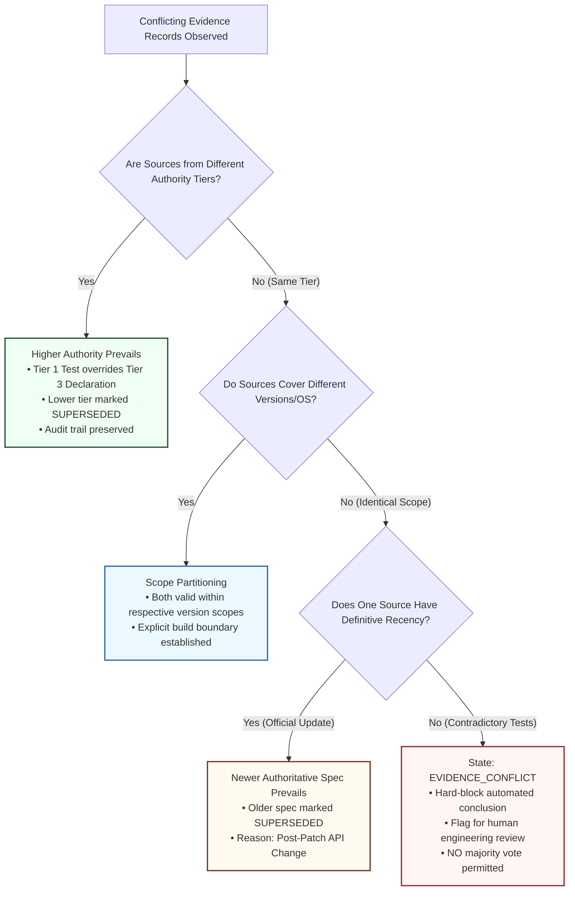

# Compatibility Evidence Quality & Conflict Rules

**Document ID:** `NLE-RUL-CEQ-001`  
**Version:** `1.0.0`  
**Status:** `APPROVED`  
**Workstream:** `Cross-Game Compatibility Assessment Framework, Assessment Unit Modeling, Decision Rules, Multi-Dimensional Evaluation, and Strategy Comparison`  
**Phase:** `4 of 12 — Game Discovery & Compatibility Intelligence`  
**Step:** `29 of 100`  
**Related Documents:**
- [CROSS_GAME_COMPATIBILITY_ASSESSMENT_FRAMEWORK.md](file:///d:/App%20Winrar%20Files/Nexludic%20Engine%20(working)/docs/game-discovery/CROSS_GAME_COMPATIBILITY_ASSESSMENT_FRAMEWORK.md) (`NLE-SPC-CAC-001`)
- [COMPATIBILITY_DIMENSION_AND_REQUIREMENT_COVERAGE_CATALOG.md](file:///d:/App%20Winrar%20Files/Nexludic%20Engine%20(working)/docs/game-discovery/COMPATIBILITY_DIMENSION_AND_REQUIREMENT_COVERAGE_CATALOG.md) (`NLE-CAT-CDC-001`)
- [CROSS_GAME_COMPATIBILITY_DECISION_TABLES.md](file:///d:/App%20Winrar%20Files/Nexludic%20Engine%20(working)/docs/game-discovery/CROSS_GAME_COMPATIBILITY_DECISION_TABLES.md) (`NLE-TAB-CCD-001`)
- [VERSION_COMPATIBILITY_EVIDENCE_AND_PROVENANCE_RULES.md](file:///d:/App%20Winrar%20Files/Nexludic%20Engine%20(working)/docs/game-discovery/VERSION_COMPATIBILITY_EVIDENCE_AND_PROVENANCE_RULES.md) (`NLE-RUL-VCE-001`)

---

## 1. Executive Summary & Purpose

This specification governs the evidentiary standards, quality classifications, conflict resolution logic, and provenance requirements used by **NexLudic Engine** to ground compatibility assessments.

In software interoperability research, treating unverified claims, outdated forum guides, demonstration videos, or generative AI assertions as proven facts results in catastrophic integration failures. This document defines an evidence taxonomy, establishes strict limits on the probative weight of indirect evidence, outlines a qualitative confidence model, and mandates deterministic rules for resolving conflicting sources without resorting to simplistic majority votes.

---

## 2. Evidence Record Schema

Every material assertion regarding game capabilities, integration feasibility, or constraints must reference an immutable `CompatibilityEvidenceRecord`:

| Field Name | Type | Nullable | Required | Purpose & Description |
| :--- | :--- | :--- | :--- | :--- |
| `evidence_id` | UUIDv4 | No | Yes | Unique identifier for this evidence entry. |
| `claim_id` | String | No | Yes | The specific assertion supported (e.g. `claim:skyrim_se:bg3:quest_sync`). |
| `source_name` | String | No | Yes | Canonical name of the source (e.g. `"SKSE64 Team Release Notes"`). |
| `source_category` | Enum | No | Yes | Category from formal taxonomy (see §3). |
| `source_uri` | String | No | Yes | Permanent URI, documentation reference, or file path. |
| `author_publisher`| String | Yes | Optional| Author, maintainer organization, or publisher. |
| `publication_date` | Date | Yes | Optional| Date when source was originally published. |
| `collected_at_utc` | Timestamp | No | Yes | UTC timestamp when record was ingested. |
| `game_scope` | Enum | No | Yes | `GAME_A_ONLY`, `GAME_B_ONLY`, or `PAIR_INTERACTION`. |
| `version_scope` | String | No | Yes | Exact build or interval expression (e.g. `"[1.6.640, 1.6.659]"`). |
| `platform_scope` | Enum | No | Yes | OS platform (`WINDOWS_X64`, `LINUX_PROTON`). |
| `strategy_scope` | Enum | No | Yes | `HOST_MODIFICATION`, `LIVE_BRIDGE`, `HYBRID`, or `ALL`. |
| `probative_tier` | Enum | No | Yes | Authority tier (`TIER_1` through `TIER_5`). |
| `directness` | Enum | No | Yes | `DIRECT_EMPIRICAL`, `DIRECT_DOCUMENTED`, `INDIRECT_ANALOGUE`, `INFERENTIAL`. |
| `evidence_excerpt` | String | No | Yes | Verbatim citation, log excerpt, or technical finding. |
| `verification_method`| Enum | No | Yes | `AUTOMATED_HARNESS_TEST`, `STATIC_PE_INSPECTION`, `MANUAL_DOCUMENT_REVIEW`. |
| `confidence_tier` | Enum | No | Yes | Qualitative classification (see §4). |
| `superseded_by` | UUIDv4 | Yes | Optional| Pointer to overriding evidence record if superseded. |

---

## 3. Evidence Categories & Probative Limitations

The framework recognizes a controlled taxonomy of evidence categories, assigning strict evidentiary limits to each:

```mermaid
flowchart TD
    E1["Category 1: Empirical Automated Test Logs<br/>• Probative Weight: 1.00 (Conclusive)<br/>• Verified runtime execution on target builds"]
    E2["Category 2: Official Developer & Platform Docs<br/>• Probative Weight: 0.90 (Authoritative)<br/>• Publisher API specs, SDK headers, EULAs"]
    E3["Category 3: Maintainer Release Documentation<br/>• Probative Weight: 0.85 (High Authority)<br/>• Script extender / mod loader release notes"]
    E4["Category 4: Adapter Manifest Declarations<br/>• Probative Weight: 0.60 (Declared Intent)<br/>• adapter.json declared support ranges"]
    E5["Category 5: Curated Modding Wikis & Analysis<br/>• Probative Weight: 0.40 (Advisory)<br/>• PCGamingWiki, reverse engineering technical blogs"]
    E6["Category 6: Community Forum Reports<br/>• Probative Weight: 0.15 (Provisional)<br/>• Unverified user comments, issue tracker discussions"]
    E7["Category 7: Demonstration Videos<br/>• Probative Weight: 0.10 (Illustrative Only)<br/>• Proof-of-concept clips; lacks build/code transparency"]
    E8["Category 8: AI-Generated Assertions<br/>• Probative Weight: 0.00 (Zero Authority)<br/>• Exploratory hypothesis only; cannot serve as proof"]

    E1 --> E2 --> E3 --> E4 --> E5 --> E6 --> E7 --> E8
    
    style E1 fill:#f0fff4,stroke:#22543d,stroke-width:2px
    style E2 fill:#ebf8ff,stroke:#2b6cb0,stroke-width:2px
    style E3 fill:#ebf8ff,stroke:#2b6cb0,stroke-width:2px
    style E4 fill:#fffaf0,stroke:#7b341e,stroke-width:1px
    style E5 fill:#fffaf0,stroke:#dd6b20,stroke-width:1px
    style E6 fill:#fff5f5,stroke:#9b2c2c,stroke-width:1px
    style E7 fill:#fff5f5,stroke:#9b2c2c,stroke-width:1px
    style E8 fill:#edf2f7,stroke:#4a5568,stroke-width:1px
```

### 3.1 Strict Limitations on Demonstration Videos
A video showing a mashup or mod working in a YouTube or Twitter clip is **illustrative, never conclusive**:
- It demonstrates that something appeared to function once under unknown conditions.
- It does not disclose game builds, patch levels, installed third-party DLLs, custom source code, or hardware configurations.
- It provides zero evidence of stability, performance, or legal/anti-cheat safety.
- **Rule RUL-CEQ-01:** A demonstration video receives a maximum weight of $0.10$. It may be cited as an exploratory reference, but it can **never** satisfy a technical feasibility requirement.

### 3.2 Strict Limitations on AI-Generated Statements
Generative AI outputs and LLM explanations are tools for research synthesis and hypothesis generation:
- AI models frequently hallucinate API names, conflate different game editions, or cite non-existent mod releases.
- **Rule RUL-CEQ-02:** An AI-generated statement has an intrinsic probative weight of **$0.00$**. It cannot be stored as independent evidence. An AI hypothesis must be validated against official documentation, source code, or empirical tests before becoming evidence.

---

## 4. Qualitative Evidence Confidence Model

To avoid fabricating artificial mathematical probabilities, evidence quality is classified into five discrete qualitative tiers:

| Confidence Tier | Entry Criteria | Permitted Operational Usage |
| :--- | :--- | :--- |
| **`CONVINCING_GROUND_TRUTH`** | Direct, reproducible Tier 1 automated test execution log on matching target builds and OS platform. | Authorizes full compatibility validation and execution planning. |
| **`HIGHLY_PERSUASIVE`** | Tier 2 official developer SDK or maintainer release documentation matching target builds. | Authorizes technical feasibility assessment and adapter binding. |
| **`CORROBORATED_ADVISORY`** | Tier 3/4 declarations corroborated by multiple independent community technical analyses. | Authorizes exploratory design; requires local validation before execution. |
| **`PRELIMINARY_UNCONFIRMED`** | Single community report, forum issue discussion, or analogue from an adjacent build. | Displayed as advisory notice; flagged as unverified hypothesis. |
| **`UNVERIFIED_SPECULATION`** | Demonstration video without environment metadata, ungrounded claim, or stale forum guide. | Blocked from supporting compatibility claims; requires empirical test. |

---

## 5. Conflict Resolution Rules

When multiple evidence records present contradictory conclusions regarding an integration claim, the framework resolves the disagreement deterministically:

### 5.1 Deterministic Resolution Rules
1. **Rule RUL-CEQ-03 (Tier Precedence):** Higher authority tiers strictly supersede lower authority tiers ($\text{Tier 1} > \text{Tier 2} > \text{Tier 3} > \text{Tier 4} > \text{Tier 5}$).
2. **Rule RUL-CEQ-04 (Scope Partitioning):** When sources disagree because they evaluated different game builds (e.g. Source A says compatible on 1.6.640; Source B says broken on 1.6.1170), both records are retained and partitioned by their respective version scopes.
3. **Rule RUL-CEQ-05 (No Majority Voting):** The system must **never** resolve peer contradictions by counting sources (e.g. three forum posts saying "it works" cannot override one reproducible test failure).
4. **Rule RUL-CEQ-06 (Peer Conflict Triage):** When two peer Tier 1 tests conflict (e.g. Test A passes on Windows 10; Test B fails on Windows 11), the status is set to `EVIDENCE_CONFLICT`. The conflict is highlighted in the UI and flagged for manual developer triage.

---

## 6. Document Sign-Off & Verification

| Role | Reviewer | Verdict | Date |
| :--- | :--- | :--- | :--- |
| **Principal Software Architect** | Engine Architecture Team | Approved | 2026-11-17 |
| **Lead Game Interoperability Researcher**| Interoperability Research Group | Approved | 2026-11-17 |
| **Senior Security & Compliance Officer**| Security Governance | Approved | 2026-11-17 |

