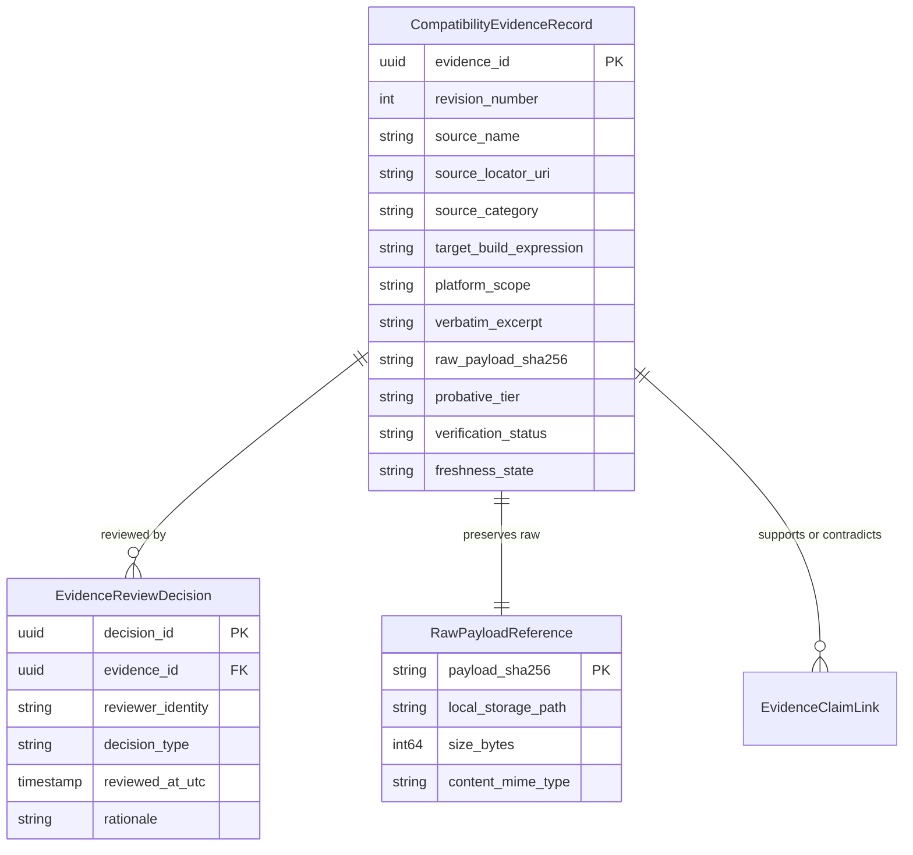

# Compatibility Evidence Record & Provenance Schema Specification

**Document ID:** `NLE-DOM-ERP-001`  
**Version:** `1.0.0`  
**Status:** `APPROVED`  
**Workstream:** `Compatibility Evidence Collection, Verification, Provenance Tracking, and Operational Lifecycle Architecture`  
**Phase:** `4 of 12 — Game Discovery & Compatibility Intelligence`  
**Step:** `30 of 100`  
**Related Documents:**
- [COMPATIBILITY_EVIDENCE_COLLECTION_AND_LIFECYCLE_SPECIFICATION.md](file:///d:/App%20Winrar%20Files/Nexludic%20Engine%20(working)/docs/game-discovery/COMPATIBILITY_EVIDENCE_COLLECTION_AND_LIFECYCLE_SPECIFICATION.md) (`NLE-SPC-ECL-001`)
- [COMPATIBILITY_EVIDENCE_QUALITY_AND_CONFLICT_RULES.md](file:///d:/App%20Winrar%20Files/Nexludic%20Engine%20(working)/docs/game-discovery/COMPATIBILITY_EVIDENCE_QUALITY_AND_CONFLICT_RULES.md) (`NLE-RUL-CEQ-001`)
- [EVIDENCE_CLAIM_LINKAGE_AND_VERIFICATION_RULES.md](file:///d:/App%20Winrar%20Files/Nexludic%20Engine%20(working)/docs/game-discovery/EVIDENCE_CLAIM_LINKAGE_AND_VERIFICATION_RULES.md) (`NLE-RUL-ECL-001`)
- [EVIDENCE_FRESHNESS_CHANGE_DETECTION_AND_RETENTION_POLICY.md](file:///d:/App%20Winrar%20Files/Nexludic%20Engine%20(working)/docs/game-discovery/EVIDENCE_FRESHNESS_CHANGE_DETECTION_AND_RETENTION_POLICY.md) (`NLE-POL-EFD-001`)

---

## 1. Executive Summary & Purpose

This specification defines the formal conceptual data model, field dictionary, validation contracts, and revision immutability rules for evidence records within **NexLudic Engine**.

To support rigorous audits, reproducibility, and transparent explanation generation, compatibility evidence cannot be stored as loose unstructured strings or ephemeral notes. This document formalizes the `CompatibilityEvidenceRecord` and its auxiliary entities (`EvidenceReviewDecision`, `RawPayloadReference`). It establishes an immutable chain of custody, guarantees cryptographic integrity through SHA-256 content hashing, enforces strict non-destructive normalization, and ensures all evidence data persists cleanly on Volume D (`DEC-009`).

---

## 2. Conceptual Entity Architecture

---

## 3. Field Dictionary: `CompatibilityEvidenceRecord`

| Field Group | Field Name | Type | Nullable | Required | Purpose & Validation Rules |
| :--- | :--- | :--- | :--- | :--- | :--- |
| **Identity & Revisions** | `evidence_id` | UUIDv4 | No | Yes | Immutable unique identifier for this evidence record. |
| | `revision_number` | Integer | No | Yes | Increments monotonically on material review updates (starts at 1). |
| | `record_state` | Enum | No | Yes | Current lifecycle state (`PROVISIONAL`, `ACTIVE_VERIFIED`, `SUPERSEDED`, `RETIRED`). |
| | `created_at_utc` | Timestamp | No | Yes | Immutable creation timestamp. |
| | `updated_at_utc` | Timestamp | No | Yes | Timestamp of most recent revision. |
| **Source Provenance** | `source_id` | UUIDv5 | No | Yes | Deterministic identifier derived from normalized source URI. |
| | `source_name` | String | No | Yes | Human-readable title (e.g. `"SKSE64 Official Documentation"`). |
| | `source_locator_uri`| String | No | Yes | Canonical URL, git commit URL, or local reference locator. |
| | `source_category` | Enum | No | Yes | Category from formal taxonomy (`OFFICIAL_DEV_DOCS`, `TEST_LOG`, etc.). |
| | `author_publisher` | String | Yes | Optional | Entity responsible for publishing source content. |
| | `publication_date_utc`| Date | Yes | Optional | Date originally published (must be null if unknown; no guessing). |
| | `collected_at_utc` | Timestamp | No | Yes | Exact UTC timestamp when payload was retrieved. |
| | `retrieval_method` | Enum | No | Yes | Method (`BOUNDED_HTTP_GET`, `LOCAL_MANIFEST_READ`, `AUTOMATED_TEST_RUN`). |
| | `source_license_type`| Enum | No | Yes | Licensing class (`PUBLIC_SPECIFICATION`, `OPEN_SOURCE_MIT`, `PROPRIETARY_DOC`). |
| **Context & Scope** | `game_scope` | Enum | No | Yes | Target scope (`GAME_A_ONLY`, `GAME_B_ONLY`, `PAIR_INTERACTION`). |
| | `canonical_game_id_a`| UUIDv5 | No | Yes | Foreign Key $\rightarrow$ `CanonicalGame.game_id` (Participant A). |
| | `canonical_game_id_b`| UUIDv5 | Yes | Optional | Foreign Key $\rightarrow$ `CanonicalGame.game_id` (Participant B, if pair scope). |
| | `edition_scope` | String | Yes | Optional | Normalized edition name (e.g. `"Special Edition"`). |
| | `target_build_expression`| String | No | Yes | Exact build number or standardized interval (`"[1.6.640, 1.6.659]"`). |
| | `platform_scope` | Enum | No | Yes | Target OS/arch (`WINDOWS_X64`, `LINUX_PROTON`, `WINDOWS_X86`). |
| | `strategy_scope` | Enum | No | Yes | Strategy (`HOST_MODIFICATION`, `LIVE_BRIDGE`, `HYBRID`, `ALL`). |
| | `capability_key` | String | No | Yes | Target capability identifier (e.g. `cap:sync_player_gold`). |
| **Captured Content** | `raw_payload_sha256`| HexString(64)| No | Yes | Cryptographic SHA-256 digest of original unmodified payload. |
| | `raw_payload_size_bytes`| Int64 | No | Yes | Byte length of captured content. |
| | `verbatim_excerpt` | String | No | Yes | Exact source quotation, code snippet, or test assertion log. |
| | `normalized_assertions`| KeyValueMap| No | Yes | Extracted key-value facts (APIs, parameters, supported versions). |
| **Quality & Review** | `probative_tier` | Enum | No | Yes | Authority tier (`TIER_1` through `TIER_5`). |
| | `directness` | Enum | No | Yes | Evidence directness (`DIRECT_EMPIRICAL`, `DIRECT_DOC`, `INDIRECT`, `INFERENTIAL`). |
| | `verification_status`| Enum | No | Yes | Verification status (`UNVERIFIED`, `VERIFIED_APPROVED`, `CONTRADICTED`). |
| | `confidence_tier` | Enum | No | Yes | Qualitative tier (`CONVINCING_GROUND_TRUTH`, `HIGHLY_PERSUASIVE`, etc.). |
| | `is_ai_assisted` | Boolean | No | Yes | Flag indicating whether AI was utilized for extraction/synthesis. |
| | `ai_model_metadata`| String | Yes | Optional | AI model identifier and prompt task if `is_ai_assisted = true`. |
| **Freshness & Retirement**| `freshness_state`| Enum | No | Yes | Freshness state (`CURRENT`, `STALE_CHANGED`, `SUPERSEDED`, `RETIRED`). |
| | `stale_reason` | String | Yes | Optional | Diagnostic explanation if marked stale. |
| | `superseded_by` | UUIDv4 | Yes | Optional | Foreign Key $\rightarrow$ `CompatibilityEvidenceRecord.evidence_id`. |

---

## 4. Entity: `EvidenceReviewDecision`

When an evidence record undergoes formal human or automated verification, an immutable decision audit record is generated:

| Field Name | Type | Description |
| :--- | :--- | :--- |
| `decision_id` | UUIDv4 | Unique identifier for this review event. |
| `evidence_id` | UUIDv4 | Foreign Key $\rightarrow$ `CompatibilityEvidenceRecord.evidence_id`. |
| `evidence_revision`| Integer | Exact revision of the evidence record evaluated. |
| `reviewer_identity`| String | Role or system component (e.g. `"Lead Architecture Reviewer"`, `"TestHarnessDaemon"`). |
| `decision_type` | Enum | Decision (`APPROVED_AS_GROUND_TRUTH`, `REJECTED_LOW_QUALITY`, `FLAGGED_CONFLICT`). |
| `reviewed_at_utc` | Timestamp | Exact UTC timestamp of the review decision. |
| `rationale` | String | Detailed explanation justifying the decision. |
| `previous_state` | Enum | Lifecycle status prior to review. |
| `resulting_state` | Enum | Lifecycle status after review. |

---

## 5. Non-Destructive Normalization Rules

To ensure complete reversibility and prevent normalization distortion:

1. **Rule RUL-ERP-01 (Verbatim Preservation):** Normalization pipelines must never delete or overwrite the `verbatim_excerpt`. The exact source text must remain accessible alongside extracted key-value pairs.
2. **Rule RUL-ERP-02 (Raw Payload Archiving):** When source material is retrieved from external networks or local logs, the raw bytes are compressed and stored on Volume D:
   `D:\NexLudic\Catalog\EvidencePayloads\<sha256>.blob`
3. **Rule RUL-ERP-03 (No Semantic Inflation):** Normalization parsers must never broaden version scopes. If a source states *"Tested on v1.6.640"*, normalization must set `target_build_expression = "[1.6.640]"`; it must **never** infer `"[1.6.0, *)"`.
4. **Rule RUL-ERP-04 (Unknown Date Preservation):** If a source webpage lacks a verifiable publication timestamp, `publication_date_utc` must remain `NULL`. Inserting the collection date into the publication date field is strictly prohibited.

---

## 6. Document Sign-Off & Verification

| Role | Reviewer | Verdict | Date |
| :--- | :--- | :--- | :--- |
| **Principal Software Architect** | Engine Architecture Team | Approved | 2026-11-17 |
| **Senior Evidence & Data Provenance Engineer**| Data Governance | Approved | 2026-11-17 |
| **Senior Domain-Model Architect** | Core Data Modeling | Approved | 2026-11-17 |

