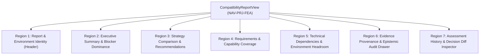

# Compatibility Report Information Architecture and Content Catalog

**Document ID:** `NLE-CAT-RIC-001`  
**Version:** 1.0.0  
**Phase:** 4 of 12 — Game Discovery & Compatibility Intelligence  
**Step:** 32 of 100 — Game-Pair Compatibility Report & Recommendation Experience Specification  
**Classification:** Information Architecture & Content Schema Catalog  
**Status:** Approved Specification  
**Authoritative Reference:** `NLE-DOM-SPEC-001`, `NLE-SPC-CAC-001`, `NLE-SPC-CRD-001`, `NLE-CAT-RIA-001`

---

## 1. Catalog Purpose & Scope

This catalog formally defines the **Information Architecture (IA)** and **Content Schema** for the NexLudic Engine Game-Pair Compatibility Report view. It establishes:
1. Every user-visible section, block, card, table, and data field rendered in the report view.
2. The exact authoritative source-of-truth service and domain model backing each field.
3. Field presence rules: `REQUIRED`, `OPTIONAL`, `CONDITIONALLY_REQUIRED`, `UNKNOWN`, or `NOT_APPLICABLE`.
4. Formatting rules, sanitization contracts, and redaction boundaries for sensitive local paths.
5. Invalidation triggers and data dependencies across the assessment pipeline.

---

## 2. Content Hierarchy & Region Map

---

## 3. Data Field Catalog & Source-of-Truth Bindings

### 3.1 Region 1: Report & Environment Identity

This region establishes the authoritative context under which the compatibility evaluation occurred. It prevents conflating findings across different versions, installations, or rule sets.

| Field ID | Field Name | Data Type | Presence | Authoritative Source | Formatting & Constraints |
|:---|:---|:---|:---|:---|:---|
| `REP-IDN-01` | Report ID | `UUIDv4` | REQUIRED | `FeasibilityAssessment.ReportId` | Formatted as `REP-xxxx-xxxx` |
| `REP-IDN-02` | Project ID | `UUIDv4` | REQUIRED | `ProjectContext.ProjectId` | Displayed as `PRJ-xxxx` with link to Dashboard |
| `REP-IDN-03` | Host Game Identity | `CanonicalGameIdentity` | REQUIRED | `GameCatalogService` (`NLE-SPC-GDC-001`) | Canonical Title + Canonical ID |
| `REP-IDN-04` | Host Game Version | `GameVersionSummary` | REQUIRED | `LocalGameDiscoveryService` (`NLE-SPC-LID-001`) | Exact version string + Edition (`v1.5.97 Special Edition`) |
| `REP-IDN-05` | Host Verification State | `VerificationState` | REQUIRED | `LocalInstallationState` (`NLE-SPC-LID-001`) | Badge: `VERIFIED`, `DETECTED`, `MANUALLY_DECLARED`, `UNVERIFIED` |
| `REP-IDN-06` | Guest Game Identity | `CanonicalGameIdentity` | REQUIRED | `GameCatalogService` (`NLE-SPC-GDC-001`) | Canonical Title + Canonical ID |
| `REP-IDN-07` | Guest Game Version | `GameVersionSummary` | REQUIRED | `LocalGameDiscoveryService` (`NLE-SPC-LID-001`) | Exact version string + Edition (`v2.1.0 Enhanced Edition`) |
| `REP-IDN-08` | Guest Verification State | `VerificationState` | REQUIRED | `LocalInstallationState` (`NLE-SPC-LID-001`) | Badge: `VERIFIED`, `DETECTED`, `MANUALLY_DECLARED`, `UNVERIFIED` |
| `REP-IDN-09` | Assessment Revision | `Integer` | REQUIRED | `FeasibilityAssessment.Revision` | Incremental revision number (`Rev 3`) |
| `REP-IDN-10` | Evaluation Timestamp | `ISO-8601 UTC` | REQUIRED | `EvaluationTrace.EvaluatedAt` | Rendered in local time + relative ago (`2 hours ago`) |
| `REP-IDN-11` | Freshness State | `AssessmentFreshnessState` | REQUIRED | `FreshnessPolicyService` (`NLE-POL-RVG-001`) | Badge: `FRESH`, `STALE_EVIDENCE`, `STALE_VERSION`, `STALE_RULESET` |
| `REP-IDN-12` | Rule Set Version | `SemanticVersion` | REQUIRED | `RuleCatalogService` (`NLE-SPC-CRD-001`) | Rule catalog release version (`v1.2.0`) |
| `REP-IDN-13` | Primary Mashup Goal | `String` (1-200 chars) | REQUIRED | `ProjectRequirements.PrimaryGoal` | Plain-language goal captured during project creation |

---

### 3.2 Region 2: Executive Summary & Blocker Dominance

This region renders the high-level synthesis of feasibility. If any mandatory blocker is active, this region immediately surfaces a high-severity alert overriding standard recommendations.

| Field ID | Field Name | Data Type | Presence | Authoritative Source | Formatting & Constraints |
|:---|:---|:---|:---|:---|:---|
| `REP-SUM-01` | Primary Feasibility Verdict | `FeasibilityOutcomeEnum` | REQUIRED | `FeasibilityAssessment.Outcome` | `CMP-041 FeasibilityOutcomeBadge`: `FEASIBLE_CONDITIONAL`, `PARTIAL`, `BLOCKED`, `IMPOSSIBLE`, `UNKNOWN`, `STALE` |
| `REP-SUM-02` | Executive Summary Text | `MarkdownText` | REQUIRED | `EvaluationTrace.SynthesizedSummary` | Plain-language summary (max 300 words). Explicitly states known vs. unknown scope. |
| `REP-SUM-03` | Active Blocker Count | `Integer` | REQUIRED | `EvaluationTrace.ActiveBlockers.Count` | Number of active blocking constraints (0..n) |
| `REP-SUM-04` | Blocker Detail List | `List<BlockerRecord>` | CONDITIONAL | `EvaluationTrace.ActiveBlockers` | Required if Count > 0. Displays Blocker Code (`BLK-SEC-01`), Category, Impact, and Resolution Path. |
| `REP-SUM-05` | Unresolved Mandatory Count| `Integer` | REQUIRED | `RequirementsCoverage.UnresolvedCount` | Number of mandatory requirements lacking coverage |
| `REP-SUM-06` | Next Safe Action Label | `String` | REQUIRED | `FeasibilityAssessment.NextAction` | Actionable button/banner: *"Resolve Unverified Game Installation"* or *"Review Strategy A Trade-Offs"* |
| `REP-SUM-07` | Next Safe Action Route | `NavigationRoute` | REQUIRED | `NavigationHierarchy` | Target workspace route (e.g. `NAV-PRJ-ENG`, `NAV-PRJ-REQ`, `NAV-PRJ-PLN`) |

---

### 3.3 Region 3: Strategy Comparison & Recommendation

This region compares the three candidate architectures and presents the justified recommendation.

| Field ID | Field Name | Data Type | Presence | Authoritative Source | Formatting & Constraints |
|:---|:---|:---|:---|:---|:---|
| `REP-STR-01` | Recommended Strategy | `IntegrationStrategyEnum` | REQUIRED | `StrategyEvaluationSummary.Recommended` | `STRATEGY_A_HOST_MOD`, `STRATEGY_B_LIVE_BRIDGE`, `STRATEGY_C_HYBRID`, or `NONE_DEFENSIBLE` |
| `REP-STR-02` | Recommendation Justification | `MarkdownText` | REQUIRED | `StrategyEvaluationSummary.Justification` | Structured rationale detailing addressed requirements and evidence maturity |
| `REP-STR-03` | Strategy A Suitability | `StrategyStatusEnum` | REQUIRED | `StrategyEvaluationRecord[STR_A].Status` | `STRATEGY_RECOMMENDED`, `VIABLE_WITH_CONDITIONS`, `DEFERRED`, `UNVIABLE`, `PROHIBITED` |
| `REP-STR-04` | Strategy A Coverage | `RequirementCoverageRatio` | REQUIRED | `StrategyEvaluationRecord[STR_A].Coverage` | Displayed as `X of Y Requirements Addressed` (Anti-aggregation: no percentages) |
| `REP-STR-05` | Strategy A Trade-Offs | `List<TradeOffItem>` | REQUIRED | `StrategyEvaluationRecord[STR_A].TradeOffs` | Bulleted list of technical overheads (e.g. "Requires complex Havok-to-PhysX bone mapping") |
| `REP-STR-06` | Strategy B Suitability | `StrategyStatusEnum` | REQUIRED | `StrategyEvaluationRecord[STR_B].Status` | Same enum values as STR-03 |
| `REP-STR-07` | Strategy B Coverage | `RequirementCoverageRatio` | REQUIRED | `StrategyEvaluationRecord[STR_B].Coverage` | Same formatting as STR-04 |
| `REP-STR-08` | Strategy B Trade-Offs | `List<TradeOffItem>` | REQUIRED | `StrategyEvaluationRecord[STR_B].TradeOffs` | IPC latency, multi-monitor/window synchronization overhead |
| `REP-STR-09` | Strategy C Suitability | `StrategyStatusEnum` | REQUIRED | `StrategyEvaluationRecord[STR_C].Status` | Same enum values as STR-03 |
| `REP-STR-10` | Strategy C Coverage | `RequirementCoverageRatio` | REQUIRED | `StrategyEvaluationRecord[STR_C].Coverage` | Same formatting as STR-04 |
| `REP-STR-11` | Strategy C Trade-Offs | `List<TradeOffItem>` | REQUIRED | `StrategyEvaluationRecord[STR_C].TradeOffs` | Extreme architectural complexity; dual runtime debugging |

---

### 3.4 Region 4: Requirements & Capability Coverage Grid

This region provides itemized coverage tracking for each user requirement across the 8 assessment dimensions defined in `NLE-SPC-CAC-001`.

| Field ID | Field Name | Data Type | Presence | Authoritative Source | Formatting & Constraints |
|:---|:---|:---|:---|:---|:---|
| `REP-REQ-01` | Requirement ID | `String` | REQUIRED | `CapabilityRequirement.Id` | Stable requirement key (`REQ-01`, `REQ-02`) |
| `REP-REQ-02` | Requirement Name | `String` | REQUIRED | `CapabilityRequirement.Title` | Concise title (e.g., "Custom Vehicle Mesh Injection") |
| `REP-REQ-03` | Dimension Category | `AssessmentDimensionEnum` | REQUIRED | `CapabilityRequirement.Dimension` | One of 8 dimensions: `ASSET_PIPELINE`, `PHYSICS`, `MEMORY_HOOKING`, `INPUT_CONTROL`, `TELEMETRY_IPC`, `RENDER_HOOK`, `AUDIO`, `STATE_SYNC` |
| `REP-REQ-04` | Priority Classification | `PriorityEnum` | REQUIRED | `CapabilityRequirement.Priority` | `MANDATORY`, `OPTIONAL`, `CONDITIONAL` |
| `REP-REQ-05` | Coverage Finding | `CoverageOutcomeEnum` | REQUIRED | `RequirementCoverageRecord.Outcome` | `COVERAGE_SATISFIED`, `COVERAGE_PARTIAL`, `COVERAGE_UNRESOLVED_UNKNOWN`, `COVERAGE_UNSUPPORTED`, `COVERAGE_BLOCKED` |
| `REP-REQ-06` | Addressing Strategy | `Set<StrategyEnum>` | REQUIRED | `RequirementCoverageRecord.Strategies` | Badges indicating which strategies can fulfill this requirement |
| `REP-REQ-07` | Primary Evidence Citation | `EvidenceCitationSummary` | OPTIONAL | `RequirementCoverageRecord.PrimaryEvidence`| Clickable citation chip opening the Evidence Drawer (`[EVD-8021]`) |
| `REP-REQ-08` | Missing Prerequisites | `List<String>` | CONDITIONAL | `RequirementCoverageRecord.MissingItems` | Displayed if status is `PARTIAL` or `UNRESOLVED` |
| `REP-REQ-09` | Requirement Detail Drawer | `NavigationAction` | REQUIRED | UI Interaction Contract | Opens side sheet with full rule evaluation chain |

---

### 3.5 Region 5: Technical Dependencies & Environment Headroom

| Field ID | Field Name | Data Type | Presence | Authoritative Source | Formatting & Constraints |
|:---|:---|:---|:---|:---|:---|
| `REP-DEP-01` | Bitness Match State | `BitnessEvaluation` | REQUIRED | `RULE-STR-HM-001` Result | `MATCH (64-bit / 64-bit)`, `MISMATCH_FATAL (32-bit / 64-bit)` |
| `REP-DEP-02` | Extension / Mod Framework | `FrameworkRequirement` | REQUIRED | `CapabilityRuleExecutionEngine` | Framework name + minimum version (`SKSE64 >= 2.0.20`) |
| `REP-DEP-03` | Framework Installation Status| `VerificationState` | REQUIRED | `LocalGameDiscoveryService` | `INSTALLED_VERIFIED`, `MISSING`, `INCOMPATIBLE_VERSION` |
| `REP-DEP-04` | Memory Headroom Estimate | `MemoryMetric` | REQUIRED | `EnvironmentProfilerService` | Estimated RAM footprint + Available System RAM (`Req: 4.2GB, Avail: 16.0GB`) |
| `REP-DEP-05` | IPC Transport Support | `TransportCapability` | REQUIRED | `RULE-STR-LB-001` Result | `SHARED_MEMORY_WIN32`, `NAMED_PIPES`, `LOCAL_WEBSOCKET` |
| `REP-DEP-06` | OS Kernel / Platform | `PlatformSummary` | REQUIRED | `EnvironmentContext.Platform` | Windows version, build number, Integrity Level (`Win11 23H2 / Medium Integrity`) |

---

### 3.6 Region 6: Evidence Provenance & Epistemic Audit Drawer

| Field ID | Field Name | Data Type | Presence | Authoritative Source | Formatting & Constraints |
|:---|:---|:---|:---|:---|:---|
| `REP-EVD-01` | Evidence ID | `UUIDv4` / `String` | REQUIRED | `EvidenceRecord.Id` | Stable evidence identifier (`EVD-8021`) |
| `REP-EVD-02` | Evidence Title | `String` | REQUIRED | `EvidenceRecord.Title` | Descriptive title of source material |
| `REP-EVD-03` | Epistemic Maturity Tier | `EpistemicTierEnum` | REQUIRED | `EvidenceRecord.MaturityTier` | `TIER_1_REPRODUCED`, `TIER_2_DOCUMENTED`, `TIER_3_COMMUNITY`, `TIER_4_INDIRECT` |
| `REP-EVD-04` | Source Origin / Provider | `String` | REQUIRED | `EvidenceRecord.ProviderId` | Official Docs, GitHub Release, Reverse Engineering Benchmark |
| `REP-EVD-05` | Cryptographic Content Hash | `String` (SHA-256) | REQUIRED | `EvidenceRecord.ContentHash` | Truncated hex display (`sha256:7f83b1...`) with copy action |
| `REP-EVD-06` | Collection Timestamp | `ISO-8601 UTC` | REQUIRED | `EvidenceRecord.CollectedAt` | ISO date string |
| `REP-EVD-07` | Claim Target | `String` | REQUIRED | `EvidenceRecord.TargetClaim` | Specific technical fact validated by this evidence |
| `REP-EVD-08` | Redacted File Reference | `SanitizedPath` | OPTIONAL | `EvidenceRecord.LocalArtifactPath`| Host-sanitized path (e.g. `[ProjectRoot]\evidence\skse_bench.json`) |
| `REP-EVD-09` | Conflict Status | `ConflictStatusEnum` | REQUIRED | `EvidenceRecord.ConflictStatus` | `NO_CONFLICTS`, `DISPUTED_CONFIRMED`, `SUPERSEDED` |

---

### 3.7 Region 7: Assessment History & Decision Diff Inspector

| Field ID | Field Name | Data Type | Presence | Authoritative Source | Formatting & Constraints |
|:---|:---|:---|:---|:---|:---|
| `REP-HIS-01` | Historical Revisions List | `List<RevisionSummary>` | REQUIRED | `FeasibilityAssessmentService` | List of historical evaluation events for this project |
| `REP-HIS-02` | Reassessment Trigger Cause | `TriggerCauseEnum` | REQUIRED | `AssessmentRevision.TriggerCause` | `INITIAL_EVALUATION`, `GAME_VERSION_UPDATED`, `RULESET_UPGRADED`, `REQUIREMENT_ADDED`, `EVIDENCE_INVALIDATED` |
| `REP-HIS-03` | Diff Summary | `List<FindingDelta>` | CONDITIONAL | `EvaluationTrace.DiffEngine` | Required if Revision > 1. Shows what changed (e.g. `REQ-02: UNKNOWN -> SATISFIED`). |
| `REP-HIS-04` | Superseded Assessment Link | `NavigationAction` | CONDITIONAL | UI History Inspector | Loads read-only snapshot of previous revision marked with `SUPERSEDED` watermark |

---

## 4. Path Redaction & Privacy Contracts (`DEC-009`, `REQ-SEC-001`)

To strictly protect user privacy and avoid leaking filesystem details in exportable reports or UI screenshots, the following redaction rules are enforced:
1. **User Directory Redaction:** Paths containing `C:\Users\<username>\` must be rendered as `~` or `<UserHome>`.
2. **Drive Volume Normalization:** Project data located on `D:\NexLudic\Projects\<id>\` (`DEC-009`) must render as `<ProjectRoot>\`.
3. **Registry and Process Keys:** Internal Windows registry roots (`HKEY_LOCAL_MACHINE\SOFTWARE\...`) must be truncated to standard provider prefixes (`HKLM:\...\SkyrimSpecialEdition`).
4. **Zero Credential or Auth Token Display:** External metadata API tokens or user session identifiers must never appear in report models or traces.

