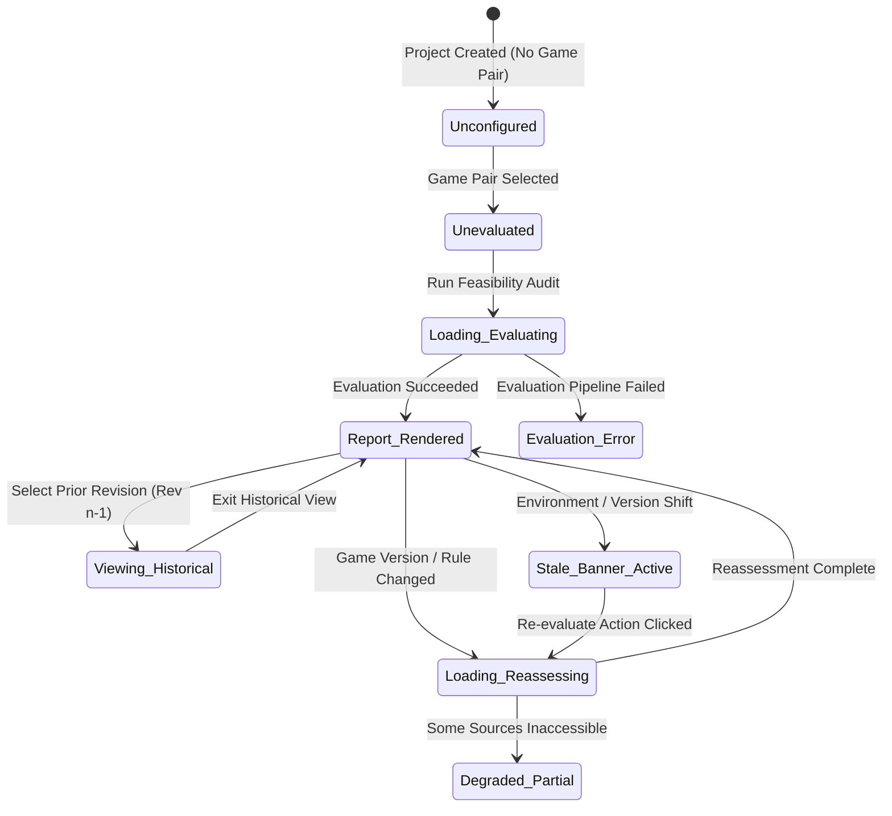

# Compatibility Report Interaction and State Specification

**Document ID:** `NLE-SPC-RIS-001`  
**Version:** 1.0.0  
**Phase:** 4 of 12 — Game Discovery & Compatibility Intelligence  
**Step:** 32 of 100 — Game-Pair Compatibility Report & Recommendation Experience Specification  
**Classification:** Interaction State Model & Error Recovery Specification  
**Status:** Approved Specification  
**Authoritative Reference:** `NLE-DOM-SPEC-001`, `UI_STATUS_EMPTY_LOADING_AND_ERROR_STATE_CATALOG.md`, `ERROR_TAXONOMY_AND_USER_MESSAGE_CATALOG.md`, `OPERATION_RETRY_AND_ERROR_RECOVERY_SPECIFICATION.md`

---

## 1. Report Interaction State Architecture

The Compatibility Report view (`NAV-PRJ-FEA`) participates in a rigorous, multi-state lifecycle that handles everything from unconfigured projects to partial evaluations, background reassessments, offline evidence providers, and historical diffing.

---

## 2. Empty & Unconfigured State Specifications

Empty states must inform users exactly what is missing and guide them to the appropriate setup destination without presenting missing setup as an engine failure or an incompatible game pair.

### 2.1 State ES-01: No Game Pair Selected
- **Trigger Condition:** User navigates to `NAV-PRJ-FEA`, but the active project has not bound a Host and Donor game.
- **Visual Presentation:** Center-aligned empty container with `icon-layers-off`.
- **Title:** "No Game Pair Selected for this Project"
- **Description:** "Compatibility evaluation requires both a Host Game (target environment) and a Guest Game (asset or logic donor). Configure your game pair in Project Settings to enable compatibility intelligence."
- **Primary Safe Action:** `[Select Game Pair in Settings]` -> routes cleanly to `NAV-PRJ-SET`.

### 2.2 State ES-02: Game Pair Bound but Assessment Never Run
- **Trigger Condition:** Host and Guest games are assigned, but no `FeasibilityAssessment` record exists for the current project.
- **Visual Presentation:** Center-aligned container with `CMP-041 FeasibilityOutcomeBadge` set to `UNEVALUATED`.
- **Title:** "Compatibility Assessment Not Yet Performed"
- **Description:** "NexLudic Engine is ready to evaluate technical feasibility between Game A (v1.5.97) and Game B (v2.1.0) across all 8 compatibility dimensions and 3 integration architectures."
- **Primary Safe Action:** `[Run Initial Feasibility Audit]` -> initiates read-only `Stage A` evaluation pipeline.
- **Secondary Action:** `[Review Declared Requirements]` -> routes to `NAV-PRJ-REQ`.

### 2.3 State ES-03: No User Requirements Declared
- **Trigger Condition:** Game pair is assigned, but project requirements list is empty ($|R| = 0$).
- **Visual Presentation:** Center-aligned card with `icon-list-bullet`.
- **Title:** "No Mashup Goals or Capabilities Declared"
- **Description:** "The compatibility engine evaluates feasibility against specific functional goals (such as asset injection, physics transfer, or telemetry bridging). Declare at least one capability requirement to evaluate strategy coverage."
- **Primary Safe Action:** `[Declare Mashup Requirements]` -> routes to `NAV-PRJ-REQ`.

---

## 3. Loading, In-Progress & Cancellation States

The report must provide clear visual feedback during pipeline execution without locking the application window or presenting frozen interfaces.

### 3.1 State LS-01: Initial Report & Rule Pipeline Execution
- **Trigger Condition:** User triggers `[Run Feasibility Audit]`.
- **Visual Presentation:** Skeleton view of the report structure + determinate progress card (`CMP-026 OperationProgressCard`).
- **Progressive Step Indicators:**
  - *Stage A–D:* "Validating Game Versions & Checking Security Policies…" (25%)
  - *Stage E–G:* "Evaluating Strategy A, B, and C Compatibility Rules…" (60%)
  - *Stage H–J:* "Synthesizing Recommendations & Generating Evidence Trace…" (90%)
- **Cancellation Contract:** User can click `[Cancel Evaluation]` at any time. Because evaluation is strictly read-only, cancellation safely aborts in-memory rule processing without database rollbacks or file corruption.

### 3.2 State LS-02: Background Reassessment on Stale Trigger
- **Trigger Condition:** User updates game installation path in `NAV-PRJ-ENG`; reassessment runs in background.
- **Visual Presentation:** Prior report remains visible with an overlay progress bar: *"Reassessing compatibility against updated Game A v1.6.640 installation… Existing findings displayed below."*
- **Integrity Rule:** Controls leading to strategy commitment (`[Select for Plan]`) are temporarily disabled with tooltip: *"Disabled during background reassessment."*

---

## 4. Partial, Degraded & Offline Provider States

When external data sources or local evidence files are partially unavailable, the report degrades gracefully rather than throwing generic error screens.

### 4.1 State DS-01: Offline Metadata Provider
- **Condition:** Metadata service for Guest Game is unreachable; only local cached headers are available.
- **Visual Treatment:** Non-modal informational banner at top of report:
  > *`[Info]` External metadata provider (PCGamingWiki / IGDB) is offline. Report was generated using local cached evidence. Version-specific modding capabilities may be incomplete.*
- **Outcome:** The report remains fully functional. Unverified requirements are marked `COVERAGE_UNRESOLVED_UNKNOWN` rather than failing the entire view.

### 4.2 State DS-02: Partial Strategy Evaluation
- **Condition:** Strategy A and B completed evaluation, but Strategy C could not be evaluated due to missing hybrid rule schemas.
- **Visual Treatment:** Strategy A and B render normal cards; Strategy C renders a degraded card:
  - Badge: `DEFERRED (INSUFFICIENT DATA)`
  - Description: *"Hybrid architecture could not be evaluated: required dual-engine profiling schemas are missing from RuleSet v1.2.0."*

---

## 5. Error & Recovery Specifications

All error conditions follow the centralized error taxonomy (`NLE-TAX-ERR-001`, Step 23).

| Error ID | Error Title | Cause / Context | UI Treatment | Safe Recovery Action |
|:---|:---|:---|:---|:---|
| `ERR-REP-001` | "Report Record Not Found" | Project assessment ID in route does not exist in local database. | Full-page error container with error code and project link. | `[Return to Project Dashboard]` |
| `ERR-REP-002` | "Rule Execution Timeout" | Complex rule dependency graph exceeded 10-second evaluation deadline. | Error alert banner over empty report container. | `[Retry with Core RuleSet Only]` |
| `ERR-REP-003` | "Corrupted Evidence Record" | Local evidence JSON failed cryptographic SHA-256 integrity check. | Warning alert in Evidence Drawer; drawer disables preview. | `[Re-fetch Evidence from Catalog]` |
| `ERR-REP-004` | "Version Context Incompatible"| Stored report references a game version hash that was deleted. | Inline error banner prompting version re-selection. | `[Select Detected Local Version]` |

---

## 6. Stale, Superseded & Historical Inspection States

### 6.1 State HS-01: Viewing Stale Assessment
- **Condition:** Local game installation was patched; current report evaluated prior version.
- **Visual Banner:** Persistent amber warning bar across the top of Region 1:
  > *`[Warning]` Stale Assessment: Game A was updated to v1.6.640 on 2026-11-16. This report reflects v1.5.97. Some compatibility conclusions may no longer apply.*
  > `[Re-evaluate Compatibility Now]`  `[Dismiss Warning]`

### 6.2 State HS-02: Viewing Historical Assessment Revision (Rev n-1)
- **Condition:** User selects an earlier revision from the Assessment History table to inspect what changed.
- **Visual Treatment:**
  - High-visibility banner across the entire viewport header:
    > *`[Eye Icon]` Viewing Historical Assessment (Revision 2 of 4 — Evaluated 2026-11-10). This is a read-only historical snapshot.*
    > `[Return to Current Assessment (Rev 4)]`
  - Subtle watermark across the background: `"HISTORICAL SNAPSHOT — READ ONLY"`.
  - All actionable buttons (`[Select for Plan]`, `[Re-evaluate]`) are disabled.

