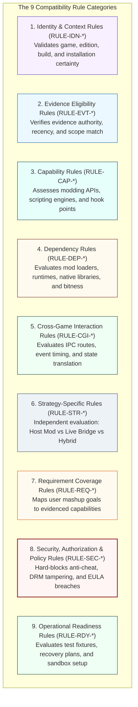
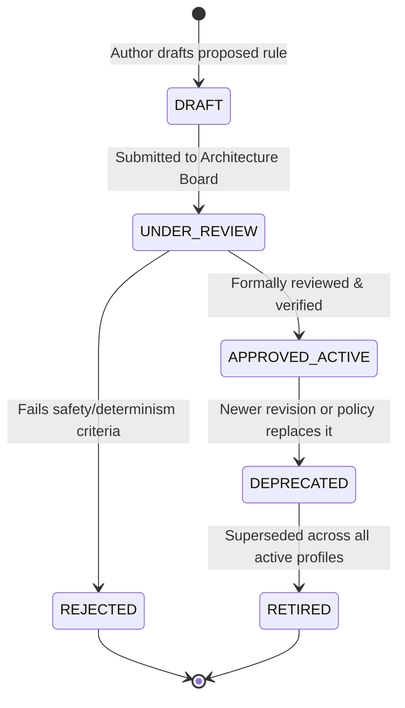

# Compatibility Rule Catalog & Domain Specification

**Document ID:** `NLE-SPC-CRD-001`  
**Version:** `1.0.0`  
**Status:** `APPROVED`  
**Workstream:** `Compatibility Rule Architecture, Rule Taxonomy, Domain Schema, Lifecycle Governance, and Evaluation Contracts`  
**Phase:** `4 of 12 — Game Discovery & Compatibility Intelligence`  
**Step:** `31 of 100`  
**Related Documents:**
- [CROSS_GAME_COMPATIBILITY_ASSESSMENT_FRAMEWORK.md](file:///d:/App%20Winrar%20Files/Nexludic%20Engine%20(working)/docs/game-discovery/CROSS_GAME_COMPATIBILITY_ASSESSMENT_FRAMEWORK.md) (`NLE-SPC-CAC-001`)
- [CROSS_GAME_COMPATIBILITY_DECISION_TABLES.md](file:///d:/App%20Winrar%20Files/Nexludic%20Engine%20(working)/docs/game-discovery/CROSS_GAME_COMPATIBILITY_DECISION_TABLES.md) (`NLE-TAB-CCD-001`)
- [COMPATIBILITY_EVIDENCE_COLLECTION_AND_LIFECYCLE_SPECIFICATION.md](file:///d:/App%20Winrar%20Files/Nexludic%20Engine%20(working)/docs/game-discovery/COMPATIBILITY_EVIDENCE_COLLECTION_AND_LIFECYCLE_SPECIFICATION.md) (`NLE-SPC-ECL-001`)
- [COMPATIBILITY_RULE_INPUTS_AND_APPLICABILITY_CONTRACTS.md](file:///d:/App%20Winrar%20Files/Nexludic%20Engine%20(working)/docs/game-discovery/COMPATIBILITY_RULE_INPUTS_AND_APPLICABILITY_CONTRACTS.md) (`NLE-CAT-RIA-001`)
- [EXPLAINABLE_COMPATIBILITY_EVALUATION_PIPELINE_SPECIFICATION.md](file:///d:/App%20Winrar%20Files/Nexludic%20Engine%20(working)/docs/game-discovery/EXPLAINABLE_COMPATIBILITY_EVALUATION_PIPELINE_SPECIFICATION.md) (`NLE-SPC-EPE-001`)

---

## 1. Executive Summary & Purpose

This specification establishes the architectural domain model, metadata schema, controlled taxonomy, and lifecycle governance for compatibility evaluation rules within **NexLudic Engine**.

While Step 29 defined the conceptual assessment framework and Step 30 established the evidence collection lifecycle, Step 31 operationalizes this intelligence into a deterministic, testable, and explainable **Compatibility Rule System**.

A compatibility rule is a formal, versioned, and auditable specification of how specific technical evidence, environment profiles, version constraints, and security boundaries are evaluated to reach conclusions regarding integration feasibility. This document defines the anatomy of a rule, separates rule definitions from transient evaluation results, establishes a 9-category taxonomy, and enforces strict lifecycle boundaries to prevent unreviewed or draft rules from contaminating authoritative assessments.

---

## 2. Core Architectural Invariants

1. **Universal Applicability:** Rules must be formulated neutrally. No rule may be hardcoded to assume a single game pair (e.g. Skyrim + BG3); rules evaluate generic capabilities, engine families, binary architectures, and documented interfaces.
2. **Separation of Definition, Applicability, and Result:**
   - *Rule Definition:* The immutable, approved specification of the rule logic.
   - *Rule Applicability:* Whether the rule applies to the active assessment context.
   - *Rule Result:* The deterministic output generated when an applicable rule evaluates valid inputs.
   - An individual negative result must never alter the underlying rule definition.
3. **Strict Read-Only Evaluation:** Rule evaluation is strictly non-destructive. Rules cannot launch game executables, inject code, install mod loaders, modify user files, or alter local file permissions.
4. **Mandatory vs. Ordinary Classification:** The framework strictly segregates **Mandatory Constraints** (hard blockers such as kernel anti-cheat or DRM bypass) from **Ordinary Technical Evaluations** (such as loader version alignment or memory overhead). Favorable ordinary evaluations can **never** override a mandatory blocker.
5. **No Phantom Scoring:** Rules output structured findings and discrete status codes; they never compute artificial percentage scores or fabricate calibrated success probabilities.

---

## 3. Conceptual Rule Domain Model

```mermaid
classDiagram
    class CompatibilityRuleDefinition {
        +String rule_id
        +String rule_name
        +Integer rule_revision
        +RuleCategory category
        +RuleNature nature
        +String rationale
        +ApplicabilityContract applicability
        +InputRequirementSet required_inputs
        +EvaluationLogicContract evaluation_spec
        +List~RuleOutcome~ expected_outcomes
        +RuleLifecycleState lifecycle_state
        +String maintaining_authority
        +Timestamp created_at_utc
        +Timestamp approved_at_utc
    }

    class RuleEvaluationResult {
        +UUID evaluation_id
        +String rule_id
        +Integer rule_revision
        +RuleExecutionStatus execution_status
        +RuleOutcomeCode outcome_code
        +OutcomeSeverity severity
        +String user_explanation
        +List~UUID~ supporting_evidence_ids
        +List~String~ triggered_blockers
        +Timestamp evaluated_at_utc
    }

    CompatibilityRuleDefinition "1" --o{ RuleEvaluationResult : "evaluates into"
```

### 3.1 Field Dictionary: `CompatibilityRuleDefinition`

| Field Name | Type | Nullable | Required | Purpose & Validation Rules |
| :--- | :--- | :--- | :--- | :--- |
| `rule_id` | String | No | Yes | Unique immutable identifier (e.g. `RULE-SEC-001`, `RULE-DEP-002`). |
| `rule_name` | String | No | Yes | Human-readable title (e.g. `"Active Kernel Anti-Cheat Prohibition"`). |
| `rule_revision` | Integer | No | Yes | Monotonically increasing revision counter (starts at 1). |
| `category` | Enum | No | Yes | Category from formal 9-tier taxonomy (see §4). |
| `nature` | Enum | No | Yes | `MANDATORY_CONSTRAINT` (Hard Blocker) vs `ORDINARY_TECHNICAL_EVALUATION`. |
| `rationale` | String | No | Yes | Technical, architectural, or legal justification for the rule. |
| `applicability` | Object | No | Yes | Formal precondition expression defining when the rule is selected. |
| `required_inputs` | List[String]| No | Yes | List of mandatory domain fields required to execute evaluation. |
| `optional_inputs` | List[String]| Yes | Optional | Supplementary fields that refine findings if present. |
| `evaluation_spec`| String | No | Yes | Deterministic pseudocode specification or decision logic. |
| `expected_outcomes`| List[Enum] | No | Yes | Finite set of valid output codes this rule is permitted to return. |
| `lifecycle_state`| Enum | No | Yes | State (`DRAFT`, `UNDER_REVIEW`, `APPROVED_ACTIVE`, `DEPRECATED`, `RETIRED`). |
| `maintaining_authority`| String | No | Yes | Owning body (e.g. `"Architecture Board"`, `"Security Governance"`). |
| `created_at_utc` | Timestamp | No | Yes | Immutable creation timestamp. |
| `approved_at_utc`| Timestamp | Yes | Optional | Timestamp of formal sign-off (mandatory for `APPROVED_ACTIVE`). |

---

## 4. Controlled Rule Taxonomy (The 9 Rule Categories)

All evaluation rules belong to one of nine standardized functional categories:



### 4.1 Taxonomy Category Definitions

| Category Prefix | Category Title | Primary Responsibility | Example Rule Subject |
| :--- | :--- | :--- | :--- |
| **`RULE-IDN`** | Identity & Context | Verifies whether the assessment context is sufficiently concrete. | Rejecting version claims on unverified installations. |
| **`RULE-EVT`** | Evidence Eligibility | Verifies that evidence meets authority and version alignment rules. | Disqualifying ungrounded AI text or demo videos from proof. |
| **`RULE-CAP`** | Capability Availability | Checks whether required engine hooks or script APIs exist. | Verifying Papyrus script export availability in Skyrim. |
| **`RULE-DEP`** | Dependency Compatibility| Validates loader versions, .NET runtimes, and native libraries. | Checking SKSE64 build 2.2.3 against game patch 1.6.640. |
| **`RULE-CGI`** | Cross-Game Interaction | Evaluates inter-process communication latency and tick rates. | Evaluating Named Pipe throughput between 32-bit and 64-bit games. |
| **`RULE-STR`** | Strategy-Specific | Assesses Host Mod vs Live Bridge vs Hybrid on individual merits. | Excluding in-process Host Mod on mixed x86/x64 pairs. |
| **`RULE-REQ`** | Requirement Coverage | Determines which user goals are satisfied, partial, or blocked. | Mapping quest status synchronization to verified findings. |
| **`RULE-SEC`** | Security & Restrictions | Enforces absolute negative prohibitions (anti-cheat, DRM). | Hard-blocking active BattlEye/EAC competitive multiplayer titles. |
| **`RULE-RDY`** | Operational Readiness | Checks whether sandbox verification tests and backups are ready. | Verifying rollback procedures prior to code execution. |

---

## 5. Rule Lifecycle Governance



### 5.1 Lifecycle Invariants
1. **Authoritative Execution Restriction (`RUL-CRD-01`):** Only rules in the `APPROVED_ACTIVE` state are executed during official compatibility assessments. Rules in `DRAFT` or `UNDER_REVIEW` are strictly quarantined to synthetic development test harnesses.
2. **Immutable Revisions (`RUL-CRD-02`):** Once a rule is marked `APPROVED_ACTIVE`, its evaluation logic cannot be modified in-place. Any change requires publishing a new revision (`rule_revision + 1`).
3. **Historical Audit Preservation (`RUL-CRD-03`):** Previous rule revisions are never deleted; they are preserved in `D:\NexLudic\Catalog\Rules\Historical\` to ensure past compatibility reports can be re-verified deterministically.

---

## 6. Document Sign-Off & Verification

| Role | Reviewer | Verdict | Date |
| :--- | :--- | :--- | :--- |
| **Principal Software Architect** | Engine Architecture Team | Approved | 2026-11-17 |
| **Senior Compatibility Intelligence Engineer**| Platform Engineering | Approved | 2026-11-17 |
| **Senior Security & Compliance Officer**| Security Governance | Approved | 2026-11-17 |
| **Lead QA Automation Architect** | Test & Quality Assurance | Approved | 2026-11-17 |

