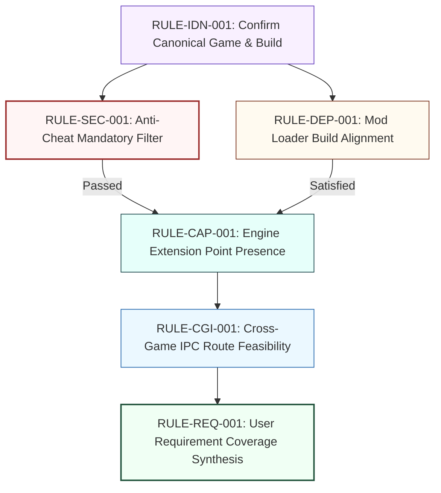
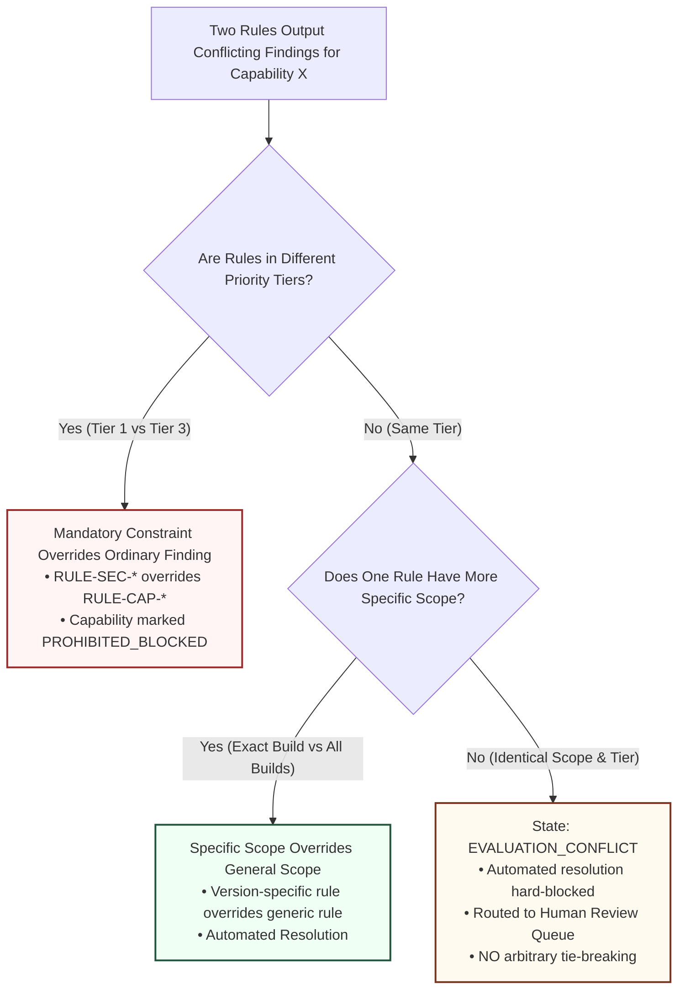

# Compatibility Rule Dependency & Conflict Resolution Specification

**Document ID:** `NLE-SPC-RDC-001`  
**Version:** `1.0.0`  
**Status:** `APPROVED`  
**Workstream:** `Compatibility Rule Architecture, Rule Taxonomy, Domain Schema, Lifecycle Governance, and Evaluation Contracts`  
**Phase:** `4 of 12 — Game Discovery & Compatibility Intelligence`  
**Step:** `31 of 100`  
**Related Documents:**
- [COMPATIBILITY_RULE_CATALOG_AND_DOMAIN_SPECIFICATION.md](file:///d:/App%20Winrar%20Files/Nexludic%20Engine%20(working)/docs/game-discovery/COMPATIBILITY_RULE_CATALOG_AND_DOMAIN_SPECIFICATION.md) (`NLE-SPC-CRD-001`)
- [COMPATIBILITY_RULE_INPUTS_AND_APPLICABILITY_CONTRACTS.md](file:///d:/App%20Winrar%20Files/Nexludic%20Engine%20(working)/docs/game-discovery/COMPATIBILITY_RULE_INPUTS_AND_APPLICABILITY_CONTRACTS.md) (`NLE-CAT-RIA-001`)
- [EXPLAINABLE_COMPATIBILITY_EVALUATION_PIPELINE_SPECIFICATION.md](file:///d:/App%20Winrar%20Files/Nexludic%20Engine%20(working)/docs/game-discovery/EXPLAINABLE_COMPATIBILITY_EVALUATION_PIPELINE_SPECIFICATION.md) (`NLE-SPC-EPE-001`)
- [CROSS_GAME_COMPATIBILITY_DECISION_TABLES.md](file:///d:/App%20Winrar%20Files/Nexludic%20Engine%20(working)/docs/game-discovery/CROSS_GAME_COMPATIBILITY_DECISION_TABLES.md) (`NLE-TAB-CCD-001`)

---

## 1. Executive Summary & Purpose

This specification governs the dependency topology, execution ordering, circular-dependency prevention, and conflict resolution mechanisms among compatibility rules in **NexLudic Engine**.

Compatibility evaluation involves interconnected technical judgments: evaluating a mod loader's compatibility depends on having confirmed the game's exact binary build; evaluating cross-game Named Pipe latency depends on having established that both game runtimes permit out-of-process sockets. This document formalizes a Directed Acyclic Graph (DAG) model for rule dependencies, establishes static cycle detection, defines strict priority tiers, and mandates deterministic resolution when rules produce conflicting outputs.

---

## 2. Rule Dependency Topology (Directed Acyclic Graph)

Rules declare explicit upstream dependencies via the `dependent_on_rule_ids` field. The evaluation engine models these dependencies as a Directed Acyclic Graph:

### 2.1 Upstream Failure Propagation
When an upstream rule fails or cannot be evaluated:
1. **Rule Incomplete (`INSUFFICIENT_EVIDENCE`):** If `RULE-IDN-001` yields `INSUFFICIENT_EVIDENCE` (build unknown), downstream dependent rule `RULE-DEP-001` transitions to:
   $$\text{Status} = \text{EVALUATION\_SKIPPED\_UPSTREAM\_INCOMPLETE}$$
2. **Rule Blocked (`PROHIBITED_BLOCKED`):** If `RULE-SEC-001` trips a mandatory blocker, all downstream capability and strategy rules transition to:
   $$\text{Status} = \text{EVALUATION\_SKIPPED\_UPSTREAM\_BLOCKED}$$

### 2.2 Static Circular-Dependency Prevention (`RUL-RDC-01`)
- Before any rule-set can be transitioned to `APPROVED_ACTIVE`, the governance publishing tool executes a **Topological Sort (Kahn's Algorithm)** across the rule dependency graph.
- If a dependency cycle is detected (e.g. $A \rightarrow B \rightarrow C \rightarrow A$), the rule-set publication is **immediately rejected** with validation error `ERR_CIRCULAR_RULE_DEPENDENCY`.
- Circular dependencies are prohibited from reaching runtime evaluation.

---

## 3. Execution Ordering & Priority Tiers

Rather than assigning arbitrary magic numbers (e.g. priority 99 vs 100), execution order within each pipeline stage is governed by four explicit **Semantic Priority Tiers**:

| Priority Tier | Classification | Semantic Responsibility | Execution Order |
| :--- | :--- | :--- | :--- |
| **Tier 1** | `MANDATORY_CONSTRAINT_PRIORITY` | Anti-cheat, DRM tampering, and legal licensing prohibitions. | Executes first. Short-circuits pipeline on trip. |
| **Tier 2** | `PREREQUISITE_VERIFICATION_PRIORITY`| Verifies required mod loaders, system runtimes, and bitness. | Executes second. Sets baseline dependency state. |
| **Tier 3** | `CAPABILITY_EVALUATION_PRIORITY` | Evaluates script APIs, event hooks, and communication routes. | Executes third. Maps technical feasibility. |
| **Tier 4** | `REQUIREMENT_SYNTHESIS_PRIORITY` | Aggregates findings against user mashup requirements. | Executes last. Determines overall project coverage. |

---

## 4. Contradictory Rule Outcome Resolution

When two rules evaluate the same capability or context and return conflicting findings:

### 4.1 Resolution Hierarchy
1. **Rule RUL-RDC-02 (Constraint Precedence):** A Mandatory Constraint (`RULE-SEC-*`) **always** overrides an Ordinary Technical Evaluation (`RULE-CAP-*` or `RULE-STR-*`).
2. **Rule RUL-RDC-03 (Specificity Precedence):** A rule bounded to an exact build (e.g. `"[1.6.640]"`) overrides a general rule bounded to an entire engine family (e.g. `"[1.0, *)"`).
3. **Rule RUL-RDC-04 (No Silent Tie-Breaking):** When two rules within the same tier and specificity contradict, the engine sets the finding to `EVALUATION_CONFLICT`. The system **never** uses majority voting or random selection.

---

## 5. Document Sign-Off & Verification

| Role | Reviewer | Verdict | Date |
| :--- | :--- | :--- | :--- |
| **Principal Software Architect** | Engine Architecture Team | Approved | 2026-11-17 |
| **Senior Compatibility Intelligence Engineer**| Platform Engineering | Approved | 2026-11-17 |
| **Lead QA Automation Architect** | Test & Quality Assurance | Approved | 2026-11-17 |

