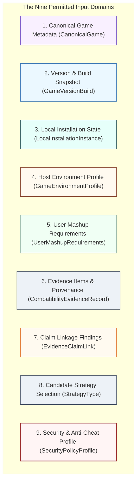
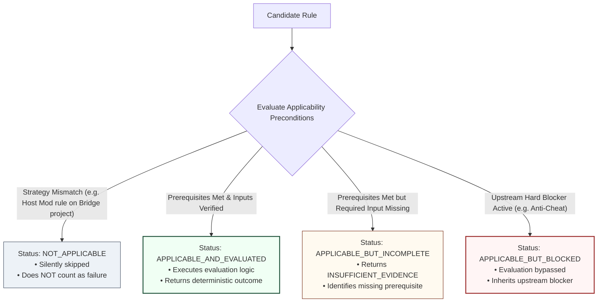

# Compatibility Rule Inputs & Applicability Contracts

**Document ID:** `NLE-CAT-RIA-001`  
**Version:** `1.0.0`  
**Status:** `APPROVED`  
**Workstream:** `Compatibility Rule Architecture, Rule Taxonomy, Domain Schema, Lifecycle Governance, and Evaluation Contracts`  
**Phase:** `4 of 12 — Game Discovery & Compatibility Intelligence`  
**Step:** `31 of 100`  
**Related Documents:**
- [COMPATIBILITY_RULE_CATALOG_AND_DOMAIN_SPECIFICATION.md](file:///d:/App%20Winrar%20Files/Nexludic%20Engine%20(working)/docs/game-discovery/COMPATIBILITY_RULE_CATALOG_AND_DOMAIN_SPECIFICATION.md) (`NLE-SPC-CRD-001`)
- [EXPLAINABLE_COMPATIBILITY_EVALUATION_PIPELINE_SPECIFICATION.md](file:///d:/App%20Winrar%20Files/Nexludic%20Engine%20(working)/docs/game-discovery/EXPLAINABLE_COMPATIBILITY_EVALUATION_PIPELINE_SPECIFICATION.md) (`NLE-SPC-EPE-001`)
- [COMPATIBILITY_RULE_DEPENDENCY_AND_CONFLICT_RESOLUTION_SPECIFICATION.md](file:///d:/App%20Winrar%20Files/Nexludic%20Engine%20(working)/docs/game-discovery/COMPATIBILITY_RULE_DEPENDENCY_AND_CONFLICT_RESOLUTION_SPECIFICATION.md) (`NLE-SPC-RDC-001`)
- [GAME_ENVIRONMENT_PROFILE_AND_COMPATIBILITY_CONTEXT_MODEL.md](file:///d:/App%20Winrar%20Files/Nexludic%20Engine%20(working)/docs/game-discovery/GAME_ENVIRONMENT_PROFILE_AND_COMPATIBILITY_CONTEXT_MODEL.md) (`NLE-DOM-ENV-001`)

---

## 1. Executive Summary & Purpose

This contract establishes the formal specifications for the input domains, input validation states, applicability preconditions, and standardized evaluation outcome codes consumed and produced by compatibility rules within **NexLudic Engine**.

Rules must never execute in an unconstrained environment or read arbitrary ambient variables. Every rule operates against a strictly bounded set of authorized inputs. This document defines the behavior of rules when inputs are missing, unknown, conflicting, or stale, and enforces deterministic distinctions between rules that are not applicable, rules that fail, and rules that cannot proceed due to upstream blockers.

---

## 2. Permitted Input Domain Catalog

Rules are permitted to consume inputs strictly from nine authorized domain contracts:

### 2.1 Input Data Invariants
1. **Rule RUL-RIA-01 (No Undocumented Inputs):** Rules are strictly prohibited from consuming environment variables, arbitrary filesystem paths outside the profile, host usernames, or undocumented network APIs.
2. **Rule RUL-RIA-02 (Local Path Isolation):** Rules evaluate architectural attributes (bitness, build IDs, DLL presence); they never evaluate or display raw host drive paths (`install_path`).

---

## 3. Formal Input Validation States

When an input is supplied to a rule, the evaluation engine classifies the input across six formal validation states:

| Input Validation State | Meaning & Definition | Engine Behavior |
| :--- | :--- | :--- |
| **`INPUT_CONFIRMED_VERIFIED`** | Input value is cryptographically verified (SHA-256 match) or confirmed via authoritative manifest. | Full rule evaluation authorized. |
| **`INPUT_DECLARED_UNVERIFIED`**| Input is asserted by user without local filesystem verification. | Rule evaluates under `PROVISIONAL` mode; cannot authorize execution. |
| **`INPUT_UNKNOWN`** | Field is unpopulated or undetectable (e.g. unknown build version). | Triggers non-blocking unknown handling; rule yields `INSUFFICIENT_EVIDENCE`. |
| **`INPUT_CONFLICTING`** | Two contradictory values supplied for the same field. | Suspends deterministic evaluation; sets rule state to `EVIDENCE_CONFLICT`. |
| **`INPUT_STALE`** | Value was verified in past, but disk timestamp indicates recent file modification. | Flags input as stale; triggers reassessment notice. |
| **`INPUT_CORRUPTED`** | Value violates structural schema or fails type constraints. | Rejects input immediately; logs input corruption warning. |

---

## 4. Rule Applicability Preconditions

Before executing a rule, the pipeline evaluates its **Applicability Contract**. A rule does not run simply because it exists in the catalog.

### 4.1 Applicability Invariants
1. **`NOT_APPLICABLE` $\ne$ Failure:** If a rule assessing in-process 32-bit/64-bit memory injection is skipped because the user selected *Live Interoperability Bridge*, the rule is marked `NOT_APPLICABLE`. It does **not** indicate a failure.
2. **Missing Input $\ne$ Incompatibility:** If a rule requires an exact game build number, and the build is currently `INPUT_UNKNOWN`, the rule outputs `OUTCOME_INSUFFICIENT_EVIDENCE`. It must **never** conclude that the game is incompatible.

---

## 5. Standardized Rule Outcome Codes

To ensure cross-system determinism, all rules must return one of six standardized outcome codes:

| Outcome Code | Meaning & Significance | Downstream Effect |
| :--- | :--- | :--- |
| **`OUTCOME_SATISFIED`** | Preconditions and evaluation logic fully met with adequate evidence. | Contributes positive finding to requirement coverage. |
| **`OUTCOME_PARTIALLY_SATISFIED`**| Primary conditions met, but non-critical limitations or optional gaps identified. | Contributes partial finding; flags advisory notice. |
| **`OUTCOME_UNSATISFIED`** | Technical conditions not met; required capability is demonstrably absent. | Flags capability as unsupported under current build. |
| **`OUTCOME_BLOCKED_BY_POLICY`** | Mandatory security, anti-cheat, or licensing restriction triggered. | **Critical Blocker:** Hard-blocks live execution. |
| **`OUTCOME_INSUFFICIENT_EVIDENCE`**| Required inputs or evidence items are unknown or unverified. | Preserves open research state; prompts user for input. |
| **`OUTCOME_EVIDENCE_CONFLICT`** | Contradictory evidence items exist within same authority tier. | Flags claim for Human Review Queue triage. |

---

## 6. Document Sign-Off & Verification

| Role | Reviewer | Verdict | Date |
| :--- | :--- | :--- | :--- |
| **Principal Software Architect** | Engine Architecture Team | Approved | 2026-11-17 |
| **Senior Compatibility Intelligence Engineer**| Platform Engineering | Approved | 2026-11-17 |
| **Senior QA Automation Architect** | Test & Quality Assurance | Approved | 2026-11-17 |

