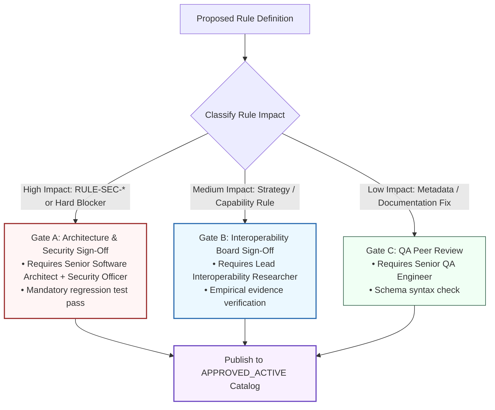

# Compatibility Rule Versioning, Governance & Reassessment Policy

**Document ID:** `NLE-POL-RVG-001`  
**Version:** `1.0.0`  
**Status:** `APPROVED`  
**Workstream:** `Compatibility Rule Architecture, Rule Taxonomy, Domain Schema, Lifecycle Governance, and Evaluation Contracts`  
**Phase:** `4 of 12 — Game Discovery & Compatibility Intelligence`  
**Step:** `31 of 100`  
**Related Documents:**
- [COMPATIBILITY_RULE_CATALOG_AND_DOMAIN_SPECIFICATION.md](file:///d:/App%20Winrar%20Files/Nexludic%20Engine%20(working)/docs/game-discovery/COMPATIBILITY_RULE_CATALOG_AND_DOMAIN_SPECIFICATION.md) (`NLE-SPC-CRD-001`)
- [EXPLAINABLE_COMPATIBILITY_EVALUATION_PIPELINE_SPECIFICATION.md](file:///d:/App%20Winrar%20Files/Nexludic%20Engine%20(working)/docs/game-discovery/EXPLAINABLE_COMPATIBILITY_EVALUATION_PIPELINE_SPECIFICATION.md) (`NLE-SPC-EPE-001`)
- [COMPATIBILITY_RULE_DEPENDENCY_AND_CONFLICT_RESOLUTION_SPECIFICATION.md](file:///d:/App%20Winrar%20Files/Nexludic%20Engine%20(working)/docs/game-discovery/COMPATIBILITY_RULE_DEPENDENCY_AND_CONFLICT_RESOLUTION_SPECIFICATION.md) (`NLE-SPC-RDC-001`)
- [ENVIRONMENT_CHANGE_AND_STALE_ASSESSMENT_POLICY.md](file:///d:/App%20Winrar%20Files/Nexludic%20Engine%20(working)/docs/game-discovery/ENVIRONMENT_CHANGE_AND_STALE_ASSESSMENT_POLICY.md) (`NLE-POL-ECS-001`)

---

## 1. Executive Summary & Purpose

This policy defines the governance procedures, formal approval gates, versioning semantics, publication validation requirements, and containment rollback mechanisms for compatibility rules within **NexLudic Engine**.

Compatibility rules constitute the core decision logic of the engine. A flawed or unvetted rule can erroneously declare a viable integration impossible, or worse, authorize code generation for a title protected by active anti-cheat. This document establishes strict governance standards ensuring that only formally approved rules execute in production, that all rule updates are versioned immutably, and that rule rollbacks preserve historical auditability without corrupting user workspace data.

---

## 2. Rule Approval Gates & Authority Boundaries

Rule proposals must pass through formal governance gates based on their operational impact:

### 2.1 Governance Sign-Off Invariant
- **Rule POL-RVG-01:** No rule in the `RULE-SEC-*` category (Security, DRM, Anti-Cheat) may be published to `APPROVED_ACTIVE` without explicit, cryptographically signed approval from both the **Principal Software Architect** and the **Lead Security Officer**.

---

## 3. Rule Versioning Semantics

Rule definitions follow semantic versioning conventions (`v<Major>.<Minor>.<Patch>`):

1. **Major Version Bump ($1.0.0 \rightarrow 2.0.0$):**
   - Triggered when evaluation logic is fundamentally altered, a new mandatory blocker is introduced, or an existing outcome definition changes.
   - *Impact:* **Invalidates all prior assessments.** All projects must re-evaluate when loading.
2. **Minor Version Bump ($1.0.0 \rightarrow 1.1.0$):**
   - Triggered when a new rule is added to the catalog or an existing rule supports additional optional capabilities.
   - *Impact:* Non-breaking; projects re-evaluate on next standard assessment pass.
3. **Patch Version Bump ($1.0.0 \rightarrow 1.0.1$):**
   - Triggered by typo corrections, documentation clarifications, or performance refactorings of evaluation logic that do not change outcomes.
   - *Impact:* Fully compatible; does not invalidate existing assessment records.

---

## 4. Publication Validation Conditions

Before any bundle of rules can be transitioned from `UNDER_REVIEW` to `APPROVED_ACTIVE`, it must satisfy four mandatory criteria:

1. **Cycle-Free DAG:** Topological sort across rule dependencies passes with zero circular references (`RUL-RDC-01`).
2. **Full Input Schema Resolution:** Every field declared in `required_inputs` maps to a verified domain entity in Step 27, 28, or 30.
3. **Unit Test Coverage:** Every individual rule must have at least one deterministic test specification in `STEP_31_COMPATIBILITY_RULE_VALIDATION_AND_REGRESSION_TEST_PLAN.md`.
4. **Volume D Isolation:** Rule bundle must reside in `D:\NexLudic\Catalog\Rules\Active\`.

---

## 5. Rollback & Containment Protocol

If a published rule revision is found to produce erroneous compatibility results or false-positive security blocks in the field:

```mermaid
stateDiagram-v2
    APPROVED_ACTIVE --> QUARANTINED : Logic defect / false-positive reported
    QUARANTINED --> ROLLED_BACK : Governance triggers rollback to v(n-1)
    ROLLED_BACK --> RETIRED : Post-mortem complete; superseded by v(n+1)
```

1. **Immediate Quarantine:** The affected rule revision is tagged `QUARANTINED_ROLLBACK`. The evaluation engine immediately ceases executing that revision.
2. **Restoration of Previous Active Version:** The engine falls back synchronously to the previous approved revision (`v(n-1)`).
3. **Affected Assessment Notification:** Any project workspace evaluated under the quarantined revision has its status updated to:
   $$\text{Status} = \text{STALE\_REASSESSMENT\_REQUIRED}$$
   $$\text{Reason} = \text{"Rule revision } vX.Y.Z \text{ quarantined due to logic defect. Re-evaluation required."}$$
4. **Historical Preservation:** The quarantined rule revision is archived permanently for post-mortem analysis; it is never deleted from repository history.

---

## 6. Document Sign-Off & Verification

| Role | Reviewer | Verdict | Date |
| :--- | :--- | :--- | :--- |
| **Principal Software Architect** | Engine Architecture Team | Approved | 2026-11-17 |
| **Senior Security & Compliance Officer**| Security Governance | Approved | 2026-11-17 |
| **Senior Systems Assurance Engineer**| Quality Assurance Governance | Approved | 2026-11-17 |

