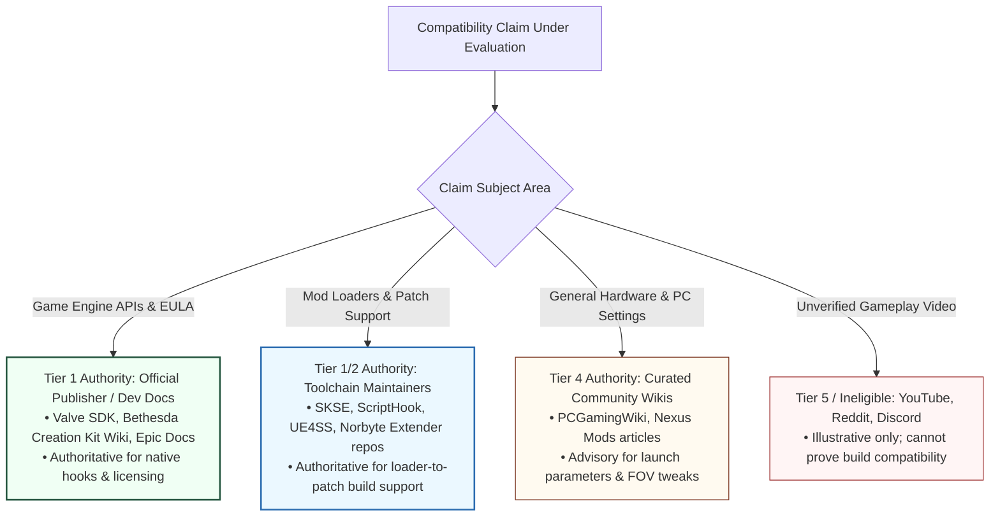

# Compatibility Source Eligibility & Collection Policy

**Document ID:** `NLE-POL-SEC-001`  
**Version:** `1.0.0`  
**Status:** `APPROVED`  
**Workstream:** `Compatibility Evidence Collection, Verification, Provenance Tracking, and Operational Lifecycle Architecture`  
**Phase:** `4 of 12 — Game Discovery & Compatibility Intelligence`  
**Step:** `30 of 100`  
**Related Documents:**
- [COMPATIBILITY_EVIDENCE_COLLECTION_AND_LIFECYCLE_SPECIFICATION.md](file:///d:/App%20Winrar%20Files/Nexludic%20Engine%20(working)/docs/game-discovery/COMPATIBILITY_EVIDENCE_COLLECTION_AND_LIFECYCLE_SPECIFICATION.md) (`NLE-SPC-ECL-001`)
- [GAME_METADATA_LICENSING_AND_DATA_GOVERNANCE_REVIEW.md](file:///d:/App%20Winrar%20Files/Nexludic%20Engine%20(working)/docs/game-discovery/GAME_METADATA_LICENSING_AND_DATA_GOVERNANCE_REVIEW.md) (`NLE-REV-LIC-001`)
- [COMPATIBILITY_EVIDENCE_RECORD_AND_PROVENANCE_SCHEMA_SPECIFICATION.md](file:///d:/App%20Winrar%20Files/Nexludic%20Engine%20(working)/docs/game-discovery/COMPATIBILITY_EVIDENCE_RECORD_AND_PROVENANCE_SCHEMA_SPECIFICATION.md) (`NLE-DOM-ERP-001`)
- [EVIDENCE_COLLECTION_SECURITY_PRIVACY_AND_FAILURE_RECOVERY_PLAN.md](file:///d:/App%20Winrar%20Files/Nexludic%20Engine%20(working)/docs/game-discovery/EVIDENCE_COLLECTION_SECURITY_PRIVACY_AND_FAILURE_RECOVERY_PLAN.md) (`NLE-PLN-ESP-001`)

---

## 1. Executive Summary & Purpose

This policy governs the eligibility criteria, domain authority classifications, licensing compliance safeguards, and network collection boundaries for acquiring external compatibility evidence in **NexLudic Engine**.

Public accessibility on the Internet does not equate to technical credibility, legal eligibility, or ethical collection. Ingesting arbitrary web content exposes the engine to malware, poisoned documentation, prompt injection attacks, copyright infringement, and rate-limiting blocks. This document establishes an authoritative domain whitelist, strictly regulates collection depths, mandates respectful network rate limits, and bars pirate or DRM-circumvention repositories from serving as evidence sources.

---

## 2. Source Classification & Authority by Claim Type

The technical authority of a source is **claim-specific**. No single source is universally authoritative across all technical dimensions:



### 2.1 Authority Mapping Matrix

| Subject Matter / Claim Type | Primary Authoritative Source | Secondary / Corroborating Source | Ineligible / Low-Authority Sources |
| :--- | :--- | :--- | :--- |
| **Engine Extension Points & APIs** | Official game publisher developer portal, engine SDK headers. | Verified open-source framework documentation. | Forum speculation, video clips. |
| **Patch Build-to-Loader Compatibility**| Official mod loader release notes, GitHub commit logs of maintainers. | Toolchain release announcement threads. | Generic gaming blogs, outdated wikis. |
| **Multiplayer / Anti-Cheat Boundaries**| Publisher EULA, official platform Terms of Service, anti-cheat developer specs. | Official support knowledge base articles. | Third-party cheat forums, pirate tutorials. |
| **Cross-Game Interop Bridge Telemetry**| Automated test harness execution logs (`TestExecutionRecord`). | Open-source bridge adapter maintainer specs. | Unverified social media announcements. |

---

## 3. Source Eligibility Classification & State Model

Every external source domain is evaluated against eligibility criteria and assigned one of five formal eligibility states:

```mermaid
stateDiagram-v2
    [*] --> UNKNOWN_PENDING_CHECK
    UNKNOWN_PENDING_CHECK --> ELIGIBLE_FOR_COLLECTION : Domain verified on Whitelist
    UNKNOWN_PENDING_CHECK --> CONDITIONALLY_ELIGIBLE : Community site; requires user opt-in
    UNKNOWN_PENDING_CHECK --> MANUAL_REVIEW_REQUIRED : Unrecognized commercial domain
    UNKNOWN_PENDING_CHECK --> REJECTED_INELIGIBLE : Blacklisted / Piracy / DRM bypass
    
    CONDITIONALLY_ELIGIBLE --> ELIGIBLE_FOR_COLLECTION : User grants specific permission
    CONDITIONALLY_ELIGIBLE --> REJECTED_INELIGIBLE : Security flag raised
```

1. **`ELIGIBLE_FOR_COLLECTION`:** Whitelisted, established documentation domain (e.g. `docs.unrealengine.com`, `github.com/ianpatt/skse64`). Automated collection authorized within bounded scope.
2. **`CONDITIONALLY_ELIGIBLE`:** Reputable community platform (e.g. Nexus Mods wiki, Steam Community guides). Collection authorized **only** with explicit user opt-in; evidence tagged as Tier 4.
3. **`MANUAL_REVIEW_REQUIRED`:** Commercial or private technical blog not previously audited. Requires engineering review before ingestion.
4. **`REJECTED_INELIGIBLE`:** Hard blacklisted domains. Includes:
   - Websites distributing cracked executables, keygens, or DRM bypasses.
   - Cheat development forums or malicious script distributors.
   - Domains violating robots.txt or requiring unauthorized credential bypass.
5. **`UNKNOWN_PENDING_CHECK`:** Newly discovered candidate URL; held in staging until domain reputation and terms are validated.

---

## 4. Collection Scope & Politeness Mandates

To protect external web servers, avoid denial-of-service triggers, and respect intellectual property:

1. **Zero Unbounded Web Crawling (`POL-SEC-01`):** The evidence collection engine strictly prohibits recursive web crawling. Collection is bounded to the specific target URI and immediate documentation anchors (maximum crawl depth = 1).
2. **Strict Politeness & Rate Limiting (`POL-SEC-02`):**
   - Maximum request frequency: **1 request per $1000\text{ ms}$** per domain.
   - Concurrent connections: Maximum **1 active connection** per external host.
   - User-Agent Identification: Standard transparent header: `NexLudicEngine-CompatibilityResearch/1.0 (+https://nexludic.org/bot-policy)`.
3. **Strict Timeout Bounds (`POL-SEC-03`):**
   - TCP Connection Timeout: **$5000\text{ ms}$ ($5\text{ seconds}$)**.
   - HTTP Read Timeout: **$10000\text{ ms}$ ($10\text{ seconds}$)**.
   - Maximum Payload Size: **$5\text{ MB}$** per document. Any response exceeding $5\text{ MB}$ is truncated and logged.

---

## 5. Licensing & Data Governance Constraints

1. **Text Quotation & Fair Use:** Captured evidence stores only minimal technical excerpts (code signatures, parameter tables, version compatibility statements) necessary to substantiate a claim. Whole-site scraping and full article republication are strictly prohibited.
2. **No Proprietary Asset Ingestion:** Evidence collection must **never** download proprietary game assets, compiled game binaries (`.exe`), game archives (`.bsa`, `.pak`), or proprietary 3D models.
3. **Volume D Storage Containment (`DEC-009`):** All cached documentation payloads and source indexes must be stored exclusively under:
   `D:\NexLudic\Catalog\Cache\EvidenceSources\`

---

## 6. Document Sign-Off & Verification

| Role | Reviewer | Verdict | Date |
| :--- | :--- | :--- | :--- |
| **Principal Software Architect** | Engine Architecture Team | Approved | 2026-11-17 |
| **Lead Privacy & Data Governance Officer**| Legal & Compliance | Approved | 2026-11-17 |
| **Senior Security Architect** | Security Operations | Approved | 2026-11-17 |

