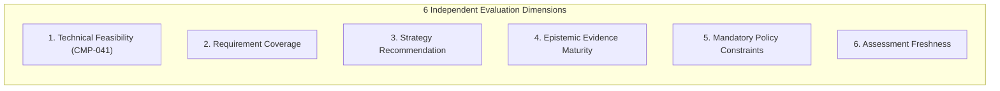

# Compatibility Status Visualization and Language Guide

**Document ID:** `NLE-GDE-SVL-001`  
**Version:** 1.0.0  
**Phase:** 4 of 12 — Game Discovery & Compatibility Intelligence  
**Step:** 32 of 100 — Game-Pair Compatibility Report & Recommendation Experience Specification  
**Classification:** Design Language & Visual Semantics Specification  
**Status:** Approved Specification  
**Authoritative Reference:** `NLE-DOM-SPEC-001`, `NLE-SPC-CAC-001`, `NLE-SPC-CRD-001`, `UI_COMPONENT_CATALOG_AND_CONTRACTS.md`

---

## 1. Visual Semantics Philosophy

NexLudic Engine operates under a strict anti-deception standard. Compatibility evaluations often involve high uncertainty, incomplete metadata, and emerging community research. The user interface must never mask technical ambiguity behind confident, decorative visual treatments.

### 1.1 The Golden Invariants
1. **Never Convey Status by Color Alone:** Every badge, card, and indicator must pair color tokens with distinct text labels, semantic icons, and explicit screen-reader accessible names (`aria-label`).
2. **Anti-Aggregation Invariant:** The system strictly rejects composite percentage scores (e.g. "85% Compatible"). A single mandatory blocker or unfulfilled prerequisite halts the strategy; averaging coverage states is prohibited.
3. **Explicit Unknown vs. Unsupported:** The UI must visually and semantically separate `UNKNOWN` (we have not evaluated or lack evidence) from `UNSUPPORTED` (we verified that it fails) and `BLOCKED` (prohibited by security or policy).
4. **No Forced Green Checkmarks:** A green badge is reserved exclusively for requirements verified by Tier 1 (`REPRODUCED_BEHAVIOR`) or Tier 2 (`DOCUMENTED_CAPABILITY`) evidence. Hypotheses or unverified declarations must use neutral or dashed visual treatments.

---

## 2. Multi-Dimensional Status Taxonomy

The report coordinates six distinct status dimensions. The UI must never collapse these dimensions into a single monolithic badge.

---

### 2.1 Dimension 1: Primary Feasibility Outcome (`CMP-041 FeasibilityOutcomeBadge`)

Bound directly to `FeasibilityAssessment.Outcome` (`NLE-SPC-CAC-001`).

| Enum Key | Display Label | Token Class | Accessible Name | Visual Description | Mandatory Tooltip / Disclaimer |
|:---|:---|:---|:---|:---|:---|
| `FEASIBLE_CONDITIONAL` | "Feasible (Conditional)" | `badge--success-outlined` | "Feasible under declared conditions" | Green 1px border, transparent bg, check-circle icon | *"Technical feasibility established for assessed versions. Requires adapter development and testing."* |
| `PARTIAL` | "Partially Feasible" | `badge--warning` | "Partially feasible; some requirements unfulfilled" | Amber solid border, subtle amber bg, slash-circle icon | *"Some requested capabilities are supported, but others lack technical routes."* |
| `INSUFFICIENT_EVIDENCE` | "Unknown / Needs Research" | `badge--neutral` | "Feasibility unknown due to insufficient evidence" | Slate-grey border and bg, help-circle icon | *"The platform currently lacks sufficient evidence to evaluate feasibility."* |
| `UNSUPPORTED` | "Technically Unsupported" | `badge--danger-outlined` | "Technically unsupported" | Red 1px border, transparent bg, x-circle icon | *"Evaluated capabilities are fundamentally incompatible under current game architectures."* |
| `PROHIBITED_BLOCKED` | "Blocked by Policy / Safety" | `badge--danger-solid` | "Blocked by platform security or legal policy" | Dark red solid bg, white text, shield-alert icon | *"Integration blocked by anti-cheat, DRM, or security policies. Cannot proceed."* |
| `STALE` | "Stale — Reassessment Needed" | `badge--warning-dashed` | "Assessment is stale and requires reevaluation" | Amber dashed border, clock-alert icon | *"Game installation, version, or rules have changed since this evaluation occurred."* |

---

### 2.2 Dimension 2: Requirement Coverage Outcomes

Evaluated per user requirement ($r \in R$) across the 8 assessment dimensions.

| Coverage Enum | Display Label | Icon Token | Token Styling | Screen-Reader Text | UX Definition |
|:---|:---|:---|:---|:---|:---|
| `COVERAGE_SATISFIED` | "Satisfied" | `icon-check` | `token-cov-satisfied` (Green text/icon) | "Requirement satisfied by evidence" | Technical route confirmed by Tier 1 or Tier 2 evidence. |
| `COVERAGE_PARTIAL` | "Partial" | `icon-split` | `token-cov-partial` (Amber text/icon) | "Requirement partially satisfied" | Partial route identified; some sub-capabilities missing. |
| `COVERAGE_UNRESOLVED_UNKNOWN`| "Unresolved (Unknown)" | `icon-help` | `token-cov-unknown` (Grey text/icon) | "Requirement unresolved; unknown feasibility" | No authoritative evidence currently associated. |
| `COVERAGE_UNSUPPORTED` | "Unsupported" | `icon-x` | `token-cov-unsupported` (Red text/icon) | "Requirement verified unsupported" | Evidence confirms requirement cannot be fulfilled. |
| `COVERAGE_BLOCKED` | "Blocked" | `icon-shield-lock`| `token-cov-blocked` (Crimson text/icon) | "Requirement blocked by mandatory policy" | Blocked by anti-cheat or architectural hard limit. |

---

### 2.3 Dimension 3: Strategy Recommendation & Suitability States

Evaluated independently for Strategy A (Host Mod), Strategy B (Live Bridge), and Strategy C (Hybrid).

| Strategy State Enum | Display Label | Badge Treatment | Decision Interpretation |
|:---|:---|:---|:---|
| `STRATEGY_RECOMMENDED` | "Recommended Route" | `badge--accent-prominent` (Cyan/Indigo) | Best-justified architecture satisfying mandatory requirements with superior evidence maturity. |
| `STRATEGY_VIABLE_WITH_CONDITIONS` | "Viable with Conditions" | `badge--info` (Blue outlined) | Architecturally sound but carries specific technical trade-offs or unfulfilled optional requirements. |
| `STRATEGY_DEFERRED_MISSING_EVIDENCE`| "Deferred (Needs Evidence)" | `badge--neutral-subtle` (Muted grey) | Cannot be safely evaluated or recommended until upstream probing or research occurs. |
| `STRATEGY_UNVIABLE` | "Unviable" | `badge--danger-muted` (Muted red) | Fails mandatory technical prerequisites (e.g. process bitness mismatch in Strategy A). |
| `STRATEGY_PROHIBITED` | "Prohibited" | `badge--danger-heavy` (Solid crimson) | Triggers a fatal policy or security blocker (e.g., active kernel anti-cheat). |

---

### 2.4 Dimension 4: Epistemic Evidence Maturity Tiers (`CMP-047`)

Directly reflects the provenance and empirical rigor of supporting evidence records (`NLE-SPC-ECL-001`).

| Epistemic Tier | Display Label | Visual Badge | Provenance Meaning | Example Evidence |
|:---|:---|:---|:---|:---|
| `TIER_1_REPRODUCED` | "Reproduced Behavior" | `tier--reproduced` (Solid purple) | Empirically observed and executed via reproducible test harness. | Local IPC benchmark run; memory injection test log. |
| `TIER_2_DOCUMENTED` | "Documented Capability" | `tier--documented` (Blue outlined) | Published in official developer documentation or API headers. | SDK header files; SKSE64 API documentation. |
| `TIER_3_COMMUNITY` | "Community Reported" | `tier--community` (Teal outlined) | Disclosed in modding wikis, forums, or third-party guides. | NexusMods mod description; community engine research forum. |
| `TIER_4_INDIRECT` | "Indirect / Heuristic" | `tier--heuristic` (Grey dashed) | Inferred from engine family, compiler version, or file extension heuristics. | Generic Unity mono capability inferred from file tree. |

---

### 2.5 Dimension 5: Assessment Freshness & Reassessment Triggers

Reflects whether the report accurately represents current project files and local environment state.

| Freshness State | Display Label | Header Treatment | Action Prompt |
|:---|:---|:---|:---|
| `ASSESSMENT_FRESH` | "Assessment Fresh" | Subtle green dot + timestamp | None required |
| `ASSESSMENT_STALE_VERSION` | "Game Version Changed" | Persistent warning banner across header | `[Re-evaluate Compatibility]` |
| `ASSESSMENT_STALE_ENVIRONMENT`| "Environment Changed" | Warning banner: local path/hardware altered | `[Verify Environment & Reassess]` |
| `ASSESSMENT_STALE_RULESET` | "New Rules Available" | Informational banner: Rule Catalog upgraded | `[Run Evaluation with RuleSet v1.3]` |
| `ASSESSMENT_STALE_EVIDENCE` | "Evidence Expired" | Warning banner: cited source marked stale/invalid | `[Refresh Evidence Citations]` |

---

## 3. Plain-Language Wording Guide & Anti-Deception Dictionary

Technical reports must use clear, measured prose. The following terminology dictionary is mandatory across all report views, tooltips, dialogs, and exported summaries:

### 3.1 Banned Wording vs. Approved Replacements

| Banned Unscientific Phrase | Why Banned | Mandatory Approved Phrasing |
|:---|:---|:---|
| *"100% Compatible"* / *"Fully Compatible"* | Inaccurate. Mod compatibility is always conditioned on version, mods, and environment. | *"Feasibility established under assessed version conditions."* |
| *"Guaranteed to work"* | The platform does not guarantee runtime execution before adapter testing. | *"Documented capability indicates probable feasibility."* |
| *"Incompatible"* (when unassessed) | Confuses absence of evidence with failure. | *"Feasibility unknown; insufficient evidence available."* |
| *"AI Verified"* | AI analysis is assistive inference, not empirical verification. | *"Synthesized analysis based on documented sources."* |
| *"Overall Compatibility Score: 85%"* | Numerical percentages falsely imply statistical measurement. | *"4 of 5 requirements addressed across assessed dimensions."* |
| *"Safe to install"* | The report is diagnostic and does not audit arbitrary binary safety. | *"No architectural blockers detected for this integration strategy."* |

### 3.2 Standardized Report Phrase Templates

1. **When Recommending a Strategy:**
   > *"Strategy A (Host-Game Modification) is currently recommended as the primary integration route. It satisfies 4 of your 5 declared requirements and is backed by Documented Capability evidence for both game runtimes. Review technical trade-offs before generating the integration plan."*

2. **When No Strategy is Defensible:**
   > *"No defensible recommendation is currently available. 3 of your mandatory requirements lack authoritative evidence. Further adapter probing or technical research is required before an architecture can be chosen."*

3. **When a Mandatory Blocker is Detected:**
   > *"Integration is Blocked by Security Policy (Code: BLK-SEC-01). Game B employs an active kernel-level anti-cheat driver that prohibits external memory mapping or live bridging. This project cannot proceed under Strategy A, B, or C."*

4. **When Findings are Stale:**
   > *"This compatibility assessment was performed against Game A v1.5.97. Your local installation was updated to v1.6.640 on 2026-11-16. Prior compatibility findings may no longer apply. Click Re-evaluate Compatibility to update."*

