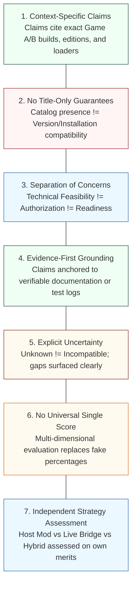
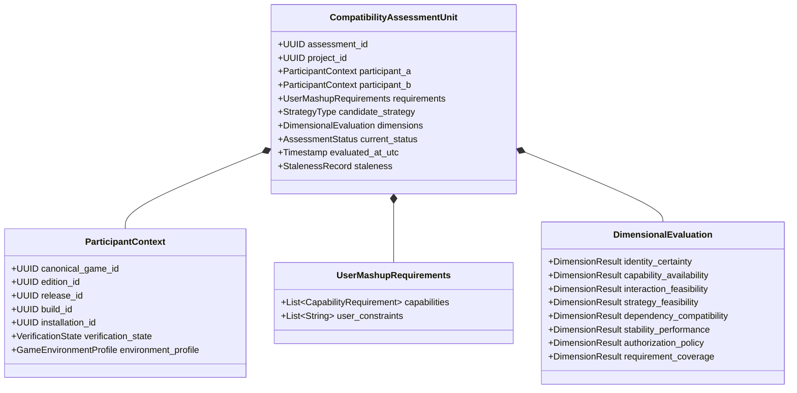
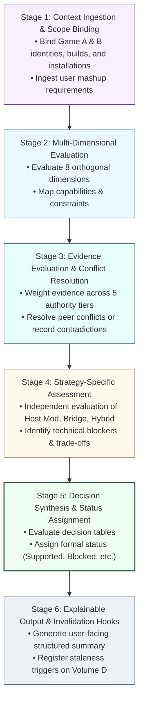

# Cross-Game Compatibility Assessment Framework

**Document ID:** `NLE-SPC-CAC-001`  
**Version:** `1.0.0`  
**Status:** `APPROVED`  
**Workstream:** `Cross-Game Compatibility Assessment Framework, Assessment Unit Modeling, Decision Rules, Multi-Dimensional Evaluation, and Strategy Comparison`  
**Phase:** `4 of 12 — Game Discovery & Compatibility Intelligence`  
**Step:** `29 of 100`  
**Related Documents:**
- [GAME_VERSION_EDITION_AND_ENVIRONMENT_COMPATIBILITY_MAPPING_SPECIFICATION.md](file:///d:/App%20Winrar%20Files/Nexludic%20Engine%20(working)/docs/game-discovery/GAME_VERSION_EDITION_AND_ENVIRONMENT_COMPATIBILITY_MAPPING_SPECIFICATION.md) (`NLE-SPC-VEC-001`)
- [GAME_PAIR_ENVIRONMENT_AND_DEPENDENCY_MAPPING_SPECIFICATION.md](file:///d:/App%20Winrar%20Files/Nexludic%20Engine%20(working)/docs/game-discovery/GAME_PAIR_ENVIRONMENT_AND_DEPENDENCY_MAPPING_SPECIFICATION.md) (`NLE-SPC-GPE-001`)
- [COMPATIBILITY_DIMENSION_AND_REQUIREMENT_COVERAGE_CATALOG.md](file:///d:/App%20Winrar%20Files/Nexludic%20Engine%20(working)/docs/game-discovery/COMPATIBILITY_DIMENSION_AND_REQUIREMENT_COVERAGE_CATALOG.md) (`NLE-CAT-CDC-001`)
- [COMPATIBILITY_EVIDENCE_QUALITY_AND_CONFLICT_RULES.md](file:///d:/App%20Winrar%20Files/Nexludic%20Engine%20(working)/docs/game-discovery/COMPATIBILITY_EVIDENCE_QUALITY_AND_CONFLICT_RULES.md) (`NLE-RUL-CEQ-001`)
- [CROSS_GAME_COMPATIBILITY_DECISION_TABLES.md](file:///d:/App%20Winrar%20Files/Nexludic%20Engine%20(working)/docs/game-discovery/CROSS_GAME_COMPATIBILITY_DECISION_TABLES.md) (`NLE-TAB-CCD-001`)
- [INTEGRATION_STRATEGY_COMPARISON_AND_FEASIBILITY_RULES.md](file:///d:/App%20Winrar%20Files/Nexludic%20Engine%20(working)/docs/game-discovery/INTEGRATION_STRATEGY_COMPARISON_AND_FEASIBILITY_RULES.md) (`NLE-RUL-ISC-001`)

---

## 1. Executive Summary & Purpose

This specification defines the architectural framework, evaluation pipeline, decision principles, and status model for evaluating cross-game compatibility within **NexLudic Engine**.

NexLudic Engine is designed to evaluate, design, develop, and validate integrations between two distinct games (*Game A* and *Game B*) via three primary strategies: **Host-Game Modification**, **Live Interoperability Bridging**, or **Hybrid Integration**.

Cross-game compatibility cannot be treated as a trivial binary attribute or a fabricated single percentage score. Evaluating whether two games can interoperate requires analyzing heterogeneous versions, modding loaders, binary architectures, IPC mechanisms, licensing constraints, security boundaries, and the user's specific requested capabilities.

This specification enforces an evidence-first, multi-dimensional, and explainable decision framework. It guarantees that missing information is never conflated with technical incompatibility, that theoretical possibilities are distinguished from verified realities, and that explicit blockers (such as anti-cheat protections or missing dependencies) are surfaced transparently to the user.

---

## 2. Core Epistemic Distinctions & Mandatory Principles

To prevent architectural confusion and unwarranted compatibility claims, the framework enforces seven mandatory principles:

### 2.1 Principle Analysis

1. **Context-Specific Conclusions:** Every compatibility claim must specify the exact pair of games, editions, release channels, patch builds, operating system environments, and required mod loaders. A claim that *"Skyrim and Baldur's Gate 3 are compatible"* is invalid; the valid statement is *"Skyrim Special Edition (GOG v1.6.659, x64, SKSE64 v2.2.3) and Baldur's Gate 3 (Steam Patch 7, x64, Norbyte Extender) support live quest status synchronization via Named Pipes bridge adapter v1.0.0."*
2. **No Title-Only Guarantees:** A game's inclusion in the canonical catalog does not imply that any specific version, storefront release, or local installation is compatible.
3. **Separation of Feasibility, Authorization, and Readiness:**
   - *Technical Feasibility:* Can the two games technically exchange data or run modification code?
   - *Authorization & Licensing:* Is the technique permitted by applicable software licenses, terms of service, and user permissions without DRM/anti-cheat bypass?
   - *Operational Readiness:* Are the required local files verified, runtimes installed, and test cases executed?
   - An approach may be technically feasible but legally prohibited or operationally unverified.
4. **Evidence-First Grounding:** Claims must be traceable to authoritative documentation, maintainer notes, or empirical test executions. Speculative claims or third-party gameplay videos without environment details are classified as low-authority or unverified.
5. **Explicit Uncertainty:** Unknown data (e.g. unverified build, undocumented API) must be reported as `INSUFFICIENT_EVIDENCE`. The engine must never guess, assume compatibility, or treat missing documentation as evidence of incompatibility.
6. **No Manufactured Single Scores:** The framework strictly prohibits combining unrelated qualitative factors into a single composite percentage (e.g. "82% compatible"). Compatibility is evaluated across discrete dimensions.
7. **Independent Strategy Evaluation:** Host-Game Modification, Live Interoperability Bridging, and Hybrid Integration must be evaluated independently against user requirements. Hybrid integration is not assumed to be superior simply because it combines methods.

---

## 3. The Compatibility Assessment Unit

The atomic evaluation target of the framework is the `CompatibilityAssessmentUnit`:

### 3.1 Multiple Assessment Records per Game-Pair
A single project or game-pair may maintain multiple distinct `CompatibilityAssessmentUnit` records to explore different scenarios:
- **Scenario A:** Game A (Steam 1.6.640) + Game B (Steam Patch 7) via **Live Interoperability Bridge**.
- **Scenario B:** Game A (GOG 1.6.659) + Game B (GOG Patch 7) via **Host-Game Modification**.
- **Scenario C:** Exploratory assessment with unverified local installations vs. Confirmed assessment with verified local installations.

### 3.2 Required vs. Optional Assessment Fields
- **Required for Exploratory Assessment:** Canonical game identities for Game A and Game B; user mashup requirements; target integration strategy.
- **Required for Actionable Assessment:** Confirmed editions, release channels, detected builds, verified installations (`LocalInstallationInstance`), and resolved `GameEnvironmentProfile` for both participants.
- **Consequence of Missing Fields:** The assessment proceeds under `EXPLORATORY_PRELIMINARY` state; version-specific constraints cannot be finalized, and runtime execution is hard-blocked.

---

## 4. Assessment Pipeline & Workflow

The cross-game compatibility assessment executes through a six-stage deterministic pipeline:

---

## 5. Formal Assessment Status Model

The framework defines six top-level outcome statuses. To avoid conflating technical feasibility with currency, authorization, or evidence completeness, the status is evaluated across orthogonal vectors:

| Outcome Status | Meaning & Criteria | Downstream Action / UI Presentation |
| :--- | :--- | :--- |
| **`SUPPORTED`** | All mandatory requested capabilities have an evidenced, feasible technical route under the assessed builds, without authorization blockers. | Ready for design and validation testing. UI badge: Green (Success). |
| **`PARTIALLY_SUPPORTED`** | Some requested capabilities are feasible, but one or more optional capabilities lack evidence or are technically constrained. | User may proceed with reduced capability scope or seek alternate adapters. UI badge: Yellow (Advisory). |
| **`INSUFFICIENT_EVIDENCE`** | Available technical documentation, maintainer notes, and local installation data do not permit a reliable determination. | Additional evidence collection or local installation verification required. UI badge: Grey (Uncertainty). |
| **`UNSUPPORTED`** | Verified technical evidence proves that a required interaction cannot be achieved under the assessed versions/environments. | Strategy cannot proceed; user must change versions, strategy, or requirements. UI badge: Orange (Limitation). |
| **`PROHIBITED_BLOCKED`** | The proposed route is explicitly barred due to active kernel anti-cheat, DRM restriction, license prohibition, or security policy. | Route is hard-blocked; engine prohibits code generation or execution. UI badge: Red (Prohibited). |
| **`STALE_REASSESSMENT_REQUIRED`**| An environment change (binary patch, dependency update, path change) has invalidated the currency of a prior assessment. | Assessment must be re-run against current disk state. UI badge: Amber (Stale). |

---

## 6. Architectural Traceability Matrix

| Requirement / Standard | Section in this Specification | Implementation Deliverable |
| :--- | :--- | :--- |
| `REQ-SEC-001` (Medium Integrity Level) | Section 2.1, Section 6 | Non-elevated execution; zero UAC prompt. |
| `REQ-SAFE-001` (Anti-Cheat Safety)| Section 2.1, Section 5 | `PROHIBITED_BLOCKED` triggered on kernel anti-cheat. |
| `DEC-002` (Non-Blocking Unknowns) | Section 2.1, Section 5 | `INSUFFICIENT_EVIDENCE` cleanly distinguishes unknowns. |
| `DEC-009` (Volume D Containment) | Section 3, Section 4 | Assessment records stored in `D:\NexLudic\Projects\`. |
| Multi-Dimensional Evaluation | Section 4 | [COMPATIBILITY_DIMENSION_AND_REQUIREMENT_COVERAGE_CATALOG.md](file:///d:/App%20Winrar%20Files/Nexludic%20Engine%20(working)/docs/game-discovery/COMPATIBILITY_DIMENSION_AND_REQUIREMENT_COVERAGE_CATALOG.md) (`NLE-CAT-CDC-001`) |
| Evidence Quality & Conflicts | Section 4 | [COMPATIBILITY_EVIDENCE_QUALITY_AND_CONFLICT_RULES.md](file:///d:/App%20Winrar%20Files/Nexludic%20Engine%20(working)/docs/game-discovery/COMPATIBILITY_EVIDENCE_QUALITY_AND_CONFLICT_RULES.md) (`NLE-RUL-CEQ-001`) |
| Decision Tables & Status Semantics| Section 5 | [CROSS_GAME_COMPATIBILITY_DECISION_TABLES.md](file:///d:/App%20Winrar%20Files/Nexludic%20Engine%20(working)/docs/game-discovery/CROSS_GAME_COMPATIBILITY_DECISION_TABLES.md) (`NLE-TAB-CCD-001`) |
| Strategy Comparison | Section 2.1, Section 4 | [INTEGRATION_STRATEGY_COMPARISON_AND_FEASIBILITY_RULES.md](file:///d:/App%20Winrar%20Files/Nexludic%20Engine%20(working)/docs/game-discovery/INTEGRATION_STRATEGY_COMPARISON_AND_FEASIBILITY_RULES.md) (`NLE-RUL-ISC-001`) |

---

## 7. Document Sign-Off & Verification

| Role | Reviewer | Verdict | Date |
| :--- | :--- | :--- | :--- |
| **Principal Software Architect** | Engine Architecture Team | Approved | 2026-11-17 |
| **Lead Game Interoperability Researcher**| Interoperability Research Group | Approved | 2026-11-17 |
| **Senior Compatibility Intelligence Engineer**| Platform Engineering | Approved | 2026-11-17 |
| **Senior Security & Compliance Officer**| Security Governance | Approved | 2026-11-17 |

