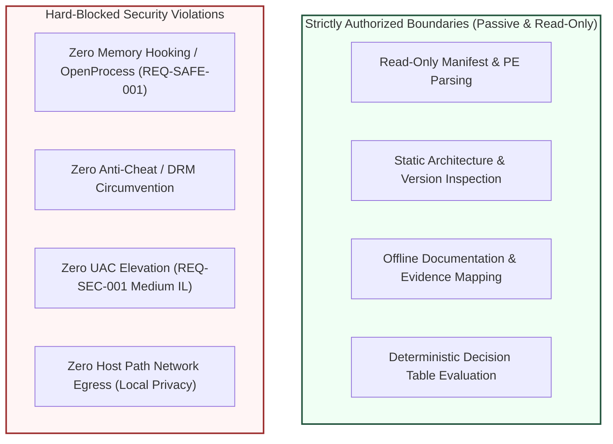

# Cross-Game Compatibility Assessment Security & Test Plan

**Document ID:** `NLE-PLN-CAS-001`  
**Version:** `1.0.0`  
**Status:** `APPROVED`  
**Workstream:** `Cross-Game Compatibility Assessment Framework, Assessment Unit Modeling, Decision Rules, Multi-Dimensional Evaluation, and Strategy Comparison`  
**Phase:** `4 of 12 — Game Discovery & Compatibility Intelligence`  
**Step:** `29 of 100`  
**Related Documents:**
- [CROSS_GAME_COMPATIBILITY_ASSESSMENT_FRAMEWORK.md](file:///d:/App%20Winrar%20Files/Nexludic%20Engine%20(working)/docs/game-discovery/CROSS_GAME_COMPATIBILITY_ASSESSMENT_FRAMEWORK.md) (`NLE-SPC-CAC-001`)
- [COMPATIBILITY_DIMENSION_AND_REQUIREMENT_COVERAGE_CATALOG.md](file:///d:/App%20Winrar%20Files/Nexludic%20Engine%20(working)/docs/game-discovery/COMPATIBILITY_DIMENSION_AND_REQUIREMENT_COVERAGE_CATALOG.md) (`NLE-CAT-CDC-001`)
- [CROSS_GAME_COMPATIBILITY_DECISION_TABLES.md](file:///d:/App%20Winrar%20Files/Nexludic%20Engine%20(working)/docs/game-discovery/CROSS_GAME_COMPATIBILITY_DECISION_TABLES.md) (`NLE-TAB-CCD-001`)
- [INTEGRATION_STRATEGY_COMPARISON_AND_FEASIBILITY_RULES.md](file:///d:/App%20Winrar%20Files/Nexludic%20Engine%20(working)/docs/game-discovery/INTEGRATION_STRATEGY_COMPARISON_AND_FEASIBILITY_RULES.md) (`NLE-RUL-ISC-001`)

---

## 1. Security Architecture & Operational Boundaries

This document establishes the security safeguards, operational safety boundaries, threat mitigations, and validation test plan for the cross-game compatibility assessment engine in **NexLudic Engine**.

Compatibility assessment is strictly a **passive, read-only analytical process**. Evaluating whether two games can integrate must never involve active code injection, process memory snooping, binary modification, or anti-cheat circumvention.

### 1.1 Security Mandates
1. **Windows Medium Integrity Level (`REQ-SEC-001`):** Executes strictly non-elevated. Any inaccessible file triggers `ACCESS_DENIED` without UAC prompts.
2. **Anti-Cheat Isolation (`REQ-SAFE-001`):** No calls to `OpenProcess` with `PROCESS_VM_READ` or `PROCESS_ALL_ACCESS`. Games with active kernel-level anti-cheat are assigned `PROHIBITED_BLOCKED`.
3. **No Code Execution:** The assessment engine never executes game binaries, third-party mod scripts, or AI-generated code snippets.
4. **Local Storage Containment (`DEC-009`):** Assessment caches and reports are stored exclusively on Volume D (`D:\NexLudic\Projects\<project-id>\Environment\`).

---

## 2. Misuse Scenarios & Threat Mitigations

| Threat / Misuse Scenario | Attack Vector / Misuse Attempt | Engine Defense & Hard Block |
| :--- | :--- | :--- |
| **Misuse 1: Anti-Cheat Evasion Tool** | User attempts to configure an integration targeting an online competitive title protected by BattlEye or Easy Anti-Cheat. | Engine detects anti-cheat signature $\rightarrow$ triggers `PROHIBITED_BLOCKED` (`BLK-SEC-01`). Refuses adapter binding. |
| **Misuse 2: Malicious Third-Party Adapter** | Community adapter attempts to execute arbitrary shell commands during compatibility checks. | Assessment evaluates static JSON metadata only; adapter code execution is strictly prohibited. |
| **Misuse 3: Local Host Path Telemetry Leak** | Diagnostic error report attempts to send host paths (`D:\Users\Alice\...`) to an external service or LLM prompt. | Path redaction filter scrubs all drive letters and user folders to `<INSTALL_ROOT>` before egress. |
| **Misuse 4: DRM Circumvention Request** | User selects Host Modification for a game requiring unpacking of Denuvo or SteamStub wrappers. | Engine flags `PROHIBITED_DRM_BYPASS` (`BLK-SEC-02`); blocks execution. |

---

## 3. Validation Test Suite (35 Design-Level Test Specifications)

### 3.1 Group 1: Normal Cases (TCAS-NRM)

| Test ID | Test Title | Objective | Input Fixture | Expected Outcome | Pass Criteria |
| :--- | :--- | :--- | :--- | :--- | :--- |
| `TCAS-NRM-001` | Full Multi-Capability Match | Verify clean assessment of supported pair. | Skyrim SE (1.6.640) + BG3 (Patch 7); Live Bridge; 2 capabilities. | State: `SUPPORTED` (Gate 3). | Full coverage; 100% verified. |
| `TCAS-NRM-002` | Host Modification Clean Match | Verify clean host modification evaluation. | Skyrim SE (Host) + Morrowind Assets; Host Mod strategy. | State: `SUPPORTED` (Gate 3). | Asset conversion feasible. |
| `TCAS-NRM-003` | Partial Support Optional Gap | Verify missing optional capability handling. | Skyrim + BG3; 2 mandatory + 1 optional unevidenced capability. | State: `PARTIALLY_SUPPORTED` (Gate 2). | Mandatory met; optional unassessed. |
| `TCAS-NRM-004` | Multi-Strategy Comparison | Verify all 3 strategies evaluated independently. | User requests strategy evaluation for pair. | 3 distinct strategy findings emitted. | No strategy conflation. |
| `TCAS-NRM-005` | Machine-Readable Output | Verify structured JSON output serialization. | Completed assessment. | JSON matches `latest_assessment.json` schema. | Valid schema syntax. |

### 3.2 Group 2: Uncertainty Cases (TCAS-UNC)

| Test ID | Test Title | Objective | Input Fixture | Expected Outcome | Pass Criteria |
| :--- | :--- | :--- | :--- | :--- | :--- |
| `TCAS-UNC-001` | Unknown Game B Build | Verify unknown version does not crash. | Game B version is unverified/null. | State: `INSUFFICIENT_EVIDENCE` (Gate 1). | Marked unknown; non-blocking. |
| `TCAS-UNC-002` | Unverified Local Installation | Verify catalog record without local files. | Catalog match; `LocalInstallationInstance` missing. | State: `INSUFFICIENT_EVIDENCE` (Gate 1). | Exploratory mode only. |
| `TCAS-UNC-003` | Indirect Analogue Evidence | Verify analogue from adjacent build. | Evidence cites build 1.6.659; target is 1.6.1170. | Classified as `PRELIMINARY_UNCONFIRMED`. | Requires empirical test. |
| `TCAS-UNC-004` | Missing Metadata Provider | Verify provider offline handling. | External provider unreachable during check. | State: `INSUFFICIENT_EVIDENCE`. | Distinguished from broken. |
| `TCAS-UNC-005` | AI Hypothesis Rejection | Verify AI assertion alone is rejected. | Only evidence is an LLM response text. | Weight: $0.00$; state: `INSUFFICIENT_EVIDENCE`. | Zero probative weight. |

### 3.3 Group 3: Contradictory Evidence Cases (TCAS-CNT)

| Test ID | Test Title | Objective | Input Fixture | Expected Outcome | Pass Criteria |
| :--- | :--- | :--- | :--- | :--- | :--- |
| `TCAS-CNT-001` | Test Log Overrides Declaration | Verify Tier 1 test overrides Tier 3 declaration. | Adapter declares support; test log proves crash. | State: `UNSUPPORTED`; Tier 1 prevails. | Higher tier overrides. |
| `TCAS-CNT-002` | Version Scope Partitioning | Verify divergent version claims partitioned. | Doc A: 1.6.640 works; Doc B: 1.6.1170 broken. | Both claims partitioned by version scope. | No conflict collision. |
| `TCAS-CNT-003` | Peer Conflict Flagging | Verify contradictory Tier 1 tests flag conflict. | Test A passes on Win 10; Test B fails on Win 11. | State: `EVIDENCE_CONFLICT`. | Flagged for manual triage. |
| `TCAS-CNT-004` | Recency Superseding | Verify newer post-patch note supersedes old. | Old note says valid; new patch note confirms API removed. | State: `UNSUPPORTED`; old marked `SUPERSEDED`. | Audit trail preserved. |
| `TCAS-CNT-005` | Video Demonstration Subordination | Verify demo video cannot override bug log. | Video shows mashup; bug tracker logs memory corruption. | Video weight $0.10$; bug log prevails. | Demo video subordinated. |

### 3.4 Group 4: Restriction & Security Cases (TCAS-SEC)

| Test ID | Test Title | Objective | Input Fixture | Expected Outcome | Pass Criteria |
| :--- | :--- | :--- | :--- | :--- | :--- |
| `TCAS-SEC-001` | Active Kernel Anti-Cheat Hard Block| Verify BattlEye/EAC title triggers block. | Destiny 2 selected as participant. | State: `PROHIBITED_BLOCKED` (Gate 0). | Absolute hard block. |
| `TCAS-SEC-002` | Commercial DRM Bypass Rejection | Verify DRM tampering request is blocked. | Host modification requires unpacking Denuvo executable. | State: `PROHIBITED_BLOCKED` (Gate 0). | DRM bypass rejected. |
| `TCAS-SEC-003` | Medium Integrity Enforcement | Verify non-elevated token assertion. | Process token queried during assessment. | Token matches Medium IL; zero UAC. | Non-elevated verified. |
| `TCAS-SEC-004` | Zero Memory Hooking Assertion | Verify no `OpenProcess` calls dispatched. | API monitor attached during evaluation. | Zero calls to process memory APIs. | Passive analysis only. |
| `TCAS-SEC-005` | Local Path Redaction in Outputs | Verify host paths redacted in user summary. | Target path: `D:\Users\Alice\Games\...`. | Rendered as `<INSTALL_ROOT>\game.exe`. | Privacy protected. |

### 3.5 Group 5: Regression & Change Cases (TCAS-REG)

| Test ID | Test Title | Objective | Input Fixture | Expected Outcome | Pass Criteria |
| :--- | :--- | :--- | :--- | :--- | :--- |
| `TCAS-REG-001` | Steam Patch Invalidation | Verify game binary patch invalidates prior finding.| Executable timestamp modified on disk. | State: `STALE_REASSESSMENT_REQUIRED`. | Execution paused. |
| `TCAS-REG-002` | Historical Assessment Immutability| Verify old assessment preserved after update. | Assessment invalidated. | Old record appended to `assessment_history.jsonl`. | Zero overwrite. |
| `TCAS-REG-003` | Requirement Scope Expansion | Verify user adding capability flags staleness. | User adds 3rd capability to 2-capability project. | State: `SCOPE_STALE`; old kept valid. | Granular reassessment. |
| `TCAS-REG-004` | Disconnected Drive Resilience | Verify missing storage marks unavailable. | USB drive unmounted. | State: `UNAVAILABLE`; project intact. | Zero cascade deletion. |
| `TCAS-REG-005` | Mod Loader Upgrade Invalidation | Verify SKSE update triggers major reassessment. | SKSE updated from 2.2.3 to 2.2.4. | State: `STALE_REASSESSMENT_REQUIRED`. | Adapters re-checked. |

### 3.6 Group 6: Explainability & Strategy Comparison Cases (TCAS-EXP / TCAS-STR)

| Test ID | Test Title | Objective | Input Fixture | Expected Outcome | Pass Criteria |
| :--- | :--- | :--- | :--- | :--- | :--- |
| `TCAS-EXP-001` | Plain-Language Explanation Match | Verify user summary matches status. | Status is `SUPPORTED`. | Renders template: *"Both installations verified..."*. | Clear text generated. |
| `TCAS-EXP-002` | Critical Blocker Disclosure | Verify blocker explanation is unambiguous. | Status is `PROHIBITED_BLOCKED`. | Explicitly states: *"Anti-cheat title prohibited..."*. | Blocker transparent. |
| `TCAS-EXP-003` | Architecture Mismatch Guidance | Verify x86/x64 in-process guidance. | 32-bit Game A + 64-bit Game B Host Mod. | Guidance: *"In-process mismatch; use Live Bridge."*. | Actionable advice. |
| `TCAS-STR-001` | 32-Bit / 64-Bit Bitness Mismatch | Verify Host Mod excluded on bitness clash. | 32-bit Game A + 64-bit Game B. | Host Mod: `EXCLUDED`; Bridge: `VIABLE`. | Cross-arch isolated. |
| `TCAS-STR-002` | Static Content Strategy Selection | Verify Host Mod selected for static mesh sync. | Requirements involve static armor models only. | Host Mod: `RECOMMENDED`; Bridge: `DEFERRED`. | Optimal strategy picked. |

---

## 4. Document Sign-Off & Verification

| Role | Reviewer | Verdict | Date |
| :--- | :--- | :--- | :--- |
| **Principal Security Test Engineer** | Security Assurance | Approved | 2026-11-17 |
| **Lead QA Automation Architect** | Test Architecture | Approved | 2026-11-17 |
| **Senior Software Architect** | Engine Architecture Team | Approved | 2026-11-17 |

