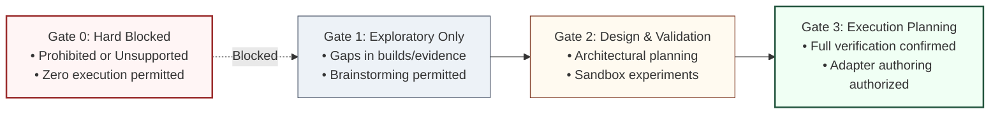

# Cross-Game Compatibility Decision Tables

**Document ID:** `NLE-TAB-CCD-001`  
**Version:** `1.0.0`  
**Status:** `APPROVED`  
**Workstream:** `Cross-Game Compatibility Assessment Framework, Assessment Unit Modeling, Decision Rules, Multi-Dimensional Evaluation, and Strategy Comparison`  
**Phase:** `4 of 12 — Game Discovery & Compatibility Intelligence`  
**Step:** `29 of 100`  
**Related Documents:**
- [CROSS_GAME_COMPATIBILITY_ASSESSMENT_FRAMEWORK.md](file:///d:/App%20Winrar%20Files/Nexludic%20Engine%20(working)/docs/game-discovery/CROSS_GAME_COMPATIBILITY_ASSESSMENT_FRAMEWORK.md) (`NLE-SPC-CAC-001`)
- [COMPATIBILITY_DIMENSION_AND_REQUIREMENT_COVERAGE_CATALOG.md](file:///d:/App%20Winrar%20Files/Nexludic%20Engine%20(working)/docs/game-discovery/COMPATIBILITY_DIMENSION_AND_REQUIREMENT_COVERAGE_CATALOG.md) (`NLE-CAT-CDC-001`)
- [COMPATIBILITY_EVIDENCE_QUALITY_AND_CONFLICT_RULES.md](file:///d:/App%20Winrar%20Files/Nexludic%20Engine%20(working)/docs/game-discovery/COMPATIBILITY_EVIDENCE_QUALITY_AND_CONFLICT_RULES.md) (`NLE-RUL-CEQ-001`)
- [INTEGRATION_STRATEGY_COMPARISON_AND_FEASIBILITY_RULES.md](file:///d:/App%20Winrar%20Files/Nexludic%20Engine%20(working)/docs/game-discovery/INTEGRATION_STRATEGY_COMPARISON_AND_FEASIBILITY_RULES.md) (`NLE-RUL-ISC-001`)

---

## 1. Executive Summary & Purpose

This document defines the deterministic decision tables, eligibility gating rules, critical blocker classifications, and worked decision examples governing cross-game compatibility assessments in **NexLudic Engine**.

By formalizing decision logic into explicit multidimensional tables, the framework prevents cognitive bias, eliminates undocumented heuristic leaps, ensures transparent explanations for users, and guarantees that favorable aggregate conditions can never override a critical blocker or policy prohibition.

---

## 2. Core Decision Table

The decision table maps inputs across the eight assessment dimensions to a definitive outcome status and operational eligibility gate.

| Rule ID | Identity & Build Certainty | Dependency Status | Mandatory Req Coverage | Strategy Feasibility | Security & Licensing State | Evidence Integrity | Resulting Status | Eligibility Gate |
| :--- | :--- | :--- | :--- | :--- | :--- | :--- | :--- | :--- |
| **DEC-01** | `CONFIRMED_VERIFIED` | `SATISFIED` | `100% COVERED` | `FEASIBLE` | `PERMITTED_COMPLIANT` | `TIER_1_OR_2_VERIFIED` | `SUPPORTED` | **Execution Planning** |
| **DEC-02** | `CONFIRMED_VERIFIED` | `SATISFIED` | `100% COVERED` | `FEASIBLE` | `PERMITTED_COMPLIANT` | `TIER_3_DECLARED_ONLY`| `SUPPORTED` (Provisional) | **Sandbox Validation** |
| **DEC-03** | `CONFIRMED_VERIFIED` | `SATISFIED` | `100% MANDATORY` (Optional Missing) | `FEASIBLE` | `PERMITTED_COMPLIANT` | `CORROBORATED` | `PARTIALLY_SUPPORTED` | **Design & Validation** |
| **DEC-04** | `PARTIALLY_IDENTIFIED` | `UNASSESSED` | `UNKNOWN` | `PLAUSIBLE` | `PERMITTED_COMPLIANT` | `TIER_4_ADVISORY` | `INSUFFICIENT_EVIDENCE` | **Exploratory Only** |
| **DEC-05** | Any State | Any State | Any State | Any State | `PROHIBITED_ANTI_CHEAT` | Any State | `PROHIBITED_BLOCKED` | **Hard Blocked** |
| **DEC-06** | Any State | Any State | Any State | Any State | `PROHIBITED_DRM_BYPASS`| Any State | `PROHIBITED_BLOCKED` | **Hard Blocked** |
| **DEC-07** | `CONFIRMED_VERIFIED` | `UNSATISFIED_MANDATORY` | Any State | `BLOCKED` | Any State | Any State | `UNSUPPORTED` | **Hard Blocked** |
| **DEC-08** | `CONFIRMED_VERIFIED` | `SATISFIED` | `MANDATORY_UNMET` | `BLOCKED` | `PERMITTED_COMPLIANT` | `VERIFIED_INCOMPATIBLE`| `UNSUPPORTED` | **Hard Blocked** |
| **DEC-09** | Any State | Any State | Any State | Any State | Any State | `EVIDENCE_CONFLICT` | `EVIDENCE_CONFLICT` | **Human Triage Required** |
| **DEC-10** | `STALE_CHANGED` | Any State | Any State | Any State | Any State | Any State | `STALE_REASSESSMENT_REQUIRED` | **Reassessment Required** |

---

## 3. Operational Eligibility Gates

The assessment status maps directly to five progressive operational gates:

1. **Gate 0 (Hard Blocked):** Active for `PROHIBITED_BLOCKED` or `UNSUPPORTED`. The engine hard-blocks adapter generation, file modifications, and runtime launches.
2. **Gate 1 (Exploratory Only):** Active for `INSUFFICIENT_EVIDENCE`. The user may explore concept requirements, but cannot build or test adapters until local installations are verified.
3. **Gate 2 (Design & Sandbox Validation):** Active for `PARTIALLY_SUPPORTED` or provisional `SUPPORTED` (Tier 3 declarations). The user may configure adapters and execute controlled sandbox verification tests.
4. **Gate 3 (Execution Planning):** Active for verified `SUPPORTED` (Tier 1 evidence). Cleared for full workspace adapter compilation and live execution.

---

## 4. Critical Blocker Classification

The framework recognizes five categories of **Critical Blockers**. Under rule `RUL-TAB-01`, the presence of a single critical blocker **immediately overrides** all favorable scores and forces the outcome to `PROHIBITED_BLOCKED` or `UNSUPPORTED`:

1. **Active Kernel Anti-Cheat (`BLK-SEC-01`):** Participant game runs BattlEye, Easy Anti-Cheat, Vanguard, or Equ8 for online competitive multiplayer. (*Status:* `PROHIBITED_BLOCKED`).
2. **Commercial DRM Tampering Required (`BLK-SEC-02`):** Feasibility requires unpacking, patching, or bypassing commercial DRM executables (Denuvo, SteamStub wrapper). (*Status:* `PROHIBITED_BLOCKED`).
3. **In-Process Binary Architecture Incompatibility (`BLK-TEC-01`):** Host-Game Modification strategy attempting to inject 32-bit x86 DLLs into a 64-bit x64 host game process space without a decoupled bridge. (*Status:* `UNSUPPORTED`).
4. **Unsatisfied Mandatory Framework Dependency (`BLK-DEP-01`):** Required script extender or native hook is absent or broken for the current patch build with no known alternative. (*Status:* `UNSUPPORTED`).
5. **Corrupted or Inaccessible Local Installation (`BLK-ENV-01`):** Local game files truncated, corrupted, or locked by another process with read access denied. (*Status:* `UNSUPPORTED`).

---

## 5. Illustrative Worked Decision Cases

### 5.1 Case A: Clean Multi-Capability Match (Normal Supported)
- **Context:** Skyrim SE (Steam v1.6.640, x64) + Baldur's Gate 3 (GOG Patch 7, x64).
- **Strategy:** Live Interoperability Bridge (Named Pipes).
- **Requirements:** Sync Player Gold + Quest Completion Flag.
- **Evidence:** Tier 1 test harness logs confirm Papyrus named pipe emitter and BG3 Norbyte extender receiver pass with $< 2\text{ ms}$ latency.
- **Evaluation:**
  - Identity Certainty: `CONFIRMED_VERIFIED`
  - Dependencies: SKSE64 v2.2.3 and BG3 Extender v18 installed and verified.
  - Security: Single-player offline games; zero anti-cheat.
  - Coverage: $100\%$ mandatory capabilities covered.
- **Outcome:** **`SUPPORTED` (Gate 3: Execution Planning)**.

### 5.2 Case B: Missing Optional Capability (Partial Support)
- **Context:** Same as Case A, but user adds *"Real-Time Dynamic Weather Sync"*.
- **Evidence:** Gold and Quests have Tier 1 evidence. Weather sync has no documented API hook in BG3 Osiris.
- **Evaluation:** Mandatory requirements met; optional requirement lacks API capability.
- **Outcome:** **`PARTIALLY_SUPPORTED` (Gate 2: Design & Validation)**.
- **User Disclosure:** *"Gold and Quest synchronization are fully supported. Dynamic Weather Sync cannot be evaluated due to missing engine hooks in Baldur's Gate 3."*

### 5.3 Case C: Attempted In-Process Host Modification on Anti-Cheat Game (Blocked)
- **Context:** Skyrim SE (Host) + Destiny 2 (Target).
- **Strategy:** Host-Game Modification with memory hook into Destiny 2.
- **Evaluation:** Destiny 2 runs BattlEye active anti-cheat.
- **Outcome:** **`PROHIBITED_BLOCKED` (Gate 0: Hard Blocked)**.
- **User Disclosure:** *"Integration blocked by security policy. Destiny 2 is protected by BattlEye anti-cheat. NexLudic Engine strictly prohibits interfacing with anti-cheat protected titles."*

### 5.4 Case D: In-Process Architecture Mismatch (Unsupported)
- **Context:** Original Skyrim (2011, 32-bit x86) + Cyberpunk 2077 (64-bit x64).
- **Strategy:** User selects *Host-Game Modification* intending to load Cyberpunk REDmod scripts directly into Skyrim's 32-bit memory space.
- **Evaluation:** 32-bit OS process cannot load 64-bit native modules.
- **Outcome:** **`UNSUPPORTED` for Host Modification**.
- **Actionable Guidance:** *"In-process modification is impossible due to 32-bit / 64-bit architecture mismatch. Select 'Live Interoperability Bridge' to coordinate across separate processes via IPC."*

---

## 6. Document Sign-Off & Verification

| Role | Reviewer | Verdict | Date |
| :--- | :--- | :--- | :--- |
| **Principal Software Architect** | Engine Architecture Team | Approved | 2026-11-17 |
| **Lead Game Interoperability Researcher**| Interoperability Research Group | Approved | 2026-11-17 |
| **Senior Security & Compliance Officer**| Security Governance | Approved | 2026-11-17 |

