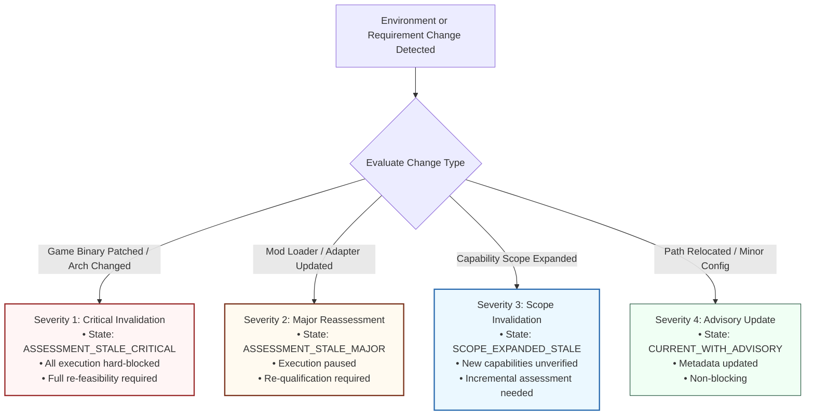

# Environment Change & Stale Assessment Policy

**Document ID:** `NLE-POL-ECS-001`  
**Version:** `1.0.0`  
**Status:** `APPROVED`  
**Workstream:** `Game Version Modeling, Edition and Release Relationships, Environment Profiles, Version-Specific Technical Evidence, Compatibility Constraints, and Assessment Freshness`  
**Phase:** `4 of 12 — Game Discovery & Compatibility Intelligence`  
**Step:** `28 of 100`  
**Related Documents:**
- [GAME_VERSION_EDITION_AND_ENVIRONMENT_COMPATIBILITY_MAPPING_SPECIFICATION.md](file:///d:/App%20Winrar%20Files/Nexludic%20Engine%20(working)/docs/game-discovery/GAME_VERSION_EDITION_AND_ENVIRONMENT_COMPATIBILITY_MAPPING_SPECIFICATION.md) (`NLE-SPC-VEC-001`)
- [GAME_ENVIRONMENT_PROFILE_AND_COMPATIBILITY_CONTEXT_MODEL.md](file:///d:/App%20Winrar%20Files/Nexludic%20Engine%20(working)/docs/game-discovery/GAME_ENVIRONMENT_PROFILE_AND_COMPATIBILITY_CONTEXT_MODEL.md) (`NLE-DOM-ENV-001`)
- [VERSION_COMPATIBILITY_EVIDENCE_AND_PROVENANCE_RULES.md](file:///d:/App%20Winrar%20Files/Nexludic%20Engine%20(working)/docs/game-discovery/VERSION_COMPATIBILITY_EVIDENCE_AND_PROVENANCE_RULES.md) (`NLE-RUL-VCE-001`)
- [LOCAL_INSTALLATION_IDENTITY_AND_VERIFICATION_STATE_MODEL.md](file:///d:/App%20Winrar%20Files/Nexludic%20Engine%20(working)/docs/game-discovery/LOCAL_INSTALLATION_IDENTITY_AND_VERIFICATION_STATE_MODEL.md) (`NLE-DOM-INS-001`)

---

## 1. Executive Summary & Purpose

This policy governs how changes in the local host environment, game patch builds, runtime dependencies, adapter versions, and project capability requirements affect the validity and freshness of compatibility assessments in **NexLudic Engine**.

Compatibility is not an indelible property; it is an ephemeral relationship bounded by exact runtime conditions. When Steam automatically updates a game binary or a user installs a new script extender version, prior compatibility assertions cease to apply to the live environment. This document defines a clear change-impact taxonomy, guarantees historical evidence retention, specifies reassessment triggers, and prevents stale assessments from being incorrectly used to authorize dangerous or failing integration actions.

---

## 2. Change Impact Taxonomy & Invalidation Severity

When an environment change is detected (via Step 27 revalidation or explicit user update), the change is classified across four severity tiers:

### 2.1 Severity Tiers & Operational Policies

| Severity Tier | Trigger Condition | Status Code | Policy & System Action |
| :--- | :--- | :--- | :--- |
| **Severity 1: Critical Invalidation** | Game executable replaced, Steam auto-patch detected, binary SHA-256 changed, or bitness changed. | `STALE_CRITICAL` | Prior compatibility assessment is **invalidated**. Active integration bridge or mod injection is hard-blocked until full re-evaluation. |
| **Severity 2: Major Reassessment** | Mod loader (SKSE, ScriptHook) updated, adapter upgraded, or secondary runtime library patched. | `STALE_MAJOR` | Assessment marked stale for affected capabilities. Adapter must be re-qualified before runtime launch. |
| **Severity 3: Scope Expansion** | User adds new integration capabilities to project requirements (e.g. added live telemetry to static sync). | `SCOPE_STALE` | Prior assessment remains valid for old capabilities; newly added capabilities marked `UNASSESSED`. |
| **Severity 4: Minor Advisory** | Installation folder moved across drives with identical binary SHA-256; non-critical INI tweak. | `CURRENT_ADVISORY` | Assessment remains valid. Update `install_path` pointers; no reassessment required. |

---

## 3. Historical Evidence Retention & Immutability

A foundational rule of engineering provenance is that **historical evidence must never be retroactively rewritten or destroyed**:

1. **Rule POL-ECS-01 (Historical Immutability):** An empirical test record (`TestExecutionRecord`) or formal assessment conducted on date $T_0$ under environment $E_0$ remains an immutable historical fact.
2. **Rule POL-ECS-02 (Applicability Decoupling):** When the local environment mutates to $E_1$ at date $T_1$, the historical test record is **not** deleted or marked failed. Its operational status is updated to:
   $$\text{Status} = \text{HISTORICALLY\_VALID\_CURRENTLY\_INAPPLICABLE}$$
3. **Audit Trail Preservation:** The user can inspect the project history log to see:
   - *"On 2026-11-10, capability X was verified on Skyrim build 1.6.640."*
   - *"On 2026-11-17, Skyrim was updated to 1.6.1170. Reassessment is required for the new build."*

---

## 4. Reassessment Triggers & Architectural Ownership

### 4.1 Reassessment Triggers
Reassessment evaluation is triggered exclusively by explicit contextual events:
1. **Trigger TRG-01: Project Load:** When opening a project workspace, the engine performs a lightweight check of recorded binary timestamps against the current disk state.
2. **Trigger TRG-02: Pre-Execution Verification:** Before launching a live bridge or compiling a mod package, the engine validates that all environment profile hashes match the current installation.
3. **Trigger TRG-03: User-Initiated "Revalidate":** User clicks "Revalidate Environment" in the workspace UI.
4. **Trigger TRG-04: Capability Requirement Edit:** User modifies the project capability checklist in the workspace settings.

### 4.2 Separation of Invalidation and Reassessment
- **Context Mapping Responsibility (Step 28):** Flags the environment profile as `STALE_REASSESSMENT_REQUIRED` and provides clear diagnostic reasons explaining what changed.
- **Downstream Responsibility (Phase 5/8):** The Feasibility Engine and Integration Testing Harness own the decision to execute new evaluations or run validation test suites. Context mapping **never** initiates autonomous background scans or executes tests.

---

## 5. User-Facing Explanations & Transparency

When an assessment is marked stale, the UI must provide clear, actionable explanations:

| Stale Scenario | UI Title | User-Facing Explanation | Recommended User Action |
| :--- | :--- | :--- | :--- |
| **Steam Auto-Patch** | Game Update Detected | *"Skyrim Special Edition was updated from build 1.6.640 to 1.6.1170 by Steam. Previous compatibility findings may not apply."* | Click "Re-evaluate Compatibility" to check adapter support for 1.6.1170. |
| **Missing Mod Loader** | Required Framework Missing | *"SKSE64 was not detected in the game folder. Capability 'Papyrus Bridge' requires SKSE64 version 2.2.3+."* | Install the required loader version or update project settings. |
| **New Capability Added** | New Requirements Added | *"You added 'Live Audio Streaming' to project requirements. This capability has not yet been evaluated for this game pair."* | Run Feasibility Assessment for the newly added capability. |
| **Drive Disconnected** | Installation Storage Offline | *"Game storage drive (E:\) is offline. Prior assessments cannot be validated."* | Reconnect the external storage drive or relocate the installation. |

---

## 6. Document Sign-Off & Verification

| Role | Reviewer | Verdict | Date |
| :--- | :--- | :--- | :--- |
| **Principal Software Architect** | Engine Architecture Team | Approved | 2026-11-17 |
| **Senior Domain-Model Architect** | Core Data Modeling | Approved | 2026-11-17 |
| **Senior System Reliability Engineer**| Platform Operations | Approved | 2026-11-17 |

