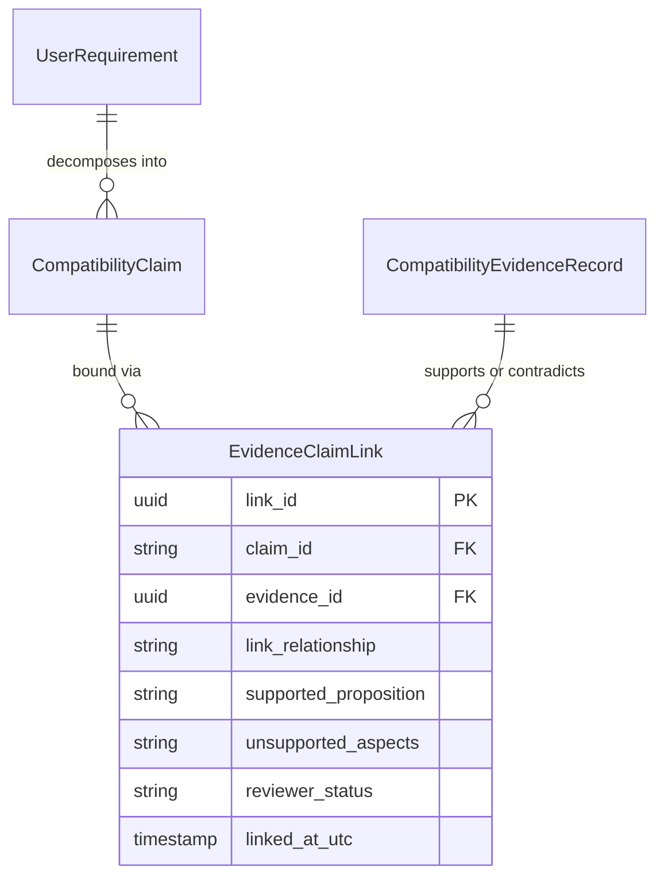
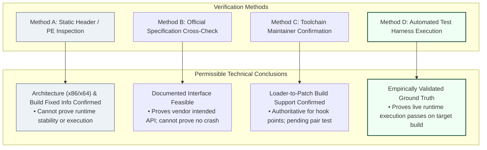

# Evidence-Claim Linkage & Verification Rules

**Document ID:** `NLE-RUL-ECL-001`  
**Version:** `1.0.0`  
**Status:** `APPROVED`  
**Workstream:** `Compatibility Evidence Collection, Verification, Provenance Tracking, and Operational Lifecycle Architecture`  
**Phase:** `4 of 12 — Game Discovery & Compatibility Intelligence`  
**Step:** `30 of 100`  
**Related Documents:**
- [COMPATIBILITY_EVIDENCE_COLLECTION_AND_LIFECYCLE_SPECIFICATION.md](file:///d:/App%20Winrar%20Files/Nexludic%20Engine%20(working)/docs/game-discovery/COMPATIBILITY_EVIDENCE_COLLECTION_AND_LIFECYCLE_SPECIFICATION.md) (`NLE-SPC-ECL-001`)
- [COMPATIBILITY_EVIDENCE_RECORD_AND_PROVENANCE_SCHEMA_SPECIFICATION.md](file:///d:/App%20Winrar%20Files/Nexludic%20Engine%20(working)/docs/game-discovery/COMPATIBILITY_EVIDENCE_RECORD_AND_PROVENANCE_SCHEMA_SPECIFICATION.md) (`NLE-DOM-ERP-001`)
- [COMPATIBILITY_DIMENSION_AND_REQUIREMENT_COVERAGE_CATALOG.md](file:///d:/App%20Winrar%20Files/Nexludic%20Engine%20(working)/docs/game-discovery/COMPATIBILITY_DIMENSION_AND_REQUIREMENT_COVERAGE_CATALOG.md) (`NLE-CAT-CDC-001`)
- [CROSS_GAME_COMPATIBILITY_DECISION_TABLES.md](file:///d:/App%20Winrar%20Files/Nexludic%20Engine%20(working)/docs/game-discovery/CROSS_GAME_COMPATIBILITY_DECISION_TABLES.md) (`NLE-TAB-CCD-001`)

---

## 1. Executive Summary & Purpose

This specification governs the semantic linkage between captured evidence records and specific compatibility claims, establishes requirement traceability models, and defines the permissible conclusions that can be drawn from distinct verification methods within **NexLudic Engine**.

A frequent flaw in automated compatibility systems is **broad-brush attribution**—assuming that because an article discusses a game, it supports every technical feature requested by the user. This document enforces granular, claim-specific linkage, provides formal validation methods, and ensures that evidence establishing a static feature is never misrepresented as empirical proof of runtime stability.

---

## 2. The Evidence-Claim Linkage Model

Every association between an evidence item and a technical claim is formalized as an `EvidenceClaimLink` entity:

### 2.1 Schema: `EvidenceClaimLink`

| Field Name | Type | Nullable | Description |
| :--- | :--- | :--- | :--- |
| `link_id` | UUIDv4 | No | Unique identifier for this linkage entry. |
| `claim_id` | String | No | Target claim (e.g. `claim:skyrim_se:papyrus:named_pipe_export`). |
| `evidence_id` | UUIDv4 | No | Foreign Key $\rightarrow$ `CompatibilityEvidenceRecord.evidence_id`. |
| `link_relationship`| Enum | No | `SUPPORTS`, `CONTRADICTS`, `PARTIALLY_SUPPORTS`, `CONTEXT_ONLY`, `ESTABLISHES_RESTRICTION`. |
| `supported_proposition`| String | No | Exact technical assertion substantiated by the evidence. |
| `unsupported_aspects`| String | Yes | Elements of the claim not substantiated (identifies remaining gaps). |
| `reviewer_status` | Enum | No | `PROVISIONAL_SUGGESTION`, `HUMAN_APPROVED`, `REJECTED_MISMATCH`. |
| `linked_at_utc` | Timestamp | No | Exact UTC timestamp when association was established. |

---

## 3. Linkage Invariants & Rules

1. **Rule RUL-ECL-01 (No Broad-Brush Association):** An evidence item captured for Game A (e.g. Skyrim script extender documentation) must **never** be automatically linked to claims regarding Game B or to cross-game pair bridging without explicit justification.
2. **Rule RUL-ECL-02 (Scope Precision):** If an evidence item supports a capability only on version `1.6.640`, the link must record `target_build = "[1.6.640]"`. The link must not assert support for unlisted builds (e.g. `1.6.1170`).
3. **Rule RUL-ECL-03 (Contradiction Retention):** If an evidence item contradicts a claim (e.g. maintainer note confirms a function was deprecated and removed in patch 7), a link with relationship `CONTRADICTS` must be created. Contradictory evidence must **never** be discarded.

---

## 4. Verification Methods & Permissible Conclusions

To ensure cognitive honesty, each verification method has strictly defined boundaries:

### 4.1 Permissible Boundaries by Method

| Verification Method | Prerequisites | What It Formally Proves | What It CANNOT Prove |
| :--- | :--- | :--- | :--- |
| **Method A: Static PE Inspection** | Read-only access to local binary on disk. | Binary bitness (32-bit vs 64-bit), fixed file versions, subsystem, import table presence. | Cannot prove binary runs without crashing, passes anti-cheat, or accepts hooks. |
| **Method B: Official Doc Review** | Official publisher SDK headers or developer portal documentation. | Official vendor API design, documented parameters, supported operating systems. | Cannot prove community script extenders or third-party adapters work. |
| **Method C: Maintainer Notes** | Official release notes / commits from framework maintainers (SKSE, UE4SS). | Specific patch build compatibility and hook offsets confirmed by maintainer. | Cannot prove cross-game live bridge interop with another game. |
| **Method D: Test Harness Execution**| Automated isolated sandbox test run with monitored game execution. | **Empirical Ground Truth:** Code executes, passes assertions, and exchanges telemetry on target build. | Cannot be generalized to untested game builds or different operating systems. |

---

## 5. End-to-End Requirement Traceability

The framework mandates complete vertical traceability:

$$\text{User Mashup Requirement} \longrightarrow \text{Compatibility Claims} \longrightarrow \text{Evidence Records} \longrightarrow \text{Source Citations}$$

### 5.1 Verification Checklist for Requirement Coverage
When presenting compatibility findings to the user:
- Every requirement marked `SATISFIED` must trace to at least one `SUPPORTS` link with `VERIFIED_APPROVED` status.
- Any requirement containing a `CONTRADICTS` link is flagged as `BLOCKED_OR_CONTRADICTED`.
- Any requirement lacking evidence links is flagged as `UNDOCUMENTED_UNASSESSED`.

---

## 6. Document Sign-Off & Verification

| Role | Reviewer | Verdict | Date |
| :--- | :--- | :--- | :--- |
| **Principal Software Architect** | Engine Architecture Team | Approved | 2026-11-17 |
| **Senior Evidence & Data Provenance Engineer**| Data Governance | Approved | 2026-11-17 |
| **Senior QA & Testing Architect** | Quality Assurance Governance | Approved | 2026-11-17 |

