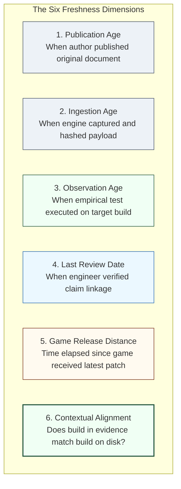
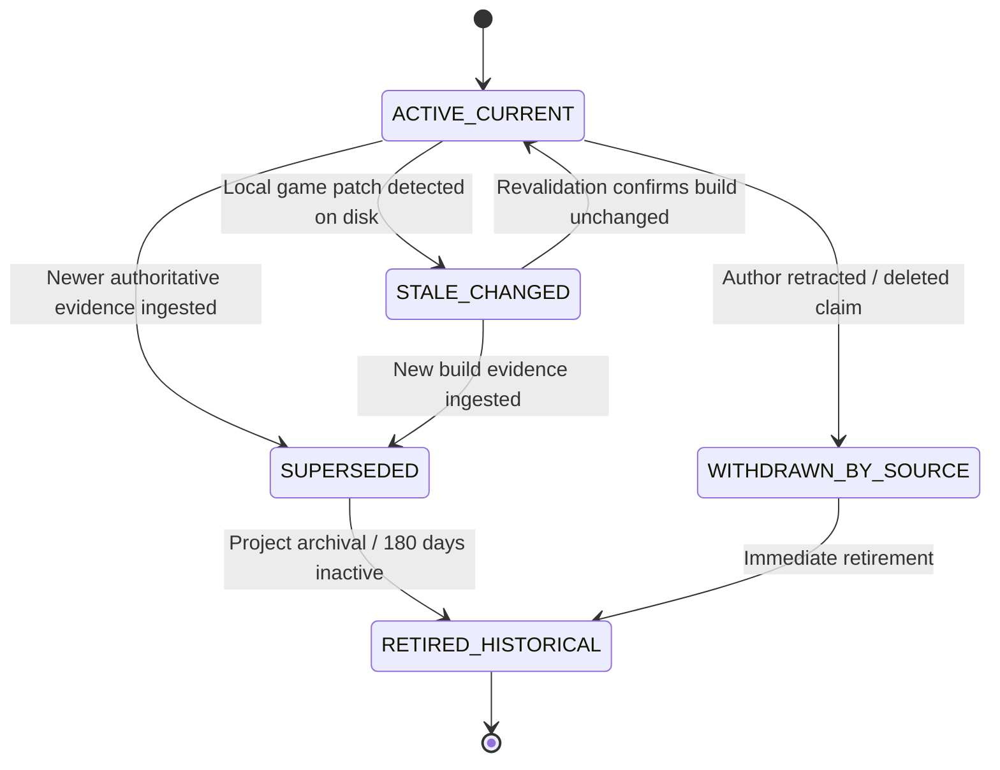

# Evidence Freshness, Change Detection & Retention Policy

**Document ID:** `NLE-POL-EFD-001`  
**Version:** `1.0.0`  
**Status:** `APPROVED`  
**Workstream:** `Compatibility Evidence Collection, Verification, Provenance Tracking, and Operational Lifecycle Architecture`  
**Phase:** `4 of 12 — Game Discovery & Compatibility Intelligence`  
**Step:** `30 of 100`  
**Related Documents:**
- [COMPATIBILITY_EVIDENCE_COLLECTION_AND_LIFECYCLE_SPECIFICATION.md](file:///d:/App%20Winrar%20Files/Nexludic%20Engine%20(working)/docs/game-discovery/COMPATIBILITY_EVIDENCE_COLLECTION_AND_LIFECYCLE_SPECIFICATION.md) (`NLE-SPC-ECL-001`)
- [COMPATIBILITY_EVIDENCE_RECORD_AND_PROVENANCE_SCHEMA_SPECIFICATION.md](file:///d:/App%20Winrar%20Files/Nexludic%20Engine%20(working)/docs/game-discovery/COMPATIBILITY_EVIDENCE_RECORD_AND_PROVENANCE_SCHEMA_SPECIFICATION.md) (`NLE-DOM-ERP-001`)
- [ENVIRONMENT_CHANGE_AND_STALE_ASSESSMENT_POLICY.md](file:///d:/App%20Winrar%20Files/Nexludic%20Engine%20(working)/docs/game-discovery/ENVIRONMENT_CHANGE_AND_STALE_ASSESSMENT_POLICY.md) (`NLE-POL-ECS-001`)
- [COMPATIBILITY_ASSESSMENT_OUTPUT_AND_REASSESSMENT_SPECIFICATION.md](file:///d:/App%20Winrar%20Files/Nexludic%20Engine%20(working)/docs/game-discovery/COMPATIBILITY_ASSESSMENT_OUTPUT_AND_REASSESSMENT_SPECIFICATION.md) (`NLE-SPC-CAO-001`)

---

## 1. Executive Summary & Purpose

This policy defines the temporal freshness dimensions, automated change-detection mechanisms, supersession classifications, and long-term retention rules for compatibility evidence within **NexLudic Engine**.

Compatibility intelligence operates in an environment of continuous change: digital storefronts deploy silent patches, modding framework maintainers release hotfixes, and upstream documentation is updated or deleted. This document ensures that evidence validity is continuously audited against local environment realities, that stale evidence is flagged before causing runtime errors, and that historical audit trails remain preserved even when upstream sources withdraw their content.

---

## 2. Multi-Dimensional Freshness Model

Freshness cannot be reduced to a single "expiry date". An article written in 2012 may remain 100% accurate for a legacy game that never received another update, while an article written yesterday may be rendered obsolete today by an unexpected game patch.

### 2.1 Freshness Evaluation Invariants
1. **Rule POL-EFD-01 (Release Timeline Alignment):** An evidence item is considered temporally fresh if its observation or publication date is **equal to or newer than** the release date of the game build installed on disk.
2. **Rule POL-EFD-02 (Pre-Patch Vulnerability):** Any evidence item published *prior* to the latest game patch build is automatically flagged as `REQUIRES_REVALIDATION`, regardless of its chronological age.

---

## 3. Change-Detection Triggers & Invalidation Cascades

The freshness daemon monitors five primary event triggers:

| Event Trigger | Detection Mechanism | System Action & Invalidation Cascade |
| :--- | :--- | :--- |
| **Local Game Patch Detected** | Executable timestamp / SHA-256 changed on disk (Step 27). | Flags all associated evidence records as `STALE_CHANGED`. Transitions project status to `STALE_REASSESSMENT_REQUIRED`. |
| **Upstream Source Updated** | HTTP `ETag` or `Last-Modified` changed; byte hash differs. | Fetches new revision; generates new `CompatibilityEvidenceRecord` (rev + 1); marks old record `SUPERSEDED`. |
| **Source URL 404 / Deleted** | HTTP 404/410 returned during verification poll. | Flags source as `SOURCE_VANISHED`. Retains local cached payload blob; marks confidence as `HISTORICAL_FROZEN`. |
| **Mod Loader Updated** | Mod loader DLL hash changed (e.g. SKSE upgraded). | Transitions loader-dependent evidence to `STALE_MAJOR`; triggers re-qualification. |
| **Maintainer Retraction** | Maintainer issues notice confirming API bug or defect. | Transitions record to `WITHDRAWN_BY_SOURCE`; marks associated claim `UNSUPPORTED`. |

---

## 4. Evidence Retirement & Supersession States

Evidence records progress through a strict, irreversible retirement lifecycle:

1. **`ACTIVE_CURRENT`:** Authoritative, verified, and perfectly aligned with the active installation build.
2. **`STALE_CHANGED`:** Local environment modified; retained for context but excluded from authorizing new runtime executions.
3. **`SUPERSEDED`:** Replaced by a higher-tier or more recent evidence record. Contains permanent pointer (`superseded_by`) to the new record.
4. **`WITHDRAWN_BY_SOURCE`:** Source confirmed to be flawed or retracted. Explicitly barred from supporting claims.
5. **`RETIRED_HISTORICAL`:** Inactive; preserved strictly for audit logs in `D:\NexLudic\Projects\<id>\Environment\assessment_history.jsonl`.

---

## 5. Retention Policies & Privacy Sanitization

1. **Audit Trail Immutability:** Historical evidence metadata (`evidence_id`, `source_locator_uri`, `raw_payload_sha256`, timestamps) is retained permanently to ensure that past engineering decisions remain auditable.
2. **Right to Erasure / Cache Purge:** If a user clicks *"Purge Evidence Cache"* in settings:
   - Full-text payload blobs (`D:\NexLudic\Catalog\EvidencePayloads\*.blob`) are permanently deleted.
   - Evidence records retain their SHA-256 hashes, domain citations, and conclusion statuses without storing the cached web text.
3. **Volume D Containment (`DEC-009`):** All active and historical evidence stores reside strictly on Volume D.

---

## 6. Document Sign-Off & Verification

| Role | Reviewer | Verdict | Date |
| :--- | :--- | :--- | :--- |
| **Principal Software Architect** | Engine Architecture Team | Approved | 2026-11-17 |
| **Senior Evidence & Data Provenance Engineer**| Data Governance | Approved | 2026-11-17 |
| **Senior Compliance & Legal Reviewer** | Legal Operations | Approved | 2026-11-17 |

