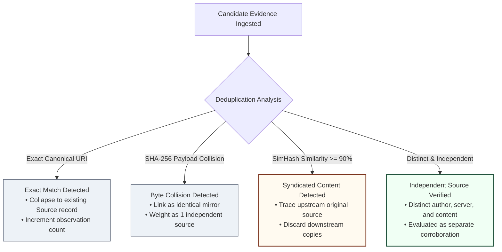
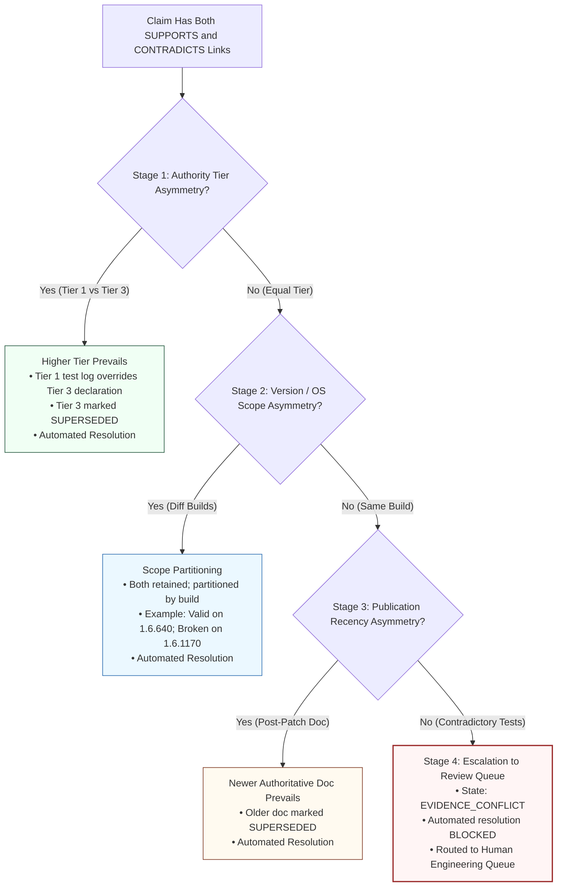

# Evidence Quality, Conflict & Duplicate Resolution Workflow

**Document ID:** `NLE-WKF-QCD-001`  
**Version:** `1.0.0`  
**Status:** `APPROVED`  
**Workstream:** `Compatibility Evidence Collection, Verification, Provenance Tracking, and Operational Lifecycle Architecture`  
**Phase:** `4 of 12 — Game Discovery & Compatibility Intelligence`  
**Step:** `30 of 100`  
**Related Documents:**
- [COMPATIBILITY_EVIDENCE_COLLECTION_AND_LIFECYCLE_SPECIFICATION.md](file:///d:/App%20Winrar%20Files/Nexludic%20Engine%20(working)/docs/game-discovery/COMPATIBILITY_EVIDENCE_COLLECTION_AND_LIFECYCLE_SPECIFICATION.md) (`NLE-SPC-ECL-001`)
- [COMPATIBILITY_EVIDENCE_QUALITY_AND_CONFLICT_RULES.md](file:///d:/App%20Winrar%20Files/Nexludic%20Engine%20(working)/docs/game-discovery/COMPATIBILITY_EVIDENCE_QUALITY_AND_CONFLICT_RULES.md) (`NLE-RUL-CEQ-001`)
- [EVIDENCE_CLAIM_LINKAGE_AND_VERIFICATION_RULES.md](file:///d:/App%20Winrar%20Files/Nexludic%20Engine%20(working)/docs/game-discovery/EVIDENCE_CLAIM_LINKAGE_AND_VERIFICATION_RULES.md) (`NLE-RUL-ECL-001`)
- [CROSS_GAME_COMPATIBILITY_DECISION_TABLES.md](file:///d:/App%20Winrar%20Files/Nexludic%20Engine%20(working)/docs/game-discovery/CROSS_GAME_COMPATIBILITY_DECISION_TABLES.md) (`NLE-TAB-CCD-001`)

---

## 1. Executive Summary & Purpose

This specification governs the automated duplicate detection pipeline, source independence auditing, and human escalation workflows for conflicting compatibility evidence within **NexLudic Engine**.

A frequent vulnerability in data ingestion is the **echo chamber effect**—where a single unverified blog post or Reddit comment is syndicated, republished, and quoted across dozens of gaming websites, giving the illusion of widespread consensus. This document enforces cryptographic and textual deduplication, traces syndication lineage, mandates that multiple copies of a claim collapse into a single evidentiary instance, and defines deterministic escalation procedures when authoritative sources directly conflict.

---

## 2. Duplicate Detection & Source Independence

### 2.1 Deduplication Mechanisms

1. **Exact Canonical URI Matching:** Normalizes URLs (stripping tracking query parameters like `utm_source`, fragments, trailing slashes). Matching records are mapped to the existing `source_id`.
2. **Cryptographic SHA-256 Collision:** If two distinct URLs yield identical byte payloads, they are linked as mirrors. They do **not** count as separate corroborating sources.
3. **Fuzzy Text Similarity (SimHash / MinHash):** When content text matches an existing source $\ge 90\%$, the ingestion engine flags it as `SYNDICATED_MIRROR`. The downstream copy is linked as an alias to the original upstream publication.
4. **Attribution Tracing:** If an article explicitly cites an upstream source (e.g. *"As reported by the SKSE team on GitHub..."*), the citation is attributed to the primary source.

### 2.2 The Independence Invariant (`RUL-QCD-01`)
- **Raw source count must never determine compatibility confidence.**
- Ten syndicated gaming news articles reprinting one maintainer's tweet represent **one** data point of Tier 2 authority, not ten independent confirmations.

---

## 3. Contradiction Resolution & Human Review Escalation

When evidence items supporting and contradicting a claim are both present, the engine executes the five-stage conflict resolution workflow:

### 3.1 Review Queue Management States

When an evidence contradiction is escalated to the Human Review Queue, the following lifecycle states govern its resolution:

| Queue State | Meaning & Operational Constraint | System Action |
| :--- | :--- | :--- |
| **`QUEUE_PENDING_REVIEW`** | Newly escalated conflict awaiting engineer evaluation. | Associated capability set to `EVIDENCE_CONFLICT`; execution blocked. |
| **`REVIEW_IN_PROGRESS`** | Assigned to lead engineer; investigation active. | Retains blocked state; displays advisory banner in UI. |
| **`RESOLVED_SPLIT_SCOPE`** | Engineer determines conflict was caused by undocumented minor patch differences. | Scopes partitioned; separate build constraints created. |
| **`RESOLVED_SUPERSEDED`** | Engineer confirms one source was flawed or corrupted. | Flawed record marked `SUPERSEDED_INVALIDATED`; valid record active. |
| **`RESOLVED_HARNESS_TEST`** | Test harness executed to empirically establish ground truth. | Test log created (`Tier 1`); overrides all conflicting community claims. |

---

## 4. Preservation of Competing Interpretations

1. **Zero Data Destruction:** When a conflict is resolved, the rejected or superseded evidence record is **never** deleted.
2. **Audit Attribution:** The review decision records the exact rationale, reviewer identity, timestamp, and a reference to the overriding evidence in `EvidenceReviewDecision`.
3. **Transparency:** If a user requests a detailed diagnostic report, both the active finding and the historical conflicting record are displayed with full citations.

---

## 5. Document Sign-Off & Verification

| Role | Reviewer | Verdict | Date |
| :--- | :--- | :--- | :--- |
| **Principal Software Architect** | Engine Architecture Team | Approved | 2026-11-17 |
| **Senior Evidence & Data Provenance Engineer**| Data Governance | Approved | 2026-11-17 |
| **Lead QA Automation Architect** | Test & Quality Assurance | Approved | 2026-11-17 |

