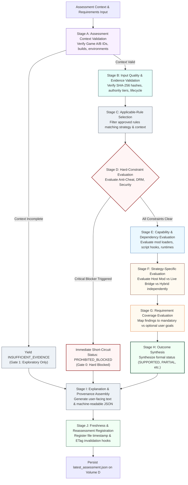

# Explainable Compatibility Evaluation Pipeline Specification

**Document ID:** `NLE-SPC-EPE-001`  
**Version:** `1.0.0`  
**Status:** `APPROVED`  
**Workstream:** `Compatibility Rule Architecture, Rule Taxonomy, Domain Schema, Lifecycle Governance, and Evaluation Contracts`  
**Phase:** `4 of 12 — Game Discovery & Compatibility Intelligence`  
**Step:** `31 of 100`  
**Related Documents:**
- [COMPATIBILITY_RULE_CATALOG_AND_DOMAIN_SPECIFICATION.md](file:///d:/App%20Winrar%20Files/Nexludic%20Engine%20(working)/docs/game-discovery/COMPATIBILITY_RULE_CATALOG_AND_DOMAIN_SPECIFICATION.md) (`NLE-SPC-CRD-001`)
- [COMPATIBILITY_RULE_INPUTS_AND_APPLICABILITY_CONTRACTS.md](file:///d:/App%20Winrar%20Files/Nexludic%20Engine%20(working)/docs/game-discovery/COMPATIBILITY_RULE_INPUTS_AND_APPLICABILITY_CONTRACTS.md) (`NLE-CAT-RIA-001`)
- [COMPATIBILITY_RULE_DEPENDENCY_AND_CONFLICT_RESOLUTION_SPECIFICATION.md](file:///d:/App%20Winrar%20Files/Nexludic%20Engine%20(working)/docs/game-discovery/COMPATIBILITY_RULE_DEPENDENCY_AND_CONFLICT_RESOLUTION_SPECIFICATION.md) (`NLE-SPC-RDC-001`)
- [COMPATIBILITY_EVALUATION_EXPLAINABILITY_AND_TRACE_SPECIFICATION.md](file:///d:/App%20Winrar%20Files/Nexludic%20Engine%20(working)/docs/game-discovery/COMPATIBILITY_EVALUATION_EXPLAINABILITY_AND_TRACE_SPECIFICATION.md) (`NLE-SPC-EET-001`)

---

## 1. Executive Summary & Purpose

This specification defines the 10-stage sequential execution pipeline, stage dependencies, short-circuit rules, error-handling contracts, and determinism guarantees governing compatibility evaluation within **NexLudic Engine**.

Evaluating the compatibility of a complex cross-game integration cannot be executed as an unstructured batch of disconnected rules. Execution must follow a strictly ordered pipeline where context is validated first, evidence integrity is verified second, mandatory constraints are evaluated third, and downstream capability rules execute only if no critical blockers exist. This document guarantees that critical blockers immediately abort unsafe execution paths, that failure at any stage degrades gracefully, and that identical normalized inputs consistently yield identical evaluation outcomes.

---

## 2. The 10-Stage Evaluation Pipeline

---

## 3. Detailed Stage Contracts

### 3.1 Stage A: Assessment Context Validation
- **Objective:** Verifies that both participant games are identified, target builds are recognized, and the user's mashup requirements are well-formed.
- **Short-Circuit Rule:** If either game identity is missing or unresolvable, the pipeline aborts further evaluation, yields `INSUFFICIENT_EVIDENCE`, and routes directly to Stage I for user guidance.

### 3.2 Stage B: Input Quality & Evidence Validation
- **Objective:** Validates that evidence records bound to the claims are in the `ACTIVE_VERIFIED` lifecycle state and that SHA-256 payload hashes match.
- **Invariant:** Discards stale or superseded evidence from influencing current evaluation findings.

### 3.3 Stage C: Applicable-Rule Selection
- **Objective:** Queries the `APPROVED_ACTIVE` rule catalog and selects rules whose applicability preconditions match the active context.
- **Invariant:** Draft or deprecated rules are strictly excluded from selection.

### 3.4 Stage D: Hard-Constraint Evaluation
- **Objective:** Evaluates mandatory security, anti-cheat, licensing, and operational prohibitions (`RULE-SEC-*`).
- **Short-Circuit Rule:** If a mandatory blocker is triggered (e.g. `BLK-SEC-01` Active Kernel Anti-Cheat), the pipeline **immediately short-circuits** downstream stages (Stages E, F, G), assigns status `PROHIBITED_BLOCKED`, and jumps directly to Stage I. No capability evaluation or code generation is attempted.

### 3.5 Stage E: Capability & Dependency Evaluation
- **Objective:** Evaluates mod loader versions (SKSE64, ScriptHook), system runtimes (.NET, VC++), and native engine extension interfaces.
- **Outcome:** Records `SATISFIED`, `DEPENDENCY_VERSION_MISMATCH`, or `PREREQUISITE_MISSING`.

### 3.6 Stage F: Strategy-Specific Evaluation
- **Objective:** Evaluates Host-Game Modification, Live Interoperability Bridging, and Hybrid Integration independently against identical user requirements.
- **Invariant:** Feasibility of Host Modification does not imply feasibility of Live Bridging, and vice versa.

### 3.7 Stage G: Requirement Coverage Evaluation
- **Objective:** Maps technical findings back to the user's specific requested capabilities, categorizing coverage into mandatory met, optional met, or blocked.

### 3.8 Stage H: Outcome Synthesis
- **Objective:** Evaluates Step 29 Decision Tables (`DEC-01` through `DEC-10`) to assign final status (`SUPPORTED`, `PARTIALLY_SUPPORTED`, `UNSUPPORTED`, `PROHIBITED_BLOCKED`, etc.).

### 3.9 Stage I: Explanation & Provenance Assembly
- **Objective:** Constructs machine-readable JSON (`latest_assessment.json`) and renders user-facing plain-language text summaries citing exact evidence records.

### 3.10 Stage J: Freshness & Reassessment Registration
- **Objective:** Registers file modification timestamps, executable hashes, and ETag pointers with the Freshness Daemon on Volume D (`DEC-009`).

---

## 4. Pipeline Determinism & Error Handling

1. **Determinism Contract (`RUL-EPE-01`):** Given identical normalized input records and identical approved rule revisions, the evaluation pipeline must produce identical rule outcomes, identical status codes, and identical explanation outputs across multiple runs.
2. **Failure Degradation (`RUL-EPE-02`):** If an unexpected unhandled exception occurs within an individual rule (e.g. regex timeout or null pointer), the pipeline catches the exception, flags the rule result as `RULE_EVALUATION_ERROR`, marks the associated capability as `UNASSESSED_ERROR`, and completes the remaining stages without crashing the desktop application.
3. **Cancellation Semantics (`RUL-EPE-03`):** Pipeline operations accept a standard `CancellationToken`. User cancellation halts evaluation in $< 200\text{ ms}$ and discards in-flight buffers without altering previously persisted assessment records.

---

## 5. Document Sign-Off & Verification

| Role | Reviewer | Verdict | Date |
| :--- | :--- | :--- | :--- |
| **Principal Software Architect** | Engine Architecture Team | Approved | 2026-11-17 |
| **Senior Compatibility Intelligence Engineer**| Platform Engineering | Approved | 2026-11-17 |
| **Lead QA Automation Architect** | Test & Quality Assurance | Approved | 2026-11-17 |

