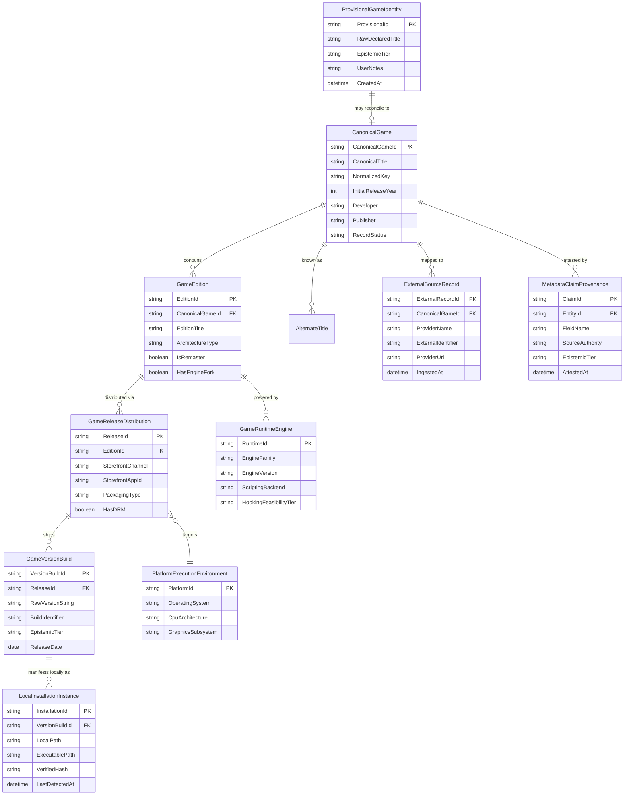

# Game Catalog Domain Model & Entity Relationships

**Document ID:** NLE-DOM-CAT-001  
**Version:** 1.0.0  
**Status:** Approved — Domain Model Specification  
**Phase:** 4 — Game Discovery & Compatibility Intelligence  
**Step:** 25 of 100  
**Date:** 2026-11-17  
**Parent Specification:** NLE-SPC-DSC-001  
**Classification:** Core Domain Architecture & Entity Modeling  

---

## 1. Purpose and Modeling Principles

This document defines the conceptual entity model, structural invariants, value objects, and relationships governing the **NexLudic Engine Game Catalog**.

In strict accordance with Domain-Driven Design (DDD) principles and the Phase 2 Core Domain Model (`NLE-DOM-SPEC-001`), the catalog model:
- Separates conceptual game identity from storefront distributions, version strings, and local installation paths.
- Establishes explicit boundaries between universal catalog metadata, local environment discovery, and game-specific adapters.
- Treats `UNKNOWN` and `UNEVALUATED` as first-class domain values rather than failure states.
- Embeds data provenance into every substantive metadata claim.

---

## 2. Conceptual Entity-Relationship Diagram

---

## 3. Comprehensive Entity Specifications

### 3.1 CanonicalGame (Aggregate Root)
- **Purpose:** Represents the immutable, universal identity of a distinct video game title. Acts as the stable anchor for all project associations, research notes, and compatibility history.
- **Identity:** `CanonicalGameId` — Strongly-typed UUIDv5 formatted string (`nle:game:<uuid>`).
- **Core Attributes:**
  - `CanonicalTitle` (string): Authoritative English title (e.g., *"Portal 2"*).
  - `NormalizedKey` (string): Lowercase alphanumeric slug for indexing (e.g., *"portal-2"*).
  - `InitialReleaseYear` (int?): Year of initial commercial release (e.g., 2011). Vital for homonymous titles.
  - `Developer` (string?): Primary development studio (e.g., *"Valve"*).
  - `Publisher` (string?): Primary publishing entity (e.g., *"Valve"*).
  - `RecordStatus` (enum): `ACTIVE`, `PROVISIONAL`, `DEPRECATED`, `SUPERSEDED`, `HISTORICAL`.
- **Relationships:**
  - Has many `GameEdition` entities (1..*).
  - Has many `AlternateTitle` value objects (0..*).
  - Has many `ExternalSourceRecord` entries (0..*).
- **Invariants:**
  1. `CanonicalTitle` must be non-empty and <= 200 characters.
  2. `NormalizedKey` must be unique across the universal catalog.
  3. Deleting or modifying an external provider mapping must never alter `CanonicalGameId`.
- **Approval Status:** **Approved Core Concept** (`NLE-DOM-SPEC-001`).

---

### 3.2 GameEdition (Entity)
- **Purpose:** Represents a materially distinct commercial, technical, or content release family of a canonical game where technical runtime, binary architecture, or engine features diverge.
- **Identity:** `EditionId` — Strongly-typed string (`nle:edition:<slug>`).
- **Core Attributes:**
  - `EditionTitle` (string): Distinctive edition name (e.g., *"Special Edition"*, *"Anniversary Edition"*, *"Original 2011"*).
  - `ArchitectureType` (enum): `X64`, `X86`, `ARM64`, `UNKNOWN`.
  - `IsRemaster` (bool): Indicates a major graphical or engine overhaul.
  - `HasEngineFork` (bool): Indicates that the codebase was branched into a different engine generation.
- **Relationships:**
  - Belongs to `CanonicalGame` (1..1).
  - Has many `GameReleaseDistribution` records (1..*).
  - References 1 `GameRuntimeEngine` record (1..1).
- **Invariants:**
  1. If `HasEngineFork == true`, downstream compatibility intelligence must treat adapters for other editions as incompatible unless explicitly bridged.
  2. Editions cannot cross canonical game boundaries.
- **Approval Status:** **Approved Core Concept**.

---

### 3.3 GameReleaseDistribution (Entity)
- **Purpose:** Identifies a specific distribution channel, packaging format, and storefront SKU of a game edition.
- **Identity:** `ReleaseId` — Strongly-typed string (`nle:release:<store>-<appid>`).
- **Core Attributes:**
  - `StorefrontChannel` (enum): `STEAM`, `GOG`, `EPIC_GAMES`, `MICROSOFT_STORE`, `STANDALONE`, `PHYSICAL_MEDIA`, `CUSTOM`.
  - `StorefrontAppId` (string?): Storefront-specific numeric or string key (e.g., Steam AppID *"480"*).
  - `PackagingType` (enum): `STANDARD_DIRECTORY`, `VIRTUAL_FILE_SYSTEM`, `PACKAGED_UWP`, `ARCHIVE`.
  - `HasDRM` (bool?): Indicates presence of digital rights management layers (e.g., Steamworks DRM, Denuvo).
- **Relationships:**
  - Belongs to `GameEdition` (1..1).
  - Targets 1 `PlatformExecutionEnvironment` (1..1).
  - Has many `GameVersionBuild` entries (0..*).
- **Approval Status:** **Approved Core Concept**.

---

### 3.4 GameVersionBuild (Entity)
- **Purpose:** Captures an exact technical patch, build, or version iteration within a release distribution.
- **Identity:** `VersionBuildId` — Unique scoped string (`nle:version:<release-id>:<build-hash>`).
- **Core Attributes:**
  - `RawVersionString` (string): Unmodified version string as reported by the game or manifest (e.g., *"1.6.640.0"*, *"Patch 4"*, *"Build 108249"*).
  - `BuildIdentifier` (string?): Numeric or hexadecimal build manifest ID (e.g., Steam Manifest ID).
  - `ReleaseDate` (date?): Date of patch release.
  - `EpistemicTier` (enum): `DECLARED`, `IMPORTED`, `DETECTED`, `VERIFIED`.
- **Relationships:**
  - Belongs to `GameReleaseDistribution` (1..1).
  - Has many `LocalInstallationInstance` manifestations (0..*).
- **Unknown-Data Semantics:**
  - If a game has no published version numbering, `RawVersionString` is set to `"UNKNOWN"`, and `EpistemicTier` is `DECLARED`. This is fully valid and non-blocking.
- **Approval Status:** **Approved Core Concept**.

---

### 3.5 PlatformExecutionEnvironment (Value Object / Entity)
- **Purpose:** Defines the target hardware and operating system environment required to execute the game release.
- **Identity:** `PlatformId` (e.g., `win-x64`, `win-x86`, `linux-x64-proton`).
- **Core Attributes:**
  - `OperatingSystem` (enum): `WINDOWS`, `LINUX`, `MACOS`.
  - `CpuArchitecture` (enum): `X64`, `X86`, `ARM64`.
  - `GraphicsSubsystem` (enum): `DIRECTX_9`, `DIRECTX_11`, `DIRECTX_12`, `VULKAN`, `OPENGL`.
- **Approval Status:** **Approved Core Concept**.

---

### 3.6 GameRuntimeEngine (Value Object / Reference Entity)
- **Purpose:** Captures the foundational game engine, runtime, and language environment powering the game edition. Essential for downstream adapter binding.
- **Identity:** `RuntimeId` (e.g., `engine:creation:2`, `engine:ue:5.3`, `engine:unity:mono`).
- **Core Attributes:**
  - `EngineFamily` (string): e.g., *"Unreal Engine"*, *"Unity"*, *"Creation Engine"*, *"id Tech"*, *"Proprietary"*.
  - `EngineVersion` (string?): e.g., *"4.27.2"*, *"2021.3.16f1"*.
  - `ScriptingBackend` (enum): `MONO_CLR`, `IL2CPP`, `NATIVE_C_PLUS_PLUS`, `LUA`, `PYTHON`, `PAPIN`, `UNKNOWN`.
  - `HookingFeasibilityTier` (enum): `HIGH_STANDARDIZED`, `MODERATE_COMMUNITY_ADAPTER`, `DIFFICULT_BESPOKE`, `BLOCKED_ENCRYPTION`.
- **Approval Status:** **Approved Reference Entity**.

---

### 3.7 ExternalSourceRecord (Entity)
- **Purpose:** Preserves the link between a canonical game and its external provider references.
- **Identity:** `ExternalRecordId` (`nle:ext:<provider>:<id>`).
- **Core Attributes:**
  - `ProviderName` (string): e.g., *"PCGamingWiki"*, *"IGDB"*, *"SteamStore"*, *"Wikidata"*.
  - `ExternalIdentifier` (string): e.g., Steam AppID *"220"*, IGDB ID *"72"*.
  - `ProviderUrl` (string?): Web link to external resource.
  - `IngestedAt` (datetime): Timestamp of last synchronization.
- **Approval Status:** **Approved Core Concept**.

---

### 3.8 MetadataClaimProvenance (Value Object)
- **Purpose:** Provides field-level epistemic evidence tracking for consequential technical metadata.
- **Identity:** `ClaimId` (GUID).
- **Core Attributes:**
  - `EntityId` (string): Target entity ID.
  - `FieldName` (string): Specific attribute attested (e.g., *"EngineVersion"*).
  - `SourceAuthority` (string): Name or URI of the attesting entity.
  - `EpistemicTier` (enum): `DECLARED`, `DETECTED`, `PROBED`, `VERIFIED`.
  - `AttestedAt` (datetime): Timestamp when claim was captured.
  - `RawEvidenceSnippet` (string?): Optional short citation or hash.
- **Approval Status:** **Approved Core Concept**.

---

### 3.9 ProvisionalGameIdentity (Entity)
- **Purpose:** Accommodates games entered manually by users that do not yet exist in the canonical catalog.
- **Identity:** `ProvisionalId` (`nle:provisional:<slug>`).
- **Core Attributes:**
  - `RawDeclaredTitle` (string): Unsanitized user title.
  - `EpistemicTier`: `DECLARED`.
  - `UserNotes` (string?): Optional context provided during project creation.
  - `CreatedAt` (datetime): Creation timestamp.
- **Lifecycle:**
  - Remains active within local project scope.
  - May transition to `RECONCILED` if later linked to a canonical record via `GameIdentityReconciliationService`.
- **Approval Status:** **Approved Core Concept**.

---

### 3.10 LocalInstallationInstance (Entity — Downstream Phase 4)
- **Purpose:** Represents a concrete physical installation of a game version on the user's host machine.
- **Identity:** `InstallationId` (GUID).
- **Core Attributes:**
  - `LocalPath` (string): Absolute Windows path on local filesystem (must reside on Volume D: or authorized path).
  - `ExecutablePath` (string): Path to main game binary.
  - `VerifiedHash` (string?): SHA-256 hash of the main executable.
  - `LastDetectedAt` (datetime): Timestamp of detection.
- **Boundary Note:** Excluded from universal catalog distribution; stored strictly in local user app data.
- **Approval Status:** **Approved Downstream Concept**.

---

## 4. Entity Invariants and Consistency Rules

1. **Hierarchy Integrity:** A `GameVersionBuild` cannot exist without an owning `GameReleaseDistribution`, which cannot exist without an owning `GameEdition`, which cannot exist without a `CanonicalGame`.
2. **Provenance Mandatory on Overrides:** When an automated ingestion pipeline overwrites an existing metadata field, a `MetadataClaimProvenance` entry must be appended documenting the old value, new value, and source authority.
3. **No Foreign Key Cascade Deletion to Projects:** If a canonical game record is deprecated or removed from an external provider, local projects referencing that game retain their snapshot; cascade deletion is strictly prohibited.
4. **Epistemic Non-Coercion:** A `GameVersionBuild` with `RawVersionString == "UNKNOWN"` must never be coerced into `0.0.0` or any fabricated semver number.

---

## 5. Document Control

| Field | Value |
|---|---|
| Author | NexLudic Engine Architecture & Game Technology Team |
| Step | 25 — Game Discovery Architecture & Canonical Game Identity Specification |
| Document ID | NLE-DOM-CAT-001 |
| Created | 2026-11-17 |
| Classification | Core Domain Architecture & Entity Modeling |
| Implementation Authorization | Architecture and modeling only |

