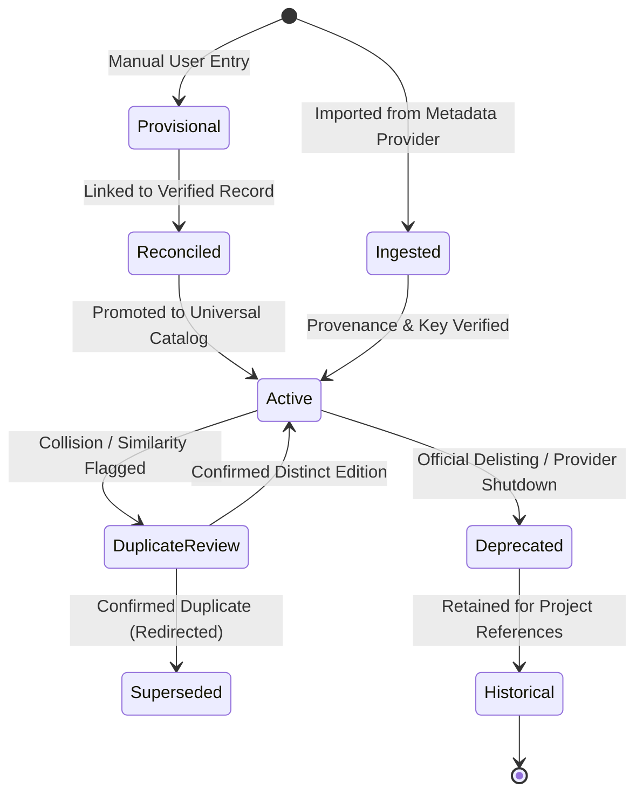

# Game Discovery, Identity Resolution & Data Quality Rules

**Document ID:** NLE-RUL-RES-001  
**Version:** 1.0.0  
**Status:** Approved — Quality & Resolution Rules Baseline  
**Phase:** 4 — Game Discovery & Compatibility Intelligence  
**Step:** 25 of 100  
**Date:** 2026-11-17  
**Parent Specification:** NLE-SPC-DSC-001  
**Classification:** Resolution Architecture & Data Quality Specification  

---

## 1. Purpose and Scope

This document specifies the algorithmic rules, matching pipelines, ambiguity resolution protocols, manual entry workflows, and data quality standards governing **Game Discovery and Identity Resolution** in the NexLudic Engine.

The primary architectural mandate is to ensure that searching for and matching game titles is **accurate, deterministic, transparent, and user-guided**, strictly prohibiting silent assumptions, false auto-selections, or confusing identity matches with technical compatibility claims.

---

## 2. Multi-Stage Identity Resolution Pipeline

When a user or external subsystem queries the game discovery service, resolution executes through a deterministic 4-stage pipeline:

```
[User / Service Query: Title, Anchor, or Keywords]
                      │
                      ▼
┌──────────────────────────────────────────────────────────┐
│ STAGE 1: Exact External Anchor / Identifier Match        │
│ Matches Storefront AppID, Wikidata QID, or Canonical ID  │
└─────────────────────┬────────────────────────────────────┘
                      │ No exact ID match
                      ▼
┌──────────────────────────────────────────────────────────┐
│ STAGE 2: Exact Normalized Title Match                    │
│ Matches Indexed NormalizedKey (NFKD, lowercase, stripped)│
└─────────────────────┬────────────────────────────────────┘
                      │ No exact normalized key match
                      ▼
┌──────────────────────────────────────────────────────────┐
│ STAGE 3: Alternate Title & Alias Match                   │
│ Matches Localized Titles, Acronyms, and Former Titles    │
└─────────────────────┬────────────────────────────────────┘
                      │ No exact alias match
                      ▼
┌──────────────────────────────────────────────────────────┐
│ STAGE 4: Fuzzy Candidate Generation & Disambiguation     │
│ Computes Jaro-Winkler similarity (Threshold >= 0.85)     │
└─────────────────────┬────────────────────────────────────┘
                      │
        ┌─────────────┴─────────────┐
        ▼                           ▼
[Single Confident Match]    [Ambiguous Candidates] ──► [Surfaced to User UI]
(Score >= 0.95 & Gap >= 0.10) (Multiple Candidates)   (Human Selection Mandate)
```

---

## 3. Matching and Ambiguity Rules

### RULE-MAT-001: Precedence of Exact Anchors
- An exact match on a verified external identifier (e.g., `steam:220` or `nle:game:<uuid>`) immediately resolves to the associated canonical game.
- String-based matching is bypassed when an exact technical anchor is supplied.

### RULE-MAT-002: Normalization Pipeline Execution
- All query text and catalog titles are processed via `RULE-ID-003` prior to index comparison:
  1. Unicode NFKD normalization.
  2. Accent and diacritic stripping.
  3. Lowercase ASCII conversion.
  4. Stop-article removal (`the`, `a`, `an`).
  5. Punctuation replaced with hyphens.

### RULE-MAT-003: Strict Prohibition on Blind Auto-Selection
- If Stage 4 produces multiple candidate records where the top two candidates have a similarity score difference:
  $$\Delta(\text{Score}_1, \text{Score}_2) < 0.08$$
- The system is **strictly prohibited from automatically selecting the top candidate**.
- The result must be returned with status `AMBIGUOUS_CANDIDATES`.
- The user must be presented with the candidate list, accompanied by release year, developer, and platform tags, to make an affirmative manual selection (`NLE-SPC-GPS-001`).

### RULE-MAT-004: Identity Match ≠ Compatibility Proof
- Resolving a query to a canonical game with 100% confidence proves **identity only**.
- It does **not** assert that:
  - The game is installed on the user's system.
  - The game is moddable.
  - An adapter exists for the game.
  - Integration with another game is feasible.
- Downstream compatibility intelligence (`CompatibilityEngine`) retains exclusive authority over feasibility claims.

---

## 4. Manual Entry & Provisional Game Identities

The platform must support games that do not exist in any connected catalog (e.g., custom homebrew, obscure indie releases, unreleased titles):

### RULE-MAN-001: Unblocked Manual Registration
- If discovery yields zero matches or the user explicitly selects *"Add Game Manually"*:
  1. A `ProvisionalGameIdentity` record is instantiated.
  2. The record captures the user's raw input string as `RawDeclaredTitle`.
  3. A temporary slug is generated with prefix `nle:provisional:`.
  4. Epistemic tier is permanently tagged as `DECLARED`.
- Project creation proceeds immediately without artificial blocking (`VR-GAME-003`).

### RULE-MAN-002: UI Presentation of Provisional Records
- In all workspace views, dashboards, and project manifests:
  - Provisional titles are rendered with a distinct visual indicator (e.g., an Amber "Provisional" badge).
  - Tooltips explicitly state: *"This game was manually entered and has not been verified against the universal catalog."*

### RULE-MAN-003: Formal Reconciliation Workflow
- If a future catalog update introduces a canonical record matching a provisional game:
  - A reconciliation proposal is generated (`ReconciliationCandidate`).
  - The user is prompted: *"We found a verified catalog entry for [Declared Title]. Would you like to link it?"*
  - If approved, the project links to the canonical record; the historical declared title is preserved in project audit logs.

---

## 5. Data Quality Dimensions & Integrity Metrics

To prevent catalog degradation, metadata quality is measured across five explicit quality dimensions:

| Quality Dimension | Metric Definition | Acceptable Threshold | Operational Consequence |
|---|---|---|---|
| **Identity Completeness** | Presence of non-null `CanonicalTitle`, `NormalizedKey`, and valid `CanonicalGameId`. | **100%** (Mandatory) | Record rejected at ingestion if incomplete. |
| **Technical Attribute Completeness** | Population of `EngineFamily`, `ArchitectureType`, and `AntiCheatStatus`. | $\ge 80\%$ of catalog | Missing attributes marked as `UNKNOWN`; triggers advisory tag. |
| **Provenance Coverage** | Percentage of fields possessing valid `MetadataClaimProvenance` records. | **100%** of imported claims | Unattested imported claims are rejected. |
| **Duplicate Candidate Ratio** | Number of unresolved `DUPLICATE_CANDIDATE` flags. | $\le 2\%$ of active catalog | Triggers administrative deduplication review. |
| **Metadata Freshness** | Elapsed time since last source synchronization. | $\le 90$ days for active pilot titles | Triggers background cache refresh advisory. |

---

## 6. Record Lifecycle State Machine

A canonical catalog record progresses through a formal, deterministic lifecycle:



### 6.1 Lifecycle States Defined
- **`PROVISIONAL`:** User-declared record; unverified against authoritative sources.
- **`ACTIVE`:** Verified, fully indexed canonical game record available for all projects.
- **`DUPLICATE_REVIEW`:** Flagged for potential collision; quarantined from automatic matching.
- **`SUPERSEDED`:** Former record merged into another canonical game; acts as permanent redirect pointer.
- **`DEPRECATED`:** Game delisted or unavailable from upstream sources; active projects unaffected.
- **`HISTORICAL`:** Read-only archive preserving historical integrity for closed projects.

---

## 7. Document Control

| Field | Value |
|---|---|
| Author | NexLudic Engine Architecture & Game Technology Team |
| Step | 25 — Game Discovery Architecture & Canonical Game Identity Specification |
| Document ID | NLE-RUL-RES-001 |
| Created | 2026-11-17 |
| Classification | Resolution Architecture & Data Quality Specification |
| Implementation Authorization | Rules and quality specification only |

