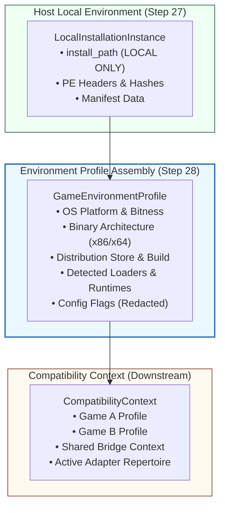
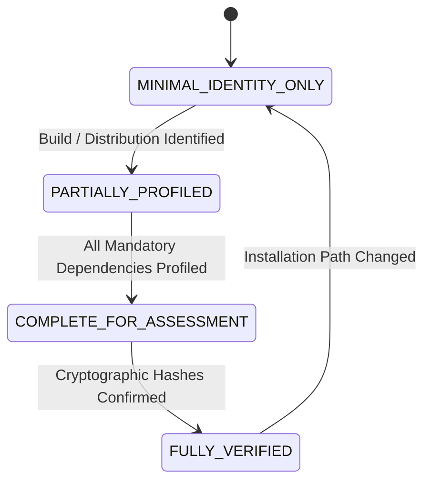

# Game Environment Profile & Compatibility Context Model

**Document ID:** `NLE-DOM-ENV-001`  
**Version:** `1.0.0`  
**Status:** `APPROVED`  
**Workstream:** `Game Version Modeling, Edition and Release Relationships, Environment Profiles, Version-Specific Technical Evidence, Compatibility Constraints, and Assessment Freshness`  
**Phase:** `4 of 12 — Game Discovery & Compatibility Intelligence`  
**Step:** `28 of 100`  
**Related Documents:**
- [GAME_VERSION_EDITION_AND_ENVIRONMENT_COMPATIBILITY_MAPPING_SPECIFICATION.md](file:///d:/App%20Winrar%20Files/Nexludic%20Engine%20(working)/docs/game-discovery/GAME_VERSION_EDITION_AND_ENVIRONMENT_COMPATIBILITY_MAPPING_SPECIFICATION.md) (`NLE-SPC-VEC-001`)
- [VERSION_AND_EDITION_RELATIONSHIP_CATALOG.md](file:///d:/App%20Winrar%20Files/Nexludic%20Engine%20(working)/docs/game-discovery/VERSION_AND_EDITION_RELATIONSHIP_CATALOG.md) (`NLE-CAT-VER-001`)
- [LOCAL_INSTALLATION_IDENTITY_AND_VERIFICATION_STATE_MODEL.md](file:///d:/App%20Winrar%20Files/Nexludic%20Engine%20(working)/docs/game-discovery/LOCAL_INSTALLATION_IDENTITY_AND_VERIFICATION_STATE_MODEL.md) (`NLE-DOM-INS-001`)
- [LOCAL_GAME_DISCOVERY_AUTHORIZATION_AND_PRIVACY_SPECIFICATION.md](file:///d:/App%20Winrar%20Files/Nexludic%20Engine%20(working)/docs/game-discovery/LOCAL_GAME_DISCOVERY_AUTHORIZATION_AND_PRIVACY_SPECIFICATION.md) (`NLE-SPC-LPR-001`)

---

## 1. Executive Summary & Purpose

This specification defines the multi-dimensional domain schema and operational boundaries of the `GameEnvironmentProfile` and `CompatibilityContext` entities within **NexLudic Engine**.

An environment profile represents the precise technical environment in which a game binary resides on a user's machine. It acts as the technical substrate against which compatibility constraints and adapter prerequisites are evaluated. This document establishes what environmental dimensions are strictly required, what dimensions are optional, how provenance and verification states are maintained, and how strict privacy boundaries protect the host system from invasive scanning or external data leakage.

---

## 2. Conceptual Architecture



---

## 3. Schema Specification: `GameEnvironmentProfile`

The `GameEnvironmentProfile` entity captures technical runtime properties without storing personal user data or whole-disk system inventories.

| Field Name | Type | Nullable | Required | Purpose & Description |
| :--- | :--- | :--- | :--- | :--- |
| `profile_id` | UUIDv4 | No | Yes | Unique local identifier for this profile instance. |
| `installation_id` | UUIDv4 | No | Yes | Foreign Key $\rightarrow$ `LocalInstallationInstance.installation_id`. |
| `game_id` | UUIDv5 | No | Yes | Foreign Key $\rightarrow$ `CanonicalGame.game_id`. |
| `edition_id` | UUIDv5 | Yes | Optional | Foreign Key $\rightarrow$ `GameEdition.edition_id` (null if ambiguous). |
| `release_id` | UUIDv5 | Yes | Optional | Foreign Key $\rightarrow$ `GameReleaseDistribution.release_id`. |
| `build_id` | UUIDv5 | Yes | Optional | Foreign Key $\rightarrow$ `GameVersionBuild.build_id`. |
| `os_platform` | Enum | No | Yes | OS Family (`WINDOWS_10`, `WINDOWS_11`, `LINUX_PROTON`). |
| `os_architecture` | Enum | No | Yes | Host OS bitness (`X86_64`, `ARM64`). |
| `binary_architecture`| Enum | No | Yes | Target game binary bitness (`X86_32`, `X86_64`). |
| `integrity_level` | Enum | No | Yes | Execution token (`MEDIUM_INTEGRITY_LEVEL` strictly per `REQ-SEC-001`). |
| `active_loaders` | Array[DependencyRecord]| No | Yes | List of detected mod loaders / script extenders. |
| `active_runtimes` | Array[DependencyRecord]| No | Yes | List of detected system runtimes (.NET, VC++). |
| `configuration_flags`| KeyValueMap | Yes | Optional | Relevant non-sensitive engine flags (e.g. `bEnableFileSelection`). |
| `provenance_type` | Enum | No | Yes | Provenance source (`USER_DECLARED`, `OBSERVED_STATIC`, `HASH_VERIFIED`). |
| `completeness_state`| Enum | No | Yes | Profile completeness classification (see §4). |
| `created_at_utc` | Timestamp | No | Yes | Creation timestamp. |
| `last_revalidated_at`| Timestamp | Yes | Yes | Timestamp of most recent verification check. |

---

## 4. Completeness State Classification

Rather than calculating an arbitrary or misleading numerical percentage (e.g., "73% complete"), profile completeness is categorized into four discrete, measurable operational states:



1. **`MINIMAL_IDENTITY_ONLY`:**
   - *Condition:* Canonical game and target platform are known, but specific build, distribution channel, and modding frameworks have not yet been evaluated.
   - *Downstream Impact:* Downstream workflows can evaluate general game catalog metadata, but cannot qualify version-specific adapters.
2. **`PARTIALLY_PROFILED`:**
   - *Condition:* Game build version and binary architecture (x86/x64) are confirmed, but supporting frameworks (e.g., SKSE64 version or .NET runtime) remain uninspected or unknown.
   - *Downstream Impact:* Downstream workflows can evaluate binary-level feasibility, but cannot prove adapter loader readiness.
3. **`COMPLETE_FOR_ASSESSMENT`:**
   - *Condition:* Game build, distribution channel, binary bitness, and all mandatory modding loaders/runtimes are identified.
   - *Downstream Impact:* Fully sufficient for complete Phase 5 compatibility assessment.
4. **`FULLY_VERIFIED`:**
   - *Condition:* Binary SHA-256 hash matches the catalog signature and all dependency indicators are verified on disk.
   - *Downstream Impact:* Highest confidence tier for empirical integration testing.

---

## 5. Dependency Record Structure

Dependencies (loaders, runtimes, companion plugins) are modeled using structured records:

```json
{
  "dependency_id": "8f3b2c1a-5d4e-4f3a-9b1c-2e4d6f8a0b2c",
  "dependency_name": "SKSE64",
  "dependency_type": "SCRIPT_EXTENDER",
  "detected_version": "2.2.3",
  "raw_version_string": "skse64_2_02_03",
  "is_mandatory": true,
  "verification_state": "VERIFIED_ON_DISK",
  "detection_method": "PE_FILE_VERSION",
  "relative_indicator_path": "skse64_1_6_640.dll"
}
```

- **Separation of Versions:** The dependency version (`detected_version = 2.2.3`) is strictly isolated from the game version (`game_version = 1.6.640`). They are never merged into a single ambiguous string.
- **Optional vs. Mandatory:** If an optional extension is missing (e.g., `Address Library for SKSE Plugins`), it is recorded as `ABSENT_OPTIONAL` and does not block assessments that do not request that capability.

---

## 6. Privacy Boundaries & Data Minimization

The environment profile is subject to strict data-protection boundaries:

1. **Local Path Exclusion:** The absolute host filesystem path (`install_path`, e.g., `D:\Games\Steam\...`) remains exclusively inside `LocalInstallationInstance`. It is **never** copied into `GameEnvironmentProfile` and is **never** included in external telemetry, error reports, or AI prompts.
2. **User Identity Isolation:** User account names, user profile directories (`C:\Users\<username>`), machine network hostnames, MAC addresses, IP addresses, and hardware serial numbers are strictly excluded from the profile.
3. **Unrelated Software Exclusion:** The scanner never enumerates installed applications outside documented game directories and authorized launcher registries. It is strictly prohibited from compiling a general host software inventory.
4. **Volume D Containment (`DEC-009`):** Profile state is persisted exclusively in the project environment directory on Volume D: `D:\NexLudic\Projects\<project-id>\Environment\environment_profile.json`.

---

## 7. Document Sign-Off & Verification

| Role | Reviewer | Verdict | Date |
| :--- | :--- | :--- | :--- |
| **Principal Software Architect** | Engine Architecture Team | Approved | 2026-11-17 |
| **Senior Domain-Model Architect** | Core Data Modeling | Approved | 2026-11-17 |
| **Lead Privacy & Security Reviewer**| Compliance & Security | Approved | 2026-11-17 |

