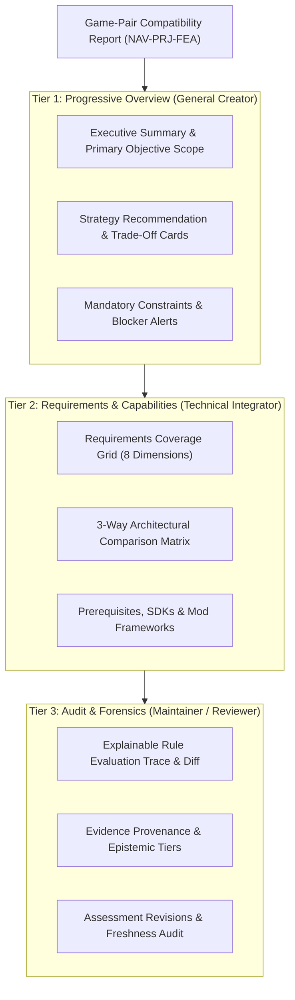

# Game-Pair Compatibility Report UX Specification

**Document ID:** `NLE-SPC-RUX-001`  
**Version:** 1.0.0  
**Phase:** 4 of 12 — Game Discovery & Compatibility Intelligence  
**Step:** 32 of 100 — Game-Pair Compatibility Report & Recommendation Experience Specification  
**Classification:** Desktop UX Specification & Architectural Interface Contract  
**Status:** Approved Specification  
**Authoritative Reference:** `NLE-SPC-CAC-001` (Assessment Framework), `NLE-SPC-ECL-001` (Evidence Lifecycle), `NLE-SPC-CRD-001` (Rule Catalog & Pipeline), `NLE-DOM-SPEC-001` (Core Domain)

---

## 1. Executive Summary & Purpose

The **Game-Pair Compatibility Report** is the primary decision-support interface within NexLudic Engine where project creators, mod developers, technical integrators, and project maintainers inspect, interpret, and act upon multi-dimensional compatibility intelligence between two selected games (Host Game $G_H$ and Donor/Guest Game $G_D$).

NexLudic Engine evaluates potential cross-game integrations across three primary architectures:
1. **Strategy A (Host-Game Modification):** Translating, converting, and injecting donor assets/logic directly into the host runtime via mod loaders, engine hooks, or asset replacement.
2. **Strategy B (Live Interoperability Bridging):** Executing both games concurrently in sandboxed environments, exchanging real-time state, player inputs, and events over IPC memory or socket channels.
3. **Strategy C (Hybrid Integration):** Partitioned execution combining host-side asset/mesh rendering with real-time live simulation bridges.

### 1.1 Core UX Mandates & Anti-Patterns
The report operates under strict epistemic and architectural invariants:
- **Evidence Before Conclusions:** Every claim, badge, and summary is backed by inspectable, cryptographically hashed evidence records (`NLE-SPC-ECL-001`).
- **Zero Decorative Scoring:** No composite percentages (e.g., "78% Compatible"), single aggregate green checkmarks, or gamified confidence scores that gloss over critical blockers or missing information.
- **Explicit Uncertainty vs. Incompatibility:** A clear, visible distinction between *absence of evidence* (`INSUFFICIENT_EVIDENCE` / `UNKNOWN`) and *evidence of absence/failure* (`UNSUPPORTED` / `PROHIBITED_BLOCKED`).
- **Strategy-Specific Evaluation:** Compatibility is never universal; each strategy is independently evaluated against declared user requirements (`RULE-STR-HM`, `RULE-STR-LB`, `RULE-STR-HY`).
- **Mandatory Constraint Dominance:** If any mandatory security, policy, anti-cheat, or architectural blocker is detected (`BLK-SEC-01`, `BLK-SEC-02`), it dominates the report. No positive technical finding may conceal a blocking constraint.
- **Strict Read-Only & Safe Next Actions:** The report is strictly advisory and diagnostic. Viewing or accepting a recommendation never triggers automated disk modifications, file patching, code injection, or process spawning (`REQ-SEC-001`, `REQ-SAFE-001`).

---

## 2. Target Audiences & Decision Needs

The report is structured using **progressive disclosure** to serve three distinct personas without diluting technical precision or overwhelming non-technical creators:



### 2.1 Persona 1: General Project Creator
- **Profile:** Creator who selected two games in the Project Creation Wizard (`Step 20`) with a specific mashup goal (e.g., "Port Donor driving physics into Host city map").
- **Key Decision Questions:**
  1. Does the engine currently know if this mashup is technically possible?
  2. Does the assessment apply to my exact installed game versions and operating environment?
  3. Which integration strategy is most promising, and what are its major drawbacks?
  4. What missing information or manual steps are required before I can proceed?
- **UI Treatment:** Top-level executive cards, plain-language summaries, structured requirement badges, clear "Next Safe Action" banners.

### 2.2 Persona 2: Advanced Integrator & Mod Developer
- **Profile:** Reverse engineer, C++/C# programmer, or experienced modder planning custom hooks, memory mapping, or asset pipelines.
- **Key Decision Questions:**
  1. What exact hook points, loader APIs, and memory architectures are required?
  2. Are process bitnesses identical (64-bit vs 32-bit), and are runtime symbols exported?
  3. What are the specific IPC throughput, latency, and serialization limits for Strategy B?
  4. Are there conflicting community reports or disputed engine version capabilities?
- **UI Treatment:** Expandable technical requirement drawers, capability tables, rule outcome codes (`OUTCOME_SATISFIED`, `OUTCOME_MISSING_PREREQUISITE`), environment parameter matrices.

### 2.3 Persona 3: Project Maintainer & Quality Reviewer
- **Profile:** Systems architect or peer reviewer validating whether a project is safe to move from Phase 4 (Intelligence) into Phase 5 (Adapter Design) and Phase 6 (Execution).
- **Key Decision Questions:**
  1. Is this assessment fresh (`ASSESSMENT_FRESH`) or stale (`ASSESSMENT_STALE_EVIDENCE`)?
  2. Which exact rule catalog version (`RuleSetVersion 1.0.0`) and pipeline evaluated this state?
  3. Are all claims supported by Tier 1 (`REPRODUCED_BEHAVIOR`) or Tier 2 (`DOCUMENTED_CAPABILITY`) evidence?
  4. Have anti-cheat systems, DRM constraints, or licensing terms been formally verified?
- **UI Treatment:** Full `CompatibilityEvaluationTrace` inspector, cryptographic evidence citation drawer, assessment revision history, rule diff breakdown.

---

## 3. Information Architecture & Workspace Integration

### 3.1 Destination Binding
Within the NexLudic Desktop Application Shell (`NLE-SPC-APP-001`, Step 18) and Project Workspace (`NLE-SPC-PRJ-001`, Step 21), the Compatibility Report resides under:
- **Workspace Navigation Route:** `NAV-PRJ-FEA` ("Feasibility & Research")
- **URL / State Path:** `/projects/{projectId}/compatibility-report`
- **Upstream Services:** `FeasibilityAssessmentService`, `CompatibilityRuleExecutionEngine`, `EvidenceCollectionService`
- **Downstream Transitions:**
  - Transition to `NAV-PRJ-REQ` ("Requirements & Scope") to refine unfulfilled mashup capabilities.
  - Transition to `NAV-PRJ-PLN` ("Integration Plan") to commit an approved strategy to the workspace roadmap.
  - Transition to `NAV-PRJ-ENG` ("Environment & Runtimes") to resolve unverified local installations.

### 3.2 Report Layout Hierarchy
The report view follows the responsive 3-column / 12-column grid established in `NLE-SPC-LAY-001`:

```
+-------------------------------------------------------------------------------------------------------+
| SHELL HEADER: [NexLudic Engine]  Project: "Skyrim-Kart" (ID: PRJ-8492)               Status: ACTIVE   |
+-------------------------------------------------------------------------------------------------------+
| SIDE NAV     | COMPATIBILITY REPORT: Game-Pair Feasibility & Strategy Assessment                      |
| [Dashboard]  +----------------------------------------------------------------------------------------+
| [Catalog]    | SECTION 1: ASSESSMENT CONTEXT & ENVIRONMENT BANNER                                     |
| [Environ.]   | Host: Game A v1.5.97 (Verified) | Guest: Game B v2.1.0 (Detected) | RuleSet: v1.2.0    |
| [Feasibil.]* | Freshness: FRESH (Evaluated 2026-11-17) | Integrity: OK | Context: CTX-9021            |
| [Plan]       +----------------------------------------------------------------------------------------+
| [Adapters]   | SECTION 2: EXECUTIVE SUMMARY & MANDATORY CONSTRAINT BANNER                             |
| [Bridge]     | Outcome: STRATEGY_VIABLE_WITH_CONDITIONS | Blocker Status: NONE DETECTED               |
| [Logs]       | Primary Recommendation: Strategy A (Host Mod) [Confidence: MEDIUM (Documented)]       |
|              +----------------------------------------------------------------------------------------+
|              | SECTION 3: STRATEGY RECOMMENDATION & COMPARISON (3 Architectural Routes)               |
|              | +-----------------------+ +-----------------------+ +-----------------------+          |
|              | | STRATEGY A: HOST MOD  | | STRATEGY B: LIVE BR.  | | STRATEGY C: HYBRID    |          |
|              | | Status: RECOMMENDED   | | Status: VIABLE (COND) | | Status: DEFERRED      |          |
|              | | Coverage: 4/5 Req.    | | Coverage: 3/5 Req.    | | Coverage: 2/5 Req.    |          |
|              | | [Inspect Route]       | | [Inspect Route]       | | [Inspect Route]       |          |
|              | +-----------------------+ +-----------------------+ +-----------------------+          |
|              +----------------------------------------------------------------------------------------+
|              | SECTION 4: USER REQUIREMENTS & CAPABILITY COVERAGE GRID                                |
|              | [Filter: All (5) | Satisfied (3) | Partial (1) | Unresolved (1) | Blocked (0)]        |
|              | - REQ-01: Custom Vehicle Physics Mesh Injection ........... [COVERAGE_SATISFIED]        |
|              | - REQ-02: Real-time Telemetry State Synchronization ........ [COVERAGE_PARTIAL]          |
|              | - REQ-03: Sound Engine Event Triggering .................... [COVERAGE_UNRESOLVED]     |
|              +----------------------------------------------------------------------------------------+
|              | SECTION 5: TECHNICAL CONSTRAINTS, RUNTIMES & DEPENDENCIES                              |
|              | Memory Architecture: 64-bit Match | Hook API: SKSE64 Required | Headroom: 45MB Avail.  |
|              +----------------------------------------------------------------------------------------+
|              | SECTION 6: EVIDENCE & PROVENANCE DRAWER (Progressive Disclosure)                       |
|              | [Ref: EVD-8021] SKSE64 API Documentation (Tier 2 Documented Capability)                |
|              | [Ref: EVD-8044] Shared Memory IPC Latency Benchmark (Tier 1 Reproduced Behavior)       |
+-------------------------------------------------------------------------------------------------------+
```

---

## 4. Key UX Principles & Architectural Safeguards

1. **No Silent Upgrades:** If a requirement has `COVERAGE_UNRESOLVED_UNKNOWN`, the UI must clearly label it as requiring user clarification or adapter probing. It must never assume default compatibility.
2. **Context Invalidation Alerts:** If the user updates the local game installation path or a new game patch is released, the report immediately updates its header badge to `ASSESSMENT_STALE_VERSION` and displays a non-modal reassessment banner.
3. **Traceability by Default:** Clicking any outcome badge or requirement status opens an inspectable side drawer showing:
   - Rule ID and rule version (`RULE-STR-HM-001 v1.0.0`).
   - Stage of evaluation (`Stage E: Strategy A Rules`).
   - Exact input facts evaluated (`host.bitness == 64`, `guest.bitness == 64`).
   - Evidence records cited with cryptographic hashes (`SHA-256`).
4. **Isolated Modals for Destructive/Consequential Transitions:** Selecting "Accept Recommendation & Create Plan" does not execute code. It routes the user to `NAV-PRJ-PLN` with draft milestone configurations pre-populated for user review and explicit confirmation.

