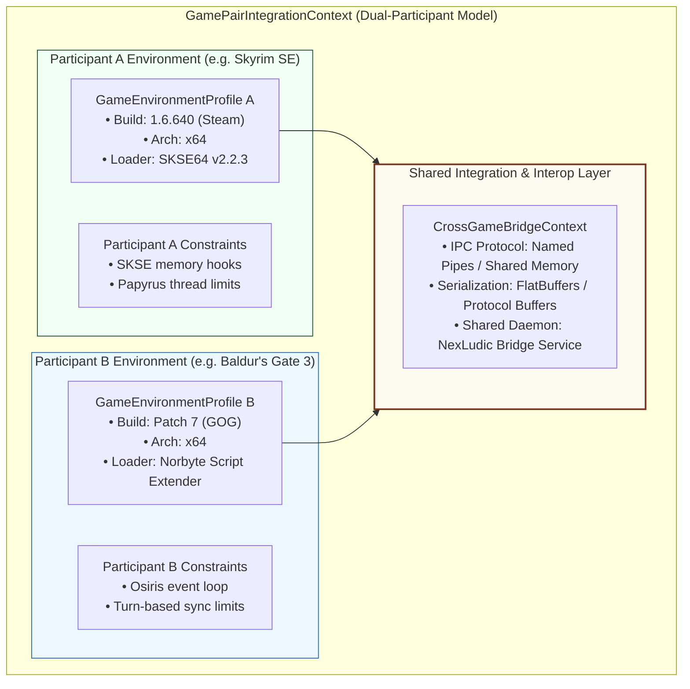

# Game-Pair Environment & Dependency Mapping Specification

**Document ID:** `NLE-SPC-GPE-001`  
**Version:** `1.0.0`  
**Status:** `APPROVED`  
**Workstream:** `Game Version Modeling, Edition and Release Relationships, Environment Profiles, Version-Specific Technical Evidence, Compatibility Constraints, and Assessment Freshness`  
**Phase:** `4 of 12 — Game Discovery & Compatibility Intelligence`  
**Step:** `28 of 100`  
**Related Documents:**
- [GAME_VERSION_EDITION_AND_ENVIRONMENT_COMPATIBILITY_MAPPING_SPECIFICATION.md](file:///d:/App%20Winrar%20Files/Nexludic%20Engine%20(working)/docs/game-discovery/GAME_VERSION_EDITION_AND_ENVIRONMENT_COMPATIBILITY_MAPPING_SPECIFICATION.md) (`NLE-SPC-VEC-001`)
- [GAME_ENVIRONMENT_PROFILE_AND_COMPATIBILITY_CONTEXT_MODEL.md](file:///d:/App%20Winrar%20Files/Nexludic%20Engine%20(working)/docs/game-discovery/GAME_ENVIRONMENT_PROFILE_AND_COMPATIBILITY_CONTEXT_MODEL.md) (`NLE-DOM-ENV-001`)
- [VERSION_COMPATIBILITY_EVIDENCE_AND_PROVENANCE_RULES.md](file:///d:/App%20Winrar%20Files/Nexludic%20Engine%20(working)/docs/game-discovery/VERSION_COMPATIBILITY_EVIDENCE_AND_PROVENANCE_RULES.md) (`NLE-RUL-VCE-001`)
- [ENVIRONMENT_CHANGE_AND_STALE_ASSESSMENT_POLICY.md](file:///d:/App%20Winrar%20Files/Nexludic%20Engine%20(working)/docs/game-discovery/ENVIRONMENT_CHANGE_AND_STALE_ASSESSMENT_POLICY.md) (`NLE-POL-ECS-001`)

---

## 1. Executive Summary & Purpose

This specification governs how **NexLudic Engine** models, maps, and evaluates the dual-environment contexts and cross-game dependencies required for game-pair integration projects.

NexLudic Engine does not operate on standalone games in isolation; its primary purpose is coordinating two distinct games (*Participant Game A* and *Participant Game B*). Each game operates within its own technical universe, potentially using different operating system runtimes, disparate binary architectures (e.g. 32-bit vs. 64-bit), distinct modding loaders, and independent distribution updates. This document establishes how their separate technical environments are isolated, how shared bridge dependencies are represented, and why cross-game feasibility strictly requires pair-level empirical evidence rather than unilateral component support.

---

## 2. Game-Pair Integration Context Architecture



---

## 3. Schema Specification: `GamePairIntegrationContext`

The `GamePairIntegrationContext` entity links the separate participants into an actionable evaluation substrate:

| Field Name | Type | Nullable | Description |
| :--- | :--- | :--- | :--- |
| `context_id` | UUIDv4 | No | Unique identifier for this pair integration context. |
| `project_id` | UUIDv4 | No | Foreign Key $\rightarrow$ Project Workspace ID. |
| `participant_a_profile`| Object (`GameEnvironmentProfile`) | No | Full technical profile for Game A. |
| `participant_b_profile`| Object (`GameEnvironmentProfile`) | No | Full technical profile for Game B. |
| `integration_strategy` | Enum | No | Target strategy (`HOST_MODIFICATION`, `LIVE_INTEROP_BRIDGE`, `HYBRID`). |
| `shared_communication` | Enum | No | Interop channel (`LOCAL_NAMED_PIPES`, `SHARED_MEMORY_MAPPING`, `LOCALHOST_WEBSOCKET`). |
| `shared_dependencies` | Array[DependencyRecord]| No | Middleware, bridge daemons, or common runtimes (.NET 8.0). |
| `cross_game_constraints`| Array[ConstraintRecord]| No | Pair-level constraints governing cross-talk and timing. |
| `capability_mappings` | Array[CapabilityEvaluation]| No | Granular capability-level compatibility mappings. |
| `context_state` | Enum | No | Context state (`PENDING_FEASIBILITY`, `CONSTRAINTS_MAPPED`, `ENVIRONMENT_MISMATCH`). |

---

## 4. The Fallacy of Symmetrical Support & Pair-Level Evidence

A common pitfall in integration modeling is the **Additive Fallacy**:
$$\text{Supported}(\text{Game A}) \land \text{Supported}(\text{Game B}) \centernot\implies \text{Supported}(\text{Game A} \longleftrightarrow \text{Game B})$$

### 4.1 Why Component Support Does Not Guarantee Pair Feasibility
1. **Clock & Update Rate Mismatches:** Game A may run a realtime $60\text{ Hz}$ physics loop, while Game B runs a turn-based or variable-tick simulation. Bridging them requires an explicit state synchronization adapter that may not exist.
2. **Memory & Address Space Collisions:** In a host-modification approach, two game runtimes cannot be forcibly loaded into the same process space if they share conflicting global symbols or runtime engines (e.g. two conflicting versions of Unreal Engine or Unity mono runtimes).
3. **Threading & Blocking Hazards:** Script extenders in Game A may execute on the main rendering thread. If Game B's IPC call blocks for $50\text{ ms}$, Game A will experience severe hitching or engine watchdog crashes.

### 4.2 Pair-Level Evidence Requirement (`RUL-GPE-01`)
- To establish compatibility for a cross-game integration, the engine requires **Pair-Level Evidence** (`GamePairEvidence`).
- A pair-level claim must reference:
  1. The specific build of Game A.
  2. The specific build of Game B.
  3. The specific bridge adapter version.
  4. Passing test assertions from an end-to-end integration test harness.

---

## 5. Granular Capability Retaining vs. Binary Collapsing

Projects frequently involve multiple discrete capabilities (e.g. *Quest Progress Sync*, *Live Inventory Transfer*, *World State Mirroring*, *Audio Cross-Fading*).

```
[Project Capabilities]
├── Quest Progress Sync      ──► [EMPIRICALLY_VALIDATED (Tier 1)]
├── Live Inventory Transfer  ──► [DECLARED_SUPPORT (Tier 3)]
└── World State Mirroring    ──► [UNDOCUMENTED_UNASSESSED (Tier 0)]

[Overall Project Status]     ──► PARTIALLY_FEASIBLE (Granular, Not Binary)
```

1. **No Binary Collapse (`RUL-GPE-02`):** The system must **never** collapse a multi-capability project into a single boolean "Compatible / Incompatible" badge.
2. **Capability-Level Attribution:** Each capability maintains its own compatibility state, evidence trail, and prerequisite list.
3. **User Transparency:** The workspace UI displays a granular checklist showing exactly which capabilities are verified, which are declared, and which are blocked or unassessed.

---

## 6. Document Sign-Off & Verification

| Role | Reviewer | Verdict | Date |
| :--- | :--- | :--- | :--- |
| **Principal Software Architect** | Engine Architecture Team | Approved | 2026-11-17 |
| **Senior Domain-Model Architect** | Core Data Modeling | Approved | 2026-11-17 |
| **Senior Integration-Testing Specialist**| Test Harness Architecture | Approved | 2026-11-17 |

