# Game Version, Edition & Environment Compatibility Mapping Specification

**Document ID:** `NLE-SPC-VEC-001`  
**Version:** `1.0.0`  
**Status:** `APPROVED`  
**Workstream:** `Game Version Modeling, Edition and Release Relationships, Environment Profiles, Version-Specific Technical Evidence, Compatibility Constraints, and Assessment Freshness`  
**Phase:** `4 of 12 — Game Discovery & Compatibility Intelligence`  
**Step:** `28 of 100`  
**Related Documents:**
- [GAME_DISCOVERY_AND_CANONICAL_IDENTITY_SPECIFICATION.md](file:///d:/App%20Winrar%20Files/Nexludic%20Engine%20(working)/docs/game-discovery/GAME_DISCOVERY_AND_CANONICAL_IDENTITY_SPECIFICATION.md) (`NLE-SPC-GDC-001`)
- [GAME_CATALOG_DOMAIN_MODEL_AND_ENTITY_RELATIONSHIPS.md](file:///d:/App%20Winrar%20Files/Nexludic%20Engine%20(working)/docs/game-discovery/GAME_CATALOG_DOMAIN_MODEL_AND_ENTITY_RELATIONSHIPS.md) (`NLE-DOM-GCD-001`)
- [LOCAL_GAME_INSTALLATION_DISCOVERY_AND_DETECTION_SPECIFICATION.md](file:///d:/App%20Winrar%20Files/Nexludic%20Engine%20(working)/docs/game-discovery/LOCAL_GAME_INSTALLATION_DISCOVERY_AND_DETECTION_SPECIFICATION.md) (`NLE-SPC-LID-001`)
- [VERSION_AND_EDITION_RELATIONSHIP_CATALOG.md](file:///d:/App%20Winrar%20Files/Nexludic%20Engine%20(working)/docs/game-discovery/VERSION_AND_EDITION_RELATIONSHIP_CATALOG.md) (`NLE-CAT-VER-001`)
- [GAME_ENVIRONMENT_PROFILE_AND_COMPATIBILITY_CONTEXT_MODEL.md](file:///d:/App%20Winrar%20Files/Nexludic%20Engine%20(working)/docs/game-discovery/GAME_ENVIRONMENT_PROFILE_AND_COMPATIBILITY_CONTEXT_MODEL.md) (`NLE-DOM-ENV-001`)
- [VERSION_COMPATIBILITY_EVIDENCE_AND_PROVENANCE_RULES.md](file:///d:/App%20Winrar%20Files/Nexludic%20Engine%20(working)/docs/game-discovery/VERSION_COMPATIBILITY_EVIDENCE_AND_PROVENANCE_RULES.md) (`NLE-RUL-VCE-001`)
- [ENVIRONMENT_CHANGE_AND_STALE_ASSESSMENT_POLICY.md](file:///d:/App%20Winrar%20Files/Nexludic%20Engine%20(working)/docs/game-discovery/ENVIRONMENT_CHANGE_AND_STALE_ASSESSMENT_POLICY.md) (`NLE-POL-ECS-001`)
- [GAME_PAIR_ENVIRONMENT_AND_DEPENDENCY_MAPPING_SPECIFICATION.md](file:///d:/App%20Winrar%20Files/Nexludic%20Engine%20(working)/docs/game-discovery/GAME_PAIR_ENVIRONMENT_AND_DEPENDENCY_MAPPING_SPECIFICATION.md) (`NLE-SPC-GPE-001`)

---

## 1. Executive Summary & Purpose

This specification defines the architectural model, contextual mapping boundaries, evidence structures, and freshness policies for relating game versions, editions, platforms, local environments, and technical dependencies to documented compatibility constraints within **NexLudic Engine**.

A canonical game title alone is never sufficient to establish technical integration feasibility. Real-world modding, live bridging, and cross-game coordination depend critically on precise binary architectures (x86 vs. x64), specific game patch builds, distribution channels (Steam vs. GOG vs. Epic), modding loaders (e.g., SKSE, ScriptHook, UE4SS), supporting runtimes (e.g., .NET, Visual C++ Redistributable), and engine extension points.

This specification enforces context-specific, evidence-backed reasoning:
1. **Title-Only Fallacy Banned:** A game's presence in the catalog or workspace does not imply that any particular version or installation is compatible.
2. **Universal Versioning Assumption Rejected:** The engine recognizes heterogeneous versioning systems (SemVer, arbitrary build numbers, date stamps, opaque hashes) without forcing arbitrary comparisons.
3. **Epistemic Separation:** Context Mapping (establishing the environment) is strictly decoupled from Compatibility Evaluation (assessing feasibility) and Integration Validation (executing test suites).
4. **Implementation Discipline:** Zero compatibility calculators, version comparator engines, or background scanners are implemented in this step.

---

## 2. Core Epistemic Framework & Separation of Responsibilities

To prevent architectural collapse where metadata discovery, version detection, and compatibility claims become conflated, NexLudic Engine enforces a strict division of architectural responsibilities:

```mermaid
flowchart LR
    GD["1. Game Discovery<br/>(Step 25)"] --> IR["2. Identity Resolution<br/>(Step 25/26)"]
    IR --> LD["3. Local Detection<br/>(Step 27)"]
    LD --> CM["4. Context Mapping<br/>(Step 28 - This Step)"]
    CM --> CE["5. Compatibility Evaluation<br/>(Future Phase 5)"]
    CE --> AQ["6. Adapter Qualification<br/>(Future Phase 5)"]
    AQ --> IV["7. Integration Validation<br/>(Future Phase 8)"]

    style GD fill:#f9f0ff,stroke:#6b46c1,stroke-width:1px
    style IR fill:#f9f0ff,stroke:#6b46c1,stroke-width:1px
    style LD fill:#e6fffa,stroke:#234e52,stroke-width:1px
    style CM fill:#ebf8ff,stroke:#2b6cb0,stroke-width:2px
    style CE fill:#fffaf0,stroke:#7b341e,stroke-width:1px
    style AQ fill:#fffaf0,stroke:#7b341e,stroke-width:1px
    style IV fill:#f0fff4,stroke:#22543d,stroke-width:1px
```

### 2.1 The Seven Architectural Responsibilities

| Responsibility | Architectural Owner | Core Function | Boundary / Output |
| :--- | :--- | :--- | :--- |
| **1. Game Discovery** | Catalog & Search Engines | Locates candidate metadata and canonical records from public providers. | Catalog references (`CanonicalGameId`). |
| **2. Identity Resolution** | Resolution Heuristics | Maps external identifiers and aliases to authoritative canonical titles. | Normalized catalog entities. |
| **3. Local Detection** | Local Environment Scanner | Bounded, read-only observation of files and manifests on host disk. | `LocalInstallationInstance` (Paths, PE info). |
| **4. Context Mapping** | **Step 28 (This Specification)** | **Assembles the complete environment profile and maps documented constraints.** | **`CompatibilityContext`, `MappedConstraintSet`.** |
| **5. Compatibility Evaluation** | Feasibility Engine (Phase 5) | Evaluates whether mapped constraints satisfy requested integration capabilities. | `FeasibilityAssessment`, `RiskClassification`. |
| **6. Adapter Qualification** | Adapter SDK (Phase 5/6) | Evaluates whether a specific adapter binary meets integration requirements. | `AdapterQualificationState`. |
| **7. Integration Validation** | Testing & Test Harness (Phase 8)| Executes concrete integration tests under monitored runtime conditions. | `TestExecutionRecord`, Empirical Evidence. |

---

## 3. Mandatory Architectural Principles

1. **Context-Specific Conclusions:** Every compatibility claim must explicitly identify the exact canonical game, edition, release, build, platform, framework, and conditions to which it applies.
2. **No Title-Only Guarantees:** A statement that "Skyrim is supported" is an architectural defect. The valid statement must specify: "Skyrim Special Edition (GOG build 1.6.659, x64) supported via Adapter v1.2.0 for capability X."
3. **No Universal Version Scheme:** Version comparison algorithms must not assume semantic versioning ($X.Y.Z$). Games using arbitrary build counters (e.g. Steam BuildID `1249021`), patch names (e.g. `Patch 7 Hotfix 2`), or release dates (`2023.11.04`) must be handled via explicit mapping rules or treated as incomparable.
4. **Separate Identity from Compatibility:** Identifying a local game binary as `SkyrimSE.exe v1.6.1170` confirms its identity; it does **not** assert that the engine or an adapter can integrate with it.
5. **Evidence-First Mapping:** Constraints must be anchored to verifiable sources: official documentation, vendor release notes, adapter manifest declarations, or empirical test logs.
6. **Explicit Uncertainty:** Unknown, partial, unverified, conflicting, or stale environment data must remain explicitly tagged. Never invent defaults or synthesize fake certainty scores.
7. **Scope Precision:** Evidence establishing compatibility for Steam (Windows x64) must never be silently inferred to apply to GOG, Epic, or Linux/Proton builds.
8. **Dependency Awareness:** When a capability requires a specific modding loader (e.g. SKSE64) or framework (.NET 8.0 Desktop Runtime), this requirement must be modeled as a distinct versioned entity.
9. **Change Sensitivity & Staleness:** Any modification to a game binary, installed patch, or runtime loader invalidates prior verified assessments, transitioning them to `STALE_REASSESSMENT_REQUIRED`.
10. **Preservation & Non-Destructive Operation:** Context mapping never alters host game files, never downloads patches, never triggers launcher updates, and preserves all user configuration.

---

## 4. Scope and Exclusions

### 4.1 In-Scope Responsibilities
- Associating projects with canonical game identities, editions, releases, and builds.
- Structuring the multi-dimensional `GameEnvironmentProfile` for each game participant.
- Modeling the combined `GamePairIntegrationContext` for cross-game operations.
- Cataloging version-specific compatibility constraints and known restrictions.
- Formalizing evidence provenance (official docs, adapter declarations, test records).
- Specifying environment staleness rules and reassessment triggers.
- Modeling dependency and framework relationships (loaders, runtimes, adapters).

### 4.2 Explicit Exclusions & Prohibitions
- **PROHIBIT-01: No Compatibility Calculators:** Do not compute a numerical "compatibility score" or boolean "works / does not work" verdict.
- **PROHIBIT-02: No Automatic Remediation:** Never trigger game file updates, rollbacks, dependency installations, or launcher verification.
- **PROHIBIT-03: No Memory Inspection:** Never read running game memory, inject DLLs, or hook game loops.
- **PROHIBIT-04: No Unbounded Traversal:** Never scan arbitrary host storage to fill environment profile gaps.
- **PROHIBIT-05: No Universal Assumptions:** Never assume two version strings with identical numbers share semantics or release lineage.

---

## 5. Architectural Traceability Matrix

| Requirement / Standard | Section in this Specification | Implementation Deliverable |
| :--- | :--- | :--- |
| `REQ-SEC-001` (Medium Integrity) | Section 3, Section 4.2 | Read-only static context assembly; zero UAC elevation. |
| `REQ-SAFE-001` (Anti-Cheat Safety)| Section 3, Section 4.2 | Zero memory hooking; passive static evidence modeling. |
| `DEC-002` (Non-Blocking Unknowns)| Section 3, Section 7 | Unknown versions/dependencies preserved as valid non-blocking states. |
| `DEC-009` (Volume D Containment) | Section 3 | Profile state stored strictly under `D:\NexLudic\Projects\`. |
| `NLE-SPC-GDC-001` (Canonical Identity)| Section 2, Section 6 | Canonical identity decoupled from volatile host versions. |
| `NLE-DOM-INS-001` (Local State) | Section 2 | Ingestion of verified `LocalInstallationInstance` state. |
| `NLE-CAT-VER-001` (Relationships) | Section 6 | Hierarchical model of Game $\rightarrow$ Edition $\rightarrow$ Release $\rightarrow$ Build. |
| `NLE-DOM-ENV-001` (Profile Model)| Section 7 | Multi-dimensional environment profile and dependency schema. |
| `NLE-RUL-VCE-001` (Evidence Rules)| Section 8 | Provenance tiers, range syntax, and conflict resolution rules. |
| `NLE-POL-ECS-001` (Staleness) | Section 9 | Change impact taxonomy and reassessment triggers. |

---

## 6. Document Sign-Off & Verification

| Role | Reviewer | Verdict | Date |
| :--- | :--- | :--- | :--- |
| **Principal Software Architect** | Engine Architecture Team | Approved | 2026-11-17 |
| **Senior Domain-Model Architect** | Core Data Modeling | Approved | 2026-11-17 |
| **Senior Game-Compatibility Specialist**| Compatibility Intelligence | Approved | 2026-11-17 |
| **Senior Security & Privacy Reviewer** | Security Governance | Approved | 2026-11-17 |

