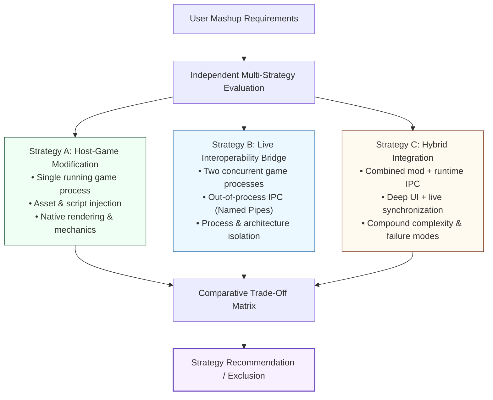
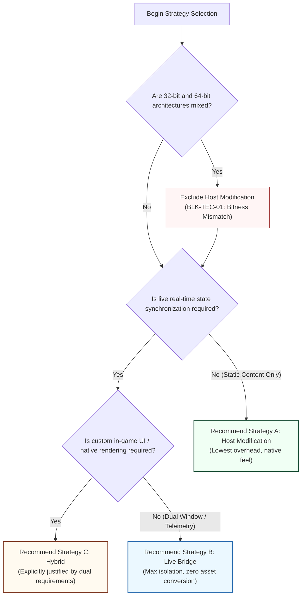

# Integration Strategy Comparison & Feasibility Rules

**Document ID:** `NLE-RUL-ISC-001`  
**Version:** `1.0.0`  
**Status:** `APPROVED`  
**Workstream:** `Cross-Game Compatibility Assessment Framework, Assessment Unit Modeling, Decision Rules, Multi-Dimensional Evaluation, and Strategy Comparison`  
**Phase:** `4 of 12 — Game Discovery & Compatibility Intelligence`  
**Step:** `29 of 100`  
**Related Documents:**
- [CROSS_GAME_COMPATIBILITY_ASSESSMENT_FRAMEWORK.md](file:///d:/App%20Winrar%20Files/Nexludic%20Engine%20(working)/docs/game-discovery/CROSS_GAME_COMPATIBILITY_ASSESSMENT_FRAMEWORK.md) (`NLE-SPC-CAC-001`)
- [COMPATIBILITY_DIMENSION_AND_REQUIREMENT_COVERAGE_CATALOG.md](file:///d:/App%20Winrar%20Files/Nexludic%20Engine%20(working)/docs/game-discovery/COMPATIBILITY_DIMENSION_AND_REQUIREMENT_COVERAGE_CATALOG.md) (`NLE-CAT-CDC-001`)
- [CROSS_GAME_COMPATIBILITY_DECISION_TABLES.md](file:///d:/App%20Winrar%20Files/Nexludic%20Engine%20(working)/docs/game-discovery/CROSS_GAME_COMPATIBILITY_DECISION_TABLES.md) (`NLE-TAB-CCD-001`)

---

## 1. Executive Summary & Purpose

This specification establishes the evaluation rules, trade-off models, and comparative decision logic for the three primary integration strategies supported by **NexLudic Engine**: **Host-Game Modification**, **Live Interoperability Bridging**, and **Hybrid Integration**.

Cross-game integrations cannot be approached with a single monolithic architectural pattern. Each strategy possesses fundamentally different operational prerequisites, process lifecycle requirements, performance footprints, and security considerations. This document ensures that all three strategies are evaluated independently against the user's specific requirements, prevents the false assumption that hybrid integration is universally superior, and provides deterministic selection rules based on empirical evidence.

---

## 2. Independent Evaluation of the Three Strategies

### 2.1 Strategy A: Host-Game Modification
- **Core Mechanism:** Introduces new capabilities, converted assets, or custom scripts into a selected *Host Game* process via authorized modding extension points (e.g. Papyrus script mods in Skyrim, Harmony patches in Unity games). *Participant Game B* is not executed at runtime.
- **Key Strengths:**
  - Single running process: Lowest system RAM and GPU overhead.
  - Native feel: Direct integration with host rendering, physics, and input loops.
  - Zero inter-process latency.
- **Key Vulnerabilities & Trade-offs:**
  - Asset conversion complexity: Meshes, animations, and textures from Game B must be converted into Game A's proprietary formats.
  - In-process crash risk: Flaws in mod code directly crash the host game.
  - Static state: Cannot reflect dynamic, live runtime changes happening inside Game B.
- **Feasibility Prerequisites:** Host game must possess an active, documented modding pipeline; converted assets must not violate redistribution or extraction terms; no anti-cheat blocking local file modifications.

### 2.2 Strategy B: Live Interoperability Bridge
- **Core Mechanism:** Both *Game A* and *Game B* execute simultaneously on the host machine. A decoupled, out-of-process communication layer (e.g. Local Named Pipes, Shared Memory, or Localhost WebSockets) synchronizes events, gameplay state, or telemetry between them.
- **Key Strengths:**
  - Complete process isolation: A crash in Game B does not crash Game A.
  - Architecture independence: A 32-bit x86 game can seamlessly bridge to a 64-bit x64 game.
  - Live bidirectional dynamic sync: Real-time state transfer without extracting or re-packaging game assets.
  - High reversibility: Zero permanent modifications to either game's files on disk.
- **Key Vulnerabilities & Trade-offs:**
  - Resource footprint: Host machine must have sufficient CPU, GPU, and RAM to run both games concurrently.
  - Latency & tick synchronization: Timing mismatches between differing engine update loops can cause jitter or desync.
  - Dual window management: Handling audio focus, full-screen vs. borderless display, and input mapping across two running games.
- **Feasibility Prerequisites:** Both games must support a non-invasive telemetry hook or plugin to read/write state; IPC channel must be performant ($< 5\text{ ms}$ latency); machine meets aggregate hardware requirements.

### 2.3 Strategy C: Hybrid Integration
- **Core Mechanism:** Combines static host-game modification (e.g. custom UI widgets, item placeholder assets) with an active live bridge daemon for real-time state exchange.
- **Key Strengths:**
  - Complete feature coverage: Enables deep in-game UI presentation (via Host Mod) while supporting live cross-game state synchronization (via Live Bridge).
- **Key Vulnerabilities & Trade-offs:**
  - **Highest Complexity:** Requires developing, debugging, and maintaining two separate technical stacks simultaneously.
  - **Compound Failure Modes:** A failure in either the mod loader, the script extender, the IPC daemon, or either game binary breaks the integration.
  - **Fragility under Updates:** Subject to breakage from updates to *either* game.
- **Architectural Policy (`RUL-ISC-01`):** Hybrid Integration is **never** the default recommendation. It is authorized only when the user's mandatory requirements explicitly demand both native in-engine asset representation AND live dynamic runtime synchronization.

---

## 3. Multi-Strategy Comparative Trade-Off Matrix

| Evaluation Dimension | Strategy A: Host Mod | Strategy B: Live Bridge | Strategy C: Hybrid |
| :--- | :--- | :--- | :--- |
| **System Resource Impact** | **Low** (Single game running) | **High** (Two games + IPC daemon) | **High** (Two games + IPC daemon) |
| **Process Isolation** | **None** (In-process execution) | **Full** (Decoupled OS processes) | **Partial** (Host coupled; Guest isolated) |
| **Cross-Architecture Support**| **None** (Same bitness strictly required)| **Full** (x86 bridges to x64 cleanly) | **Partial** (Bridge decoupled; Host fixed) |
| **Asset Conversion Burden** | **Heavy** (Full mesh/texture conversion)| **Zero** (Native game renders assets) | **Moderate** (UI & proxy meshes only) |
| **Live State Synchronization** | **None** (Static snapshot only) | **Full** (Real-time bidirectional) | **Full** (Real-time bidirectional) |
| **Installation Reversibility** | **Moderate** (Requires mod uninstall) | **Maximum** (Zero file changes) | **Moderate** (Mod files must be removed)|
| **Maintenance Sensitivity** | Sensitive to Host game updates | Sensitive to Bridge/Loader updates | Sensitive to **Both** games' updates |
| **Licensing / Extraction Risk** | High (Asset extraction policies) | Low (No asset extraction) | Moderate (Proxy asset creation) |

---

## 4. Deterministic Strategy Selection Rules

The framework applies five deterministic rules to recommend, defer, or exclude candidate strategies:

1. **Rule RUL-ISC-02 (Architecture Incompatibility):** If Game A and Game B feature different binary architectures (e.g. x86 vs. x64) and the user requests in-process integration, Strategy A (Host Modification) is marked `STRATEGY_EXCLUDED`. Strategy B (Live Bridge) must be evaluated.
2. **Rule RUL-ISC-03 (Static Content Primacy):** If user requirements involve purely static content (e.g. importing armor models or companion quests without live game coordination), Strategy A (Host Modification) is `STRATEGY_RECOMMENDED`. Strategy B is marked `STRATEGY_DEFERRED` due to unnecessary runtime overhead.
3. **Rule RUL-ISC-04 (Live State Primacy):** If user requirements demand real-time synchronization (e.g. inventory transfer or health mirroring) and do not require custom UI rendering, Strategy B (Live Bridge) is `STRATEGY_RECOMMENDED`.
4. **Rule RUL-ISC-05 (Hybrid Justification Gate):** Strategy C (Hybrid) is `STRATEGY_RECOMMENDED` **only if** both Rule RUL-ISC-03 and Rule RUL-ISC-04 conditions are simultaneously mandatory. If either pure strategy can satisfy the requirements alone, Hybrid is `STRATEGY_DEFERRED`.
5. **Rule RUL-ISC-06 (No Strategy Viable):** If all three strategies encounter critical blockers or lack supporting evidence, the framework outputs `NO_STRATEGY_FEASIBLE`, sets status to `UNSUPPORTED`, and provides explicit guidance on missing technical capabilities.

---

## 5. Document Sign-Off & Verification

| Role | Reviewer | Verdict | Date |
| :--- | :--- | :--- | :--- |
| **Principal Software Architect** | Engine Architecture Team | Approved | 2026-11-17 |
| **Lead Game Interoperability Researcher**| Interoperability Research Group | Approved | 2026-11-17 |
| **Senior Systems Performance Engineer** | Platform Engineering | Approved | 2026-11-17 |

