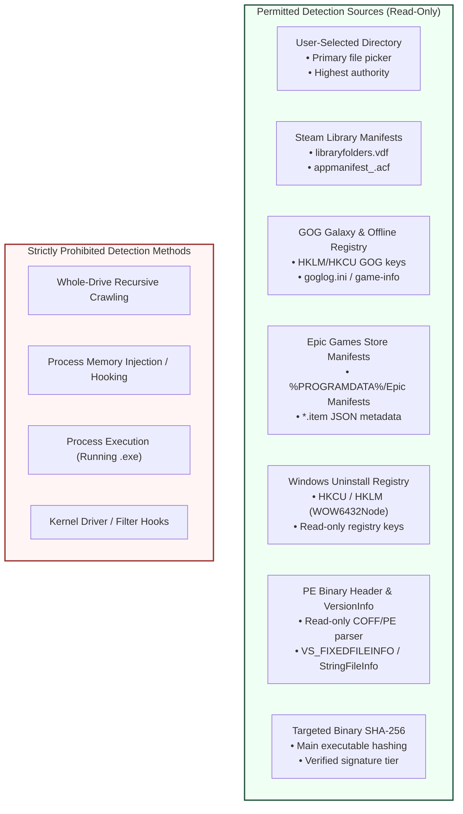

# Local Game Detection Source Catalog & Evaluation

**Document ID:** `NLE-CAT-LDS-001`  
**Version:** `1.0.0`  
**Status:** `APPROVED`  
**Workstream:** `Local Environment Discovery, Installation Identification, Detection Authorization, Version Verification, Privacy, and Recovery`  
**Phase:** `4 of 12 — Game Discovery & Compatibility Intelligence`  
**Step:** `27 of 100`  
**Related Documents:**
- [LOCAL_GAME_INSTALLATION_DISCOVERY_AND_DETECTION_SPECIFICATION.md](file:///d:/App%20Winrar%20Files/Nexludic%20Engine%20(working)/docs/game-discovery/LOCAL_GAME_INSTALLATION_DISCOVERY_AND_DETECTION_SPECIFICATION.md) (`NLE-SPC-LID-001`)
- [LOCAL_INSTALLATION_IDENTITY_AND_VERIFICATION_STATE_MODEL.md](file:///d:/App%20Winrar%20Files/Nexludic%20Engine%20(working)/docs/game-discovery/LOCAL_INSTALLATION_IDENTITY_AND_VERIFICATION_STATE_MODEL.md) (`NLE-DOM-INS-001`)
- [LOCAL_GAME_DETECTION_VERSION_AND_IDENTITY_MATCHING_RULES.md](file:///d:/App%20Winrar%20Files/Nexludic%20Engine%20(working)/docs/game-discovery/LOCAL_GAME_DETECTION_VERSION_AND_IDENTITY_MATCHING_RULES.md) (`NLE-RUL-LVM-001`)
- [LOCAL_GAME_DISCOVERY_AUTHORIZATION_AND_PRIVACY_SPECIFICATION.md](file:///d:/App%20Winrar%20Files/Nexludic%20Engine%20(working)/docs/game-discovery/LOCAL_GAME_DISCOVERY_AUTHORIZATION_AND_PRIVACY_SPECIFICATION.md) (`NLE-SPC-LPR-001`)

---

## 1. Scope & Source Taxonomy

This document catalogs and systematically evaluates all permitted and restricted sources for detecting local game installations on Windows desktop systems. Each detection source is analyzed for technical mechanism, evidentiary strength, performance cost, failure modes, permission requirements, and security implications.

---

## 2. Comprehensive Evaluation of Detection Sources

### 2.1 Source 1: User-Selected Folder / Executable (Direct File Picker)
- **Technical Mechanism:** User invokes native Windows Common Item Dialog (`IFileOpenDialog`) to select an installation root directory or primary game executable (`.exe`).
- **Access Level:** Windows Medium Integrity Level (Standard User). Operates under user's ambient security token.
- **Evidence Produced:** Definite directory path; exact executable filename; file timestamps; directory structure.
- **Evidentiary Weight:** `MAXIMUM (1.00)` for location; requires subsequent inspection for identity and version confirmation.
- **Performance Characteristics:** Immediate ($< 5\text{ ms}$). Zero filesystem crawling.
- **Failure Modes:** User selects wrong directory (e.g., parent folder, mod folder, empty directory); user lacks read permissions on target.
- **Privacy Impact:** Zero privacy leakage. Scope is strictly confined to user-indicated directory.
- **Evaluation Status:** **RECOMMENDED (Primary Tier)**. Every discovery workflow must support this mode as the default or fallback.

### 2.2 Source 2: Valve Steam Library Manifests
- **Technical Mechanism:**
  1. Read registry value `SteamPath` from `HKCU\Software\Valve\Steam`.
  2. Parse `steamapps/libraryfolders.vdf` (Valve KeyValues text format) to discover all mounted Steam library paths across all drives.
  3. In each library folder, scan `steamapps/appmanifest_<appid>.acf`.
  4. Parse fields: `appid`, `name`, `installdir`, `buildid`, `LastUpdated`, `StateFlags`.
- **Access Level:** Read-only access to user registry (`HKCU`) and Steam library directories. Standard user mode.
- **Evidence Produced:** Authoritative Valve `appid`; exact subfolder name (`installdir`); official Valve `buildid`; download state.
- **Evidentiary Weight:** `HIGH (0.90)` for installation presence and distribution channel (`STEAM`).
- **Performance Characteristics:** Fast ($< 50\text{ ms}$ for standard library with 100+ games). Only reads small `.acf` text files; does not scan asset directories.
- **Failure Modes:**
  - Steam installed on different drive than registry indicates.
  - `StateFlags != 4` (game is downloading, queued, corrupted, or uninstalling).
  - Multi-library VDF format variations (VDF v1 vs v2 format changes).
  - Game moved manually outside Steam without updating manifest.
- **Privacy Impact:** Contains user's installed Steam library list. Strictly kept in local cache; never transmitted off-box.
- **Evaluation Status:** **APPROVED (Opt-In Library Mode)**. High reliability for Steam titles.

### 2.3 Source 3: CD Projekt GOG Galaxy & Offline Installer Manifests
- **Technical Mechanism:**
  1. Inspect registry keys under `HKLM\SOFTWARE\WOW6432Node\GOG.com\Games\<gameid>` and `HKLM\SOFTWARE\GOG.com\Games\<gameid>` (read-only).
  2. Query values: `gameID`, `gameName`, `path`, `exe`, `ver`, `buildId`.
  3. For GOG Galaxy installations, inspect `%PROGRAMDATA%\GOG.com\Galaxy\storage\index.db` (SQLite) or `goglog.ini` within game directory.
- **Access Level:** Standard read-only access to registry and game directory.
- **Evidence Produced:** GOG Product ID; canonical GOG game name; exact target executable; installer-stamped version string.
- **Evidentiary Weight:** `HIGH (0.85)` for GOG releases.
- **Performance Characteristics:** Fast ($< 30\text{ ms}$ for registry queries).
- **Failure Modes:**
  - Game installed via offline installer without GOG Galaxy (registry key exists, but no launcher database).
  - Standalone portable extract (no registry keys created).
  - 32-bit vs 64-bit registry redirection differences.
- **Privacy Impact:** Reveals GOG software titles. Local storage only.
- **Evaluation Status:** **APPROVED (Opt-In Library Mode)**. High accuracy for DRM-free GOG titles.

### 2.4 Source 4: Epic Games Store Installation Manifests
- **Technical Mechanism:**
  1. Locate Epic manifest repository at `%PROGRAMDATA%\Epic\EpicGamesLauncher\Data\Manifests\`.
  2. Enumerate and parse all `*.item` files (UTF-8 JSON format).
  3. Extract fields: `AppName` (UUID/slug), `DisplayName`, `InstallLocation`, `MainGameAppName`, `AppVersionString`.
- **Access Level:** Read-only access to `%PROGRAMDATA%\Epic\EpicGamesLauncher\Data\Manifests\`. Readable by standard users.
- **Evidence Produced:** Epic catalog identifier; install path; declared version string; primary executable.
- **Evidentiary Weight:** `HIGH (0.85)` for Epic Games Store distributions.
- **Performance Characteristics:** Fast ($< 40\text{ ms}$ for 50 items).
- **Failure Modes:**
  - Manifest left behind after manual directory deletion (dead manifest).
  - Epic launcher uninstalled, leaving stale `%PROGRAMDATA%` files.
  - JSON format version changes.
- **Privacy Impact:** Bounded to Epic store metadata. Local only.
- **Evaluation Status:** **APPROVED (Opt-In Library Mode)**. Reliable for Epic titles.

### 2.5 Source 5: Windows Registry Standard Application Uninstall Keys
- **Technical Mechanism:**
  - Read-only iteration over:
    - `HKCU\Software\Microsoft\Windows\CurrentVersion\Uninstall`
    - `HKLM\SOFTWARE\Microsoft\Windows\CurrentVersion\Uninstall`
    - `HKLM\SOFTWARE\WOW6432Node\Microsoft\Windows\CurrentVersion\Uninstall`
  - Read string values: `DisplayName`, `InstallLocation`, `DisplayVersion`, `Publisher`, `UninstallString`.
- **Access Level:** Standard read-only registry access.
- **Evidence Produced:** Declared game title, installed directory (if populated), publisher, declared version string.
- **Evidentiary Weight:** `MODERATE (0.60)`. Many installers leave `InstallLocation` empty or populate invalid paths.
- **Performance Characteristics:** Moderate ($50\text{--}150\text{ ms}$ across all uninstall subkeys).
- **Failure Modes:**
  - `InstallLocation` is null (common in older custom installers); path must be parsed from `UninstallString` (heuristic and brittle).
  - Stale uninstall keys remaining after manual deletion.
  - Inconsistent version strings (e.g. `"v1.0"`, `"Release 4"`, `"Setup 1.0.234"`).
- **Privacy Impact:** Exposes non-game application titles if scanned indiscriminately. **Scanner must filter strictly against known game catalog titles.**
- **Evaluation Status:** **APPROVED WITH CONSTRAINTS (Supplemental Mode)**. Used only when targeted to match specific catalog titles or when user requests broad detection.

### 2.6 Source 6: Executable Binary Header (PE) & VersionInfo Resource Inspection
- **Technical Mechanism:**
  1. Open target executable file in read-only non-exclusive mode (`FileShare.ReadWrite`).
  2. Read DOS Header (`IMAGE_DOS_HEADER`), verify `e_magic == 0x5A4D` (`MZ`).
  3. Seek to `e_lfanew` and read PE Signature (`0x00004550`, `PE\0\0`).
  4. Parse `IMAGE_FILE_HEADER` to extract `Machine` (e.g., `0x014c` for x86, `0x8664` for x64, `0xaa64` for ARM64) and `TimeDateStamp`.
  5. Parse `IMAGE_OPTIONAL_HEADER` to verify subsystem (`IMAGE_SUBSYSTEM_WINDOWS_GUI`).
  6. Locate Resource Directory (`.rsrc`), navigate to `RT_VERSION` resource type.
  7. Parse `VS_VERSIONINFO` structure:
     - `VS_FIXEDFILEINFO`: `dwFileVersionMS`, `dwFileVersionLS`, `dwProductVersionMS`, `dwProductVersionLS`.
     - `StringFileInfo`: `OriginalFilename`, `FileDescription`, `ProductName`, `ProductVersion`, `CompanyName`.
- **Access Level:** Standard read-only filesystem access.
- **Evidence Produced:** Absolute architecture bitness (x86 vs x64); compilation timestamp; authoritative binary version numbers; original internal binary name.
- **Evidentiary Weight:** `VERY HIGH (0.95)` for technical build confirmation.
- **Performance Characteristics:** Extremely fast ($< 2\text{ ms}$ per executable; only reads the first $64\text{ KB}$ to $2\text{ MB}$ of the file).
- **Failure Modes:**
  - Executable is packed, obfuscated, or protected by third-party DRM wrapper that strips or encrypts VersionInfo resources.
  - Game uses launcher stub (e.g., `Launcher.exe`) instead of main engine executable (e.g., `SkyrimSE.exe`).
  - Developers left default/dummy version strings (`1.0.0.0`).
- **Safety & Isolation:** Strictly non-executing. Binary is never loaded as a module or executed.
- **Evaluation Status:** **MANDATORY (Verification Tier)**. Primary mechanism for confirming exact binary architecture and version without execution.

### 2.7 Source 7: Targeted Binary Cryptographic Hashing (SHA-256)
- **Technical Mechanism:**
  1. Open identified primary executable in read-only mode (`FileShare.ReadWrite`).
  2. Stream file through cryptographic SHA-256 hash algorithm in $64\text{ KB}$ buffers.
  3. Compare computed hash against catalog signature database (`GameVersionBuild.binary_hashes`).
- **Access Level:** Standard read-only filesystem access.
- **Evidence Produced:** Exact cryptographic digest of primary binary.
- **Evidentiary Weight:** `MAXIMUM (1.00)` for exact build match.
- **Performance Characteristics:** Fast for executables ($10\text{--}50\text{ ms}$ for $20\text{--}100\text{ MB}$ binaries).
- **Constraint:** Hash computation is restricted to the primary executable and specific core integration DLLs. **Full directory or multi-gigabyte asset pack hashing is strictly forbidden during discovery.**
- **Evaluation Status:** **APPROVED (Verified Signature Tier)**. Used to establish conclusive version verification.

---

## 3. Source Capability & Authority Comparison Matrix

| Source Identifier | Detection Scope | Speed / Latency | Reliability | Bitness / Arch | Version Precision | Permission Level |
| :--- | :--- | :--- | :--- | :--- | :--- | :--- |
| **SRC-USER-SEL** | Explicit folder/file | $< 5\text{ ms}$ | $1.00$ (Path) | Inferred via PE | Via subsequent PE | User ambient |
| **SRC-STEAM-LIB**| Steam libraries | $< 50\text{ ms}$ | $0.90$ | Via subsequent PE | BuildID (Manifest) | User ambient |
| **SRC-GOG-REG**  | GOG installations | $< 30\text{ ms}$ | $0.85$ | Registry / PE | Installer version | User ambient |
| **SRC-EPIC-MAN** | Epic manifests | $< 40\text{ ms}$ | $0.85$ | Declared in JSON | AppVersionString | User ambient |
| **SRC-WIN-REG**  | Standard uninstall | $50\text{--}150\text{ ms}$ | $0.60$ | Inferred | DisplayVersion | User ambient |
| **SRC-PE-HDR**   | Executable header | $< 2\text{ ms}$ | $0.95$ (Build) | Authoritative (x86/x64) | FixedFileInfo MS/LS| User ambient |
| **SRC-SHA-256**  | Main binary hash | $10\text{--}50\text{ ms}$ | $1.00$ (Binary) | Verified by hash | Authoritative digest| User ambient |

---

## 4. Evaluation of Prohibited Detection Methods

| Prohibited Method | Technical Danger / Violation | Architectural Policy Decision |
| :--- | :--- | :--- |
| **Recursive Whole-Drive Crawling** | Excessive I/O; spinning up sleeping drives; thermal throttling; user privacy violation; minutes-long stalls. | **HARD BLOCKED (`PROHIBIT-01`)**. Traversal restricted to declared library roots. |
| **Process Execution (`CreateProcess`)** | Running untrusted code; triggering game launches, DRM dialogs, full-screen graphics modes, or cloud syncs. | **HARD BLOCKED (`PROHIBIT-05`)**. Passive static file analysis only. |
| **Process Memory Inspection** | Triggers anti-virus heuristics, anti-cheat bans (VAC, BattlEye, EAC), and OS access violations. | **HARD BLOCKED (`PROHIBIT-03`)**. Zero inter-process memory reading. |
| **Code Injection / Hooking** | Destabilizes game process, corrupts game state, violates anti-cheat policies. | **HARD BLOCKED (`PROHIBIT-04`)**. Zero DLL injection. |
| **Elevated Privilege Execution** | Security boundary violation; risks system-wide tampering; violates Windows Medium IL standard. | **HARD BLOCKED (`REQ-SEC-001`)**. Never prompt for UAC elevation. |

---

## 5. Technical Requirements for Detection Source Connectors

When future implementation steps authorize building the detection pipeline, all connectors must comply with the following structural interface contract:

1. **Read-Only Non-Exclusive Access:** Every file stream opened must specify `FileAccess.Read` and `FileShare.ReadWrite | FileShare.Delete`.
2. **Strict Timeout Bounds:** Individual source queries must enforce a hard timeout of $3000\text{ ms}$ ($3\text{ seconds}$). Failure to respond within $3\text{ seconds}$ transitions the source result to `TIMED_OUT`.
3. **Graceful Error Encapsulation:** File system exceptions (`UnauthorizedAccessException`, `PathTooLongException`, `FileNotFoundException`, `IOException`) must be caught and converted into structured `DetectionObservation` error states without crashing the scanner.
4. **Zero State Mutation:** Connectors must not create lock files, write logs into the game folder, or touch file access timestamps (`File.GetLastAccessTime` must be avoided or accessed without altering metadata).

---

## 6. Document Sign-Off & Verification

| Role | Reviewer | Verdict | Date |
| :--- | :--- | :--- | :--- |
| **Senior Application Architect** | Engine Architecture Team | Approved | 2026-11-17 |
| **Lead Security & Privacy Engineer**| Security Operations | Approved | 2026-11-17 |
| **Game Platform Specialist** | Catalog Engineering | Approved | 2026-11-17 |

