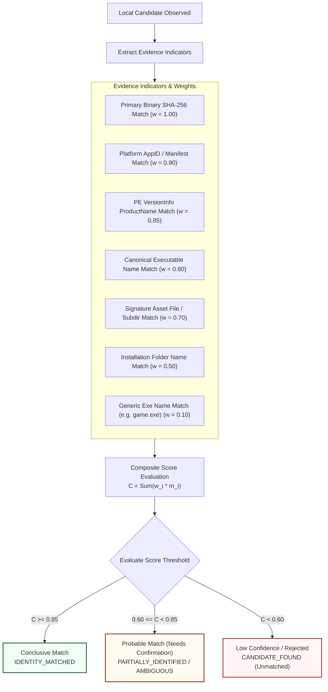
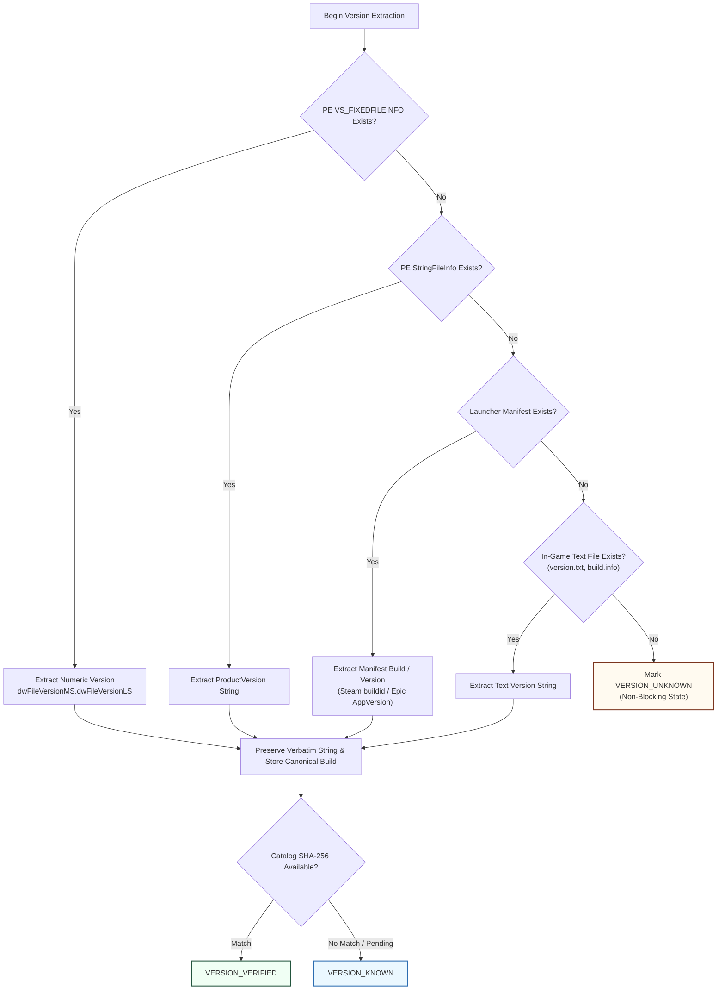

# Local Game Detection Version & Identity Matching Rules

**Document ID:** `NLE-RUL-LVM-001`  
**Version:** `1.0.0`  
**Status:** `APPROVED`  
**Workstream:** `Local Environment Discovery, Installation Identification, Detection Authorization, Version Verification, Privacy, and Recovery`  
**Phase:** `4 of 12 — Game Discovery & Compatibility Intelligence`  
**Step:** `27 of 100`  
**Related Documents:**
- [LOCAL_GAME_INSTALLATION_DISCOVERY_AND_DETECTION_SPECIFICATION.md](file:///d:/App%20Winrar%20Files/Nexludic%20Engine%20(working)/docs/game-discovery/LOCAL_GAME_INSTALLATION_DISCOVERY_AND_DETECTION_SPECIFICATION.md) (`NLE-SPC-LID-001`)
- [LOCAL_INSTALLATION_IDENTITY_AND_VERIFICATION_STATE_MODEL.md](file:///d:/App%20Winrar%20Files/Nexludic%20Engine%20(working)/docs/game-discovery/LOCAL_INSTALLATION_IDENTITY_AND_VERIFICATION_STATE_MODEL.md) (`NLE-DOM-INS-001`)
- [GAME_DISCOVERY_IDENTITY_RESOLUTION_AND_DATA_QUALITY_RULES.md](file:///d:/App%20Winrar%20Files/Nexludic%20Engine%20(working)/docs/game-discovery/GAME_DISCOVERY_IDENTITY_RESOLUTION_AND_DATA_QUALITY_RULES.md) (`NLE-RUL-IDR-001`)
- [LOCAL_GAME_DETECTION_SOURCE_CATALOG_AND_EVALUATION.md](file:///d:/App%20Winrar%20Files/Nexludic%20Engine%20(working)/docs/game-discovery/LOCAL_GAME_DETECTION_SOURCE_CATALOG_AND_EVALUATION.md) (`NLE-CAT-LDS-001`)

---

## 1. Executive Summary & Purpose

This document specifies the algorithmic rules, evidentiary scoring formulas, heuristic disambiguation logic, and version extraction standards used by **NexLudic Engine** to correlate observed local files and launcher manifests with canonical game records.

Because PC gaming environments feature diverse distribution platforms, non-standard directory structures, modded binaries, and ambiguous naming conventions, simple file checks are inadequate. This specification establishes a deterministic, evidence-weighted matching engine that prevents false positives, disambiguates duplicate installations, parses non-standard build numbers, and guarantees user confirmation whenever ambiguity exists.

---

## 2. Multi-Evidence Scoring & Matching Framework

Local detection evaluates multiple independent indicators to calculate a composite confidence score $C \in [0.0, 1.0]$.

### 2.1 Evidence Indicators & Weight Catalog

| Indicator ID | Description | Weight ($w_i$) | Match Criteria ($m_i$) |
| :--- | :--- | :--- | :--- |
| `IND-HASH-SHA256` | Executable SHA-256 matches catalog signature database. | $1.00$ | Binary digest matches known `GameVersionBuild.binary_hashes`. |
| `IND-APPID-MATCH` | Manifest contains matching official platform ID (Steam AppID, GOG ID, Epic ID). | $0.90$ | Exact string or numeric equality against catalog release platform IDs. |
| `IND-PE-PRODNAME` | PE Resource `StringFileInfo.ProductName` matches canonical game title. | $0.85$ | Normalized string match (case/punctuation insensitive) $\ge 90\%$. |
| `IND-EXE-NAME` | Executable filename matches known canonical game binary (e.g., `SkyrimSE.exe`). | $0.80$ | Exact case-insensitive filename match against known binaries. |
| `IND-ASSET-SIGN` | Key marker file or directory exists (e.g., `Data/Skyrim.esm`, `base/pak0.pk3`). | $0.70$ | Relative file existence check passes. |
| `IND-DIR-NAME` | Directory name matches canonical game title (e.g., `The Witcher 3 Wild Hunt`). | $0.50$ | Normalized Levenshtein similarity $\ge 85\%$. |
| `IND-GENERIC-EXE` | Executable has generic name (`game.exe`, `main.exe`, `start.exe`, `launcher.exe`). | $0.10$ | Fallback weight; insufficient on its own. |

### 2.2 Confidence Score Calculation
The composite confidence score $C$ is computed as:
$$C = \min\left(1.0, \sum_{i=1}^{n} w_i \cdot m_i\right)$$
where $m_i \in \{0, 1\}$ indicates the presence of evidence indicator $i$.

- **Rule RUL-MAT-01 (Conclusive Tier):** If $C \ge 0.85$, the candidate is automatically assigned `IDENTITY_MATCHED`.
- **Rule RUL-MAT-02 (Review Tier):** If $0.60 \le C < 0.85$, the candidate is assigned `PARTIALLY_IDENTIFIED` or `IDENTITY_AMBIGUOUS` and requires explicit user confirmation before binding to a project.
- **Rule RUL-MAT-03 (Rejection Tier):** If $C < 0.60$, the candidate is considered an unverified directory and remains in `CANDIDATE_FOUND` without catalog linkage.

---

## 3. Version & Build Extraction Hierarchy

Extracting the exact version of a PC game requires handling diverse metadata sources, including non-standard version strings and patched files.

### 3.1 Version Extraction Priority Rules
1. **Priority 1 (Binary Fixed File Info):** Parse `VS_FIXEDFILEINFO` from PE headers:
   $$\text{Version} = \frac{\text{MS}_{hi}.\text{MS}_{lo}.\text{LS}_{hi}.\text{LS}_{lo}}{\text{Example: } 1.6.1170.0}$$
2. **Priority 2 (Binary String File Info):** Read `StringFileInfo.ProductVersion` or `FileVersion`.
3. **Priority 3 (Platform Manifest):** Read Steam `buildid`, GOG `ver`, or Epic `AppVersionString`.
4. **Priority 4 (Static Version Marker):** Read standardized root text files (e.g., `version.txt`, `build.info`).
5. **Fallback:** If all sources fail, mark version as `UNKNOWN`. In accordance with `DEC-002`, unknown version is a valid, non-blocking state (`VERSION_UNKNOWN`).

### 3.2 Non-Standard & Non-SemVer Handling (`RUL-VER-02`)
- **Verbatim Preservation:** The engine must store `raw_version_string` exactly as discovered on disk or manifest (e.g., `"v1.5.97.0.8 (SKSE64)"`, `"Patch 7 Hotfix 2"`, `"Build 1084221"`).
- **No Forcible Truncation:** Do not coerce non-standard versions into `X.Y.Z` if semantic data would be lost.
- **Normalization Mapping:** If a mapping rule exists in the catalog (e.g., Steam `buildid: 1249021` maps to `"1.6.640"`), the engine sets `canonical_version` to `"1.6.640"` while retaining the raw string in `raw_version_string`.

---

## 4. Disambiguation, Multiple Installations & Edge Cases

### 4.1 Multiple Installations of the Same Game (`RUL-AMB-01`)
Users frequently maintain multiple concurrent installations of the same game (e.g., a vanilla Steam copy and a modded GOG copy, or an active release and a downgraded rollback release).
- **Rule:** Each installation path produces a separate `LocalInstallationInstance` with a unique `installation_id`.
- **Resolution:** The engine never overwrites one installation with another. The project UI presents both instances with platform badges (e.g., `Steam (v1.6.1170)` vs. `GOG (v1.6.659)`), allowing the user to select the active instance for the workspace.

### 4.2 Anthology & Multi-Game Bundles (`RUL-AMB-02`)
In bundle installations (e.g., *Command & Conquer Remastered Collection* or *BioShock: The Collection*), multiple distinct games reside in subdirectories under a shared parent root.
- **Rule:** Discovery identifies game instances by their specific primary executable and directory path, never by the parent folder alone.
- **Resolution:** `BioShock Remastered` and `BioShock 2 Remastered` are recognized as two distinct installations, each binding to its own `CanonicalGameId`.

### 4.3 Generic Executable Mitigation (`RUL-AMB-03`)
Many legacy or indie titles use generic executable names such as `Game.exe`, `Launch.exe`, or `Main.exe`.
- **Rule:** An executable matching a generic name list (`game.exe`, `main.exe`, `start.exe`, `launcher.exe`, `app.exe`) receives an executable weight of only $w_i = 0.10$.
- **Resolution:** Conclusive match ($C \ge 0.85$) cannot be established without PE `ProductName` ($0.85$) or launcher manifest AppID ($0.90$). If only folder name matches, the candidate is flagged `IDENTITY_AMBIGUOUS` and requires user confirmation.

### 4.4 Leftover Uninstall Artifacts & Dead Folders (`RUL-AMB-04`)
Users frequently uninstall games while leaving residual folders containing config files, crash dumps, or user logs.
- **Rule:** A candidate directory missing its primary executable is immediately disqualified from `IDENTITY_MATCHED`.
- **Resolution:** State is set to `VERIFICATION_FAILED` with error code `ERR_PRIMARY_BINARY_MISSING`.

---

## 5. False Positive & False Negative Prevention Rules

| Risk / Scenario | Root Cause | Preventive Rule & Mitigation |
| :--- | :--- | :--- |
| **False Positive: Sequels Sharing Engine** | *Skyrim* and *Skyrim Special Edition* share folder patterns and asset structures. | **RUL-FP-01:** Mandatory binary architecture check (x86 vs x64) and exact PE internal filename match (`TESV.exe` vs `SkyrimSE.exe`). |
| **False Positive: Mod Tools vs Game** | Creation Kit or editor binary detected instead of main game. | **RUL-FP-02:** Tool executables (`CreationKit.exe`, `DedicatedServer.exe`) are blacklisted from primary game executable matching. |
| **False Negative: Custom Modded Binary** | Script extenders (e.g. `skse64_loader.exe`) or DRM-free patched binaries differ in hash. | **RUL-FN-01:** If hash check fails, fallback to PE VersionInfo and folder heuristics. Set state to `VERSION_KNOWN` (unverified hash) instead of failing. |
| **False Negative: Standalone Portable Copy** | Game moved to external drive without registry or launcher manifest. | **RUL-FN-02:** User-selected folder mode bypasses launcher manifest requirements and inspects PE headers directly. |

---

## 6. Document Sign-Off & Verification

| Role | Reviewer | Verdict | Date |
| :--- | :--- | :--- | :--- |
| **Senior Heuristics Architect** | Catalog Matching Team | Approved | 2026-11-17 |
| **Lead Quality Assurance Engineer**| Platform Validation | Approved | 2026-11-17 |
| **Senior Modding Systems Engineer** | Engine Runtime Team | Approved | 2026-11-17 |

