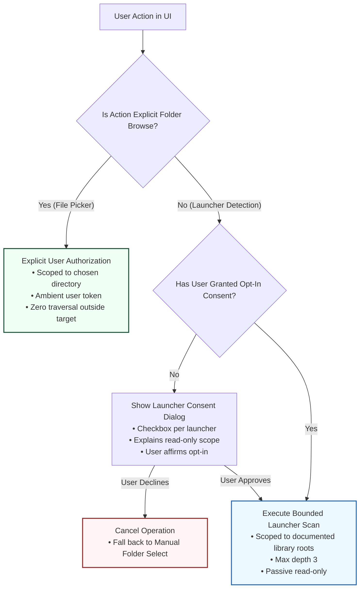

# Local Game Discovery Authorization & Privacy Specification

**Document ID:** `NLE-SPC-LPR-001`  
**Version:** `1.0.0`  
**Status:** `APPROVED`  
**Workstream:** `Local Environment Discovery, Installation Identification, Detection Authorization, Version Verification, Privacy, and Recovery`  
**Phase:** `4 of 12 — Game Discovery & Compatibility Intelligence`  
**Step:** `27 of 100`  
**Related Documents:**
- [LOCAL_GAME_INSTALLATION_DISCOVERY_AND_DETECTION_SPECIFICATION.md](file:///d:/App%20Winrar%20Files/Nexludic%20Engine%20(working)/docs/game-discovery/LOCAL_GAME_INSTALLATION_DISCOVERY_AND_DETECTION_SPECIFICATION.md) (`NLE-SPC-LID-001`)
- [LOCAL_GAME_DETECTION_SOURCE_CATALOG_AND_EVALUATION.md](file:///d:/App%20Winrar%20Files/Nexludic%20Engine%20(working)/docs/game-discovery/LOCAL_GAME_DETECTION_SOURCE_CATALOG_AND_EVALUATION.md) (`NLE-CAT-LDS-001`)
- [LOCAL_INSTALLATION_IDENTITY_AND_VERIFICATION_STATE_MODEL.md](file:///d:/App%20Winrar%20Files/Nexludic%20Engine%20(working)/docs/game-discovery/LOCAL_INSTALLATION_IDENTITY_AND_VERIFICATION_STATE_MODEL.md) (`NLE-DOM-INS-001`)
- [LOCAL_GAME_DISCOVERY_SECURITY_AND_VALIDATION_TEST_PLAN.md](file:///d:/App%20Winrar%20Files/Nexludic%20Engine%20(working)/docs/game-discovery/LOCAL_GAME_DISCOVERY_SECURITY_AND_VALIDATION_TEST_PLAN.md) (`NLE-PLN-LDS-001`)

---

## 1. Executive Summary & Purpose

This specification governs the authorization architecture, user consent models, privacy safeguards, operating system privilege boundaries, and diagnostic data protections for local game installation discovery in **NexLudic Engine**.

Because local game detection requires interacting with the host filesystem and registry, it touches sensitive user computing environments. This document mandates strict negative boundaries: arbitrary whole-drive scanning is forbidden, administrative elevation is banned, local filesystem paths and host usernames are barred from external network egress, and operations remain non-invasive to ensure zero interference with game integrity or anti-cheat safeguards.

---

## 2. User Consent & Authorization Framework



### 2.1 Consent Principles
1. **No Autonomous Scanning:** The engine must never trigger background discovery scans upon startup, project load, or installation without prior explicit user consent.
2. **Granular Opt-In:** User consent for launcher detection is requested per platform (Steam, GOG Galaxy, Epic Games Store). Authorizing Steam library inspection does not grant permission to query Epic or GOG manifests.
3. **Revocability:** The user may at any time revoke launcher discovery permissions and purge all locally cached installation records via `Settings -> Privacy & Discovery -> Clear Local Installation Records`.
4. **Transparency:** Whenever a scan is active, the UI must display a clear, non-intrusive status indicator detailing the source being inspected (e.g., `Querying Steam library manifests...`).

### 2.2 UI Consent Contract
When the user triggers launcher detection for the first time, the UI presents an explicit authorization modal with the following binding disclosures:
- *"NexLudic Engine will read official library manifest files to locate installed game folders."*
- *"The scan is strictly read-only and restricted to your configured game libraries."*
- *"No game files will be executed, modified, or moved."*
- *"Your local folder paths and username will never be sent to external servers or AI models."*

---

## 3. Bounded Scopes & Filesystem Traversal Restrictions

To protect system responsiveness and prevent accidental ingestion of private user documents, discovery scanners must enforce hard traversal boundaries:

### 3.1 Strict Depth and Root Constraints
- **Root Directory Crawling Prohibition (`PROHIBIT-01`):** A scan path targeting `C:\`, `D:\`, `E:\`, or any raw drive root must be rejected immediately with validation error `ERR_UNBOUNDED_SCAN_ROOT`.
- **Maximum Traversal Depth:** Traversal from an approved library root (e.g., `D:\Games\Steam\steamapps\common\`) must terminate at a depth of **3 subdirectories**.
- **File Filter Whitelist:** The scanner evaluates only recognized game executable extensions (`.exe`, `.bin`) and manifest files (`.acf`, `.json`, `.item`, `.ini`). Document files (`.docx`, `.pdf`), personal images (`.jpg`, `.png`), and archives are strictly ignored.

### 3.2 System & User Directory Blacklist
The discovery engine enforces an immutable blacklist. Any scan path matching or contained within the following locations is immediately blocked:

| Blacklisted Path / Pattern | Rationale | Action |
| :--- | :--- | :--- |
| `%WINDIR%` (`C:\Windows\...`) | Critical operating system binaries and system state. | Blocked (`ERR_PROTECTED_SYSTEM_PATH`) |
| `%PROGRAMDATA%\Microsoft\...` | OS telemetry, credentials, and system configs. | Blocked (`ERR_PROTECTED_SYSTEM_PATH`) |
| `%USERPROFILE%\Documents` (Root) | Personal user documents and confidential records. | Blocked unless user picks specific subfolder |
| `%USERPROFILE%\Desktop` (Root) | User desktop workspace. | Blocked unless user picks specific subfolder |
| `%USERPROFILE%\AppData\Local\Temp` | Volatile temporary files. | Blocked (`ERR_VOLATILE_PATH`) |
| `*\System Volume Information` | Windows Volume Shadow Copies & recovery points. | Blocked (`ERR_RESTRICTED_SYSTEM_FOLDER`) |
| `*\$Recycle.Bin` | Deleted files. | Blocked (`ERR_RECYCLE_BIN`) |
| WindowsApps (`C:\Program Files\WindowsApps`) | Encrypted UWP directory with restricted ACLs. | Blocked without explicit user file picker |

---

## 4. Windows Medium Integrity Level Enforcement (`REQ-SEC-001`)

Under the Windows security model, applications execute within designated Integrity Levels:

```
Low IL (Sandboxed)  <  Medium IL (Standard User)  <  High IL (Administrator / UAC)  <  SYSTEM
                              ▲
                              │
                    [NexLudic Discovery Engine]
                 (Strictly Medium Integrity Level)
```

### 4.1 Non-Elevated Execution Contract
- **No UAC Elevation:** The discovery engine executes strictly within the ambient Windows Medium Integrity Level token of the current desktop user.
- **Elevation Prompt Ban:** Under no circumstances may the discovery engine trigger a UAC elevation prompt (`runas` verb, elevated COM server, or manifest `requireAdministrator`).
- **Access Denied Handling:** If a directory or registry key cannot be read due to file permissions (`E_ACCESSDENIED` or `ERROR_ACCESS_DENIED`), the engine must catch the exception, record the observation state as `ACCESS_DENIED`, and proceed with other candidates. It must never prompt the user to "Run as Administrator" to resolve file access issues.

---

## 5. Local Privacy Governance & Telemetry Redaction

### 5.1 Strict Network Egress Prohibition
Host filesystem paths and user identifiers are classified as **Confidential Local User Data**. 

```
[Local Host Machine]                                    [External Network / LLM]
D:\Users\JohnDoe\Games\Skyrim\SkyrimSE.exe  ───X───►  STRICTLY BLOCKED FROM EGRESS
[REDACTED_INSTALL_ROOT]\SkyrimSE.exe        ───►  PERMITTED IN REDACTED TELEMETRY
```

1. **No External Transmission:** `LocalInstallationInstance.install_path` must never be sent over HTTP/HTTPS, WebSockets, or remote APIs.
2. **AI Assistant Prompt Redaction:** When project context or diagnostic information is packaged for AI assistance or external telemetry, all host paths and usernames must be tokenized or redacted:
   - User names replaced with `<USER>`
   - Drive letters and base user paths replaced with `<INSTALL_ROOT>` or `<STEAM_LIBRARY>`
   - Example: `D:\Users\Alice\Games\Steam\steamapps\common\SkyrimSE\SkyrimSE.exe` $\rightarrow$ `<STEAM_LIBRARY>\steamapps\common\SkyrimSE\SkyrimSE.exe`.
3. **Volatile In-Memory Redaction:** The redaction filter runs synchronously before any diagnostic string is written to shared logs or outbound payloads.

---

## 6. Anti-Cheat and Integrity Boundaries (`REQ-SAFE-001`)

To prevent accidental anti-cheat triggers, software bans, or game instability, discovery strictly adheres to the following operational boundaries:

1. **Passive Static Inspection Only:** Discovery reads files using standard Windows read-only file streams (`FileAccess.Read`, `FileShare.ReadWrite`).
2. **Zero Process Interaction:**
   - Discovery never calls `EnumProcesses` to search for running games.
   - Discovery never calls `OpenProcess` with `PROCESS_VM_READ` or `PROCESS_ALL_ACCESS`.
   - Discovery never injects threads, hooks (`SetWindowsHookEx`), or modifies process memory.
3. **Running Binary Protection:** If an executable is currently locked or running, the engine reads only what is permitted via non-exclusive read sharing. If the file is exclusively locked, the engine records `LOCKED_BY_PROCESS` without attempting to terminate the process or force file handles closed.

---

## 7. Storage Containment on Volume D (`DEC-009`)

All discovery state must remain strictly contained within Volume D:
- **Discovery Cache:** `D:\NexLudic\Catalog\Cache\LocalDiscovery\launcher_manifests.json`
- **Project Bindings:** `D:\NexLudic\Projects\<project-id>\Environment\installations.json`
- **Audit Logs:** `D:\NexLudic\Projects\<project-id>\Environment\discovery_audit.jsonl`

Writing discovery data, temp files, or indexes to `C:\`, `%LOCALAPPDATA%`, or `%TEMP%` is strictly prohibited.

---

## 8. Document Sign-Off & Verification

| Role | Reviewer | Verdict | Date |
| :--- | :--- | :--- | :--- |
| **Principal Security Architect** | Security Governance Team | Approved | 2026-11-17 |
| **Lead Privacy Officer** | Compliance & Data Protection | Approved | 2026-11-17 |
| **Senior Windows Systems Engineer**| Core Platform Team | Approved | 2026-11-17 |

