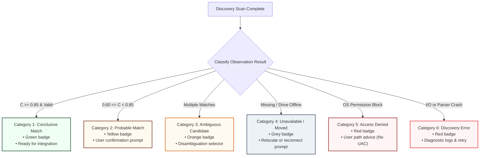

# Local Game Discovery Failure & Recovery Specification

**Document ID:** `NLE-SPC-LDF-001`  
**Version:** `1.0.0`  
**Status:** `APPROVED`  
**Workstream:** `Local Environment Discovery, Installation Identification, Detection Authorization, Version Verification, Privacy, and Recovery`  
**Phase:** `4 of 12 — Game Discovery & Compatibility Intelligence`  
**Step:** `27 of 100`  
**Related Documents:**
- [LOCAL_GAME_INSTALLATION_DISCOVERY_AND_DETECTION_SPECIFICATION.md](file:///d:/App%20Winrar%20Files/Nexludic%20Engine%20(working)/docs/game-discovery/LOCAL_GAME_INSTALLATION_DISCOVERY_AND_DETECTION_SPECIFICATION.md) (`NLE-SPC-LID-001`)
- [LOCAL_INSTALLATION_IDENTITY_AND_VERIFICATION_STATE_MODEL.md](file:///d:/App%20Winrar%20Files/Nexludic%20Engine%20(working)/docs/game-discovery/LOCAL_INSTALLATION_IDENTITY_AND_VERIFICATION_STATE_MODEL.md) (`NLE-DOM-INS-001`)
- [LOCAL_GAME_DETECTION_SOURCE_CATALOG_AND_EVALUATION.md](file:///d:/App%20Winrar%20Files/Nexludic%20Engine%20(working)/docs/game-discovery/LOCAL_GAME_DETECTION_SOURCE_CATALOG_AND_EVALUATION.md) (`NLE-CAT-LDS-001`)
- [LOCAL_GAME_DETECTION_VERSION_AND_IDENTITY_MATCHING_RULES.md](file:///d:/App%20Winrar%20Files/Nexludic%20Engine%20(working)/docs/game-discovery/LOCAL_GAME_DETECTION_VERSION_AND_IDENTITY_MATCHING_RULES.md) (`NLE-RUL-LVM-001`)

---

## 1. Executive Summary & Purpose

This specification governs the error taxonomy, timeout policies, cancellation semantics, result presentation categories, and safe user-guided recovery workflows for local game discovery in **NexLudic Engine**.

Real-world desktop gaming environments are characterized by frequent state changes: games are uninstalled, moved across storage drives, patched automatically by launchers, or locked by background processes. This document guarantees that detection failures are communicated transparently and gracefully, that cancellations terminate immediately without data corruption, and that the engine never initiates destructive or unauthorized remediation actions.

---

## 2. Result Presentation Categories

When a detection operation completes or encounters an anomaly, the UI presents the result within one of six standardized status categories:

### 2.1 Category Matrix

| Category | UI Badge & Tone | State Alignment | User Action / Recovery Workflow |
| :--- | :--- | :--- | :--- |
| **1. Conclusive Match** | Success (Green) | `VERSION_VERIFIED` / `VERSION_KNOWN` | None required; installation ready for workspace binding. |
| **2. Probable Match** | Advisory (Yellow) | `PARTIALLY_IDENTIFIED` | User confirms edition or platform distribution from dropdown. |
| **3. Ambiguous Candidate**| Warning (Orange) | `IDENTITY_AMBIGUOUS` | User selects correct title from candidate list or browses folder. |
| **4. Unavailable / Moved** | Muted (Grey) | `UNAVAILABLE` | User reconnects external drive or clicks "Relocate Folder". |
| **5. Access Denied** | Error (Red) | `ACCESS_DENIED` | User moves game to standard directory or selects custom target. |
| **6. Discovery Error** | Error (Red) | `DISCOVERY_ERROR` | View diagnostic logs; retry scan with single targeted directory. |

---

## 3. Failure Taxonomy & Error Codes

All discovery exceptions are mapped to standardized, actionable domain error codes:

| Error Code | HTTP/Domain Analogue | Trigger Condition | System Behavior & Mitigation |
| :--- | :--- | :--- | :--- |
| `ERR_PATH_NOT_FOUND` | `404 Not Found` | Folder or executable specified in record does not exist on disk. | Transition to `UNAVAILABLE`. Do not delete project bindings. |
| `ERR_ACCESS_DENIED` | `403 Forbidden` | Windows OS throws `UnauthorizedAccessException` (`E_ACCESSDENIED`). | Transition to `ACCESS_DENIED`. Log path; skip folder; **no UAC prompt**. |
| `ERR_SCAN_TIMEOUT` | `504 Gateway Timeout`| Launcher query or file read exceeds timeout threshold ($3\text{ s}$). | Abort query; mark source `TIMED_OUT`; proceed with other sources. |
| `ERR_CORRUPT_MANIFEST`| `422 Unprocessable`| Launcher file (e.g. `appmanifest.acf` or JSON) contains invalid syntax. | Log parser error; discard manifest; notify user of corrupted manifest. |
| `ERR_CORRUPT_PE` | `422 Unprocessable`| Executable lacks valid `MZ`/`PE` magic numbers or truncated headers. | Transition to `VERIFICATION_FAILED`; flag binary as corrupt or packed. |
| `ERR_UNBOUNDED_SCAN` | `400 Bad Request` | User or connector targeted a drive root (`C:\`, `D:\`) or blacklisted path. | Reject scan immediately (`ERR_UNBOUNDED_SCAN_ROOT`); warn user. |
| `ERR_FILE_LOCKED` | `423 Locked` | Binary exclusively locked by running game or anti-virus scanner. | Record `LOCKED_BY_PROCESS`; retry read on next pass; do not kill process. |

---

## 4. Timeout and Cancellation Semantics

### 4.1 Strict Timeout Thresholds
To ensure the desktop UI remains fluid and responsive:
- **Individual Source Timeout:** A single detection source query (e.g. parsing Steam `libraryfolders.vdf` or reading an executable PE header) is bounded by a **$3000\text{ ms}$ ($3\text{ second}$)** timeout.
- **Aggregate Discovery Sweep Timeout:** An entire multi-launcher discovery operation across all configured sources is bounded by a **$15000\text{ ms}$ ($15\text{ second}$)** timeout.
- **Behavior on Expiration:** If a source times out, the scanner logs a warning, sets that source's status to `TIMED_OUT`, and renders partial results from completed sources.

### 4.2 User Cancellation Workflow
- **Asynchronous Cancellation:** All scanner routines must accept a standard `CancellationToken`.
- **Immediate Termination:** When the user clicks "Cancel" in the UI:
  1. The `CancellationTokenSource` is cancelled immediately.
  2. All active filesystem streams and registry handles are closed synchronously.
  3. In-flight candidate buffers are safely discarded.
  4. The UI returns to the previous stable state within $< 200\text{ ms}$.
  5. Any installations discovered and confirmed *prior* to cancellation are preserved.

---

## 5. Moved, Deleted, and Patched Installation Workflows

### 5.1 External Drive Disconnection (`UNAVAILABLE`)
- **Scenario:** User keeps games on an external USB SSD (e.g. `E:\SteamLibrary`). The SSD is unplugged.
- **Policy:** The engine **never** auto-deletes the project configuration or wipes adapter files when an installation vanishes.
- **Handling:**
  1. The installation status transitions to `UNAVAILABLE`.
  2. The workspace UI displays a persistent non-blocking banner: *"Game storage is currently offline (Drive E: not found). Reconnect drive or select new path."*
  3. When the drive is reconnected, a lightweight check automatically restores status to `VERSION_VERIFIED`.

### 5.2 Game Relocation Workflow
- **Scenario:** User migrates a game installation to a new SSD or different folder.
- **Handling:**
  1. User clicks "Relocate Installation" on the game overview card.
  2. User selects the new directory using the native file picker.
  3. The engine verifies the new path, updates `install_path`, re-extracts PE headers and hashes, and preserves the existing `installation_id`.
  4. All downstream project bindings, notes, and custom adapter configurations remain intact.

### 5.3 Background Patching & Staleness (`STALE_CHANGED`)
- **Scenario:** Steam or Epic automatically updates the game to a newer patch release.
- **Handling:**
  1. The next project revalidation observes that the primary executable's timestamp or file size has changed.
  2. The installation state transitions to `STALE_CHANGED`.
  3. The UI alerts the user: *"Game update detected on disk (modified 2 hours ago). Revalidate to update project build metadata."*
  4. User clicks "Revalidate": Engine reads new PE version and updates `raw_version_string` without disrupting workspace settings.

---

## 6. Strict Prohibition on Automatic Remediation

To guarantee user sovereignty and prevent catastrophic data loss or accidental bans, **all automatic remediation behaviors are strictly banned**:

1. **NO AUTO-REPAIR:** The engine must never trigger Steam file verification (`steam://validate/<id>`) or launcher repair routines without explicit user initiation.
2. **NO AUTO-LAUNCH:** The engine must never launch game executables, launchers, or setup wizards to resolve an installation failure.
3. **NO AUTO-DOWNLOAD:** The engine must never initiate game installations or download patches automatically.
4. **NO AUTO-DELETE:** The engine must never delete, move, or rename user game files or save directories.

---

## 7. Document Sign-Off & Verification

| Role | Reviewer | Verdict | Date |
| :--- | :--- | :--- | :--- |
| **Principal Desktop UX Architect** | User Experience Operations | Approved | 2026-11-17 |
| **Senior Platform Reliability Engineer**| Resilience & Recovery | Approved | 2026-11-17 |
| **Lead Support & Diagnostics Specialist**| Customer Engineering | Approved | 2026-11-17 |

