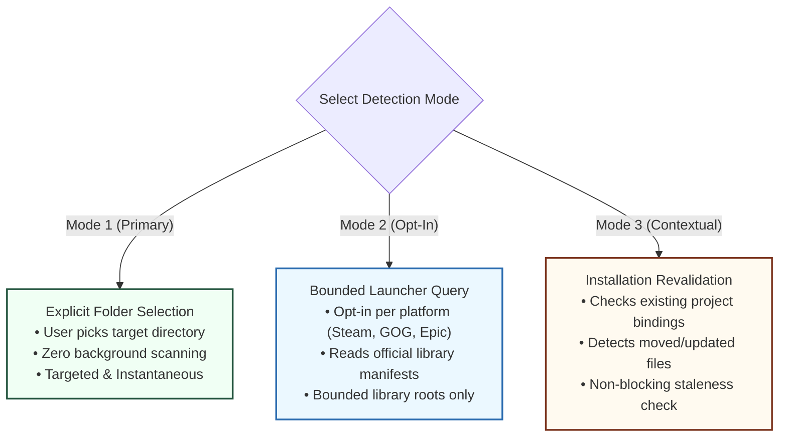

# Local Game Installation Discovery & Detection Specification

**Document ID:** `NLE-SPC-LID-001`  
**Version:** `1.0.0`  
**Status:** `APPROVED`  
**Workstream:** `Local Environment Discovery, Installation Identification, Detection Authorization, Version Verification, Privacy, and Recovery`  
**Phase:** `4 of 12 — Game Discovery & Compatibility Intelligence`  
**Step:** `27 of 100`  
**Related Documents:**
- [GAME_DISCOVERY_AND_CANONICAL_IDENTITY_SPECIFICATION.md](file:///d:/App%20Winrar%20Files/Nexludic%20Engine%20(working)/docs/game-discovery/GAME_DISCOVERY_AND_CANONICAL_IDENTITY_SPECIFICATION.md) (`NLE-SPC-GDC-001`)
- [GAME_CATALOG_DOMAIN_MODEL_AND_ENTITY_RELATIONSHIPS.md](file:///d:/App%20Winrar%20Files/Nexludic%20Engine%20(working)/docs/game-discovery/GAME_CATALOG_DOMAIN_MODEL_AND_ENTITY_RELATIONSHIPS.md) (`NLE-DOM-GCD-001`)
- [GAME_METADATA_SOURCE_AND_PROVIDER_EVALUATION.md](file:///d:/App%20Winrar%20Files/Nexludic%20Engine%20(working)/docs/game-discovery/GAME_METADATA_SOURCE_AND_PROVIDER_EVALUATION.md) (`NLE-RPT-MET-001`)
- [LOCAL_GAME_DETECTION_SOURCE_CATALOG_AND_EVALUATION.md](file:///d:/App%20Winrar%20Files/Nexludic%20Engine%20(working)/docs/game-discovery/LOCAL_GAME_DETECTION_SOURCE_CATALOG_AND_EVALUATION.md) (`NLE-CAT-LDS-001`)
- [LOCAL_INSTALLATION_IDENTITY_AND_VERIFICATION_STATE_MODEL.md](file:///d:/App%20Winrar%20Files/Nexludic%20Engine%20(working)/docs/game-discovery/LOCAL_INSTALLATION_IDENTITY_AND_VERIFICATION_STATE_MODEL.md) (`NLE-DOM-INS-001`)

---

## 1. Executive Summary & Purpose

This specification establishes the architectural requirements, design boundaries, security protocols, and operational workflows for discovering and identifying local game installations on a user's computer within the **NexLudic Engine**.

Local game discovery is the mechanism by which the engine transitions from conceptual game integration (selecting canonical game titles) to concrete, actionable workspace operations (binding integration adapters, verifying modding environments, and executing compatibility workflows).

This document enforces a strict separation between universal catalog identity and host filesystem topology. It establishes an evidence-backed verification pipeline that respects user privacy, operates under standard Windows Medium Integrity Level, prohibits arbitrary filesystem scanning, avoids anti-cheat trigger vectors, and guarantees that host paths and usernames never leave the local machine.

---

## 2. Core Architectural Distinctions & Epistemic Boundaries

A foundational failure mode in modding engines and asset orchestrators is conflating an executable on disk with the game's identity, or conflating directory presence with technical compatibility. NexLudic Engine enforces four distinct epistemic stages:

### 2.1 The Four Epistemic Stages

1. **Discovery (Candidate Located):**
   - *Definition:* An entry, directory, manifest record, or file signature has been observed on the local machine that suggests the presence of a game installation.
   - *State:* `CANDIDATE_FOUND`.
   - *Scope:* Pure observation. No guarantee that the binary is runnable, complete, uncorrupted, or belongs to any specific game.

2. **Identification (Canonical Title Matched):**
   - *Definition:* The detected candidate has been linked to a specific `CanonicalGameId` and `GameReleaseDistribution` in the NexLudic Game Catalog.
   - *State:* `IDENTITY_MATCHED` or `PARTIALLY_IDENTIFIED` or `IDENTITY_AMBIGUOUS`.
   - *Scope:* Associates the installation with metadata (publisher, series, base engine family). Does **not** guarantee version precision or integration readiness.

3. **Verification (Integrity & Build Verified):**
   - *Definition:* Technical inspection (PE headers, VersionInfo resources, manifest checksums, or SHA-256 hashes) confirms the exact build, bitness (x86/x64), and structural integrity of the installation.
   - *State:* `VERSION_KNOWN` or `VERSION_VERIFIED`.
   - *Scope:* Confirms technical reality on disk. Does **not** guarantee that an integration adapter exists or that modding is permitted.

4. **Compatibility Assessment (Downstream Integration Feasibility):**
   - *Definition:* Evaluation by downstream Phase 5+ adapter engines to determine whether this specific verified installation can participate in a project game-pair integration.
   - *State:* Managed by workspace compatibility engines (`COMPATIBLE`, `INCOMPATIBLE`, `ADAPTER_REQUIRED`).
   - *Boundary:* **Discovery never makes compatibility judgments.** Discovery strictly collects and verifies evidence.

### 2.2 Canonical Identity vs. Local Installation Instance

| Attribute / Aspect | Canonical Game Identity (`CanonicalGameId`) | Local Installation Instance (`LocalInstallationInstance`) |
| :--- | :--- | :--- |
| **Domain Scope** | Universal, shared, persistent catalog entity. | Machine-specific, local-user-scoped environment record. |
| **Permanence** | Immutable UUIDv5 based on canonical namespace. | Ephemeral or durable state tied to a host filesystem path. |
| **Path Association** | Never contains local drive letters, paths, or user folders. | Bound to a validated local root path (e.g., `D:\Games\Steam\...`). |
| **Multiplicity** | Exactly one canonical record per game concept. | May have zero, one, or multiple instances (e.g., Steam + GOG). |
| **Telemetry & Privacy** | Publicly publishable and synchronizable. | **Strictly confidential local state**; network egress prohibited. |

---

## 3. Guiding Architectural Principles

### 3.1 Affirmative User Authorization Mandate
- Detection operations are never executed autonomously without user permission.
- Selecting a game during Project Creation (Step 20) selects the canonical game concept; it does **not** grant blanket permission to crawl the host storage.
- The user must explicitly initiate discovery via targeted folder selection or by opting into bounded launcher library queries.

### 3.2 Bounded Scan Scopes Only
- The engine strictly prohibits recursive whole-drive scans (e.g., scanning `C:\` or `D:\` root).
- Scan scopes must be strictly bounded to:
  1. An explicitly user-selected directory.
  2. Documented launcher library folders discovered from authoritative launcher configuration files.
- The scanner terminates traversal at a configurable shallow depth (default: 3 levels below library root).

### 3.3 Least Privilege Execution (Medium Integrity Level)
- Discovery operations execute strictly under standard Windows user tokens (`Medium Integrity Level`).
- The engine must never request administrative elevation (UAC prompt), register Windows services, or install kernel filter drivers for game detection.
- Inaccessible paths (e.g., protected system directories, another user's profile) are handled gracefully as `ACCESS_DENIED` and skipped.

### 3.4 Non-Destructive, Passive Inspection
- Discovery must never execute game binaries, invoke game launchers, inject code or DLLs, attach debuggers, or read process memory.
- Discovery never writes to, modifies, patches, or renames game files.
- All file inspections (manifest parsing, PE header reading) are strictly read-only, non-locking (`FileShare.ReadWrite`), and non-invasive.

### 3.5 Anti-Cheat and DRM Isolation (`REQ-SAFE-001`)
- Local discovery must never attempt to bypass, disable, hook, or inspect games protected by active kernel-level anti-cheat (e.g., Easy Anti-Cheat, BattlEye, Vanguard) while running.
- In accordance with `ADR-003` and `SEC-004`, games with non-bypasable online multiplayer anti-cheat protections are flagged as restricted; discovery records their presence if legally permitted by read-only disk inspection, but notes anti-cheat constraints for downstream compatibility.

### 3.6 Volume D Storage Containment (`DEC-009`)
- All detection caches, launcher manifests, candidate indexes, and installation state records must reside within approved engine storage on Volume D:
  - Cache: `D:\NexLudic\Catalog\Cache\LocalDiscovery\`
  - Project State: `D:\NexLudic\Projects\<project-id>\Environment\`
- Writing discovery caches to `C:\`, `%APPDATA%`, or `%TEMP%` is prohibited.

---

## 4. Detection Scenarios & Interaction Modes

The engine provides three distinct interaction modes for local installation discovery:

### 4.1 Mode 1: Explicit Folder / Executable Selection (Primary Mode)
- **User Experience:** In the Project Creation Wizard or Project Environment Settings, the user clicks "Browse Folder" or "Locate Executable".
- **Execution:** A native OS file picker allows the user to select the specific directory or primary `.exe`.
- **Validation:** The engine inspects only that selected folder and its immediate children (depth 1–2).
- **Security & Privacy:** Highest security tier; no filesystem traversal outside the designated folder.

### 4.2 Mode 2: Bounded Known-Source Library Query (Opt-In Mode)
- **User Experience:** The user checks "Detect from installed Steam libraries" or "Detect from GOG Galaxy".
- **Execution:**
  1. The engine checks documented standard registry keys (`HKCU\Software\Valve\Steam`, `HKLM\SOFTWARE\WOW6432Node\GOG.com\Games`) to locate the launcher installation root.
  2. The engine parses the launcher's library configuration (e.g., Steam `libraryfolders.vdf`).
  3. The engine parses specific game manifest files (e.g., `appmanifest_<id>.acf`).
  4. The engine checks only the declared installation subdirectory within that library.
- **Boundaries:** Does not crawl unrelated directories on those drives.

### 4.3 Mode 3: Contextual Revalidation Mode
- **Trigger:** Invoked upon opening an existing project workspace, before running a validation test, or manually via "Verify Installation".
- **Execution:** Checks whether the previously recorded `install_path`, primary executable timestamps, file size, and file hashes match the current disk state.
- **Outcome:** Transitions state to `VERSION_VERIFIED` or flags `STALE_CHANGED` / `UNAVAILABLE`.

---

## 5. Prohibited Behaviors and Negative Constraints

To protect user safety, system stability, and legal compliance, the following behaviors are strictly prohibited across all discovery modules:

1. **PROHIBIT-01: Whole-Disk Crawling.** Never issue recursive directory walks from drive roots (`C:\`, `D:\`, etc.).
2. **PROHIBIT-02: Hidden Background Polling.** Never execute invisible continuous disk polling or file watchers on entire drives.
3. **PROHIBIT-03: Process Memory Reading.** Never attach to running game processes (`OpenProcess`, `VirtualQueryEx`, `ReadProcessMemory`).
4. **PROHIBIT-04: Code Injection.** Never inject DLLs, load hook drivers, or modify in-memory game state.
5. **PROHIBIT-05: Binary Execution.** Never launch game executables, launchers, or setup binaries to observe their startup behavior.
6. **PROHIBIT-06: File Mutation.** Never rename, patch, delete, or touch game assets, configuration files, or executables during discovery.
7. **PROHIBIT-07: Anti-Cheat Circumvention.** Never attempt to bypass, disable, or tamper with anti-cheat protection systems.
8. **PROHIBIT-08: Path / Hostname Egress.** Never transmit local host paths, directory names, machine names, or user profile names across external networks or LLM prompts.

---

## 6. Architecture Traceability Matrix

| Requirement / Standard | Specification Section | Implementation Rule / Artifact |
| :--- | :--- | :--- |
| `REQ-SEC-001` (Medium Integrity) | Section 3.3 | Non-elevated execution; graceful `ACCESS_DENIED`. |
| `REQ-SAFE-001` (Anti-Cheat Safety) | Section 3.5 | Passive file inspection only; zero memory hooking. |
| `DEC-009` (Volume D Containment) | Section 3.6 | Cache on `D:\NexLudic\Catalog\Cache\LocalDiscovery\`. |
| `NLE-SPC-GDC-001` (Canonical Identity) | Section 2.2 | Decoupling of `CanonicalGameId` from `install_path`. |
| `NLE-CAT-LDS-001` (Detection Sources) | Section 4 | Evaluation of permitted launcher manifests and PE inspection. |
| `NLE-DOM-INS-001` (State Model) | Section 2.1 | Formal 13-state local installation lifecycle. |
| `NLE-SPC-LPR-001` (Authorization & Privacy)| Section 3.1, 5 | Explicit opt-in and local path redaction protocols. |

---

## 7. Version History & Sign-Off

| Version | Date | Author / Role | Status | Description |
| :--- | :--- | :--- | :--- | :--- |
| `1.0.0` | 2026-11-17 | Senior Desktop Application Architect & Security Specialist | Approved | Initial approved specification for local game installation discovery and detection architecture. |

