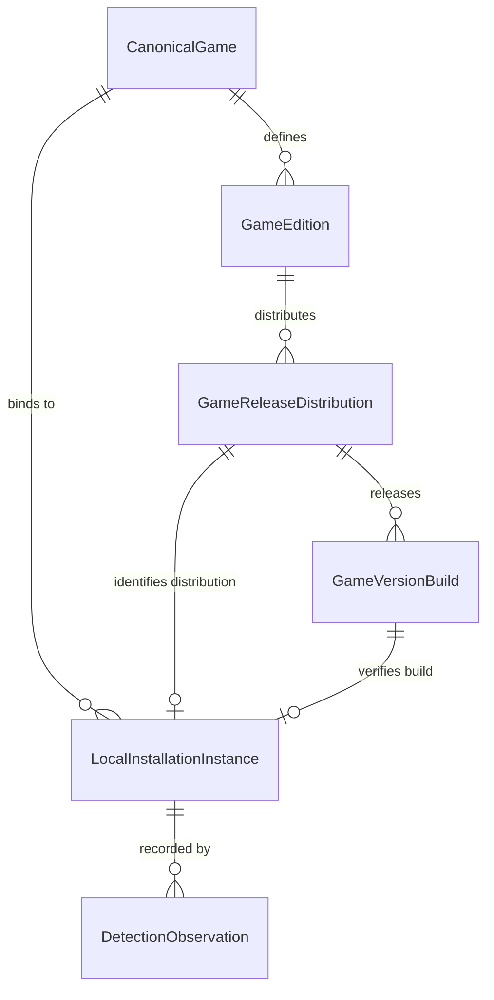
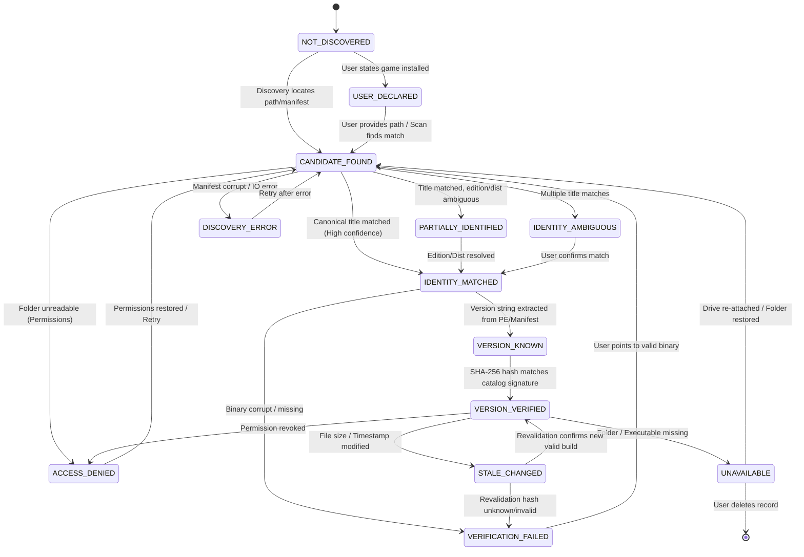

# Local Installation Identity & Verification State Model

**Document ID:** `NLE-DOM-INS-001`  
**Version:** `1.0.0`  
**Status:** `APPROVED`  
**Workstream:** `Local Environment Discovery, Installation Identification, Detection Authorization, Version Verification, Privacy, and Recovery`  
**Phase:** `4 of 12 — Game Discovery & Compatibility Intelligence`  
**Step:** `27 of 100`  
**Related Documents:**
- [LOCAL_GAME_INSTALLATION_DISCOVERY_AND_DETECTION_SPECIFICATION.md](file:///d:/App%20Winrar%20Files/Nexludic%20Engine%20(working)/docs/game-discovery/LOCAL_GAME_INSTALLATION_DISCOVERY_AND_DETECTION_SPECIFICATION.md) (`NLE-SPC-LID-001`)
- [GAME_CATALOG_DOMAIN_MODEL_AND_ENTITY_RELATIONSHIPS.md](file:///d:/App%20Winrar%20Files/Nexludic%20Engine%20(working)/docs/game-discovery/GAME_CATALOG_DOMAIN_MODEL_AND_ENTITY_RELATIONSHIPS.md) (`NLE-DOM-GCD-001`)
- [LOCAL_GAME_DETECTION_SOURCE_CATALOG_AND_EVALUATION.md](file:///d:/App%20Winrar%20Files/Nexludic%20Engine%20(working)/docs/game-discovery/LOCAL_GAME_DETECTION_SOURCE_CATALOG_AND_EVALUATION.md) (`NLE-CAT-LDS-001`)
- [LOCAL_GAME_DETECTION_VERSION_AND_IDENTITY_MATCHING_RULES.md](file:///d:/App%20Winrar%20Files/Nexludic%20Engine%20(working)/docs/game-discovery/LOCAL_GAME_DETECTION_VERSION_AND_IDENTITY_MATCHING_RULES.md) (`NLE-RUL-LVM-001`)
- [LOCAL_GAME_DISCOVERY_FAILURE_AND_RECOVERY_SPECIFICATION.md](file:///d:/App%20Winrar%20Files/Nexludic%20Engine%20(working)/docs/game-discovery/LOCAL_GAME_DISCOVERY_FAILURE_AND_RECOVERY_SPECIFICATION.md) (`NLE-SPC-LDF-001`)

---

## 1. Executive Summary & Purpose

This document specifies the authoritative domain entity relationships and state machine model for local game installations within **NexLudic Engine**.

It defines the exact structural schema of the `LocalInstallationInstance` entity, its formal relationships to the universal catalog (`CanonicalGame`, `GameEdition`, `GameReleaseDistribution`, `GameVersionBuild`), and a comprehensive 13-state lifecycle machine governing installation discovery, identification, technical verification, staleness tracking, and failure recovery.

---

## 2. Entity Architecture & Catalog Binding

### 2.1 Entity: `LocalInstallationInstance`
The `LocalInstallationInstance` represents a concrete, physical deployment of a game on the host machine. It is stored exclusively in project or local engine state on Volume D (`D:\NexLudic\Projects\<project-id>\Environment\installations.json`).

| Field Name | Type | Nullable | Description |
| :--- | :--- | :--- | :--- |
| `installation_id` | UUIDv4 | No | Unique local identifier for this installation record. |
| `canonical_game_id` | UUIDv5 | Yes | Reference to `CanonicalGame.game_id` (null if unknown candidate). |
| `edition_id` | UUIDv5 | Yes | Reference to `GameEdition.edition_id` (if resolved). |
| `release_id` | UUIDv5 | Yes | Reference to `GameReleaseDistribution.release_id` (e.g., Steam vs GOG). |
| `version_build_id` | UUIDv5 | Yes | Reference to `GameVersionBuild.build_id` (if verified). |
| `install_path` | String | No | Normalized absolute host path (e.g., `D:\Games\Steam\steamapps\common\SkyrimSE`). |
| `executable_path` | String | Yes | Path to main executable relative to `install_path` (e.g., `SkyrimSE.exe`). |
| `source_type` | Enum | No | Detection source (`USER_SELECTED`, `STEAM_LIBRARY`, `GOG_GALAXY`, `EPIC_MANIFEST`, `REGISTRY_UNINSTALL`, `MANUAL_DECLARATION`). |
| `architecture` | Enum | No | Binary architecture (`X86_32`, `X86_64`, `ARM64`, `UNKNOWN`). |
| `raw_version_string`| String | Yes | Verbatim version string extracted from PE header or manifest. |
| `verification_state`| Enum | No | Current state from the 13-state model. |
| `binary_hash_sha256`| HexString(64)| Yes | Cryptographic SHA-256 hash of the primary executable binary. |
| `file_size_bytes` | Int64 | Yes | Exact file size of the primary executable on disk. |
| `file_timestamp_utc`| Timestamp | Yes | Last modified timestamp of the primary executable. |
| `first_discovered_at`| Timestamp | No | UTC timestamp when this installation was first recorded. |
| `last_verified_at` | Timestamp | Yes | UTC timestamp of the most recent successful verification check. |
| `staleness_flag` | Boolean | No | `true` if file properties changed since last verification check. |
| `confidence_score` | Float | No | Epistemic confidence score between `0.0` (unverified) and `1.0` (hash verified). |
| `user_confirmed` | Boolean | No | `true` if the user explicitly confirmed an ambiguous or manual match. |

### 2.2 Entity: `DetectionObservation`
Represents an immutable record of an individual detection or revalidation event.

| Field Name | Type | Description |
| :--- | :--- | :--- |
| `observation_id` | UUIDv4 | Unique identifier of the observation. |
| `installation_id` | UUIDv4 | Target installation record. |
| `timestamp_utc` | Timestamp | When observation took place. |
| `detection_source` | Enum | Source queried. |
| `raw_manifest_data` | JSON (Redacted) | Extracted manifest keys (scrubbed of user paths). |
| `matched_rule_id` | String | Rule ID that triggered the classification. |
| `error_code` | String (Nullable) | Error code if observation failed (`ERR_ACCESS_DENIED`, etc.). |

---

## 3. The 13-State Installation Lifecycle Model

The installation lifecycle governs the transition from complete absence to fully verified binary readiness, encompassing all real-world operational edge cases.

---

## 4. State Definitions & Invariants

### 4.1 State 1: `NOT_DISCOVERED`
- **Definition:** The canonical game exists in the project or catalog, but no local detection has occurred and no path has been supplied.
- **Invariants:** `install_path` is null; `confidence_score` is `0.0`.
- **System Action:** Shows "Not Discovered — Click to Locate" in UI.

### 4.2 State 2: `USER_DECLARED`
- **Definition:** User explicitly asserted that they have the game installed, but has not yet browsed to the folder or run library discovery.
- **Invariants:** `user_confirmed = true`; `install_path` is null.
- **System Action:** Prompts user to select installation folder.

### 4.3 State 3: `CANDIDATE_FOUND`
- **Definition:** A directory or manifest entry was located on disk by a scanner, but the title and files have not yet been evaluated.
- **Invariants:** `install_path` is populated; `canonical_game_id` may be null.
- **System Action:** Enqueues identity matching and PE inspection.

### 4.4 State 4: `IDENTITY_MATCHED`
- **Definition:** Directory contents, manifest entries, or PE metadata conclusively match a specific `CanonicalGameId` with confidence $\ge 0.80$.
- **Invariants:** `canonical_game_id` is populated; executable identified.
- **System Action:** Enqueues version inspection.

### 4.5 State 5: `PARTIALLY_IDENTIFIED`
- **Definition:** The game title is known, but the exact edition (e.g. Standard vs. GOTY) or distribution platform (e.g. Steam vs. GOG) cannot be deduced automatically.
- **Invariants:** `canonical_game_id` is populated; `release_id` is null.
- **System Action:** Presents non-blocking dropdown for user to select distribution/edition.

### 4.6 State 6: `IDENTITY_AMBIGUOUS`
- **Definition:** Multiple conflicting games match the directory (e.g. common launcher folder containing sequels, or shared executable names like `Game.exe`).
- **Invariants:** `confidence_score < 0.60`.
- **System Action:** Flags user intervention required; lists candidate games for user confirmation.

### 4.7 State 7: `VERSION_KNOWN`
- **Definition:** Primary executable has been parsed; PE header `VS_FIXEDFILEINFO` or launcher manifest version extracted, but binary hash has not been verified against a known signature.
- **Invariants:** `raw_version_string` is non-null; architecture is known (`X86_64` or `X86_32`).
- **System Action:** Allows downstream adapter check; queues optional cryptographic hash check.

### 4.8 State 8: `VERSION_VERIFIED`
- **Definition:** Binary SHA-256 hash or exact PE build signature matches a known entry in `GameVersionBuild`.
- **Invariants:** `binary_hash_sha256` matches catalog; `confidence_score = 1.00`.
- **System Action:** Mark installation fully verified and green in workspace UI.

### 4.9 State 9: `UNAVAILABLE`
- **Definition:** Previously verified installation is no longer present at `install_path` (e.g. external SSD unplugged, game uninstalled, folder renamed).
- **Invariants:** Record retained in project; `staleness_flag = true`.
- **System Action:** Does **not** delete project records; displays warning: "Installation Offline / Drive Missing".

### 4.10 State 10: `STALE_CHANGED`
- **Definition:** File modification timestamp or file size on disk differs from `last_verified_at` values (e.g. game received a Steam patch or mod manager update).
- **Invariants:** File exists, but prior verification invalidated.
- **System Action:** Displays "Update Detected — Revalidation Recommended".

### 4.11 State 11: `VERIFICATION_FAILED`
- **Definition:** Target executable is missing, truncated, corrupted, or incompatible architecture (e.g. 32-bit binary where 64-bit required).
- **Invariants:** `confidence_score = 0.0`.
- **System Action:** Displays diagnostic failure details; offers "Re-select Executable".

### 4.12 State 12: `ACCESS_DENIED`
- **Definition:** Operating system returned access denied (`E_ACCESSDENIED` or `UnauthorizedAccessException`) when attempting to read the target directory or binary.
- **Invariants:** Standard user permissions insufficient; no elevation prompted.
- **System Action:** Notifies user of permission restriction without attempting UAC bypass.

### 4.13 State 13: `DISCOVERY_ERROR`
- **Definition:** Unexpected I/O exception, manifest JSON parsing crash, or timeout occurred during detection.
- **Invariants:** Detailed diagnostic error logged.
- **System Action:** Safe degradation; operation halted without corrupting project state.

---

## 5. State Transition & Durability Rules

### 5.1 Persistence & Durability
- All `LocalInstallationInstance` records are persisted as JSON files within the project environment folder: `D:\NexLudic\Projects\<project-id>\Environment\installations.json`.
- State transitions must be written atomically using temp-file write and rename (`WriteAllText` to `.tmp` followed by `File.Replace`).
- Discovery observations are stored in rolling append-only audit files: `D:\NexLudic\Projects\<project-id>\Environment\detection_audit.jsonl`.

### 5.2 Transition Invariants
- **Non-Destructive Degradation:** Transitioning to `UNAVAILABLE`, `STALE_CHANGED`, or `ACCESS_DENIED` must **never** wipe existing user configuration, adapter assignments, or project metadata.
- **Reversibility:** When an external SSD is reconnected, re-running detection must cleanly transition `UNAVAILABLE` $\rightarrow$ `VERSION_VERIFIED` without recreating duplicate installation IDs.
- **Immutable Keys:** `installation_id` is assigned once at creation and never mutates across state changes.

---

## 6. Document Sign-Off & Verification

| Role | Reviewer | Verdict | Date |
| :--- | :--- | :--- | :--- |
| **Senior Domain Architect** | Engine Architecture Team | Approved | 2026-11-17 |
| **Principal Desktop UX Designer** | Workspace Experience Team | Approved | 2026-11-17 |
| **Platform Verification Engineer**| Quality Assurance | Approved | 2026-11-17 |

